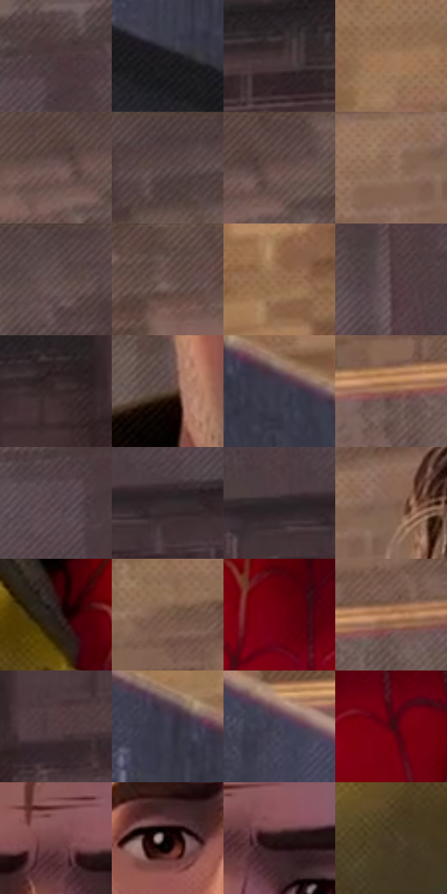

# 电影参考 252

- 状态：常规／活跃；来源世界：miles-home。
- 视角：near-level；景别：close-up；场景：city。
- 时段：daylight-time-unspecified（外观依据，中置信度；具体时间／晨昏未知）；光照：warm-day。
- 材质候选：skin, hair, fabric, stone, brick, glass（帧级，不是像素分割）。
- 明暗组：dark；L* P5/P50/P95：9.36237 / 29.14253 / 53.68784。
- 资格门禁：无附加门禁。
- 原截图 SHA-256：`d6e7d7552b091667cf044045c7e094d51d76a620d74b3c9eb94243bf4d51d460`；尺寸：2880 × 1206。
- sRGB 像素 SHA-256：`394c42d89cd5c34074c05f8261a2f17ac84d33a7f71dde04f70d650c4ff44a2e`。

## 观察与迁移

暖光建筑与人物，远人群的分布不能被清空；石砌与砖材须实际落点复核。

252／29  /  人物／砖墙；日光稳定基准  /  暖侧光与冷灰紫转折塑造头部；衣领深接触暗部、棉布宽亮面、砖缝分别起作用。  /  可借光影分工，不借访客脸型、皱纹、胡茬或衣着。

本公开版保存32个128×128原像素色卡上下文；图集格子并非原场景相邻位置。原rect、图集tile和像素SHA见 `data/palette-crops.json`。上下文不足时不得批准替色，不能以小样推断完整构图。

## 实测色卡

颜色比例分母为保留采样像素，不是材料面积；全部 32 色参与全库匹配。表内四舍五入仅用于阅读，原精度在 JSON。

| ID | HEX | Lab | 原图 xy | 像素数 | 比例 | 明度角色 |
| --- | --- | --- | --- | ---: | ---: | --- |
| 252-S01 | #4D3B3F | [26.918557, 8.654536, 0.570942] | [2808, 224] | 10751 | 5.560498% | shadow |
| 252-S02 | #1D1B1E | [10.098127, 1.723019, -1.724451] | [44, 628] | 8838 | 4.571080% | deep-shadow |
| 252-S03 | #403032 | [21.705553, 7.646813, 1.525609] | [2016, 688] | 8678 | 4.488327% | shadow |
| 252-S04 | #A17959 | [53.999977, 11.378077, 23.588519] | [712, 116] | 8492 | 4.392126% | midtone |
| 252-S05 | #745C5B | [41.411126, 9.609685, 4.297671] | [1968, 76] | 8136 | 4.208000% | midtone |
| 252-S06 | #524142 | [29.331583, 7.52429, 2.177284] | [2680, 36] | 7773 | 4.020254% | shadow |
| 252-S07 | #5D4846 | [32.710376, 8.587712, 4.618716] | [2012, 40] | 7359 | 3.806130% | shadow |
| 252-S08 | #8B6A57 | [47.605906, 10.404738, 15.751652] | [1108, 128] | 7197 | 3.722342% | midtone |
| 252-S09 | #604D4E | [34.691112, 8.15105, 2.426973] | [2436, 48] | 7123 | 3.684069% | shadow |
| 252-S10 | #67504D | [36.285062, 9.10553, 5.446354] | [1840, 64] | 6794 | 3.513908% | shadow |
| 252-S11 | #986F52 | [50.280877, 12.477966, 22.50599] | [496, 112] | 6586 | 3.406329% | midtone |
| 252-S12 | #493539 | [24.507574, 9.688977, 0.995835] | [2480, 416] | 6495 | 3.359263% | shadow |
| 252-S13 | #372929 | [18.18029, 6.516082, 2.505376] | [2444, 752] | 6439 | 3.330299% | deep-shadow |
| 252-S14 | #594639 | [31.34699, 5.985239, 10.926803] | [1260, 628] | 6269 | 3.242374% | shadow |
| 252-S15 | #383745 | [23.680512, 3.902993, -8.4743] | [172, 444] | 6248 | 3.231512% | shadow |
| 252-S16 | #90624D | [45.909281, 16.015126, 19.467501] | [984, 460] | 5927 | 3.065489% | midtone |
| 252-S17 | #57464C | [31.64373, 8.380571, -0.853891] | [2764, 276] | 5772 | 2.985322% | shadow |
| 252-S18 | #362D30 | [19.53414, 4.729523, -0.407176] | [2668, 544] | 5640 | 2.917050% | deep-shadow |
| 252-S19 | #2B2426 | [15.03646, 3.72799, -0.113401] | [2588, 536] | 5626 | 2.909809% | deep-shadow |
| 252-S20 | #816051 | [43.694331, 11.216352, 13.790131] | [1188, 104] | 5626 | 2.909809% | midtone |
| 252-S21 | #291F1D | [12.861143, 4.437978, 3.201366] | [1188, 888] | 5408 | 2.797058% | deep-shadow |
| 252-S22 | #735745 | [39.39721, 8.896723, 14.927896] | [908, 236] | 5240 | 2.710167% | shadow |
| 252-S23 | #6B010F | [20.762471, 42.394639, 25.18709] | [1412, 1000] | 5154 | 2.665687% | shadow |
| 252-S24 | #BB8562 | [60.090487, 16.518734, 27.071563] | [1084, 436] | 4901 | 2.534834% | light |
| 252-S25 | #543D41 | [28.391195, 10.783995, 1.498655] | [2556, 756] | 4747 | 2.455184% | shadow |
| 252-S26 | #403D4D | [26.629793, 5.112787, -9.233141] | [84, 408] | 4383 | 2.266920% | shadow |
| 252-S27 | #474355 | [29.436977, 5.909738, -10.125265] | [352, 528] | 4239 | 2.192443% | shadow |
| 252-S28 | #440A0F | [12.486109, 27.46122, 12.919138] | [1532, 1056] | 3809 | 1.970043% | deep-shadow |
| 252-S29 | #78484C | [36.272368, 21.037031, 6.347208] | [1444, 320] | 3792 | 1.961251% | shadow |
| 252-S30 | #0D0606 | [2.068353, 1.898337, 0.669108] | [1348, 404] | 3440 | 1.779194% | deep-shadow |
| 252-S31 | #231312 | [7.829885, 8.117701, 3.703509] | [1492, 344] | 3387 | 1.751782% | deep-shadow |
| 252-S32 | #4A3B29 | [25.992945, 3.661423, 13.645906] | [1088, 1052] | 3077 | 1.591447% | shadow |

## 色阶与空间分布

- 采样 ROI：`[0.01, 0.02, 0.98, 0.94]`；步长：4；样本数：193346。
- 排除区：`[]`。
- 深暗、暗、中、亮、高光五段计数：`[42474, 104680, 44197, 1995, 0]`。
- RGB 各 256 箱、L* 100 箱、13×5 色相明度表和 3×3 空间统计全部保存在 [总数据](../film-library.json)。
- [可视化档案](../../references/library.html)按需绘制直方图，不存 2,094 张重复图表图片。

## 纹理特征占比

**这是分块图像特征的面积占比，不是波点／排线／丝网／错版的精确语义覆盖率。** 窗格、发丝、织物也会产生方向或周期特征。
原图 ROI 像素 3098546；已测块覆盖 3098546（100.0000%）；未测 0。

| 特征 | 块覆盖像素 | 占已测面积 | 阈值敏感范围 |
| --- | ---: | ---: | --- |
| low-contrast | 59904 | 1.9333% | 0.7023% ~ 3.8707% |
| directional-structure | 616960 | 19.9113% | 3.1726% ~ 40.4381% |
| periodic-structure | 2312498 | 74.6317% | 58.3309% ~ 86.2604% |
| mixed-detail | 109184 | 3.5237% | 0.5288% ~ 6.6963% |

阈值敏感范围不是统计置信区间。逐块坐标、尺度、对比、方向一致性、频谱集中度、频率与角度见 [全量特征记录](../texture-features.jsonl)，以帧号定位。
四种印刷层的真实像素覆盖仍标为 `null`，不能填 0，也不能拿上表代替。不得据这些代理测量删除唯一证据。

[测量方法与保留策略](../../references/library-retention.md) · [分类索引](../archive/README.md)
