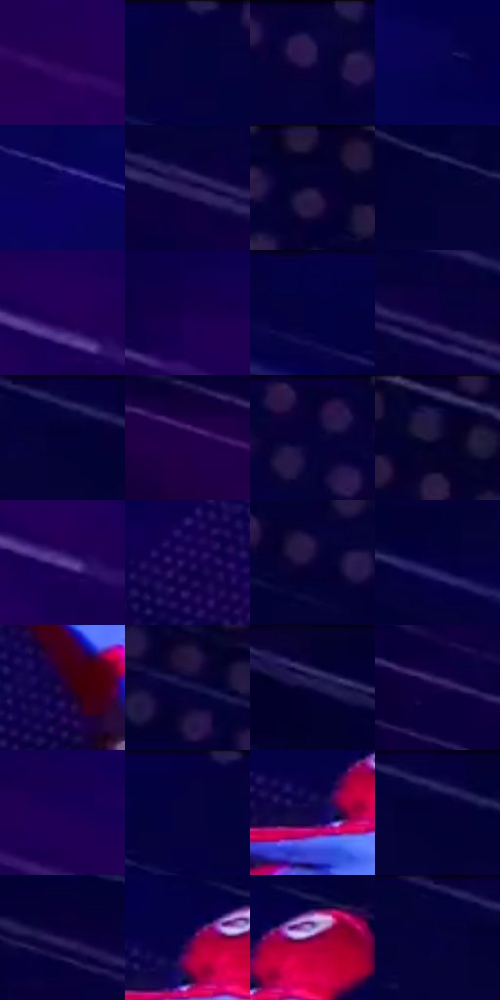

# 电影参考 253

- 状态：条件／活跃；来源世界：miles-home。
- 视角：graphic-nonphysical；景别：environment-wide；场景：graphic。
- 时段：graphic-no-physical-time（外观依据，中置信度；具体时间／晨昏未知）；光照：graphic-field。
- 材质候选：skin, fabric（帧级，不是像素分割）。
- 明暗组：very-dark；L* P5/P50/P95：2.27665 / 4.83032 / 16.37686。
- 资格门禁：motion。
- 原截图 SHA-256：`ccafc13ab4537654bb4f059172863f545279ce95de12a247f127abb1fa8d38c0`；尺寸：2880 × 1200。
- sRGB 像素 SHA-256：`9f850baf0995b511bbe9e34bab33b2da64e9059c97481e9089e37582adf50962`。

## 观察与迁移

蓝紫速度色场与横向线束，不作静态街景背景。

253／30  /  动作图形；抽象空间  /  大片暗色留白、斜向长线与牵引线表达方向；局部点块与身体分离。  /  非日常夜景材质／建筑证据；不因原照有人就删除背景。

本公开版保存32个128×128原像素色卡上下文；图集格子并非原场景相邻位置。原rect、图集tile和像素SHA见 `data/palette-crops.json`。上下文不足时不得批准替色，不能以小样推断完整构图。

## 实测色卡

颜色比例分母为保留采样像素，不是材料面积；全部 32 色参与全库匹配。表内四舍五入仅用于阅读，原精度在 JSON。

| ID | HEX | Lab | 原图 xy | 像素数 | 比例 | 明度角色 |
| --- | --- | --- | --- | ---: | ---: | --- |
| 253-S01 | #280156 | [10.142006, 37.294906, -41.683839] | [1704, 868] | 13071 | 6.784913% | deep-shadow |
| 253-S02 | #06023B | [3.593081, 20.772101, -33.615187] | [1732, 28] | 12496 | 6.486442% | deep-shadow |
| 253-S03 | #060338 | [3.516093, 18.483198, -31.550451] | [1932, 24] | 12337 | 6.403908% | deep-shadow |
| 253-S04 | #06034F | [6.035099, 30.947021, -43.787966] | [2036, 452] | 11079 | 5.750903% | deep-shadow |
| 253-S05 | #0B025E | [8.32743, 37.185569, -50.205197] | [1692, 284] | 9058 | 4.701840% | deep-shadow |
| 253-S06 | #2A1B59 | [15.472471, 24.936197, -34.962739] | [768, 716] | 8517 | 4.421017% | deep-shadow |
| 253-S07 | #060129 | [1.991439, 11.326154, -22.735749] | [2204, 28] | 8348 | 4.333292% | deep-shadow |
| 253-S08 | #030336 | [3.167971, 16.481644, -30.651831] | [736, 316] | 8142 | 4.226361% | deep-shadow |
| 253-S09 | #230055 | [9.0996, 37.105824, -42.749852] | [1804, 748] | 8128 | 4.219094% | deep-shadow |
| 253-S10 | #19004F | [6.964498, 34.576446, -42.201739] | [1516, 616] | 6867 | 3.564532% | deep-shadow |
| 253-S11 | #040146 | [4.421924, 27.288928, -40.153121] | [1592, 32] | 6239 | 3.238549% | deep-shadow |
| 253-S12 | #0B013E | [3.979267, 24.097705, -35.14651] | [540, 612] | 6096 | 3.164320% | deep-shadow |
| 253-S13 | #020232 | [2.588066, 14.333252, -28.62046] | [1240, 52] | 5960 | 3.093725% | deep-shadow |
| 253-S14 | #22004A | [7.537022, 34.133259, -37.735962] | [132, 932] | 5935 | 3.080748% | deep-shadow |
| 253-S15 | #03022F | [2.420167, 13.005168, -26.635674] | [2060, 24] | 5802 | 3.011710% | deep-shadow |
| 253-S16 | #060536 | [3.735054, 16.465021, -29.728355] | [2320, 32] | 5481 | 2.845085% | deep-shadow |
| 253-S17 | #604599 | [36.066095, 31.1941, -42.091895] | [1820, 780] | 5297 | 2.749574% | shadow |
| 253-S18 | #12014B | [5.944835, 31.651604, -41.12746] | [2292, 804] | 4971 | 2.580354% | deep-shadow |
| 253-S19 | #0E0436 | [4.032737, 19.043414, -29.223251] | [2452, 236] | 4697 | 2.438125% | deep-shadow |
| 253-S20 | #050141 | [3.93359, 24.624297, -37.392214] | [1416, 72] | 4566 | 2.370126% | deep-shadow |
| 253-S21 | #22023D | [6.50719, 29.052114, -30.201057] | [2500, 828] | 4188 | 2.173913% | deep-shadow |
| 253-S22 | #0F0B40 | [6.421768, 21.114342, -32.581863] | [2720, 276] | 4169 | 2.164050% | deep-shadow |
| 253-S23 | #050032 | [2.370836, 15.918871, -28.958541] | [396, 36] | 4010 | 2.081517% | deep-shadow |
| 253-S24 | #120241 | [5.00013, 26.708893, -35.612176] | [384, 760] | 3740 | 1.941365% | deep-shadow |
| 253-S25 | #1D0056 | [8.419435, 36.930152, -44.585768] | [1620, 644] | 3621 | 1.879594% | deep-shadow |
| 253-S26 | #03023D | [3.609164, 21.305391, -35.047317] | [1708, 32] | 3559 | 1.847411% | deep-shadow |
| 253-S27 | #0E0648 | [6.244585, 27.132329, -38.541347] | [2520, 628] | 3153 | 1.636664% | deep-shadow |
| 253-S28 | #06033E | [4.078392, 22.162802, -34.997273] | [1268, 28] | 3124 | 1.621610% | deep-shadow |
| 253-S29 | #1B104B | [9.887237, 24.277069, -34.594999] | [380, 572] | 2719 | 1.411382% | deep-shadow |
| 253-S30 | #1D004A | [6.824354, 33.453486, -38.93605] | [2548, 588] | 2677 | 1.389581% | deep-shadow |
| 253-S31 | #6B064D | [22.973849, 46.165588, -14.267029] | [2608, 584] | 2536 | 1.316391% | shadow |
| 253-S32 | #03033A | [3.521427, 18.96541, -33.011539] | [1192, 28] | 2065 | 1.071903% | deep-shadow |

## 色阶与空间分布

- 采样 ROI：`[0.01, 0.02, 0.98, 0.94]`；步长：4；样本数：192648。
- 排除区：`[]`。
- 深暗、暗、中、亮、高光五段计数：`[185827, 4720, 1927, 170, 4]`。
- RGB 各 256 箱、L* 100 箱、13×5 色相明度表和 3×3 空间统计全部保存在 [总数据](../film-library.json)。
- [可视化档案](../../references/library.html)按需绘制直方图，不存 2,094 张重复图表图片。

## 纹理特征占比

**这是分块图像特征的面积占比，不是波点／排线／丝网／错版的精确语义覆盖率。** 窗格、发丝、织物也会产生方向或周期特征。
原图 ROI 像素 3084576；已测块覆盖 3084576（100.0000%）；未测 0。

| 特征 | 块覆盖像素 | 占已测面积 | 阈值敏感范围 |
| --- | ---: | ---: | --- |
| low-contrast | 709120 | 22.9892% | 20.3334% ~ 27.0393% |
| directional-structure | 1928448 | 62.5191% | 49.8625% ~ 67.7394% |
| periodic-structure | 447008 | 14.4917% | 11.9272% ~ 20.4424% |
| mixed-detail | 0 | 0.0000% | 0.0000% ~ 2.6558% |

阈值敏感范围不是统计置信区间。逐块坐标、尺度、对比、方向一致性、频谱集中度、频率与角度见 [全量特征记录](../texture-features.jsonl)，以帧号定位。
四种印刷层的真实像素覆盖仍标为 `null`，不能填 0，也不能拿上表代替。不得据这些代理测量删除唯一证据。

[测量方法与保留策略](../../references/library-retention.md) · [分类索引](../archive/README.md)
