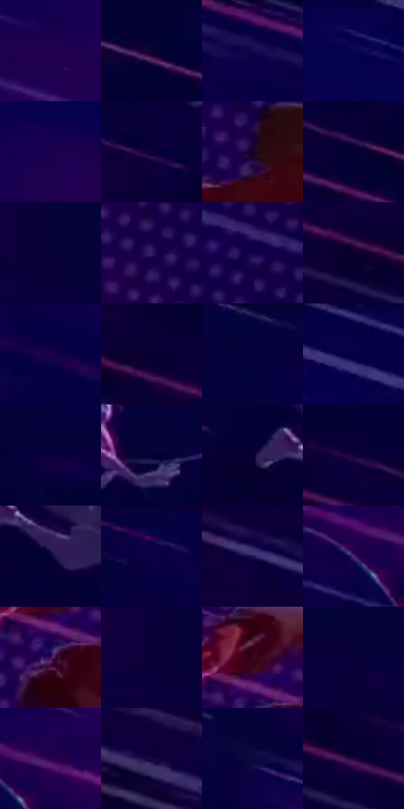

# 电影参考 254

- 状态：条件／活跃；来源世界：miles-home。
- 视角：graphic-nonphysical；景别：environment-wide；场景：graphic。
- 时段：graphic-no-physical-time（外观依据，中置信度；具体时间／晨昏未知）；光照：graphic-field。
- 材质候选：skin, fabric（帧级，不是像素分割）。
- 明暗组：very-dark；L* P5/P50/P95：2.31489 / 4.51739 / 16.78999。
- 资格门禁：motion。
- 原截图 SHA-256：`48c8406fa0e721597e95d439b868562501dbcd521a57ff7ae805941c4cbb7acf`；尺寸：2880 × 1208。
- sRGB 像素 SHA-256：`e88f1974e550f7b9e9ef032ae0983cbc51734c34f93c371bc66f2fd03ebd2e89`。

## 观察与迁移

蓝紫速度色场与横向线束，不作静态街景背景。

254／31  /  动作图形；轨迹关系  /  弯曲牵引线与直线速度场方向不同，人物近远尺度构成空间。  /  不能把弯线叫故障，静帧不能量测速度或帧率。

本公开版保存32个128×128原像素色卡上下文；图集格子并非原场景相邻位置。原rect、图集tile和像素SHA见 `data/palette-crops.json`。上下文不足时不得批准替色，不能以小样推断完整构图。

## 实测色卡

颜色比例分母为保留采样像素，不是材料面积；全部 32 色参与全库匹配。表内四舍五入仅用于阅读，原精度在 JSON。

| ID | HEX | Lab | 原图 xy | 像素数 | 比例 | 明度角色 |
| --- | --- | --- | --- | ---: | ---: | --- |
| 254-S01 | #220050 | [8.298762, 35.724313, -40.64584] | [1640, 232] | 18531 | 9.584372% | deep-shadow |
| 254-S02 | #0D0133 | [3.127331, 18.231964, -28.464913] | [1104, 636] | 10625 | 5.495330% | deep-shadow |
| 254-S03 | #140043 | [5.002845, 29.082162, -37.027948] | [2816, 32] | 9464 | 4.894852% | deep-shadow |
| 254-S04 | #06024F | [5.839021, 31.491419, -44.112781] | [1812, 36] | 8641 | 4.469190% | deep-shadow |
| 254-S05 | #1B0050 | [7.334982, 35.102457, -42.27251] | [1728, 152] | 8237 | 4.260238% | deep-shadow |
| 254-S06 | #0E013B | [3.890764, 23.129157, -33.109227] | [332, 284] | 7952 | 4.112834% | deep-shadow |
| 254-S07 | #1A0229 | [3.822065, 18.255681, -19.749052] | [2764, 548] | 7690 | 3.977326% | deep-shadow |
| 254-S08 | #030232 | [2.646374, 14.594751, -28.523832] | [668, 520] | 7069 | 3.656140% | deep-shadow |
| 254-S09 | #060139 | [3.213179, 19.911432, -32.772939] | [220, 80] | 7049 | 3.645796% | deep-shadow |
| 254-S10 | #311B62 | [17.076933, 29.326591, -38.313606] | [2604, 400] | 6645 | 3.436844% | deep-shadow |
| 254-S11 | #14014D | [6.377883, 32.703418, -41.800592] | [2664, 288] | 6643 | 3.435809% | deep-shadow |
| 254-S12 | #0C002D | [2.416929, 15.188382, -25.096072] | [272, 456] | 6443 | 3.332368% | deep-shadow |
| 254-S13 | #1A0048 | [6.208905, 32.288886, -38.560486] | [992, 180] | 6394 | 3.307025% | deep-shadow |
| 254-S14 | #050132 | [2.566914, 15.51831, -28.644568] | [368, 444] | 6133 | 3.172034% | deep-shadow |
| 254-S15 | #05023E | [3.824005, 22.385251, -35.414616] | [580, 64] | 5726 | 2.961530% | deep-shadow |
| 254-S16 | #060044 | [4.11817, 26.997213, -39.228867] | [2112, 28] | 5618 | 2.905672% | deep-shadow |
| 254-S17 | #0B0140 | [4.1812, 25.208399, -36.256033] | [1088, 476] | 5565 | 2.878260% | deep-shadow |
| 254-S18 | #030236 | [2.971894, 16.882204, -30.968052] | [864, 384] | 5539 | 2.864812% | deep-shadow |
| 254-S19 | #070030 | [2.334962, 15.370297, -27.510114] | [428, 336] | 5537 | 2.863778% | deep-shadow |
| 254-S20 | #13023E | [4.78346, 25.515272, -33.809178] | [576, 472] | 5532 | 2.861192% | deep-shadow |
| 254-S21 | #060236 | [3.14682, 17.666702, -30.677087] | [532, 380] | 5497 | 2.843090% | deep-shadow |
| 254-S22 | #0C0046 | [4.698883, 29.0112, -39.680534] | [792, 52] | 5400 | 2.792920% | deep-shadow |
| 254-S23 | #1E1351 | [11.522606, 24.996033, -36.039217] | [360, 792] | 5116 | 2.646034% | deep-shadow |
| 254-S24 | #4C3077 | [26.683813, 29.193312, -36.216486] | [1384, 352] | 4831 | 2.498629% | shadow |
| 254-S25 | #370E5B | [14.853003, 35.2437, -37.242023] | [2496, 712] | 4556 | 2.356397% | deep-shadow |
| 254-S26 | #0A003A | [3.341355, 21.96328, -33.284819] | [184, 80] | 3675 | 1.900738% | deep-shadow |
| 254-S27 | #3D061E | [10.677591, 28.02289, -0.244021] | [2496, 636] | 3488 | 1.804020% | deep-shadow |
| 254-S28 | #09003B | [3.375851, 22.332275, -33.960187] | [412, 104] | 3279 | 1.695923% | deep-shadow |
| 254-S29 | #28014C | [8.94598, 34.752241, -36.773265] | [1448, 324] | 1945 | 1.005969% | deep-shadow |
| 254-S30 | #180946 | [7.512001, 26.247553, -35.015752] | [120, 652] | 1932 | 0.999245% | deep-shadow |
| 254-S31 | #0D0841 | [5.787756, 22.725173, -34.338587] | [1916, 932] | 1606 | 0.830635% | deep-shadow |
| 254-S32 | #210640 | [7.440324, 27.571174, -30.835319] | [492, 508] | 988 | 0.511001% | deep-shadow |

## 色阶与空间分布

- 采样 ROI：`[0.01, 0.02, 0.98, 0.94]`；步长：4；样本数：193346。
- 排除区：`[]`。
- 深暗、暗、中、亮、高光五段计数：`[187777, 5371, 172, 26, 0]`。
- RGB 各 256 箱、L* 100 箱、13×5 色相明度表和 3×3 空间统计全部保存在 [总数据](../film-library.json)。
- [可视化档案](../../references/library.html)按需绘制直方图，不存 2,094 张重复图表图片。

## 纹理特征占比

**这是分块图像特征的面积占比，不是波点／排线／丝网／错版的精确语义覆盖率。** 窗格、发丝、织物也会产生方向或周期特征。
原图 ROI 像素 3104134；已测块覆盖 3104134（100.0000%）；未测 0。

| 特征 | 块覆盖像素 | 占已测面积 | 阈值敏感范围 |
| --- | ---: | ---: | --- |
| low-contrast | 750854 | 24.1888% | 19.8674% ~ 28.7701% |
| directional-structure | 1747584 | 56.2986% | 43.6806% ~ 62.8220% |
| periodic-structure | 592128 | 19.0755% | 17.3106% ~ 25.6979% |
| mixed-detail | 13568 | 0.4371% | 0.0000% ~ 1.8515% |

阈值敏感范围不是统计置信区间。逐块坐标、尺度、对比、方向一致性、频谱集中度、频率与角度见 [全量特征记录](../texture-features.jsonl)，以帧号定位。
四种印刷层的真实像素覆盖仍标为 `null`，不能填 0，也不能拿上表代替。不得据这些代理测量删除唯一证据。

[测量方法与保留策略](../../references/library-retention.md) · [分类索引](../archive/README.md)
