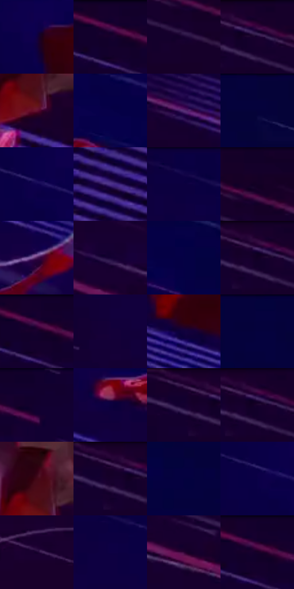

# 电影参考 255

- 状态：条件／活跃；来源世界：miles-home。
- 视角：graphic-nonphysical；景别：full-body；场景：graphic。
- 时段：graphic-no-physical-time（外观依据，中置信度；具体时间／晨昏未知）；光照：graphic-field。
- 材质候选：skin, fabric（帧级，不是像素分割）。
- 明暗组：very-dark；L* P5/P50/P95：3.01542 / 3.94663 / 23.68407。
- 资格门禁：motion。
- 原截图 SHA-256：`41971531251d36fc5958c6da91b24495433bd8debbc71236aa09142d77ae1985`；尺寸：2880 × 1208。
- sRGB 像素 SHA-256：`0cbd592c82ca87e1492b22c1bcdbd4a81e20bc6cb6c7637aa9feb04b3cb60ed5`。

## 观察与迁移

蓝紫速度色场与横向线束，不作静态街景背景。

255／32  /  动作图形；肢体旋转  /  斜线场贯穿背景，两个身体的旋转与连接线构成动作关系。  /  不据此改照片关节、增加第二个人或牵引道具。

本公开版保存32个128×128原像素色卡上下文；图集格子并非原场景相邻位置。原rect、图集tile和像素SHA见 `data/palette-crops.json`。上下文不足时不得批准替色，不能以小样推断完整构图。

## 实测色卡

颜色比例分母为保留采样像素，不是材料面积；全部 32 色参与全库匹配。表内四舍五入仅用于阅读，原精度在 JSON。

| ID | HEX | Lab | 原图 xy | 像素数 | 比例 | 明度角色 |
| --- | --- | --- | --- | ---: | ---: | --- |
| 255-S01 | #100041 | [4.441359, 27.254303, -36.533231] | [1752, 288] | 12739 | 6.588706% | deep-shadow |
| 255-S02 | #1B002E | [3.886518, 21.796334, -23.433061] | [704, 40] | 10234 | 5.293101% | deep-shadow |
| 255-S03 | #170130 | [3.76885, 20.472534, -25.150315] | [256, 144] | 10100 | 5.223796% | deep-shadow |
| 255-S04 | #1A0131 | [4.182678, 22.239215, -25.217398] | [148, 64] | 8697 | 4.498154% | deep-shadow |
| 255-S05 | #62102F | [20.724786, 37.823526, 2.918653] | [424, 880] | 8487 | 4.389540% | shadow |
| 255-S06 | #060148 | [4.770435, 28.656025, -40.987356] | [1980, 72] | 7683 | 3.973705% | deep-shadow |
| 255-S07 | #582D76 | [27.461674, 33.885596, -34.251981] | [1036, 336] | 7343 | 3.797855% | shadow |
| 255-S08 | #050239 | [3.350948, 19.249372, -32.552495] | [2556, 44] | 7338 | 3.795269% | deep-shadow |
| 255-S09 | #0F024F | [6.406841, 32.342983, -43.15471] | [1516, 128] | 7090 | 3.667001% | deep-shadow |
| 255-S10 | #240B4D | [10.184153, 29.335294, -35.45298] | [48, 892] | 7005 | 3.623038% | deep-shadow |
| 255-S11 | #090042 | [4.076331, 26.411774, -37.864796] | [1276, 28] | 6915 | 3.576490% | deep-shadow |
| 255-S12 | #150027 | [2.763199, 15.754748, -19.907822] | [276, 48] | 6912 | 3.574938% | deep-shadow |
| 255-S13 | #481956 | [18.992258, 32.686715, -27.059582] | [1844, 664] | 6610 | 3.418742% | deep-shadow |
| 255-S14 | #160134 | [3.975967, 22.027587, -27.80274] | [728, 360] | 6418 | 3.319438% | deep-shadow |
| 255-S15 | #050144 | [4.255939, 26.346887, -39.004919] | [2248, 172] | 6347 | 3.282716% | deep-shadow |
| 255-S16 | #1B002B | [3.680306, 20.475637, -21.488553] | [116, 28] | 5864 | 3.032905% | deep-shadow |
| 255-S17 | #16002E | [3.322328, 19.427797, -24.364032] | [712, 40] | 5480 | 2.834297% | deep-shadow |
| 255-S18 | #140039 | [4.011095, 24.27428, -31.433217] | [1044, 176] | 5377 | 2.781025% | deep-shadow |
| 255-S19 | #10013D | [4.23355, 24.724835, -33.994748] | [1704, 464] | 5366 | 2.775335% | deep-shadow |
| 255-S20 | #03023D | [3.609164, 21.305391, -35.047317] | [2452, 28] | 5297 | 2.739648% | deep-shadow |
| 255-S21 | #12002E | [2.943045, 17.726815, -24.989852] | [832, 28] | 5220 | 2.699823% | deep-shadow |
| 255-S22 | #0B013E | [3.979267, 24.097705, -35.14651] | [1548, 360] | 4948 | 2.559143% | deep-shadow |
| 255-S23 | #16002B | [3.116116, 17.978727, -22.41598] | [48, 32] | 4847 | 2.506905% | deep-shadow |
| 255-S24 | #19002D | [3.578142, 20.37938, -23.182406] | [128, 28] | 4825 | 2.495526% | deep-shadow |
| 255-S25 | #440617 | [12.099588, 29.610949, 7.30694] | [408, 804] | 4713 | 2.437599% | deep-shadow |
| 255-S26 | #19002B | [3.442313, 19.441636, -21.87978] | [84, 32] | 4404 | 2.277782% | deep-shadow |
| 255-S27 | #05023F | [3.924055, 22.987984, -35.971881] | [2664, 496] | 4228 | 2.186753% | deep-shadow |
| 255-S28 | #0A0146 | [4.771776, 28.205906, -39.565107] | [1492, 136] | 3287 | 1.700061% | deep-shadow |
| 255-S29 | #17012D | [3.552706, 19.002125, -23.236748] | [976, 608] | 3104 | 1.605412% | deep-shadow |
| 255-S30 | #0E0044 | [4.611931, 28.354997, -38.399824] | [1300, 116] | 2633 | 1.361807% | deep-shadow |
| 255-S31 | #310536 | [9.222131, 29.014075, -20.602699] | [1188, 568] | 2033 | 1.051483% | deep-shadow |
| 255-S32 | #14002C | [2.98577, 17.564739, -23.395635] | [720, 28] | 1802 | 0.932008% | deep-shadow |

## 色阶与空间分布

- 采样 ROI：`[0.01, 0.02, 0.98, 0.94]`；步长：4；样本数：193346。
- 排除区：`[]`。
- 深暗、暗、中、亮、高光五段计数：`[178231, 14728, 383, 4, 0]`。
- RGB 各 256 箱、L* 100 箱、13×5 色相明度表和 3×3 空间统计全部保存在 [总数据](../film-library.json)。
- [可视化档案](../../references/library.html)按需绘制直方图，不存 2,094 张重复图表图片。

## 纹理特征占比

**这是分块图像特征的面积占比，不是波点／排线／丝网／错版的精确语义覆盖率。** 窗格、发丝、织物也会产生方向或周期特征。
原图 ROI 像素 3104134；已测块覆盖 3104134（100.0000%）；未测 0。

| 特征 | 块覆盖像素 | 占已测面积 | 阈值敏感范围 |
| --- | ---: | ---: | --- |
| low-contrast | 945792 | 30.4688% | 26.2463% ~ 33.6357% |
| directional-structure | 1775622 | 57.2018% | 45.8085% ~ 65.6468% |
| periodic-structure | 382720 | 12.3294% | 8.1069% ~ 18.4446% |
| mixed-detail | 0 | 0.0000% | 0.0000% ~ 2.1112% |

阈值敏感范围不是统计置信区间。逐块坐标、尺度、对比、方向一致性、频谱集中度、频率与角度见 [全量特征记录](../texture-features.jsonl)，以帧号定位。
四种印刷层的真实像素覆盖仍标为 `null`，不能填 0，也不能拿上表代替。不得据这些代理测量删除唯一证据。

[测量方法与保留策略](../../references/library-retention.md) · [分类索引](../archive/README.md)
