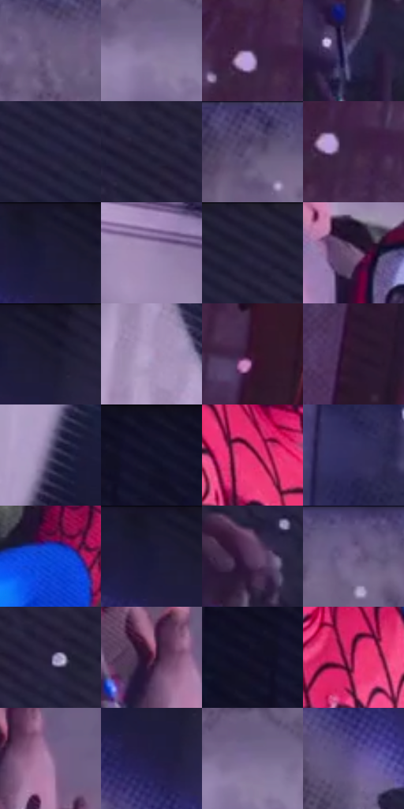

# 电影参考 256

- 状态：条件／活跃；来源世界：miles-home。
- 视角：overhead；景别：medium；场景：detail。
- 时段：night-appearance（外观依据，中置信度；具体时间／晨昏未知）；光照：night-mixed。
- 材质候选：skin, fabric, stone（帧级，不是像素分割）。
- 明暗组：dark；L* P5/P50/P95：7.4377 / 23.9958 / 60.46015。
- 资格门禁：motion。
- 原截图 SHA-256：`5a9c9d9e7b58376fda77aea6a11bd25fd9b10e0697d070be6c17f4edab1ac2b8`；尺寸：2880 × 1204。
- sRGB 像素 SHA-256：`08b0aa70d272d5ea5a01358d3a8fbc670a08727ff40737fbc84897e58b676971`。

## 观察与迁移

俯視接触与身体姿态，不能生成额外四肢。

256／33  /  接触／投影；石墙与衣料  /  手和身体后方有明确暗投影，衣褶、墙面排线、细丝和雪点可分辨。  /  投影不是墨渍；不为了加强冲击增加损伤或裂缝。

本公开版保存32个128×128原像素色卡上下文；图集格子并非原场景相邻位置。原rect、图集tile和像素SHA见 `data/palette-crops.json`。上下文不足时不得批准替色，不能以小样推断完整构图。

## 实测色卡

颜色比例分母为保留采样像素，不是材料面积；全部 32 色参与全库匹配。表内四舍五入仅用于阅读，原精度在 JSON。

| ID | HEX | Lab | 原图 xy | 像素数 | 比例 | 明度角色 |
| --- | --- | --- | --- | ---: | ---: | --- |
| 256-S01 | #6E5F81 | [42.890085, 13.230136, -16.75164] | [1332, 100] | 13415 | 6.963477% | midtone |
| 256-S02 | #87779D | [52.706558, 13.943438, -18.1588] | [1296, 308] | 10159 | 5.273348% | midtone |
| 256-S03 | #4A3254 | [24.881268, 17.935391, -16.432124] | [120, 428] | 9581 | 4.973319% | shadow |
| 256-S04 | #2D284F | [18.53961, 13.439087, -23.274364] | [2044, 384] | 8182 | 4.247124% | deep-shadow |
| 256-S05 | #201E3C | [12.99553, 10.126005, -19.034749] | [2252, 328] | 8114 | 4.211827% | deep-shadow |
| 256-S06 | #2A273E | [16.945834, 7.666156, -14.161373] | [2204, 136] | 7824 | 4.061293% | deep-shadow |
| 256-S07 | #584C74 | [35.012036, 14.262415, -21.088896] | [932, 36] | 7471 | 3.878057% | shadow |
| 256-S08 | #3D2443 | [18.623763, 18.180165, -14.831114] | [144, 452] | 7310 | 3.794485% | deep-shadow |
| 256-S09 | #1E1C37 | [11.839261, 9.206333, -17.324538] | [1748, 64] | 7098 | 3.684440% | deep-shadow |
| 256-S10 | #9D89B2 | [60.135284, 15.574714, -18.735303] | [1844, 612] | 6834 | 3.547403% | light |
| 256-S11 | #222138 | [13.904146, 7.207275, -14.760414] | [2028, 32] | 6792 | 3.525601% | deep-shadow |
| 256-S12 | #6B5173 | [38.285041, 17.537871, -15.260575] | [1476, 652] | 6699 | 3.477327% | shadow |
| 256-S13 | #17152C | [8.131573, 8.253074, -15.233023] | [1796, 40] | 6484 | 3.365724% | deep-shadow |
| 256-S14 | #B19AC4 | [66.857753, 16.447514, -18.476872] | [652, 840] | 6240 | 3.239068% | light |
| 256-S15 | #3B1732 | [14.248205, 21.911954, -9.680526] | [348, 348] | 5792 | 3.006520% | deep-shadow |
| 256-S16 | #2C162D | [11.267216, 15.723575, -10.858346] | [288, 800] | 5751 | 2.985237% | deep-shadow |
| 256-S17 | #494263 | [29.945131, 11.01643, -18.334295] | [616, 1052] | 5682 | 2.949421% | shadow |
| 256-S18 | #13132A | [6.967159, 7.53054, -15.610182] | [2524, 44] | 5487 | 2.848200% | deep-shadow |
| 256-S19 | #DE3C77 | [51.947444, 65.751623, 4.455007] | [1524, 1020] | 5469 | 2.838856% | midtone |
| 256-S20 | #35305E | [22.579557, 15.188798, -26.792983] | [2380, 808] | 5358 | 2.781238% | shadow |
| 256-S21 | #0D4CDC | [38.584647, 38.846795, -77.573923] | [1944, 880] | 5328 | 2.765666% | shadow |
| 256-S22 | #1A1834 | [9.959327, 9.855904, -18.172556] | [1732, 48] | 5151 | 2.673788% | deep-shadow |
| 256-S23 | #583A5F | [29.228077, 20.484547, -16.742295] | [2072, 260] | 4802 | 2.492629% | shadow |
| 256-S24 | #73648D | [45.195742, 14.774842, -20.38881] | [1204, 64] | 4786 | 2.484324% | midtone |
| 256-S25 | #282142 | [15.126791, 12.560616, -19.810236] | [2284, 160] | 4771 | 2.476538% | deep-shadow |
| 256-S26 | #522141 | [21.070011, 27.283426, -9.418795] | [708, 288] | 4301 | 2.232569% | shadow |
| 256-S27 | #120F24 | [5.397982, 6.988872, -13.53163] | [2452, 84] | 4128 | 2.142768% | deep-shadow |
| 256-S28 | #94144B | [32.493763, 53.349855, 2.206455] | [1704, 1060] | 4030 | 2.091898% | shadow |
| 256-S29 | #9E7AA1 | [55.848632, 20.975122, -15.495466] | [768, 312] | 3165 | 1.642893% | midtone |
| 256-S30 | #211F47 | [14.162838, 13.640513, -24.856561] | [1764, 148] | 2689 | 1.395810% | deep-shadow |
| 256-S31 | #796C93 | [48.129372, 13.41254, -19.40302] | [1316, 292] | 2545 | 1.321062% | midtone |
| 256-S32 | #5D508C | [37.766172, 19.87997, -31.518639] | [1784, 272] | 1210 | 0.628089% | shadow |

## 色阶与空间分布

- 采样 ROI：`[0.01, 0.02, 0.98, 0.94]`；步长：4；样本数：192648。
- 排除区：`[]`。
- 深暗、暗、中、亮、高光五段计数：`[83655, 52714, 45809, 10186, 284]`。
- RGB 各 256 箱、L* 100 箱、13×5 色相明度表和 3×3 空间统计全部保存在 [总数据](../film-library.json)。
- [可视化档案](../../references/library.html)按需绘制直方图，不存 2,094 张重复图表图片。

## 纹理特征占比

**这是分块图像特征的面积占比，不是波点／排线／丝网／错版的精确语义覆盖率。** 窗格、发丝、织物也会产生方向或周期特征。
原图 ROI 像素 3092958；已测块覆盖 3092958（100.0000%）；未测 0。

| 特征 | 块覆盖像素 | 占已测面积 | 阈值敏感范围 |
| --- | ---: | ---: | --- |
| low-contrast | 143744 | 4.6475% | 1.4029% ~ 8.2645% |
| directional-structure | 608256 | 19.6658% | 7.4823% ~ 34.1007% |
| periodic-structure | 2188638 | 70.7620% | 63.9667% ~ 73.5306% |
| mixed-detail | 152320 | 4.9247% | 0.5297% ~ 10.7227% |

阈值敏感范围不是统计置信区间。逐块坐标、尺度、对比、方向一致性、频谱集中度、频率与角度见 [全量特征记录](../texture-features.jsonl)，以帧号定位。
四种印刷层的真实像素覆盖仍标为 `null`，不能填 0，也不能拿上表代替。不得据这些代理测量删除唯一证据。

[测量方法与保留策略](../../references/library-retention.md) · [分类索引](../archive/README.md)
