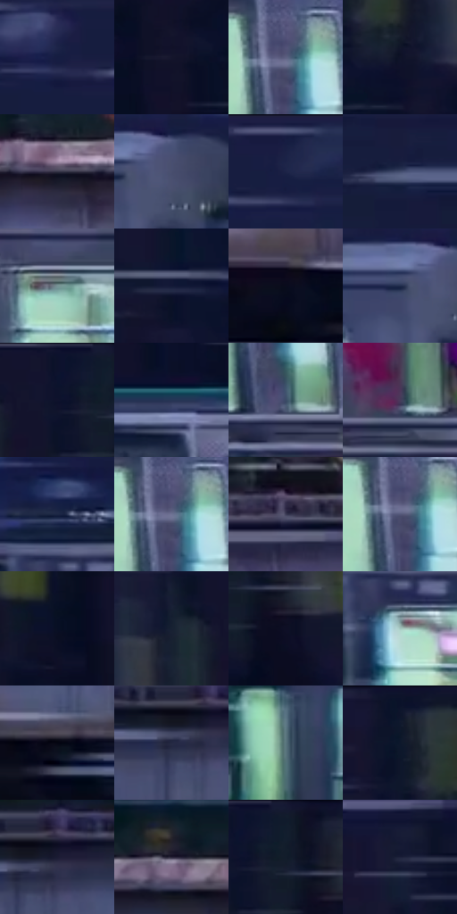

# 电影参考 257

- 状态：常规／活跃；来源世界：miles-home。
- 视角：near-level；景别：environment-wide；场景：vehicle。
- 时段：night-appearance（外观依据，中置信度；具体时间／晨昏未知）；光照：night-mixed。
- 材质候选：metal, glass, skin, fabric（帧级，不是像素分割）。
- 明暗组：very-dark；L* P5/P50/P95：3.81122 / 15.706 / 57.08075。
- 资格门禁：无附加门禁。
- 原截图 SHA-256：`ec3bfae67216d08991ea696d15182aa0febb331737a79eecf4327468ea746630`；尺寸：2880 × 1206。
- sRGB 像素 SHA-256：`91aa8c4f1e6395e867ac7b45ff325d499850b701e6857536405939bd067e6826`。

## 观察与迁移

列车窗内外与乘客，玻璃透射和车身亮带分别表达。

257／34  /  夜间交通；运动  /  窗内绿白灯与暗车壳成组，横向长短条跨背景而非只附在材料上。  /  不把所有横线当金属拉丝或断言全部是天气；运动示意不自动启用。

本公开版保存32个128×128原像素色卡上下文；图集格子并非原场景相邻位置。原rect、图集tile和像素SHA见 `data/palette-crops.json`。上下文不足时不得批准替色，不能以小样推断完整构图。

## 实测色卡

颜色比例分母为保留采样像素，不是材料面积；全部 32 色参与全库匹配。表内四舍五入仅用于阅读，原精度在 JSON。

| ID | HEX | Lab | 原图 xy | 像素数 | 比例 | 明度角色 |
| --- | --- | --- | --- | ---: | ---: | --- |
| 257-S01 | #161D41 | [12.161191, 9.987265, -23.938317] | [692, 80] | 11575 | 5.986677% | deep-shadow |
| 257-S02 | #15152C | [7.926879, 7.580286, -15.570269] | [2448, 248] | 9929 | 5.135353% | deep-shadow |
| 257-S03 | #5C5F81 | [41.286489, 7.120369, -19.350728] | [2080, 584] | 8126 | 4.202828% | midtone |
| 257-S04 | #0F1327 | [6.447076, 4.81566, -14.197316] | [2264, 156] | 7620 | 3.941121% | deep-shadow |
| 257-S05 | #333345 | [21.948162, 4.70129, -11.156507] | [1384, 876] | 7540 | 3.899744% | shadow |
| 257-S06 | #494F6E | [34.260202, 5.696871, -18.613906] | [544, 496] | 7203 | 3.725446% | shadow |
| 257-S07 | #191F43 | [13.179744, 10.009412, -23.691636] | [904, 36] | 6924 | 3.581145% | deep-shadow |
| 257-S08 | #303A5A | [24.928447, 5.488275, -20.493915] | [44, 92] | 6797 | 3.515459% | shadow |
| 257-S09 | #769395 | [58.87061, -9.667081, -4.417805] | [2764, 552] | 6746 | 3.489082% | midtone |
| 257-S10 | #141938 | [10.025958, 8.896696, -20.982601] | [1636, 180] | 6586 | 3.406329% | deep-shadow |
| 257-S11 | #090C1C | [3.656795, 2.821153, -10.022068] | [2048, 1092] | 6582 | 3.404260% | deep-shadow |
| 257-S12 | #212C4C | [18.567669, 6.007206, -21.265849] | [484, 500] | 6361 | 3.289957% | deep-shadow |
| 257-S13 | #0D122D | [6.391357, 7.502843, -18.789807] | [2480, 32] | 6205 | 3.209272% | deep-shadow |
| 257-S14 | #263555 | [22.351468, 4.322987, -21.29979] | [1660, 468] | 6034 | 3.120830% | shadow |
| 257-S15 | #3B4C66 | [31.937698, 0.791338, -17.253482] | [2100, 716] | 6004 | 3.105314% | shadow |
| 257-S16 | #473D5C | [27.979397, 11.691009, -16.889598] | [2432, 712] | 5900 | 3.051524% | shadow |
| 257-S17 | #1B2744 | [16.009728, 4.962195, -19.871575] | [992, 452] | 5876 | 3.039111% | deep-shadow |
| 257-S18 | #6F7394 | [49.226487, 6.141532, -18.388071] | [2080, 588] | 5814 | 3.007044% | midtone |
| 257-S19 | #3B3C56 | [26.254319, 6.440375, -15.746963] | [1648, 868] | 5792 | 2.995666% | shadow |
| 257-S20 | #525678 | [37.490384, 7.0163, -19.771238] | [2072, 596] | 5748 | 2.972909% | shadow |
| 257-S21 | #080F24 | [4.702447, 3.869582, -14.663312] | [2812, 140] | 5741 | 2.969288% | deep-shadow |
| 257-S22 | #172132 | [12.608453, 1.338533, -12.579072] | [2376, 72] | 5633 | 2.913430% | deep-shadow |
| 257-S23 | #0E0F25 | [5.135541, 5.954137, -14.727774] | [2588, 128] | 5517 | 2.853434% | deep-shadow |
| 257-S24 | #A3C6BF | [77.241961, -13.077636, -0.375416] | [1004, 560] | 5510 | 2.849813% | light |
| 257-S25 | #050612 | [1.862333, 1.675066, -5.362807] | [956, 1072] | 4975 | 2.573107% | deep-shadow |
| 257-S26 | #242843 | [16.978171, 6.53212, -17.608867] | [700, 916] | 4839 | 2.502767% | deep-shadow |
| 257-S27 | #58747D | [47.034148, -7.828363, -8.246913] | [328, 604] | 4641 | 2.400360% | midtone |
| 257-S28 | #0E152C | [7.329899, 5.365348, -16.553937] | [2192, 28] | 4301 | 2.224509% | deep-shadow |
| 257-S29 | #1B1B33 | [10.96297, 7.53744, -15.853002] | [740, 896] | 3448 | 1.783331% | deep-shadow |
| 257-S30 | #282337 | [15.110041, 7.650213, -12.129035] | [1160, 840] | 3420 | 1.768850% | deep-shadow |
| 257-S31 | #101D2D | [10.39599, 0.223337, -12.449082] | [2536, 28] | 3382 | 1.749196% | deep-shadow |
| 257-S32 | #1C213B | [13.532977, 6.269485, -17.502231] | [2040, 68] | 2577 | 1.332844% | deep-shadow |

## 色阶与空间分布

- 采样 ROI：`[0.01, 0.02, 0.98, 0.94]`；步长：4；样本数：193346。
- 排除区：`[]`。
- 深暗、暗、中、亮、高光五段计数：`[112248, 51639, 21681, 5711, 2067]`。
- RGB 各 256 箱、L* 100 箱、13×5 色相明度表和 3×3 空间统计全部保存在 [总数据](../film-library.json)。
- [可视化档案](../../references/library.html)按需绘制直方图，不存 2,094 张重复图表图片。

## 纹理特征占比

**这是分块图像特征的面积占比，不是波点／排线／丝网／错版的精确语义覆盖率。** 窗格、发丝、织物也会产生方向或周期特征。
原图 ROI 像素 3098546；已测块覆盖 3098546（100.0000%）；未测 0。

| 特征 | 块覆盖像素 | 占已测面积 | 阈值敏感范围 |
| --- | ---: | ---: | --- |
| low-contrast | 111872 | 3.6105% | 0.5288% ~ 5.1968% |
| directional-structure | 2284978 | 73.7436% | 64.8454% ~ 80.5266% |
| periodic-structure | 685312 | 22.1172% | 18.9446% ~ 28.9003% |
| mixed-detail | 16384 | 0.5288% | 0.0000% ~ 1.0575% |

阈值敏感范围不是统计置信区间。逐块坐标、尺度、对比、方向一致性、频谱集中度、频率与角度见 [全量特征记录](../texture-features.jsonl)，以帧号定位。
四种印刷层的真实像素覆盖仍标为 `null`，不能填 0，也不能拿上表代替。不得据这些代理测量删除唯一证据。

[测量方法与保留策略](../../references/library-retention.md) · [分类索引](../archive/README.md)
