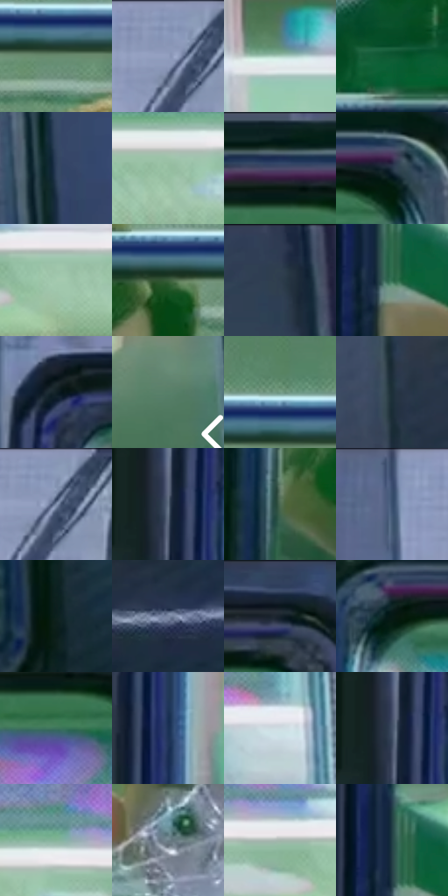

# 电影参考 258

- 状态：常规／活跃；来源世界：miles-home。
- 视角：near-level；景别：medium；场景：vehicle。
- 时段：night-appearance（外观依据，中置信度；具体时间／晨昏未知）；光照：night-mixed。
- 材质候选：metal, glass, skin, fabric（帧级，不是像素分割）。
- 明暗组：dark；L* P5/P50/P95：10.75695 / 39.83433 / 80.22617。
- 资格门禁：无附加门禁。
- 原截图 SHA-256：`b22d70f505ae68d41245262a7b44471275e6150780abaf22a3011721754a8100`；尺寸：2880 × 1208。
- sRGB 像素 SHA-256：`5eec9f070d684131bf0a53fb1b15635571b168a7bec8c7a0b7d0bf519f6ee67f`。

## 观察与迁移

列车窗内外与乘客，玻璃透射和车身亮带分别表达。

258／35  /  玻璃分层；金属窗框  /  冷色框边有集中亮带，透过玻璃仍看清车厢人物；窗面附着白色网丝。  /  网丝不等于玻璃裂纹；不以“漫画感”为由抹白玻璃或添乘客。

本公开版保存32个128×128原像素色卡上下文；图集格子并非原场景相邻位置。原rect、图集tile和像素SHA见 `data/palette-crops.json`。上下文不足时不得批准替色，不能以小样推断完整构图。

## 实测色卡

颜色比例分母为保留采样像素，不是材料面积；全部 32 色参与全库匹配。表内四舍五入仅用于阅读，原精度在 JSON。

| ID | HEX | Lab | 原图 xy | 像素数 | 比例 | 明度角色 |
| --- | --- | --- | --- | ---: | ---: | --- |
| 258-S01 | #698C70 | [54.99885, -18.22191, 11.052276] | [1524, 652] | 10627 | 5.496364% | midtone |
| 258-S02 | #8898B8 | [62.634401, 1.605621, -18.481407] | [844, 44] | 9560 | 4.944504% | light |
| 258-S03 | #ADCFC1 | [80.381069, -14.057202, 3.196952] | [2640, 252] | 9281 | 4.800203% | highlight |
| 258-S04 | #0F5832 | [32.504318, -31.434954, 16.034586] | [1572, 1100] | 8380 | 4.334199% | shadow |
| 258-S05 | #2F425D | [27.547483, 0.827637, -18.363606] | [2208, 428] | 8266 | 4.275237% | shadow |
| 258-S06 | #95BFA2 | [73.713105, -19.829404, 10.109595] | [1472, 300] | 7937 | 4.105076% | light |
| 258-S07 | #374667 | [29.840891, 3.823752, -21.163783] | [1968, 60] | 7555 | 3.907503% | shadow |
| 258-S08 | #253447 | [21.222533, -0.21426, -13.716906] | [2080, 84] | 7510 | 3.884228% | shadow |
| 258-S09 | #A4C9AF | [77.733038, -17.431944, 8.956531] | [1712, 312] | 7485 | 3.871298% | light |
| 258-S10 | #395C3B | [35.673701, -20.342839, 15.113543] | [1340, 648] | 6857 | 3.546492% | shadow |
| 258-S11 | #2F3A52 | [24.447657, 2.534702, -15.996849] | [2328, 32] | 6756 | 3.494254% | shadow |
| 258-S12 | #2C6A4C | [40.188089, -27.764056, 10.951872] | [228, 1068] | 6687 | 3.458567% | midtone |
| 258-S13 | #102026 | [11.156366, -4.648502, -6.158365] | [200, 80] | 6666 | 3.447705% | deep-shadow |
| 258-S14 | #577F69 | [49.767026, -18.98934, 7.550882] | [2796, 556] | 6409 | 3.314783% | midtone |
| 258-S15 | #739B87 | [60.636575, -18.017353, 6.078536] | [1500, 588] | 6269 | 3.242374% | light |
| 258-S16 | #1D2F39 | [18.318612, -4.11659, -8.675544] | [708, 876] | 6251 | 3.233064% | deep-shadow |
| 258-S17 | #4C5C78 | [38.805675, 1.347577, -17.782095] | [868, 56] | 6174 | 3.193239% | shadow |
| 258-S18 | #607082 | [46.560249, -1.598077, -11.882564] | [140, 240] | 5601 | 2.896879% | midtone |
| 258-S19 | #4E6B53 | [42.398323, -15.986559, 10.094111] | [988, 900] | 5428 | 2.807402% | midtone |
| 258-S20 | #374E6C | [32.575812, 0.260685, -20.071009] | [672, 56] | 5334 | 2.758785% | shadow |
| 258-S21 | #0C211E | [10.989515, -9.402501, -0.565879] | [2236, 1092] | 5199 | 2.688962% | deep-shadow |
| 258-S22 | #7A86A2 | [55.882675, 2.056676, -16.317906] | [812, 1080] | 5096 | 2.635689% | midtone |
| 258-S23 | #172433 | [13.726021, -0.48093, -11.55833] | [2792, 44] | 4879 | 2.523455% | deep-shadow |
| 258-S24 | #061915 | [7.118602, -7.824706, 0.373438] | [1036, 108] | 4784 | 2.474321% | deep-shadow |
| 258-S25 | #3D735B | [44.244717, -24.085098, 7.7825] | [1980, 148] | 4772 | 2.468114% | midtone |
| 258-S26 | #1B3155 | [20.381884, 4.452256, -24.456096] | [196, 468] | 4732 | 2.447426% | shadow |
| 258-S27 | #D0DCE2 | [87.039292, -2.876604, -4.320975] | [2068, 280] | 4448 | 2.300539% | highlight |
| 258-S28 | #435168 | [34.143288, 0.726953, -15.073011] | [136, 240] | 3924 | 2.029522% | shadow |
| 258-S29 | #85B49A | [69.44174, -21.084217, 8.253491] | [1536, 248] | 3602 | 1.862981% | light |
| 258-S30 | #6D818A | [52.714619, -5.155359, -7.273969] | [1556, 912] | 3467 | 1.793158% | midtone |
| 258-S31 | #A6B5AE | [72.368823, -6.557067, 1.785438] | [1624, 280] | 2408 | 1.245436% | light |
| 258-S32 | #244348 | [26.323289, -9.914478, -6.614881] | [212, 1020] | 1002 | 0.518242% | shadow |

## 色阶与空间分布

- 采样 ROI：`[0.01, 0.02, 0.98, 0.94]`；步长：4；样本数：193346。
- 排除区：`[]`。
- 深暗、暗、中、亮、高光五段计数：`[31362, 65873, 49267, 36438, 10406]`。
- RGB 各 256 箱、L* 100 箱、13×5 色相明度表和 3×3 空间统计全部保存在 [总数据](../film-library.json)。
- [可视化档案](../../references/library.html)按需绘制直方图，不存 2,094 张重复图表图片。

## 纹理特征占比

**这是分块图像特征的面积占比，不是波点／排线／丝网／错版的精确语义覆盖率。** 窗格、发丝、织物也会产生方向或周期特征。
原图 ROI 像素 3104134；已测块覆盖 3104134（100.0000%）；未测 0。

| 特征 | 块覆盖像素 | 占已测面积 | 阈值敏感范围 |
| --- | ---: | ---: | --- |
| low-contrast | 65536 | 2.1112% | 1.0556% ~ 2.1112% |
| directional-structure | 1680768 | 54.1461% | 43.1322% ~ 68.4960% |
| periodic-structure | 1295110 | 41.7221% | 29.9206% ~ 52.2990% |
| mixed-detail | 62720 | 2.0205% | 0.5278% ~ 2.4576% |

阈值敏感范围不是统计置信区间。逐块坐标、尺度、对比、方向一致性、频谱集中度、频率与角度见 [全量特征记录](../texture-features.jsonl)，以帧号定位。
四种印刷层的真实像素覆盖仍标为 `null`，不能填 0，也不能拿上表代替。不得据这些代理测量删除唯一证据。

[测量方法与保留策略](../../references/library-retention.md) · [分类索引](../archive/README.md)
