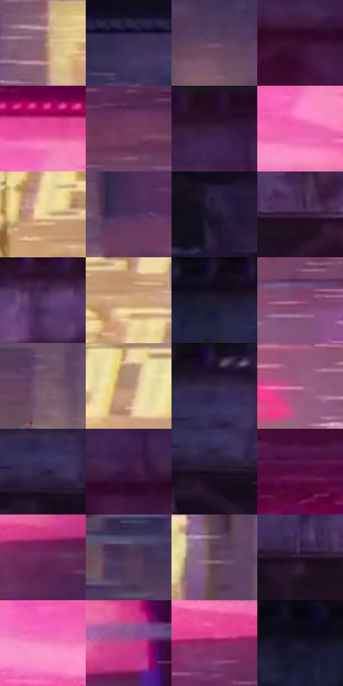

# 电影参考 259

- 状态：条件／活跃；来源世界：miles-home。
- 视角：near-level；景别：environment-wide；场景：city。
- 时段：night-appearance（外观依据，中置信度；具体时间／晨昏未知）；光照：night-mixed。
- 材质候选：skin, fabric, metal, screen, asphalt（帧级，不是像素分割）。
- 明暗组：dark；L* P5/P50/P95：4.63275 / 28.91738 / 73.09531。
- 资格门禁：motion。
- 原截图 SHA-256：`f9df6d09a663c96b2986a53d47407990c742595bbb3018f2a8a4b3576d13cf71`；尺寸：2880 × 1206。
- sRGB 像素 SHA-256：`b565815e3c7c50048454df0c6c8167bf911e718cb0c1b0fcc9992700bb57269b`。

## 观察与迁移

夜间位移与霓虹街景，只借原照支持的动势。

259／36  /  夜街动作；标牌光  /  高架底暗结构稳定，粉色大牌与黄色店字形成不同亮区，运动条和雪分布在空间中。  /  图形线不是墙面织纹，不复制字样或改店铺位置。

本公开版保存32个128×128原像素色卡上下文；图集格子并非原场景相邻位置。原rect、图集tile和像素SHA见 `data/palette-crops.json`。上下文不足时不得批准替色，不能以小样推断完整构图。

## 实测色卡

颜色比例分母为保留采样像素，不是材料面积；全部 32 色参与全库匹配。表内四舍五入仅用于阅读，原精度在 JSON。

| ID | HEX | Lab | 原图 xy | 像素数 | 比例 | 明度角色 |
| --- | --- | --- | --- | ---: | ---: | --- |
| 259-S01 | #8C646E | [46.73275, 17.72189, 0.799055] | [1588, 1052] | 9199 | 4.757792% | midtone |
| 259-S02 | #3C2D55 | [21.919933, 16.64036, -21.845727] | [416, 428] | 8727 | 4.513670% | shadow |
| 259-S03 | #644865 | [34.567245, 17.46037, -12.25935] | [648, 620] | 8208 | 4.245239% | shadow |
| 259-S04 | #390E2F | [11.886603, 25.615167, -11.180797] | [2184, 176] | 7774 | 4.020771% | deep-shadow |
| 259-S05 | #E5489C | [55.783459, 67.248115, -11.758975] | [2376, 432] | 7755 | 4.010944% | midtone |
| 259-S06 | #753E5F | [34.095292, 28.648292, -8.961066] | [2596, 840] | 7611 | 3.936466% | shadow |
| 259-S07 | #290D27 | [8.180929, 19.04877, -11.242791] | [2216, 44] | 7581 | 3.920950% | deep-shadow |
| 259-S08 | #EF64B0 | [62.171848, 61.200326, -13.578156] | [2372, 540] | 7483 | 3.870264% | light |
| 259-S09 | #ECD39C | [85.414997, 0.855068, 30.457552] | [576, 936] | 6837 | 3.536148% | highlight |
| 259-S10 | #4C2E58 | [24.306452, 22.188081, -19.947606] | [1548, 808] | 6605 | 3.416155% | shadow |
| 259-S11 | #201932 | [10.795657, 10.440477, -15.357236] | [756, 220] | 6594 | 3.410466% | deep-shadow |
| 259-S12 | #3D2543 | [18.888136, 17.519241, -14.420379] | [1228, 148] | 6472 | 3.347367% | deep-shadow |
| 259-S13 | #553964 | [28.844641, 21.249917, -20.586724] | [1496, 80] | 6356 | 3.287371% | shadow |
| 259-S14 | #CEA87E | [71.306945, 8.176239, 26.951235] | [652, 988] | 6241 | 3.227892% | light |
| 259-S15 | #110B1A | [3.912073, 5.144893, -7.99846] | [708, 44] | 6165 | 3.188584% | deep-shadow |
| 259-S16 | #83436D | [37.742896, 33.206839, -12.080563] | [2464, 960] | 5999 | 3.102728% | shadow |
| 259-S17 | #77596E | [41.521093, 16.085976, -7.159812] | [1096, 728] | 5794 | 2.996700% | midtone |
| 259-S18 | #AD8671 | [59.092791, 11.921391, 17.044021] | [1156, 1056] | 5731 | 2.964116% | midtone |
| 259-S19 | #190F22 | [5.996182, 9.393519, -11.01935] | [900, 36] | 5650 | 2.922222% | deep-shadow |
| 259-S20 | #A66289 | [50.275114, 33.01071, -9.754717] | [2300, 1028] | 5592 | 2.892224% | midtone |
| 259-S21 | #2B2142 | [15.458847, 13.556945, -19.26349] | [908, 120] | 5415 | 2.800679% | deep-shadow |
| 259-S22 | #3A163C | [14.399091, 24.256436, -16.587878] | [2240, 140] | 5234 | 2.707064% | deep-shadow |
| 259-S23 | #1D1226 | [7.53135, 10.728216, -11.644187] | [916, 152] | 5035 | 2.604140% | deep-shadow |
| 259-S24 | #530E42 | [18.129179, 36.51456, -14.621379] | [2080, 316] | 4878 | 2.522938% | deep-shadow |
| 259-S25 | #672559 | [26.530224, 36.332508, -16.83328] | [2620, 688] | 4865 | 2.516214% | shadow |
| 259-S26 | #4D3753 | [26.548188, 15.553052, -13.17223] | [300, 568] | 4644 | 2.401912% | shadow |
| 259-S27 | #5C4051 | [30.727518, 15.236766, -5.368301] | [764, 908] | 4479 | 2.316572% | shadow |
| 259-S28 | #2A1430 | [10.60154, 17.07455, -14.114004] | [1100, 152] | 4386 | 2.268472% | deep-shadow |
| 259-S29 | #F186C2 | [69.219247, 48.163092, -13.124676] | [2192, 552] | 4190 | 2.167099% | light |
| 259-S30 | #C1428A | [48.350181, 57.402277, -12.861183] | [2684, 616] | 4174 | 2.158824% | midtone |
| 259-S31 | #8F2666 | [34.368593, 49.563688, -12.608973] | [2484, 676] | 4000 | 2.068830% | shadow |
| 259-S32 | #0A0913 | [2.77231, 1.993096, -4.620729] | [380, 40] | 3672 | 1.899186% | deep-shadow |

## 色阶与空间分布

- 采样 ROI：`[0.01, 0.02, 0.98, 0.94]`；步长：4；样本数：193346。
- 排除区：`[]`。
- 深暗、暗、中、亮、高光五段计数：`[67262, 62071, 38326, 19141, 6546]`。
- RGB 各 256 箱、L* 100 箱、13×5 色相明度表和 3×3 空间统计全部保存在 [总数据](../film-library.json)。
- [可视化档案](../../references/library.html)按需绘制直方图，不存 2,094 张重复图表图片。

## 纹理特征占比

**这是分块图像特征的面积占比，不是波点／排线／丝网／错版的精确语义覆盖率。** 窗格、发丝、织物也会产生方向或周期特征。
原图 ROI 像素 3098546；已测块覆盖 3098546（100.0000%）；未测 0。

| 特征 | 块覆盖像素 | 占已测面积 | 阈值敏感范围 |
| --- | ---: | ---: | --- |
| low-contrast | 46336 | 1.4954% | 0.9666% ~ 2.5529% |
| directional-structure | 1228544 | 39.6490% | 24.8478% ~ 56.2927% |
| periodic-structure | 1823666 | 58.8555% | 42.7406% ~ 71.5417% |
| mixed-detail | 0 | 0.0000% | 0.0000% ~ 1.0575% |

阈值敏感范围不是统计置信区间。逐块坐标、尺度、对比、方向一致性、频谱集中度、频率与角度见 [全量特征记录](../texture-features.jsonl)，以帧号定位。
四种印刷层的真实像素覆盖仍标为 `null`，不能填 0，也不能拿上表代替。不得据这些代理测量删除唯一证据。

[测量方法与保留策略](../../references/library-retention.md) · [分类索引](../archive/README.md)
