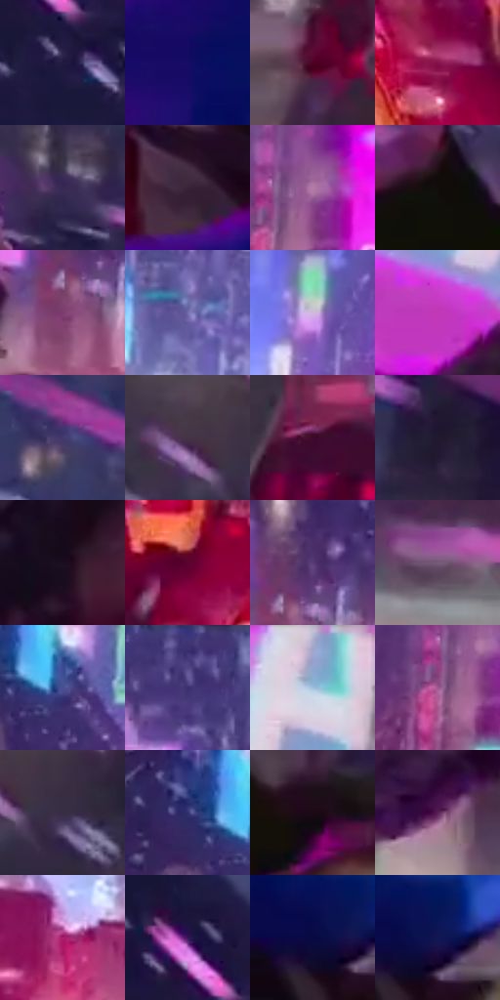

# 电影参考 260

- 状态：条件／活跃；来源世界：miles-home。
- 视角：high-angle；景别：medium；场景：city。
- 时段：night-appearance（外观依据，中置信度；具体时间／晨昏未知）；光照：night-mixed。
- 材质候选：skin, fabric, metal, screen, asphalt（帧级，不是像素分割）。
- 明暗组：dark；L* P5/P50/P95：4.4062 / 25.63044 / 67.36877。
- 资格门禁：motion。
- 原截图 SHA-256：`0df9024fa7a5abe9f7a56529f9d7371012ab98dc209923d806cc3b2bf6951682`；尺寸：2880 × 1204。
- sRGB 像素 SHA-256：`49a836a958d101b25231193a5d23da3d98cd5393a321256a41b559d29ff9a57d`。

## 观察与迁移

夜间位移与霓虹街景，只借原照支持的动势。

260／37  /  动作；近远遮挡  /  近景肢体与衣摆强透视，远车流仍有完整前后层次，彩光集中在受光边。  /  不把运动镜头的透视夸张强加到普通人像；不添车流或雪。

本公开版保存32个128×128原像素色卡上下文；图集格子并非原场景相邻位置。原rect、图集tile和像素SHA见 `data/palette-crops.json`。上下文不足时不得批准替色，不能以小样推断完整构图。

## 实测色卡

颜色比例分母为保留采样像素，不是材料面积；全部 32 色参与全库匹配。表内四舍五入仅用于阅读，原精度在 JSON。

| ID | HEX | Lab | 原图 xy | 像素数 | 比例 | 明度角色 |
| --- | --- | --- | --- | ---: | ---: | --- |
| 260-S01 | #221B41 | [12.643026, 14.701642, -23.105728] | [1760, 312] | 9036 | 4.690420% | deep-shadow |
| 260-S02 | #140D65 | [11.795527, 34.252872, -49.091237] | [680, 936] | 8759 | 4.546634% | deep-shadow |
| 260-S03 | #593C4E | [29.173845, 15.96723, -5.780039] | [36, 964] | 8375 | 4.347307% | shadow |
| 260-S04 | #86124B | [29.438676, 50.135401, -2.604081] | [2580, 1096] | 8350 | 4.334330% | shadow |
| 260-S05 | #372955 | [20.258398, 17.742162, -24.510472] | [600, 292] | 8330 | 4.323948% | shadow |
| 260-S06 | #392439 | [17.585708, 14.236401, -9.547506] | [1036, 716] | 8266 | 4.290727% | deep-shadow |
| 260-S07 | #B27CA9 | [58.738461, 28.305217, -15.52172] | [2692, 672] | 7845 | 4.072194% | midtone |
| 260-S08 | #120E0B | [4.217029, 0.948984, 1.806336] | [1352, 352] | 7745 | 4.020286% | deep-shadow |
| 260-S09 | #7B3C6E | [35.141264, 34.498709, -16.786248] | [2068, 744] | 7709 | 4.001599% | shadow |
| 260-S10 | #716BAA | [48.168831, 17.400658, -32.923823] | [2208, 336] | 7241 | 3.758669% | midtone |
| 260-S11 | #D0B8DD | [77.82281, 15.258409, -15.36669] | [2404, 484] | 7175 | 3.724409% | light |
| 260-S12 | #C139B6 | [49.060558, 67.032368, -37.863385] | [296, 216] | 7121 | 3.696379% | midtone |
| 260-S13 | #433A6E | [27.69572, 17.596578, -28.932606] | [1168, 272] | 6901 | 3.582181% | shadow |
| 260-S14 | #453247 | [23.676219, 12.91935, -9.68837] | [1344, 76] | 6774 | 3.516258% | shadow |
| 260-S15 | #3D0A29 | [11.753322, 27.737201, -6.897281] | [1668, 980] | 6710 | 3.483036% | deep-shadow |
| 260-S16 | #221730 | [10.306111, 12.01193, -14.656761] | [936, 216] | 6323 | 3.282152% | deep-shadow |
| 260-S17 | #1B0F20 | [6.132971, 9.727797, -9.2524] | [424, 376] | 6287 | 3.263465% | deep-shadow |
| 260-S18 | #5D0430 | [18.488182, 39.826769, -1.175965] | [2116, 1116] | 6161 | 3.198061% | deep-shadow |
| 260-S19 | #5A3B75 | [30.845078, 25.897069, -28.225558] | [2100, 668] | 6056 | 3.143557% | shadow |
| 260-S20 | #77597A | [41.956883, 18.526657, -13.840425] | [340, 584] | 6001 | 3.115008% | midtone |
| 260-S21 | #4A5092 | [36.494804, 16.494708, -37.280508] | [2152, 548] | 5934 | 3.080229% | shadow |
| 260-S22 | #5C508F | [37.834156, 20.43995, -33.240767] | [2112, 56] | 5825 | 3.023649% | shadow |
| 260-S23 | #88AED0 | [69.511184, -4.588199, -21.363129] | [404, 56] | 5266 | 2.733483% | light |
| 260-S24 | #A05890 | [47.582454, 37.607974, -18.077046] | [2648, 716] | 4980 | 2.585026% | midtone |
| 260-S25 | #372E46 | [20.859838, 9.929634, -13.472053] | [1416, 112] | 4511 | 2.341576% | shadow |
| 260-S26 | #323170 | [23.816993, 19.842458, -36.50198] | [2076, 524] | 4441 | 2.305241% | shadow |
| 260-S27 | #1B0916 | [4.393209, 9.512841, -4.099046] | [1532, 472] | 4430 | 2.299531% | deep-shadow |
| 260-S28 | #5A2055 | [23.213074, 34.101426, -19.518509] | [160, 552] | 3542 | 1.838586% | shadow |
| 260-S29 | #A81E69 | [38.332567, 58.997598, -8.067333] | [2320, 796] | 2659 | 1.380238% | shadow |
| 260-S30 | #3A1558 | [16.207547, 31.752909, -33.00136] | [1728, 200] | 2358 | 1.223994% | deep-shadow |
| 260-S31 | #080A43 | [6.086248, 21.914126, -35.284665] | [1052, 908] | 1334 | 0.692455% | deep-shadow |
| 260-S32 | #121853 | [11.998447, 20.433082, -36.664406] | [1092, 900] | 203 | 0.105374% | deep-shadow |

## 色阶与空间分布

- 采样 ROI：`[0.01, 0.02, 0.98, 0.94]`；步长：4；样本数：192648。
- 排除区：`[]`。
- 深暗、暗、中、亮、高光五段计数：`[70237, 75375, 31889, 11605, 3542]`。
- RGB 各 256 箱、L* 100 箱、13×5 色相明度表和 3×3 空间统计全部保存在 [总数据](../film-library.json)。
- [可视化档案](../../references/library.html)按需绘制直方图，不存 2,094 张重复图表图片。

## 纹理特征占比

**这是分块图像特征的面积占比，不是波点／排线／丝网／错版的精确语义覆盖率。** 窗格、发丝、织物也会产生方向或周期特征。
原图 ROI 像素 3092958；已测块覆盖 3092958（100.0000%）；未测 0。

| 特征 | 块覆盖像素 | 占已测面积 | 阈值敏感范围 |
| --- | ---: | ---: | --- |
| low-contrast | 97408 | 3.1493% | 1.2167% ~ 4.0226% |
| directional-structure | 523392 | 16.9221% | 4.7675% ~ 32.4412% |
| periodic-structure | 2439390 | 78.8692% | 65.8124% ~ 88.2179% |
| mixed-detail | 32768 | 1.0594% | 0.5297% ~ 2.9921% |

阈值敏感范围不是统计置信区间。逐块坐标、尺度、对比、方向一致性、频谱集中度、频率与角度见 [全量特征记录](../texture-features.jsonl)，以帧号定位。
四种印刷层的真实像素覆盖仍标为 `null`，不能填 0，也不能拿上表代替。不得据这些代理测量删除唯一证据。

[测量方法与保留策略](../../references/library-retention.md) · [分类索引](../archive/README.md)
