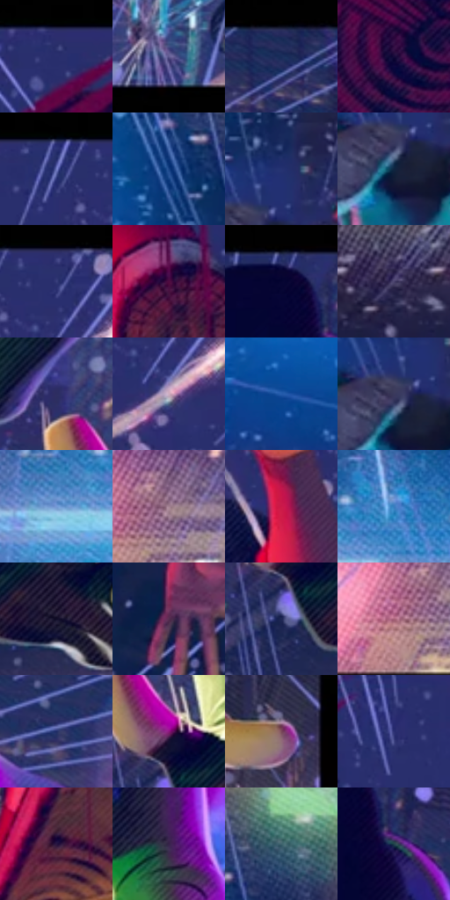

# 电影参考 261

- 状态：条件／活跃；来源世界：miles-home。
- 视角：mixed-panels；景别：graphic-or-multipanel；场景：graphic。
- 时段：night-appearance（外观依据，中置信度；具体时间／晨昏未知）；光照：night-mixed。
- 材质候选：skin, fabric（帧级，不是像素分割）。
- 明暗组：dark；L* P5/P50/P95：6.89484 / 23.72008 / 63.24017。
- 资格门禁：panel。
- 原截图 SHA-256：`c6eca64e04c7de91bd3def83a0d1aa8b807e240c7e7bdfb73cff1dd0e8bba9e1`；尺寸：2880 × 1090。
- sRGB 像素 SHA-256：`99586cc7a24fe7eef50ed2b6cd9ef70965aec051ac6453b7e8249a12610a645b`。

## 观察与迁移

三分格动作视角，黑边不计场景暗部。

261／38  /  三联动作分格；近景缩短  /  三格分别选择人物、远景、鞋底等视点，黑分隔线属于版面而非空间。  /  只有明确分镜要求才借版面；不可凭单张照片编造前后事件或骑车人。

本公开版保存32个128×128原像素色卡上下文；图集格子并非原场景相邻位置。原rect、图集tile和像素SHA见 `data/palette-crops.json`。上下文不足时不得批准替色，不能以小样推断完整构图。

## 实测色卡

颜色比例分母为保留采样像素，不是材料面积；全部 32 色参与全库匹配。表内四舍五入仅用于阅读，原精度在 JSON。

| ID | HEX | Lab | 原图 xy | 像素数 | 比例 | 明度角色 |
| --- | --- | --- | --- | ---: | ---: | --- |
| 261-S01 | #2A2F6C | [22.329172, 18.011505, -36.359903] | [2220, 48] | 11399 | 6.738033% | shadow |
| 261-S02 | #615C91 | [41.59435, 14.961558, -28.503709] | [132, 1024] | 8981 | 5.308735% | midtone |
| 261-S03 | #252A5D | [19.388286, 14.848245, -31.316852] | [820, 36] | 8533 | 5.043919% | deep-shadow |
| 261-S04 | #160B39 | [6.370393, 19.638438, -27.600527] | [2044, 412] | 7004 | 4.140116% | deep-shadow |
| 261-S05 | #262D6B | [21.394205, 18.220254, -37.238614] | [2592, 44] | 6341 | 3.748212% | shadow |
| 261-S06 | #174184 | [28.453397, 11.876554, -41.724238] | [1348, 196] | 6189 | 3.658364% | shadow |
| 261-S07 | #253271 | [23.2243, 16.803447, -38.147083] | [1472, 324] | 6035 | 3.567333% | shadow |
| 261-S08 | #0F2440 | [14.020248, 2.704106, -20.29398] | [1440, 416] | 6019 | 3.557875% | deep-shadow |
| 261-S09 | #383E7B | [28.683137, 16.254929, -35.639555] | [2680, 68] | 5964 | 3.525364% | shadow |
| 261-S10 | #510A40 | [17.164773, 36.951141, -14.757796] | [2768, 704] | 5928 | 3.504085% | deep-shadow |
| 261-S11 | #1D2443 | [15.105059, 7.339493, -20.603604] | [500, 32] | 5906 | 3.491080% | deep-shadow |
| 261-S12 | #4B436D | [30.911727, 13.844698, -23.178093] | [1772, 200] | 5778 | 3.415418% | shadow |
| 261-S13 | #2D2E61 | [21.485877, 15.416698, -30.548079] | [464, 644] | 5705 | 3.372268% | shadow |
| 261-S14 | #CDACBE | [73.677049, 14.984055, -4.690979] | [2696, 168] | 5692 | 3.364583% | light |
| 261-S15 | #255CAC | [39.621854, 11.314493, -47.948866] | [1028, 436] | 5657 | 3.343894% | shadow |
| 261-S16 | #3A395D | [25.611208, 10.248475, -21.322278] | [1436, 384] | 5646 | 3.337392% | shadow |
| 261-S17 | #749AD6 | [63.075115, 2.928004, -34.690327] | [1480, 984] | 5566 | 3.290104% | light |
| 261-S18 | #A38393 | [58.15693, 14.965555, -3.910603] | [1204, 964] | 5092 | 3.009919% | midtone |
| 261-S19 | #CB1948 | [44.036753, 66.41292, 21.789563] | [2540, 392] | 5001 | 2.956128% | midtone |
| 261-S20 | #387DBF | [50.998615, 0.26866, -40.843211] | [1584, 928] | 4971 | 2.938395% | midtone |
| 261-S21 | #0D0B26 | [4.198551, 7.929997, -16.953939] | [644, 848] | 4818 | 2.847955% | deep-shadow |
| 261-S22 | #572E51 | [25.486775, 24.513562, -13.369829] | [1968, 844] | 4578 | 2.706090% | shadow |
| 261-S23 | #1E2754 | [17.305592, 11.968287, -28.689863] | [528, 840] | 4556 | 2.693085% | deep-shadow |
| 261-S24 | #A76177 | [49.615337, 31.178009, 0.009416] | [1148, 996] | 4357 | 2.575455% | midtone |
| 261-S25 | #1E2C65 | [20.110084, 15.083433, -35.437482] | [772, 232] | 4198 | 2.481469% | shadow |
| 261-S26 | #8A177C | [32.859117, 56.107182, -28.966058] | [540, 756] | 3997 | 2.362656% | shadow |
| 261-S27 | #79485A | [36.815475, 23.514432, -1.682612] | [880, 912] | 3785 | 2.237341% | shadow |
| 261-S28 | #2C3073 | [23.293322, 20.309951, -39.292441] | [2396, 100] | 3233 | 1.911050% | shadow |
| 261-S29 | #271642 | [11.947291, 19.987422, -24.893302] | [2708, 900] | 2362 | 1.396196% | deep-shadow |
| 261-S30 | #362249 | [17.50361, 18.630792, -20.77141] | [604, 464] | 2220 | 1.312258% | deep-shadow |
| 261-S31 | #3F646E | [40.075023, -10.311814, -9.799438] | [1448, 124] | 2156 | 1.274428% | midtone |
| 261-S32 | #20424A | [25.855227, -9.751312, -8.653099] | [560, 136] | 1507 | 0.890799% | shadow |

## 色阶与空间分布

- 采样 ROI：`[0.01, 0.02, 0.98, 0.94]`；步长：4；样本数：169174。
- 排除区：`[{"label": "panel gutter", "rect": [0.322, 0, 0.338, 1]}, {"label": "panel gutter", "rect": [0.648, 0, 0.665, 1]}]`。
- 深暗、暗、中、亮、高光五段计数：`[44700, 86034, 27970, 8797, 1673]`。
- RGB 各 256 箱、L* 100 箱、13×5 色相明度表和 3×3 空间统计全部保存在 [总数据](../film-library.json)。
- [可视化档案](../../references/library.html)按需绘制直方图，不存 2,094 张重复图表图片。

## 纹理特征占比

**这是分块图像特征的面积占比，不是波点／排线／丝网／错版的精确语义覆盖率。** 窗格、发丝、织物也会产生方向或周期特征。
原图 ROI 像素 2707097；已测块覆盖 2545614（94.0348%）；未测 161483。

| 特征 | 块覆盖像素 | 占已测面积 | 阈值敏感范围 |
| --- | ---: | ---: | --- |
| low-contrast | 0 | 0.0000% | 0.0000% ~ 0.0000% |
| directional-structure | 292224 | 11.4795% | 2.5745% ~ 31.0093% |
| periodic-structure | 1731918 | 68.0354% | 58.2705% ~ 68.0354% |
| mixed-detail | 521472 | 20.4851% | 10.7202% ~ 32.6314% |

阈值敏感范围不是统计置信区间。逐块坐标、尺度、对比、方向一致性、频谱集中度、频率与角度见 [全量特征记录](../texture-features.jsonl)，以帧号定位。
四种印刷层的真实像素覆盖仍标为 `null`，不能填 0，也不能拿上表代替。不得据这些代理测量删除唯一证据。

[测量方法与保留策略](../../references/library-retention.md) · [分类索引](../archive/README.md)
