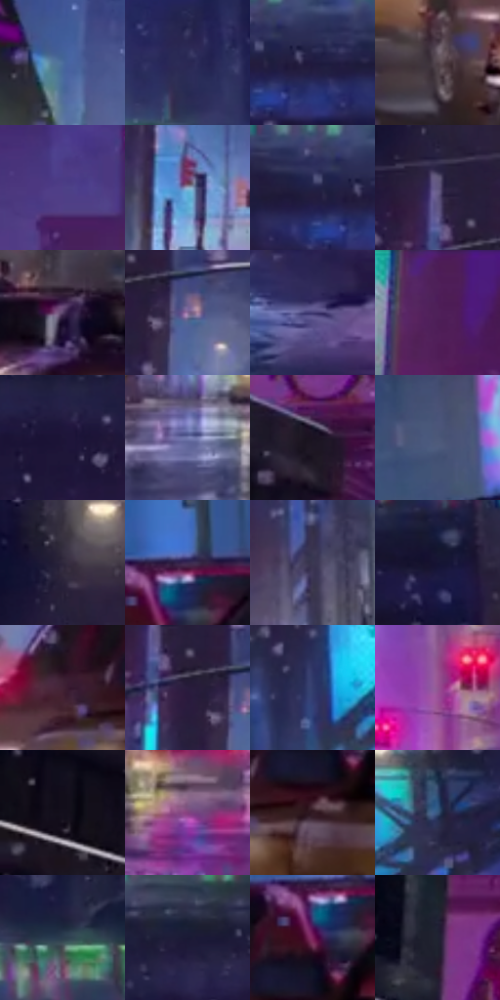

# 电影参考 262

- 状态：常规／活跃；来源世界：miles-home。
- 视角：near-level；景别：environment-wide；场景：street。
- 时段：night-appearance（外观依据，中置信度；具体时间／晨昏未知）；光照：night-mixed。
- 材质候选：skin, fabric, asphalt, glass, painted-metal, metal, screen（帧级，不是像素分割）。
- 明暗组：dark；L* P5/P50/P95：7.39714 / 25.0612 / 58.9956。
- 资格门禁：无附加门禁。
- 原截图 SHA-256：`d5d8612af739b1b9b1620d2bed8c1f22005ee60761f0814dd84f176c596195b3`；尺寸：2880 × 1208。
- sRGB 像素 SHA-256：`714c2c199f739fea8c712224d53a6ff913536b2a1a10887ea103ba702f510064`。

## 观察与迁移

湿街、桥架、车流和人群，灯光反射有方向与中断。

262／39  /  夜街稳定空间；湿地  /  桥梁暗形横向压住画面，上方绿窗一排，下方多色灯在地面形成不连续亮带与暗隙。  /  学照明层次不复制高架；湿地只在源照已有时保留。

本公开版保存32个128×128原像素色卡上下文；图集格子并非原场景相邻位置。原rect、图集tile和像素SHA见 `data/palette-crops.json`。上下文不足时不得批准替色，不能以小样推断完整构图。

## 实测色卡

颜色比例分母为保留采样像素，不是材料面积；全部 32 色参与全库匹配。表内四舍五入仅用于阅读，原精度在 JSON。

| ID | HEX | Lab | 原图 xy | 像素数 | 比例 | 明度角色 |
| --- | --- | --- | --- | ---: | ---: | --- |
| 262-S01 | #4C6D9D | [45.506494, 2.249921, -29.641638] | [296, 744] | 10527 | 5.444643% | midtone |
| 262-S02 | #2B2854 | [18.675305, 14.549097, -26.436136] | [1716, 72] | 9253 | 4.785721% | deep-shadow |
| 262-S03 | #1F1A3E | [11.809102, 13.498022, -22.345315] | [1940, 268] | 9188 | 4.752102% | deep-shadow |
| 262-S04 | #52434A | [30.163712, 7.796532, -1.801211] | [2216, 1092] | 8419 | 4.354370% | shadow |
| 262-S05 | #4E3F87 | [31.632291, 25.015356, -38.287643] | [720, 144] | 7974 | 4.124213% | shadow |
| 262-S06 | #9BB1CA | [71.334408, -2.069878, -15.190645] | [840, 816] | 7700 | 3.982498% | light |
| 262-S07 | #222247 | [15.163399, 11.720636, -23.250948] | [1880, 260] | 7652 | 3.957672% | deep-shadow |
| 262-S08 | #615881 | [39.757747, 13.122542, -21.675648] | [736, 552] | 7641 | 3.951982% | shadow |
| 262-S09 | #574169 | [31.409269, 18.098705, -19.772892] | [420, 924] | 7601 | 3.931294% | shadow |
| 262-S10 | #886A97 | [49.224369, 20.61238, -19.960426] | [828, 644] | 7055 | 3.648899% | midtone |
| 262-S11 | #413B73 | [28.085409, 17.923631, -31.503731] | [1372, 1108] | 6279 | 3.247546% | shadow |
| 262-S12 | #4C1D58 | [20.518101, 32.17446, -25.92723] | [228, 48] | 6277 | 3.246511% | shadow |
| 262-S13 | #1D1638 | [9.957336, 13.730505, -21.044341] | [1436, 340] | 6244 | 3.229444% | deep-shadow |
| 262-S14 | #767DB1 | [53.698901, 9.962986, -28.331003] | [980, 1024] | 6194 | 3.203583% | midtone |
| 262-S15 | #1A1321 | [7.182638, 7.144449, -8.425776] | [236, 444] | 5936 | 3.070144% | deep-shadow |
| 262-S16 | #4C5879 | [37.655041, 4.140772, -20.170155] | [2688, 736] | 5598 | 2.895328% | shadow |
| 262-S17 | #2E273B | [17.214995, 8.28201, -11.626313] | [732, 448] | 5439 | 2.813092% | deep-shadow |
| 262-S18 | #3B2951 | [20.478104, 17.855317, -21.454647] | [2476, 864] | 5411 | 2.798610% | shadow |
| 262-S19 | #3B3952 | [25.153153, 7.292826, -14.823624] | [2180, 820] | 5379 | 2.782059% | shadow |
| 262-S20 | #151433 | [8.117172, 11.056317, -20.417712] | [2704, 280] | 5296 | 2.739131% | deep-shadow |
| 262-S21 | #422235 | [18.185851, 18.379423, -5.716113] | [2324, 980] | 5061 | 2.617587% | deep-shadow |
| 262-S22 | #281C3C | [13.277787, 14.230906, -18.531441] | [768, 624] | 4965 | 2.567935% | deep-shadow |
| 262-S23 | #313B6A | [26.218882, 10.605543, -28.813491] | [2244, 644] | 4836 | 2.501215% | shadow |
| 262-S24 | #935491 | [45.065861, 35.723454, -22.689145] | [1696, 768] | 4675 | 2.417945% | midtone |
| 262-S25 | #0D0814 | [2.797816, 3.467507, -5.209272] | [32, 504] | 4616 | 2.387430% | deep-shadow |
| 262-S26 | #84407E | [37.984682, 38.194738, -22.260436] | [1584, 1028] | 4603 | 2.380706% | shadow |
| 262-S27 | #321A23 | [12.850009, 13.412612, -1.035834] | [2432, 1012] | 4522 | 2.338812% | deep-shadow |
| 262-S28 | #39557B | [35.588969, 1.312788, -24.710597] | [2468, 536] | 4517 | 2.336226% | shadow |
| 262-S29 | #2B3D4E | [24.954787, -2.039501, -12.601153] | [2540, 144] | 4457 | 2.305194% | shadow |
| 262-S30 | #1A1935 | [10.347979, 9.46122, -18.27749] | [1576, 264] | 3725 | 1.926598% | deep-shadow |
| 262-S31 | #7C215D | [29.822864, 44.903099, -14.064981] | [2448, 920] | 3340 | 1.727473% | shadow |
| 262-S32 | #1F2231 | [13.573534, 3.063573, -10.314601] | [164, 308] | 2966 | 1.534037% | deep-shadow |

## 色阶与空间分布

- 采样 ROI：`[0.01, 0.02, 0.98, 0.94]`；步长：4；样本数：193346。
- 排除区：`[]`。
- 深暗、暗、中、亮、高光五段计数：`[73638, 79286, 31440, 7520, 1462]`。
- RGB 各 256 箱、L* 100 箱、13×5 色相明度表和 3×3 空间统计全部保存在 [总数据](../film-library.json)。
- [可视化档案](../../references/library.html)按需绘制直方图，不存 2,094 张重复图表图片。

## 纹理特征占比

**这是分块图像特征的面积占比，不是波点／排线／丝网／错版的精确语义覆盖率。** 窗格、发丝、织物也会产生方向或周期特征。
原图 ROI 像素 3104134；已测块覆盖 3104134（100.0000%）；未测 0。

| 特征 | 块覆盖像素 | 占已测面积 | 阈值敏感范围 |
| --- | ---: | ---: | --- |
| low-contrast | 0 | 0.0000% | 0.0000% ~ 0.0000% |
| directional-structure | 315008 | 10.1480% | 4.4122% ~ 18.6136% |
| periodic-structure | 2281222 | 73.4898% | 70.5910% ~ 73.4898% |
| mixed-detail | 507904 | 16.3622% | 8.4450% ~ 24.9969% |

阈值敏感范围不是统计置信区间。逐块坐标、尺度、对比、方向一致性、频谱集中度、频率与角度见 [全量特征记录](../texture-features.jsonl)，以帧号定位。
四种印刷层的真实像素覆盖仍标为 `null`，不能填 0，也不能拿上表代替。不得据这些代理测量删除唯一证据。

[测量方法与保留策略](../../references/library-retention.md) · [分类索引](../archive/README.md)
