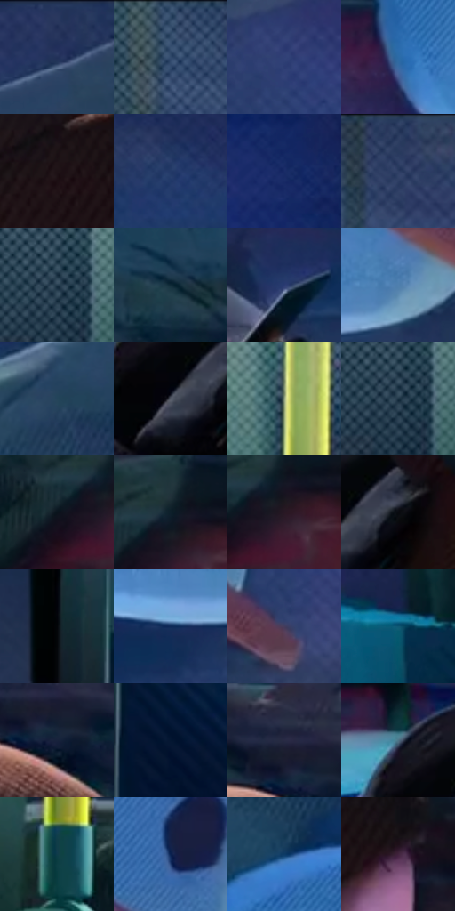

# 电影参考 263

- 状态：常规／活跃；来源世界：miles-home。
- 视角：near-level；景别：medium；场景：vehicle。
- 时段：interior-time-unknown（外观依据，中置信度；具体时间／晨昏未知）；光照：cool-interior。
- 材质候选：skin, fabric, glass, metal, plastic（帧级，不是像素分割）。
- 明暗组：dark；L* P5/P50/P95：3.42388 / 23.35983 / 51.89836。
- 资格门禁：无附加门禁。
- 原截图 SHA-256：`e72f7bb5d78ba7b26dd70cfbb076f2e1ccfb23cbaa70c022da8c5f1537127d48`；尺寸：2880 × 1210。
- sRGB 像素 SHA-256：`8410f4ce4e9a2f74560f7242d8760b1542e07de9a39dad42c03c233dec8fe6b2`。

## 观察与迁移

车内乘客与车窗外人物分层，窗面图案不误判反射。

263／40  /  车厢内外；多材料  /  前景针织帽、厚衣、耳机塑料、黄扶杆各异；玻璃外人物与室内乘客分层，脸有局部暖亮。  /  光源归因不足时不指定唯一灯具；外景不能贴到前景人物同一层。

本公开版保存32个128×128原像素色卡上下文；图集格子并非原场景相邻位置。原rect、图集tile和像素SHA见 `data/palette-crops.json`。上下文不足时不得批准替色，不能以小样推断完整构图。

## 实测色卡

颜色比例分母为保留采样像素，不是材料面积；全部 32 色参与全库匹配。表内四舍五入仅用于阅读，原精度在 JSON。

| ID | HEX | Lab | 原图 xy | 像素数 | 比例 | 明度角色 |
| --- | --- | --- | --- | ---: | ---: | --- |
| 263-S01 | #223159 | [21.047572, 7.610358, -26.027087] | [2032, 64] | 8734 | 4.501041% | shadow |
| 263-S02 | #364F6C | [32.828542, -0.655704, -19.683686] | [840, 32] | 8699 | 4.483004% | shadow |
| 263-S03 | #314077 | [28.51461, 11.842868, -33.421198] | [2060, 336] | 8672 | 4.469089% | shadow |
| 263-S04 | #2C6BA6 | [43.948272, 0.376505, -37.496505] | [1500, 748] | 8565 | 4.413947% | midtone |
| 263-S05 | #1E1216 | [6.924658, 6.831371, -0.355941] | [1020, 704] | 8493 | 4.376842% | deep-shadow |
| 263-S06 | #233968 | [24.584472, 7.987584, -30.18314] | [1668, 96] | 8200 | 4.225846% | shadow |
| 263-S07 | #192C67 | [19.991187, 15.062483, -36.94902] | [2788, 376] | 8060 | 4.153697% | deep-shadow |
| 263-S08 | #2B3D63 | [26.014814, 5.196433, -24.657541] | [1000, 56] | 7956 | 4.100101% | shadow |
| 263-S09 | #253C4E | [24.241119, -3.185826, -13.730458] | [64, 168] | 7799 | 4.019192% | shadow |
| 263-S10 | #0E2936 | [15.198107, -5.282582, -11.443357] | [1372, 452] | 7539 | 3.885201% | deep-shadow |
| 263-S11 | #2B3B72 | [26.32022, 12.101466, -33.785632] | [1572, 952] | 7389 | 3.807899% | shadow |
| 263-S12 | #5080AE | [52.060568, -2.743761, -29.329753] | [1920, 840] | 7260 | 3.741419% | midtone |
| 263-S13 | #24455A | [27.761373, -5.099644, -16.143895] | [1868, 196] | 6780 | 3.494053% | shadow |
| 263-S14 | #575D6A | [39.40363, 0.688557, -8.19184] | [704, 976] | 6432 | 3.314712% | shadow |
| 263-S15 | #99A785 | [66.598688, -11.159485, 15.975532] | [340, 220] | 6160 | 3.174538% | light |
| 263-S16 | #1A3041 | [18.864163, -2.845197, -13.348647] | [64, 184] | 6001 | 3.092598% | deep-shadow |
| 263-S17 | #0A141C | [5.859109, -1.29726, -6.729038] | [564, 560] | 5857 | 3.018388% | deep-shadow |
| 263-S18 | #0D1F2A | [10.795773, -3.30971, -9.651585] | [616, 516] | 5857 | 3.018388% | deep-shadow |
| 263-S19 | #281824 | [10.790052, 10.49978, -5.005855] | [632, 552] | 5435 | 2.800911% | deep-shadow |
| 263-S20 | #090A0F | [2.796966, 0.536181, -2.26326] | [776, 952] | 5382 | 2.773598% | deep-shadow |
| 263-S21 | #030508 | [1.31361, -0.105954, -1.319383] | [140, 920] | 5200 | 2.679805% | deep-shadow |
| 263-S22 | #0D2957 | [17.269526, 8.751653, -30.807188] | [1744, 904] | 4934 | 2.542722% | deep-shadow |
| 263-S23 | #433C5D | [27.339278, 11.23088, -18.561818] | [2076, 824] | 4743 | 2.444291% | shadow |
| 263-S24 | #0F5874 | [34.683325, -10.512884, -21.906984] | [2616, 924] | 4555 | 2.347406% | shadow |
| 263-S25 | #18223C | [13.616897, 4.721158, -18.095018] | [1072, 540] | 4408 | 2.271650% | deep-shadow |
| 263-S26 | #031631 | [7.360095, 4.244741, -20.236782] | [256, 1012] | 4160 | 2.143844% | deep-shadow |
| 263-S27 | #292B45 | [18.491017, 6.706285, -16.579782] | [1040, 488] | 3823 | 1.970172% | deep-shadow |
| 263-S28 | #4D7385 | [46.354157, -8.387066, -14.096966] | [660, 884] | 3634 | 1.872771% | midtone |
| 263-S29 | #103C49 | [23.075957, -9.863813, -12.285893] | [352, 536] | 3454 | 1.780009% | shadow |
| 263-S30 | #0A204E | [13.515651, 11.188421, -30.792993] | [1944, 628] | 3427 | 1.766094% | deep-shadow |
| 263-S31 | #0D3B66 | [24.232895, 2.323383, -29.503946] | [1636, 416] | 3274 | 1.687246% | shadow |
| 263-S32 | #42243E | [19.089606, 18.922929, -10.606076] | [1156, 728] | 3162 | 1.629527% | deep-shadow |

## 色阶与空间分布

- 采样 ROI：`[0.01, 0.02, 0.98, 0.94]`；步长：4；样本数：194044。
- 排除区：`[]`。
- 深暗、暗、中、亮、高光五段计数：`[75025, 91074, 23397, 3786, 762]`。
- RGB 各 256 箱、L* 100 箱、13×5 色相明度表和 3×3 空间统计全部保存在 [总数据](../film-library.json)。
- [可视化档案](../../references/library.html)按需绘制直方图，不存 2,094 张重复图表图片。

## 纹理特征占比

**这是分块图像特征的面积占比，不是波点／排线／丝网／错版的精确语义覆盖率。** 窗格、发丝、织物也会产生方向或周期特征。
原图 ROI 像素 3109722；已测块覆盖 3109722（100.0000%）；未测 0。

| 特征 | 块覆盖像素 | 占已测面积 | 阈值敏感范围 |
| --- | ---: | ---: | --- |
| low-contrast | 112640 | 3.6222% | 1.7658% ~ 7.5683% |
| directional-structure | 887552 | 28.5412% | 19.2182% ~ 42.0339% |
| periodic-structure | 2060378 | 66.2560% | 54.6197% ~ 70.2128% |
| mixed-detail | 49152 | 1.5806% | 1.5806% ~ 3.0007% |

阈值敏感范围不是统计置信区间。逐块坐标、尺度、对比、方向一致性、频谱集中度、频率与角度见 [全量特征记录](../texture-features.jsonl)，以帧号定位。
四种印刷层的真实像素覆盖仍标为 `null`，不能填 0，也不能拿上表代替。不得据这些代理测量删除唯一证据。

[测量方法与保留策略](../../references/library-retention.md) · [分类索引](../archive/README.md)
