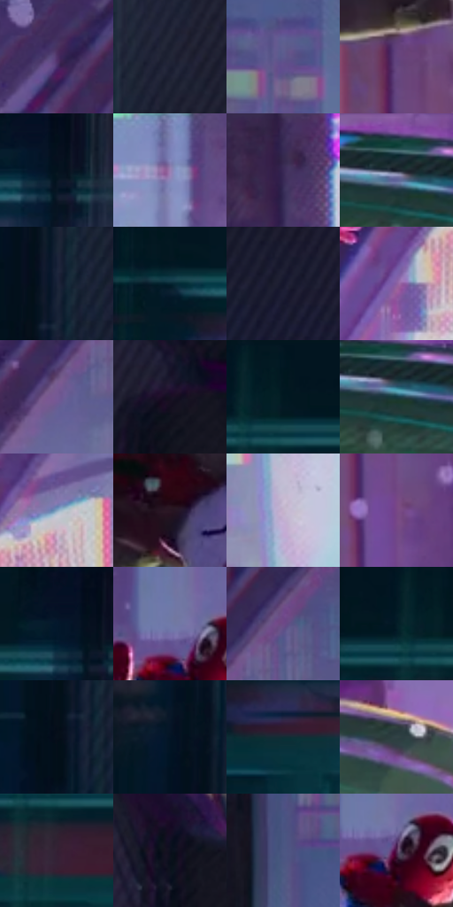

# 电影参考 264

- 状态：条件／活跃；来源世界：miles-home。
- 视角：near-level；景别：full-body；场景：street。
- 时段：night-appearance（外观依据，中置信度；具体时间／晨昏未知）；光照：night-mixed。
- 材质候选：fabric, metal, screen, asphalt（帧级，不是像素分割）。
- 明暗组：very-dark；L* P5/P50/P95：4.78115 / 19.01131 / 63.0107。
- 资格门禁：motion。
- 原截图 SHA-256：`8fef5a1e99d7959c65b13bf678382bc9f921f0f6674a0fc61c1edf39af475b0b`；尺寸：2880 × 1202。
- sRGB 像素 SHA-256：`e3382296ae6f672a7413f3dbe67be482d87ee99afe413078d2fcf2a1a3923edf`。

## 观察与迁移

现有腾空姿态与背后夜城，条线须先区分实体与动势。

264／41  /  曲面玻璃；动作遮挡  /  巴士框体、弯曲玻璃和外侧身体互相遮挡，右侧远人群对比与细节较低。  /  弯玻璃反光不是不透明色板；不继承道具、姿态或外部人群。

本公开版保存32个128×128原像素色卡上下文；图集格子并非原场景相邻位置。原rect、图集tile和像素SHA见 `data/palette-crops.json`。上下文不足时不得批准替色，不能以小样推断完整构图。

## 实测色卡

颜色比例分母为保留采样像素，不是材料面积；全部 32 色参与全库匹配。表内四舍五入仅用于阅读，原精度在 JSON。

| ID | HEX | Lab | 原图 xy | 像素数 | 比例 | 明度角色 |
| --- | --- | --- | --- | ---: | ---: | --- |
| 264-S01 | #4F3369 | [26.876242, 24.345214, -26.946088] | [2440, 84] | 9850 | 5.112952% | shadow |
| 264-S02 | #222636 | [15.44821, 2.908378, -10.949718] | [804, 468] | 9679 | 5.024189% | deep-shadow |
| 264-S03 | #5C5A8E | [40.475718, 13.858502, -28.47846] | [1248, 284] | 8938 | 4.639550% | midtone |
| 264-S04 | #64437E | [34.457423, 26.376426, -28.080246] | [2084, 560] | 7994 | 4.149537% | shadow |
| 264-S05 | #02121D | [4.825106, -1.831202, -9.100951] | [664, 84] | 7684 | 3.988622% | deep-shadow |
| 264-S06 | #9B81B3 | [57.964652, 19.726336, -22.638043] | [1760, 396] | 7644 | 3.967858% | midtone |
| 264-S07 | #392956 | [20.547577, 18.665974, -24.704646] | [2184, 64] | 7622 | 3.956439% | shadow |
| 264-S08 | #1A202E | [12.285446, 1.671505, -10.18236] | [2152, 1032] | 7174 | 3.723890% | deep-shadow |
| 264-S09 | #182137 | [12.969804, 3.536469, -15.578009] | [704, 792] | 7021 | 3.644471% | deep-shadow |
| 264-S10 | #052431 | [12.706978, -5.791929, -11.78296] | [424, 104] | 6788 | 3.523525% | deep-shadow |
| 264-S11 | #15162C | [8.262641, 6.799348, -15.038718] | [948, 828] | 6714 | 3.485113% | deep-shadow |
| 264-S12 | #8A60A1 | [47.420613, 29.364112, -28.631793] | [2380, 556] | 6648 | 3.450853% | midtone |
| 264-S13 | #735A95 | [42.953937, 22.823171, -28.653999] | [2684, 160] | 6621 | 3.436838% | midtone |
| 264-S14 | #161022 | [5.931332, 7.40209, -11.146892] | [972, 276] | 6359 | 3.300839% | deep-shadow |
| 264-S15 | #021723 | [6.74728, -3.084889, -10.771588] | [132, 28] | 6356 | 3.299282% | deep-shadow |
| 264-S16 | #15383E | [21.339681, -10.437082, -7.541943] | [2176, 1056] | 6212 | 3.224534% | shadow |
| 264-S17 | #86A4C0 | [66.077138, -3.720856, -17.743396] | [2504, 452] | 5968 | 3.097878% | light |
| 264-S18 | #281523 | [9.867285, 12.412564, -5.656529] | [1596, 716] | 5892 | 3.058428% | deep-shadow |
| 264-S19 | #C5B4CD | [75.402065, 10.630002, -10.406018] | [2744, 456] | 5799 | 3.010153% | light |
| 264-S20 | #764786 | [37.984833, 31.531758, -27.322329] | [2120, 776] | 5646 | 2.930734% | shadow |
| 264-S21 | #03182C | [7.717436, 0.268345, -15.982532] | [628, 64] | 5505 | 2.857543% | deep-shadow |
| 264-S22 | #717AA9 | [52.167455, 8.102407, -26.11395] | [1444, 468] | 5348 | 2.776048% | midtone |
| 264-S23 | #544277 | [32.062776, 20.163355, -27.606108] | [2764, 28] | 5123 | 2.659254% | shadow |
| 264-S24 | #031D27 | [9.356511, -5.799097, -9.712644] | [76, 72] | 4702 | 2.440721% | deep-shadow |
| 264-S25 | #06101B | [4.411589, -0.248232, -8.131254] | [672, 864] | 4563 | 2.368569% | deep-shadow |
| 264-S26 | #041425 | [5.958282, 0.289083, -13.498439] | [640, 692] | 4383 | 2.275134% | deep-shadow |
| 264-S27 | #0F2E35 | [17.048054, -8.772701, -7.904836] | [524, 200] | 4381 | 2.274096% | deep-shadow |
| 264-S28 | #304246 | [26.639987, -6.016448, -4.753348] | [2404, 1060] | 4152 | 2.155226% | shadow |
| 264-S29 | #342134 | [15.828769, 13.069243, -8.779257] | [128, 168] | 4026 | 2.089822% | deep-shadow |
| 264-S30 | #0C101E | [4.899883, 2.276909, -9.706989] | [972, 76] | 3080 | 1.598771% | deep-shadow |
| 264-S31 | #4C5682 | [37.486938, 8.110311, -25.953911] | [1156, 136] | 2888 | 1.499107% | shadow |
| 264-S32 | #502450 | [22.112255, 27.782782, -18.014658] | [1472, 500] | 1888 | 0.980026% | shadow |

## 色阶与空间分布

- 采样 ROI：`[0.01, 0.02, 0.98, 0.94]`；步长：4；样本数：192648。
- 排除区：`[]`。
- 深暗、暗、中、亮、高光五段计数：`[99603, 49608, 30164, 11256, 2017]`。
- RGB 各 256 箱、L* 100 箱、13×5 色相明度表和 3×3 空间统计全部保存在 [总数据](../film-library.json)。
- [可视化档案](../../references/library.html)按需绘制直方图，不存 2,094 张重复图表图片。

## 纹理特征占比

**这是分块图像特征的面积占比，不是波点／排线／丝网／错版的精确语义覆盖率。** 窗格、发丝、织物也会产生方向或周期特征。
原图 ROI 像素 3087370；已测块覆盖 3087370（100.0000%）；未测 0。

| 特征 | 块覆盖像素 | 占已测面积 | 阈值敏感范围 |
| --- | ---: | ---: | --- |
| low-contrast | 351104 | 11.3723% | 6.4552% ~ 12.9643% |
| directional-structure | 680448 | 22.0397% | 10.9494% ~ 35.7047% |
| periodic-structure | 1996298 | 64.6601% | 57.3094% ~ 70.9744% |
| mixed-detail | 59520 | 1.9279% | 0.5307% ~ 5.1119% |

阈值敏感范围不是统计置信区间。逐块坐标、尺度、对比、方向一致性、频谱集中度、频率与角度见 [全量特征记录](../texture-features.jsonl)，以帧号定位。
四种印刷层的真实像素覆盖仍标为 `null`，不能填 0，也不能拿上表代替。不得据这些代理测量删除唯一证据。

[测量方法与保留策略](../../references/library-retention.md) · [分类索引](../archive/README.md)
