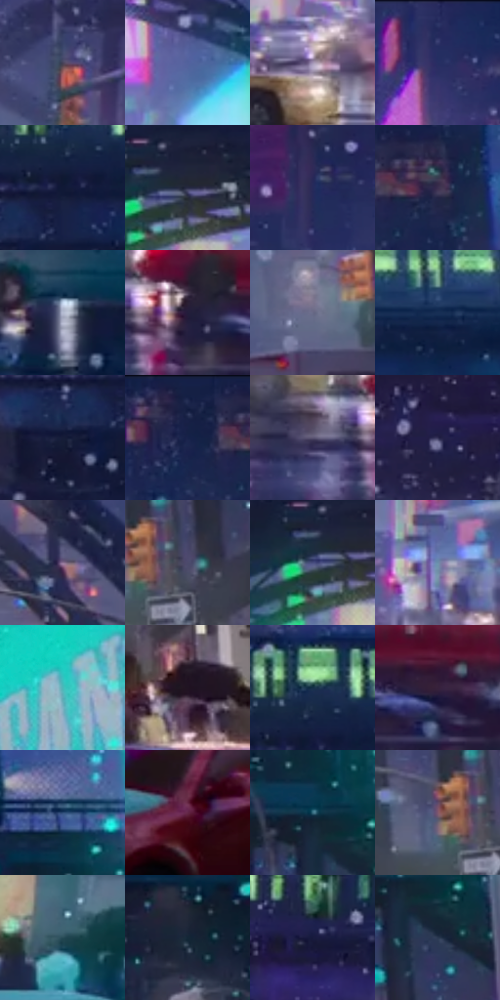

# 电影参考 265

- 状态：常规／活跃；来源世界：miles-home。
- 视角：near-level；景别：environment-wide；场景：street。
- 时段：night-appearance（外观依据，中置信度；具体时间／晨昏未知）；光照：night-mixed。
- 材质候选：skin, fabric, asphalt, glass, painted-metal, metal, screen（帧级，不是像素分割）。
- 明暗组：dark；L* P5/P50/P95：9.78954 / 26.08387 / 70.73183。
- 资格门禁：无附加门禁。
- 原截图 SHA-256：`0c2ab6ea461e0ea6d4cf8ec6bdbd4c745be157ecc916e860edf1e18f3c240663`；尺寸：2880 × 1206。
- sRGB 像素 SHA-256：`553728e49678c0672ee73d94f4ef145c47e961ada68e95c738e76c73a640f70c`。

## 观察与迁移

湿街、桥架、车流和人群，灯光反射有方向与中断。

265／42  /  夜街稳定空间；桥梁／多色车漆  /  拱形高架与车辆暗底托住青、粉、绿灯和红黄车漆；道路反射保留断裂、方向与暗空。  /  多色不是平均饱和；雪、牌灯、反射都不授权凭空新增。

本公开版保存32个128×128原像素色卡上下文；图集格子并非原场景相邻位置。原rect、图集tile和像素SHA见 `data/palette-crops.json`。上下文不足时不得批准替色，不能以小样推断完整构图。

## 实测色卡

颜色比例分母为保留采样像素，不是材料面积；全部 32 色参与全库匹配。表内四舍五入仅用于阅读，原精度在 JSON。

| ID | HEX | Lab | 原图 xy | 像素数 | 比例 | 明度角色 |
| --- | --- | --- | --- | ---: | ---: | --- |
| 265-S01 | #464259 | [29.208955, 7.233585, -13.065481] | [600, 620] | 9630 | 4.980708% | shadow |
| 265-S02 | #52619C | [42.372846, 10.887624, -33.941671] | [1704, 588] | 8768 | 4.534875% | midtone |
| 265-S03 | #A193B4 | [63.127196, 11.656456, -15.296784] | [1232, 932] | 8499 | 4.395746% | light |
| 265-S04 | #34396C | [25.976803, 13.451721, -30.467207] | [1892, 40] | 8405 | 4.347129% | shadow |
| 265-S05 | #101936 | [9.574575, 7.054408, -20.282444] | [1032, 280] | 8325 | 4.305752% | deep-shadow |
| 265-S06 | #272A44 | [17.938904, 6.417484, -16.77156] | [1304, 492] | 7902 | 4.086974% | deep-shadow |
| 265-S07 | #262A5B | [19.320823, 14.336665, -30.096121] | [820, 92] | 7854 | 4.062148% | deep-shadow |
| 265-S08 | #3B2E4F | [21.756497, 13.906296, -18.106676] | [2440, 68] | 7358 | 3.805613% | shadow |
| 265-S09 | #B6BDD3 | [76.704861, 1.990904, -11.842689] | [1424, 1012] | 7307 | 3.779235% | light |
| 265-S10 | #241D3B | [13.043273, 11.833873, -18.225114] | [1876, 1024] | 7274 | 3.762167% | deep-shadow |
| 265-S11 | #686A87 | [45.634265, 5.938493, -16.214889] | [2364, 724] | 6911 | 3.574421% | midtone |
| 265-S12 | #172F55 | [19.518573, 5.072619, -25.841692] | [1480, 252] | 6806 | 3.520114% | deep-shadow |
| 265-S13 | #161D38 | [11.516117, 6.358296, -18.596741] | [960, 344] | 6724 | 3.477703% | deep-shadow |
| 265-S14 | #172145 | [13.823111, 8.818885, -24.060546] | [2344, 32] | 6503 | 3.363400% | deep-shadow |
| 265-S15 | #5B5573 | [37.768382, 9.338333, -16.192729] | [1772, 1032] | 6285 | 3.250649% | shadow |
| 265-S16 | #302F54 | [21.212371, 11.095891, -22.378114] | [548, 416] | 6281 | 3.248580% | shadow |
| 265-S17 | #8D7296 | [51.723539, 17.417107, -15.512884] | [1976, 660] | 6060 | 3.134277% | midtone |
| 265-S18 | #4B4A6B | [32.820451, 8.720449, -18.943832] | [2624, 684] | 5935 | 3.069626% | shadow |
| 265-S19 | #484D7E | [34.378251, 11.513312, -28.39119] | [1268, 504] | 5683 | 2.939290% | shadow |
| 265-S20 | #6B90AC | [58.084028, -5.596881, -18.786478] | [1816, 860] | 5469 | 2.828608% | midtone |
| 265-S21 | #35C4BD | [72.166513, -38.132012, -7.273423] | [2820, 148] | 5256 | 2.718443% | light |
| 265-S22 | #201321 | [7.972958, 9.868847, -7.146186] | [2752, 884] | 5134 | 2.655343% | deep-shadow |
| 265-S23 | #143047 | [18.874149, -1.97446, -17.444616] | [1044, 216] | 4882 | 2.525007% | deep-shadow |
| 265-S24 | #37213B | [16.581183, 15.958336, -12.514622] | [2004, 1028] | 4748 | 2.455701% | deep-shadow |
| 265-S25 | #2F4D79 | [32.462354, 3.411781, -28.417729] | [2628, 260] | 4169 | 2.156238% | shadow |
| 265-S26 | #632646 | [25.203926, 31.423185, -6.281401] | [128, 1072] | 4135 | 2.138653% | shadow |
| 265-S27 | #396E82 | [43.701065, -11.542035, -16.435606] | [2640, 476] | 4128 | 2.135033% | midtone |
| 265-S28 | #7F576C | [41.863241, 19.990805, -5.325015] | [2560, 680] | 3918 | 2.026419% | midtone |
| 265-S29 | #264A55 | [29.324211, -9.437045, -10.515938] | [216, 892] | 3772 | 1.950907% | shadow |
| 265-S30 | #132737 | [14.763135, -2.268013, -12.80101] | [2492, 368] | 3607 | 1.865567% | deep-shadow |
| 265-S31 | #171A3D | [10.976695, 10.915799, -23.013278] | [704, 264] | 3085 | 1.595585% | deep-shadow |
| 265-S32 | #293850 | [23.266311, 1.357563, -16.541783] | [2680, 540] | 2533 | 1.310087% | shadow |

## 色阶与空间分布

- 采样 ROI：`[0.01, 0.02, 0.98, 0.94]`；步长：4；样本数：193346。
- 排除区：`[]`。
- 深暗、暗、中、亮、高光五段计数：`[69632, 70708, 32714, 17981, 2311]`。
- RGB 各 256 箱、L* 100 箱、13×5 色相明度表和 3×3 空间统计全部保存在 [总数据](../film-library.json)。
- [可视化档案](../../references/library.html)按需绘制直方图，不存 2,094 张重复图表图片。

## 纹理特征占比

**这是分块图像特征的面积占比，不是波点／排线／丝网／错版的精确语义覆盖率。** 窗格、发丝、织物也会产生方向或周期特征。
原图 ROI 像素 3098546；已测块覆盖 3098546（100.0000%）；未测 0。

| 特征 | 块覆盖像素 | 占已测面积 | 阈值敏感范围 |
| --- | ---: | ---: | --- |
| low-contrast | 0 | 0.0000% | 0.0000% ~ 0.0000% |
| directional-structure | 54528 | 1.7598% | 1.2310% ~ 7.6588% |
| periodic-structure | 2558002 | 82.5549% | 71.1906% ~ 83.3522% |
| mixed-detail | 486016 | 15.6853% | 8.9890% ~ 27.5784% |

阈值敏感范围不是统计置信区间。逐块坐标、尺度、对比、方向一致性、频谱集中度、频率与角度见 [全量特征记录](../texture-features.jsonl)，以帧号定位。
四种印刷层的真实像素覆盖仍标为 `null`，不能填 0，也不能拿上表代替。不得据这些代理测量删除唯一证据。

[测量方法与保留策略](../../references/library-retention.md) · [分类索引](../archive/README.md)
