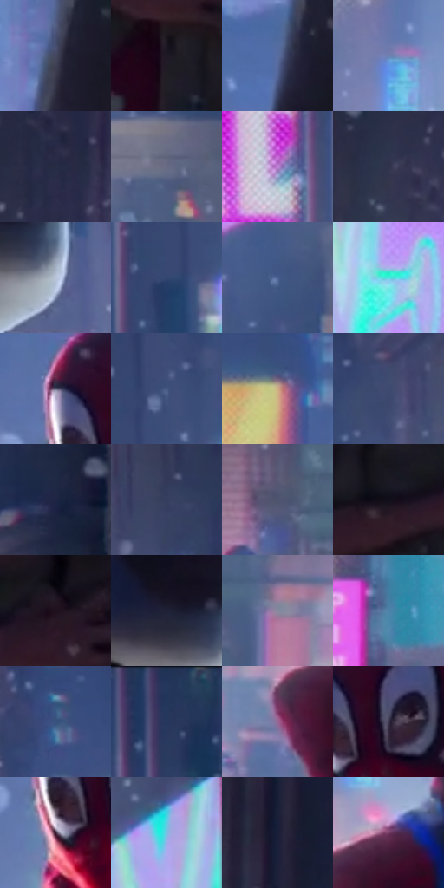

# 电影参考 266

- 状态：条件／活跃；来源世界：miles-home。
- 视角：low-angle；景别：full-body；场景：street。
- 时段：night-appearance（外观依据，中置信度；具体时间／晨昏未知）；光照：night-mixed。
- 材质候选：fabric, metal, screen, asphalt（帧级，不是像素分割）。
- 明暗组：dark；L* P5/P50/P95：7.23201 / 35.31381 / 79.74461。
- 资格门禁：motion。
- 原截图 SHA-256：`b0e0d14b62275610973e70f6d5e03f3a314550dccc1a0ffe238bc0b7311c5dc1`；尺寸：2880 × 1206。
- sRGB 像素 SHA-256：`6e6e0bd7af74890ce2398a92a410b6513d97be2818e58d61a9990e2c2bb7191a`。

## 观察与迁移

现有腾空姿态与背后夜城，条线须先区分实体与动势。

266  /  夜街动作；布料与彩光  /  人物被局部彩光分离，暗部仍保持衣物体积，远楼有中间层次  /  面罩与雪人道具不可作裸脸模型；不新增雪或道具

本公开版保存32个128×128原像素色卡上下文；图集格子并非原场景相邻位置。原rect、图集tile和像素SHA见 `data/palette-crops.json`。上下文不足时不得批准替色，不能以小样推断完整构图。

## 实测色卡

颜色比例分母为保留采样像素，不是材料面积；全部 32 色参与全库匹配。表内四舍五入仅用于阅读，原精度在 JSON。

| ID | HEX | Lab | 原图 xy | 像素数 | 比例 | 明度角色 |
| --- | --- | --- | --- | ---: | ---: | --- |
| 266-S01 | #45475E | [30.83018, 4.970166, -13.803] | [1460, 264] | 9883 | 5.111562% | shadow |
| 266-S02 | #1F1925 | [9.954668, 6.038913, -7.128692] | [1648, 1008] | 9340 | 4.830718% | deep-shadow |
| 266-S03 | #586DA0 | [46.377199, 6.262344, -29.996314] | [1416, 412] | 8750 | 4.525566% | midtone |
| 266-S04 | #6D81B2 | [54.201535, 5.28238, -28.176641] | [1152, 872] | 8328 | 4.307304% | midtone |
| 266-S05 | #272C45 | [18.636962, 5.329875, -16.36465] | [444, 140] | 8129 | 4.204380% | deep-shadow |
| 266-S06 | #696B85 | [45.922921, 5.17462, -14.57264] | [2516, 1048] | 8066 | 4.171796% | midtone |
| 266-S07 | #BF84D7 | [63.742426, 37.120453, -33.742882] | [2108, 232] | 7968 | 4.121109% | light |
| 266-S08 | #31334D | [22.146736, 6.386636, -16.235649] | [380, 280] | 7044 | 3.643210% | shadow |
| 266-S09 | #B9C4D9 | [78.927648, 0.469286, -11.736989] | [2012, 632] | 7009 | 3.625107% | light |
| 266-S10 | #324771 | [30.342662, 5.219021, -26.735502] | [2268, 448] | 6929 | 3.583731% | shadow |
| 266-S11 | #4D6392 | [42.117187, 5.171075, -28.394675] | [2528, 836] | 6748 | 3.490116% | midtone |
| 266-S12 | #50E5DF | [83.477596, -40.126741, -8.665761] | [2412, 652] | 6668 | 3.448740% | highlight |
| 266-S13 | #5B5F76 | [40.761614, 3.889243, -13.466115] | [1276, 564] | 6646 | 3.437361% | midtone |
| 266-S14 | #455782 | [37.285072, 5.497823, -26.30569] | [2320, 348] | 6399 | 3.309611% | shadow |
| 266-S15 | #CEAE85 | [72.950677, 5.780801, 25.388704] | [1140, 188] | 6377 | 3.298232% | light |
| 266-S16 | #3F4A6E | [31.987675, 5.809213, -22.202967] | [2436, 192] | 6217 | 3.215479% | shadow |
| 266-S17 | #1E2544 | [15.57281, 7.262427, -20.549149] | [2808, 444] | 6085 | 3.147208% | deep-shadow |
| 266-S18 | #343D5E | [26.376831, 5.984939, -20.809296] | [2616, 172] | 6047 | 3.127554% | shadow |
| 266-S19 | #4E556F | [36.487851, 3.818343, -15.774993] | [644, 1016] | 5796 | 2.997735% | shadow |
| 266-S20 | #120F1A | [4.921307, 3.639231, -6.50176] | [1472, 924] | 5779 | 2.988942% | deep-shadow |
| 266-S21 | #20101E | [6.968331, 11.114554, -6.383093] | [1652, 880] | 5615 | 2.904120% | deep-shadow |
| 266-S22 | #1F2136 | [13.503364, 5.473851, -13.98894] | [1936, 568] | 5431 | 2.808954% | deep-shadow |
| 266-S23 | #85899E | [57.411088, 3.0248, -11.629203] | [808, 1064] | 5252 | 2.716374% | midtone |
| 266-S24 | #5182AB | [52.567943, -4.622962, -26.807292] | [928, 584] | 4922 | 2.545695% | midtone |
| 266-S25 | #39557F | [35.788001, 2.671568, -26.863456] | [952, 112] | 4722 | 2.442254% | shadow |
| 266-S26 | #24375C | [23.269991, 5.007811, -24.468904] | [2228, 28] | 4662 | 2.411221% | shadow |
| 266-S27 | #956895 | [50.050263, 25.82974, -17.39396] | [1108, 1124] | 4371 | 2.260714% | midtone |
| 266-S28 | #3F3850 | [25.150383, 8.864269, -13.476687] | [1364, 620] | 4226 | 2.185719% | shadow |
| 266-S29 | #3A1F34 | [16.143047, 16.873287, -8.222025] | [1292, 672] | 3842 | 1.987111% | deep-shadow |
| 266-S30 | #79C2E4 | [74.980297, -13.830068, -23.998722] | [2580, 312] | 3204 | 1.657133% | light |
| 266-S31 | #151830 | [9.206371, 6.773005, -16.486944] | [56, 176] | 1840 | 0.951662% | deep-shadow |
| 266-S32 | #793F68 | [35.24245, 31.078346, -12.87493] | [1196, 1040] | 1051 | 0.543585% | shadow |

## 色阶与空间分布

- 采样 ROI：`[0.01, 0.02, 0.98, 0.94]`；步长：4；样本数：193346。
- 排除区：`[]`。
- 深暗、暗、中、亮、高光五段计数：`[45086, 65769, 50714, 22512, 9265]`。
- RGB 各 256 箱、L* 100 箱、13×5 色相明度表和 3×3 空间统计全部保存在 [总数据](../film-library.json)。
- [可视化档案](../../references/library.html)按需绘制直方图，不存 2,094 张重复图表图片。

## 纹理特征占比

**这是分块图像特征的面积占比，不是波点／排线／丝网／错版的精确语义覆盖率。** 窗格、发丝、织物也会产生方向或周期特征。
原图 ROI 像素 3098546；已测块覆盖 3098546（100.0000%）；未测 0。

| 特征 | 块覆盖像素 | 占已测面积 | 阈值敏感范围 |
| --- | ---: | ---: | --- |
| low-contrast | 0 | 0.0000% | 0.0000% ~ 0.0000% |
| directional-structure | 387712 | 12.5127% | 2.9950% ~ 26.5431% |
| periodic-structure | 2596146 | 83.7859% | 71.8706% ~ 88.6357% |
| mixed-detail | 114688 | 3.7013% | 1.5863% ~ 8.3693% |

阈值敏感范围不是统计置信区间。逐块坐标、尺度、对比、方向一致性、频谱集中度、频率与角度见 [全量特征记录](../texture-features.jsonl)，以帧号定位。
四种印刷层的真实像素覆盖仍标为 `null`，不能填 0，也不能拿上表代替。不得据这些代理测量删除唯一证据。

[测量方法与保留策略](../../references/library-retention.md) · [分类索引](../archive/README.md)
