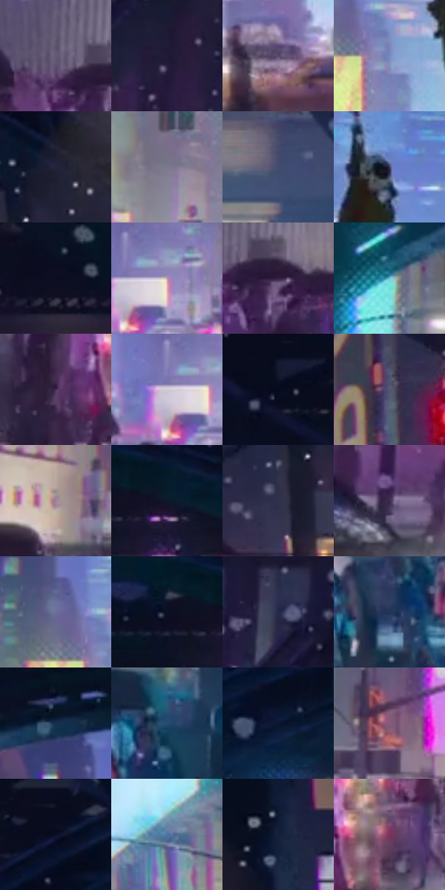

# 电影参考 267

- 状态：常规／活跃；来源世界：miles-home。
- 视角：near-level；景别：environment-wide；场景：street。
- 时段：night-appearance（外观依据，中置信度；具体时间／晨昏未知）；光照：night-mixed。
- 材质候选：skin, fabric, asphalt, glass, painted-metal, metal, screen（帧级，不是像素分割）。
- 明暗组：dark；L* P5/P50/P95：4.96379 / 27.31026 / 73.42138。
- 资格门禁：无附加门禁。
- 原截图 SHA-256：`9a9f29081a66e2eda3be53034f61c10938239866522afe556b6cc98f7b6be7ce`；尺寸：2880 × 1202。
- sRGB 像素 SHA-256：`89e72d8b5518828533afbd2190886c1beafa2958e34e9549cc428af21649d5cd`。

## 观察与迁移

湿街、桥架、车流和人群，灯光反射有方向与中断。

267  /  夜景空间；金属与湿地  /  深色桥拱框住较亮街道，近车／人群／远楼分层，路面破碎反光  /  源照无桥、雨水或人群不增造；小脸不补高清细节

本公开版保存32个128×128原像素色卡上下文；图集格子并非原场景相邻位置。原rect、图集tile和像素SHA见 `data/palette-crops.json`。上下文不足时不得批准替色，不能以小样推断完整构图。

## 实测色卡

颜色比例分母为保留采样像素，不是材料面积；全部 32 色参与全库匹配。表内四舍五入仅用于阅读，原精度在 JSON。

| ID | HEX | Lab | 原图 xy | 像素数 | 比例 | 明度角色 |
| --- | --- | --- | --- | ---: | ---: | --- |
| 267-S01 | #665A76 | [40.320223, 10.862352, -14.047591] | [480, 852] | 8936 | 4.638512% | midtone |
| 267-S02 | #221B38 | [12.020202, 11.633287, -17.725413] | [284, 532] | 8861 | 4.599581% | deep-shadow |
| 267-S03 | #544565 | [31.989776, 13.474067, -16.360169] | [1384, 904] | 8526 | 4.425688% | shadow |
| 267-S04 | #768AC1 | [57.920478, 6.706431, -30.912451] | [1344, 444] | 8169 | 4.240376% | midtone |
| 267-S05 | #23243A | [15.085847, 6.031411, -14.317705] | [2484, 216] | 7930 | 4.116316% | deep-shadow |
| 267-S06 | #7D798E | [51.823149, 5.923426, -10.817756] | [1076, 724] | 7686 | 3.989660% | midtone |
| 267-S07 | #434C6F | [32.939715, 6.030535, -21.32536] | [2444, 696] | 7548 | 3.918027% | shadow |
| 267-S08 | #383F5E | [27.307268, 5.878178, -19.33365] | [1456, 316] | 7530 | 3.908683% | shadow |
| 267-S09 | #071323 | [5.710628, 0.935929, -12.34661] | [148, 28] | 6859 | 3.560380% | deep-shadow |
| 267-S10 | #BA99B6 | [66.975641, 17.299112, -10.407565] | [1692, 828] | 6773 | 3.515739% | light |
| 267-S11 | #342142 | [16.558421, 16.671892, -17.456805] | [548, 884] | 6670 | 3.462273% | deep-shadow |
| 267-S12 | #77C1D9 | [74.233657, -16.769135, -19.187221] | [832, 364] | 6644 | 3.448777% | light |
| 267-S13 | #4A3159 | [24.870576, 19.831194, -19.742123] | [912, 1032] | 6423 | 3.334060% | shadow |
| 267-S14 | #D0CBD6 | [82.366276, 3.737698, -4.834931] | [1644, 832] | 6400 | 3.322121% | highlight |
| 267-S15 | #151931 | [9.612029, 6.385929, -16.573899] | [396, 36] | 6271 | 3.255160% | deep-shadow |
| 267-S16 | #535976 | [38.360448, 4.901992, -17.19295] | [2148, 428] | 6131 | 3.182488% | shadow |
| 267-S17 | #A2809D | [57.611941, 18.165636, -10.489522] | [856, 812] | 6078 | 3.154977% | midtone |
| 267-S18 | #0F172C | [8.094258, 4.14469, -15.338364] | [2060, 68] | 5889 | 3.056871% | deep-shadow |
| 267-S19 | #31324D | [21.835117, 7.077932, -16.720422] | [2416, 328] | 5570 | 2.891284% | shadow |
| 267-S20 | #3D2C4E | [21.370235, 15.689443, -18.022961] | [220, 1024] | 5470 | 2.839375% | shadow |
| 267-S21 | #6A6F98 | [47.879105, 7.985747, -22.848579] | [1280, 388] | 5455 | 2.831589% | midtone |
| 267-S22 | #0D1227 | [6.003305, 4.778937, -14.901313] | [1964, 52] | 5420 | 2.813421% | deep-shadow |
| 267-S23 | #242749 | [17.022208, 9.376164, -21.656757] | [152, 412] | 5150 | 2.673269% | deep-shadow |
| 267-S24 | #213457 | [21.825143, 4.483102, -23.474559] | [2432, 972] | 5094 | 2.644201% | shadow |
| 267-S25 | #152F4D | [18.919845, 1.37799, -21.431054] | [1236, 196] | 4740 | 2.460446% | deep-shadow |
| 267-S26 | #274B73 | [31.115422, 0.817207, -26.81586] | [2600, 916] | 4488 | 2.329637% | shadow |
| 267-S27 | #060D1E | [3.796173, 2.205076, -11.405638] | [812, 28] | 4406 | 2.287073% | deep-shadow |
| 267-S28 | #845B7D | [44.044411, 22.668169, -12.358229] | [716, 688] | 4224 | 2.192600% | midtone |
| 267-S29 | #0B0E20 | [4.421337, 3.704467, -11.992119] | [632, 56] | 4062 | 2.108509% | deep-shadow |
| 267-S30 | #4D729A | [46.901398, -1.477732, -25.695234] | [1876, 676] | 3717 | 1.929426% | midtone |
| 267-S31 | #13203A | [12.459908, 4.080983, -18.535673] | [2764, 196] | 3297 | 1.711411% | deep-shadow |
| 267-S32 | #79335C | [32.271794, 35.600536, -9.733898] | [1020, 988] | 2231 | 1.158071% | shadow |

## 色阶与空间分布

- 采样 ROI：`[0.01, 0.02, 0.98, 0.94]`；步长：4；样本数：192648。
- 排除区：`[]`。
- 深暗、暗、中、亮、高光五段计数：`[71431, 59854, 37976, 17288, 6099]`。
- RGB 各 256 箱、L* 100 箱、13×5 色相明度表和 3×3 空间统计全部保存在 [总数据](../film-library.json)。
- [可视化档案](../../references/library.html)按需绘制直方图，不存 2,094 张重复图表图片。

## 纹理特征占比

**这是分块图像特征的面积占比，不是波点／排线／丝网／错版的精确语义覆盖率。** 窗格、发丝、织物也会产生方向或周期特征。
原图 ROI 像素 3087370；已测块覆盖 3087370（100.0000%）；未测 0。

| 特征 | 块覆盖像素 | 占已测面积 | 阈值敏感范围 |
| --- | ---: | ---: | --- |
| low-contrast | 0 | 0.0000% | 0.0000% ~ 0.0000% |
| directional-structure | 125056 | 4.0506% | 0.5307% ~ 10.3648% |
| periodic-structure | 2604682 | 84.3657% | 78.1427% ~ 86.0117% |
| mixed-detail | 357632 | 11.5837% | 3.6235% ~ 21.3266% |

阈值敏感范围不是统计置信区间。逐块坐标、尺度、对比、方向一致性、频谱集中度、频率与角度见 [全量特征记录](../texture-features.jsonl)，以帧号定位。
四种印刷层的真实像素覆盖仍标为 `null`，不能填 0，也不能拿上表代替。不得据这些代理测量删除唯一证据。

[测量方法与保留策略](../../references/library-retention.md) · [分类索引](../archive/README.md)
