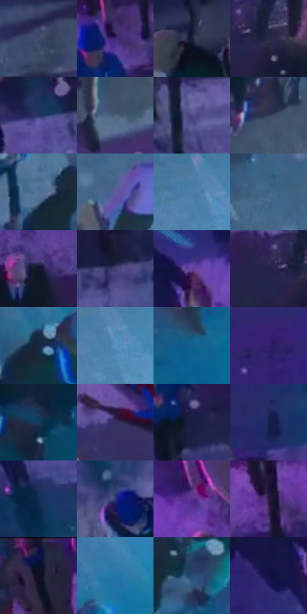

# 电影参考 268

- 状态：常规／活跃；来源世界：miles-home。
- 视角：high-angle；景别：environment-wide；场景：street。
- 时段：night-appearance（外观依据，中置信度；具体时间／晨昏未知）；光照：night-mixed。
- 材质候选：skin, fabric, asphalt, glass, painted-metal, metal, screen（帧级，不是像素分割）。
- 明暗组：dark；L* P5/P50/P95：9.00576 / 25.49058 / 52.30144。
- 资格门禁：无附加门禁。
- 原截图 SHA-256：`8f580cee7d53c7a7b103191488d2ed5b3657c860456463cf9b9e15beb87b9d93`；尺寸：2880 × 1208。
- sRGB 像素 SHA-256：`7c05c9c7781b02ddfa095b700796d9856259ffef0f2ddbd80ba0a53ae35de174`。

## 观察与迁移

湿街、桥架、车流和人群，灯光反射有方向与中断。

268  /  俯视街景；投影与表面  /  斑马线、雨伞和人物有不同材质；长投影与路面磨损分开  /  投影不是排线，不移植倒地姿势或伤害

本公开版保存32个128×128原像素色卡上下文；图集格子并非原场景相邻位置。原rect、图集tile和像素SHA见 `data/palette-crops.json`。上下文不足时不得批准替色，不能以小样推断完整构图。

## 实测色卡

颜色比例分母为保留采样像素，不是材料面积；全部 32 色参与全库匹配。表内四舍五入仅用于阅读，原精度在 JSON。

| ID | HEX | Lab | 原图 xy | 像素数 | 比例 | 明度角色 |
| --- | --- | --- | --- | ---: | ---: | --- |
| 268-S01 | #425070 | [34.117865, 3.452266, -20.127268] | [1560, 484] | 8079 | 4.178519% | shadow |
| 268-S02 | #422975 | [23.764544, 30.409001, -39.708361] | [1292, 80] | 7954 | 4.113868% | shadow |
| 268-S03 | #171F35 | [12.084009, 3.964344, -15.549024] | [1016, 960] | 7775 | 4.021288% | deep-shadow |
| 268-S04 | #272D48 | [19.122763, 5.640212, -17.648088] | [1724, 152] | 7599 | 3.930260% | deep-shadow |
| 268-S05 | #262E62 | [21.009224, 14.105395, -31.997905] | [928, 332] | 7290 | 3.770443% | shadow |
| 268-S06 | #4C617C | [40.476351, -0.571431, -17.658983] | [1772, 500] | 7269 | 3.759581% | midtone |
| 268-S07 | #4E4986 | [34.201754, 18.278261, -33.574175] | [1484, 304] | 7051 | 3.646830% | shadow |
| 268-S08 | #353D59 | [26.202223, 4.681604, -17.825506] | [1840, 392] | 7001 | 3.620970% | shadow |
| 268-S09 | #537399 | [47.49408, -0.831348, -24.160764] | [2348, 848] | 6884 | 3.560456% | midtone |
| 268-S10 | #5E5F94 | [42.310206, 13.045772, -29.201259] | [2260, 316] | 6837 | 3.536148% | midtone |
| 268-S11 | #4C7FAC | [51.48739, -3.692758, -29.08067] | [2632, 152] | 6830 | 3.532527% | midtone |
| 268-S12 | #3C6184 | [39.873862, -2.446045, -23.52782] | [2176, 228] | 6787 | 3.510287% | shadow |
| 268-S13 | #12182C | [8.684829, 4.265008, -14.389729] | [1476, 96] | 6726 | 3.478738% | deep-shadow |
| 268-S14 | #423E70 | [28.832497, 15.266008, -28.409266] | [1060, 324] | 6665 | 3.447188% | shadow |
| 268-S15 | #67409F | [36.086604, 37.538028, -45.639469] | [404, 428] | 6637 | 3.432706% | shadow |
| 268-S16 | #24234A | [15.857517, 12.641812, -24.194618] | [1664, 144] | 6611 | 3.419259% | deep-shadow |
| 268-S17 | #17273C | [15.272086, 0.765295, -15.496668] | [2524, 740] | 6383 | 3.301335% | deep-shadow |
| 268-S18 | #5B8FBE | [57.640849, -3.922649, -29.768675] | [2668, 184] | 6081 | 3.145139% | midtone |
| 268-S19 | #11618D | [38.881824, -6.064892, -30.630695] | [2600, 960] | 6041 | 3.124450% | shadow |
| 268-S20 | #31206A | [18.912681, 28.823842, -40.575279] | [132, 416] | 5717 | 2.956875% | deep-shadow |
| 268-S21 | #143C5B | [24.113837, -2.057859, -22.532849] | [2140, 1108] | 5403 | 2.794472% | shadow |
| 268-S22 | #363060 | [22.801153, 16.130856, -27.745426] | [1412, 736] | 5219 | 2.699306% | shadow |
| 268-S23 | #181D40 | [12.240623, 10.078044, -23.099955] | [1308, 232] | 5203 | 2.691031% | deep-shadow |
| 268-S24 | #17224C | [14.667292, 10.938566, -27.529652] | [364, 704] | 5125 | 2.650688% | deep-shadow |
| 268-S25 | #122E53 | [18.829135, 4.059036, -25.616968] | [904, 500] | 5081 | 2.627931% | deep-shadow |
| 268-S26 | #2D3B6D | [26.126382, 10.699671, -30.898969] | [716, 756] | 4801 | 2.483113% | shadow |
| 268-S27 | #5B2C87 | [28.836711, 39.4847, -42.705451] | [500, 160] | 4468 | 2.310883% | shadow |
| 268-S28 | #2C194A | [13.972795, 21.884115, -27.169824] | [1132, 112] | 4442 | 2.297436% | deep-shadow |
| 268-S29 | #0F1020 | [5.206512, 3.894171, -10.771909] | [1004, 64] | 4263 | 2.204856% | deep-shadow |
| 268-S30 | #2375A6 | [46.752382, -6.840681, -33.094573] | [2640, 632] | 4221 | 2.183133% | midtone |
| 268-S31 | #254D74 | [31.718683, -0.505938, -26.499143] | [2452, 876] | 4093 | 2.116930% | shadow |
| 268-S32 | #131347 | [9.47317, 19.359911, -32.51484] | [328, 504] | 2810 | 1.453353% | deep-shadow |

## 色阶与空间分布

- 采样 ROI：`[0.01, 0.02, 0.98, 0.94]`；步长：4；样本数：193346。
- 排除区：`[]`。
- 深暗、暗、中、亮、高光五段计数：`[63650, 89761, 38511, 1412, 12]`。
- RGB 各 256 箱、L* 100 箱、13×5 色相明度表和 3×3 空间统计全部保存在 [总数据](../film-library.json)。
- [可视化档案](../../references/library.html)按需绘制直方图，不存 2,094 张重复图表图片。

## 纹理特征占比

**这是分块图像特征的面积占比，不是波点／排线／丝网／错版的精确语义覆盖率。** 窗格、发丝、织物也会产生方向或周期特征。
原图 ROI 像素 3104134；已测块覆盖 3104134（100.0000%）；未测 0。

| 特征 | 块覆盖像素 | 占已测面积 | 阈值敏感范围 |
| --- | ---: | ---: | --- |
| low-contrast | 0 | 0.0000% | 0.0000% ~ 0.7175% |
| directional-structure | 81920 | 2.6391% | 1.0556% ~ 7.9172% |
| periodic-structure | 2785792 | 89.7446% | 86.7468% ~ 89.7446% |
| mixed-detail | 236422 | 7.6164% | 3.8844% ~ 11.4801% |

阈值敏感范围不是统计置信区间。逐块坐标、尺度、对比、方向一致性、频谱集中度、频率与角度见 [全量特征记录](../texture-features.jsonl)，以帧号定位。
四种印刷层的真实像素覆盖仍标为 `null`，不能填 0，也不能拿上表代替。不得据这些代理测量删除唯一证据。

[测量方法与保留策略](../../references/library-retention.md) · [分类索引](../archive/README.md)
