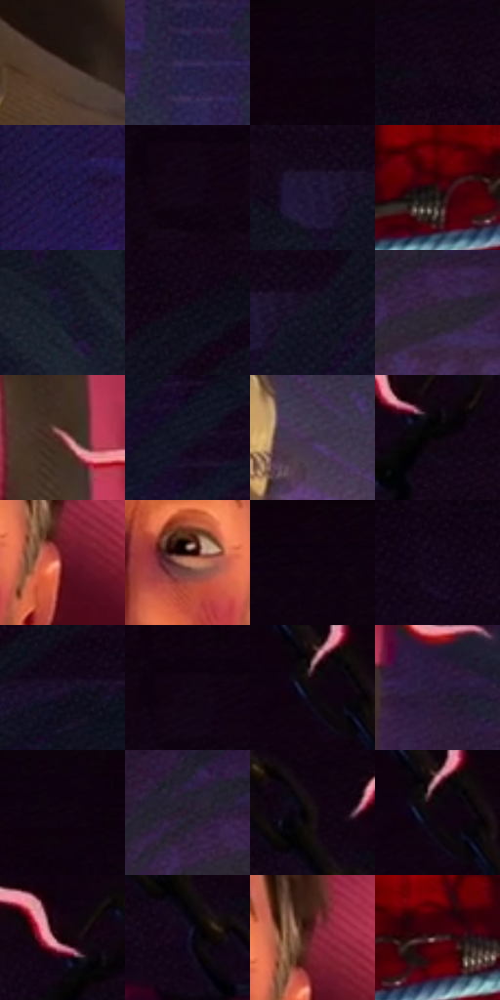

# 电影参考 269

- 状态：条件／活跃；来源世界：miles-home。
- 视角：near-level；景别：medium；场景：portrait。
- 时段：interior-time-unknown（外观依据，中置信度；具体时间／晨昏未知）；光照：interior-mixed。
- 材质候选：skin, hair, fabric, wood（帧级，不是像素分割）。
- 明暗组：very-dark；L* P5/P50/P95：1.47341 / 8.852 / 40.69541。
- 资格门禁：sense。
- 原截图 SHA-256：`8bfecec3a41bfdff5782209ae945373b4ef62f58426e0ba5bdb798e01ed4a0e5`；尺寸：2880 × 1206。
- sRGB 像素 SHA-256：`bd34166e47dda885082307805c7534a8fd1574a9b1408c2373f9961fcd0ed510`。

## 观察与迁移

暖面光和头周感知线，线与束缚实体分开。

269  /  头周感应图形；成人面部与暖下照  /  彼得长脸、鼻梁、眉形和下颌体块；短波浪线分段放射，粗细有变化  /  只学习线形；当次有蜘蛛感应口令时单人可用一组头周短线；不借入瘀伤、闭眼、绑缚

本公开版保存32个128×128原像素色卡上下文；图集格子并非原场景相邻位置。原rect、图集tile和像素SHA见 `data/palette-crops.json`。上下文不足时不得批准替色，不能以小样推断完整构图。

## 实测色卡

颜色比例分母为保留采样像素，不是材料面积；全部 32 色参与全库匹配。表内四舍五入仅用于阅读，原精度在 JSON。

| ID | HEX | Lab | 原图 xy | 像素数 | 比例 | 明度角色 |
| --- | --- | --- | --- | ---: | ---: | --- |
| 269-S01 | #4E3C35 | [27.04226, 6.693127, 7.345711] | [1800, 856] | 10237 | 5.294653% | shadow |
| 269-S02 | #322850 | [19.118327, 15.316683, -22.998765] | [2236, 896] | 10005 | 5.174661% | deep-shadow |
| 269-S03 | #0F0210 | [1.647609, 5.688015, -4.437352] | [500, 28] | 9098 | 4.705554% | deep-shadow |
| 269-S04 | #140719 | [3.350115, 7.6761, -7.992219] | [2680, 200] | 9020 | 4.665212% | deep-shadow |
| 269-S05 | #241942 | [12.37472, 17.060153, -24.225641] | [56, 812] | 8418 | 4.353853% | deep-shadow |
| 269-S06 | #110514 | [2.513236, 6.030996, -5.588397] | [2812, 116] | 8310 | 4.297994% | deep-shadow |
| 269-S07 | #1B1331 | [8.310483, 12.889233, -18.607667] | [2248, 380] | 8092 | 4.185243% | deep-shadow |
| 269-S08 | #321015 | [9.821735, 17.800789, 4.976274] | [1448, 996] | 7551 | 3.905434% | deep-shadow |
| 269-S09 | #1D1E32 | [12.090041, 5.621018, -13.349054] | [408, 644] | 7283 | 3.766822% | deep-shadow |
| 269-S10 | #0F0F1B | [4.718061, 2.832184, -7.614497] | [2448, 268] | 6890 | 3.563560% | deep-shadow |
| 269-S11 | #131423 | [6.865689, 4.078002, -10.495507] | [2320, 384] | 6803 | 3.518563% | deep-shadow |
| 269-S12 | #2C2635 | [16.398574, 6.51224, -8.702133] | [880, 760] | 6780 | 3.506667% | deep-shadow |
| 269-S13 | #8F5255 | [42.048578, 25.783033, 9.343552] | [1840, 576] | 6551 | 3.388226% | midtone |
| 269-S14 | #171828 | [8.895994, 4.499832, -11.063949] | [2644, 484] | 6484 | 3.353573% | deep-shadow |
| 269-S15 | #3D304A | [22.303838, 11.906352, -13.886079] | [2016, 1080] | 6157 | 3.184447% | shadow |
| 269-S16 | #090209 | [1.095016, 2.803767, -2.003929] | [1176, 212] | 6151 | 3.181343% | deep-shadow |
| 269-S17 | #5F0B10 | [18.844769, 36.314566, 21.713358] | [1632, 560] | 6088 | 3.148759% | deep-shadow |
| 269-S18 | #BF806B | [59.506127, 21.870267, 21.337188] | [1520, 548] | 6004 | 3.105314% | midtone |
| 269-S19 | #110310 | [2.002833, 6.001183, -3.899553] | [824, 28] | 5683 | 2.939290% | deep-shadow |
| 269-S20 | #17091D | [4.211625, 9.405064, -9.864819] | [156, 276] | 5516 | 2.852917% | deep-shadow |
| 269-S21 | #1B0F29 | [6.63689, 12.819759, -15.321406] | [2528, 372] | 4786 | 2.475355% | deep-shadow |
| 269-S22 | #130415 | [2.52417, 7.443416, -6.22737] | [2804, 84] | 4761 | 2.462425% | deep-shadow |
| 269-S23 | #64404C | [31.574476, 17.595116, -0.770885] | [1568, 44] | 4502 | 2.328468% | shadow |
| 269-S24 | #2C1C3D | [13.843759, 15.901145, -18.309485] | [1968, 696] | 4354 | 2.251921% | deep-shadow |
| 269-S25 | #0D030F | [1.672806, 4.454048, -3.874991] | [528, 28] | 4121 | 2.131412% | deep-shadow |
| 269-S26 | #25192D | [11.12109, 10.81682, -11.163704] | [836, 708] | 4115 | 2.128309% | deep-shadow |
| 269-S27 | #190F11 | [5.318802, 4.638888, 0.468539] | [1720, 188] | 3988 | 2.062623% | deep-shadow |
| 269-S28 | #0D090D | [2.800236, 1.70609, -1.219229] | [1576, 52] | 3843 | 1.987628% | deep-shadow |
| 269-S29 | #130209 | [1.821236, 6.060672, -0.856368] | [1140, 168] | 3705 | 1.916254% | deep-shadow |
| 269-S30 | #140D24 | [5.09388, 8.797099, -13.987115] | [1720, 268] | 3072 | 1.588861% | deep-shadow |
| 269-S31 | #6E2630 | [26.492834, 32.79183, 10.649498] | [1632, 508] | 2994 | 1.548519% | shadow |
| 269-S32 | #462225 | [18.27675, 17.515667, 5.744937] | [1540, 984] | 1984 | 1.026140% | deep-shadow |

## 色阶与空间分布

- 采样 ROI：`[0.01, 0.02, 0.98, 0.94]`；步长：4；样本数：193346。
- 排除区：`[]`。
- 深暗、暗、中、亮、高光五段计数：`[152487, 30825, 6523, 3455, 56]`。
- RGB 各 256 箱、L* 100 箱、13×5 色相明度表和 3×3 空间统计全部保存在 [总数据](../film-library.json)。
- [可视化档案](../../references/library.html)按需绘制直方图，不存 2,094 张重复图表图片。

## 纹理特征占比

**这是分块图像特征的面积占比，不是波点／排线／丝网／错版的精确语义覆盖率。** 窗格、发丝、织物也会产生方向或周期特征。
原图 ROI 像素 3098546；已测块覆盖 3098546（100.0000%）；未测 0。

| 特征 | 块覆盖像素 | 占已测面积 | 阈值敏感范围 |
| --- | ---: | ---: | --- |
| low-contrast | 649728 | 20.9688% | 14.6236% ~ 32.4421% |
| directional-structure | 393088 | 12.6862% | 2.9950% ~ 22.5551% |
| periodic-structure | 1591168 | 51.3521% | 44.2220% ~ 54.9626% |
| mixed-detail | 464562 | 14.9929% | 7.8587% ~ 20.3409% |

阈值敏感范围不是统计置信区间。逐块坐标、尺度、对比、方向一致性、频谱集中度、频率与角度见 [全量特征记录](../texture-features.jsonl)，以帧号定位。
四种印刷层的真实像素覆盖仍标为 `null`，不能填 0，也不能拿上表代替。不得据这些代理测量删除唯一证据。

[测量方法与保留策略](../../references/library-retention.md) · [分类索引](../archive/README.md)
