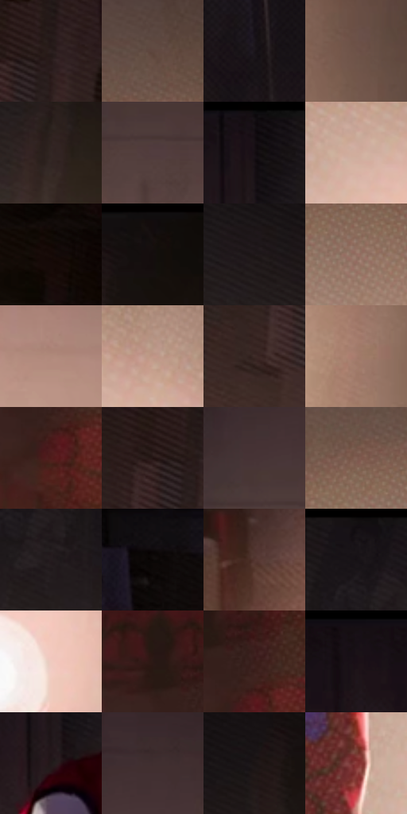

# 电影参考 270

- 状态：常规／活跃；来源世界：miles-home。
- 视角：near-level；景别：medium；场景：interior。
- 时段：interior-time-unknown（外观依据，中置信度；具体时间／晨昏未知）；光照：interior-mixed。
- 材质候选：skin, hair, fabric, wood, metal, paint（帧级，不是像素分割）。
- 明暗组：very-dark；L* P5/P50/P95：3.41962 / 17.1419 / 72.02074。
- 资格门禁：无附加门禁。
- 原截图 SHA-256：`246b090e6f4e2e5ee40e8ef7896a283c3e9b270432f4d1cc8f48f2f52d029e06`；尺寸：2880 × 1214。
- sRGB 像素 SHA-256：`21010d117ce4fd8944e00c16568da23da734d17a51fcbe4a7458b65e26da7860`。

## 观察与迁移

冷蓝暗部与暖灯双侧作用，明亮灯晕不掩盖人物结构。

270  /  低照度室内；面罩与灯光  /  暖灯雾与暗衣形成层级，局部亮边仍区别衣料  /  面罩白色眼孔不是眼球比例，不据此放大真实眼睛

本公开版保存32个128×128原像素色卡上下文；图集格子并非原场景相邻位置。原rect、图集tile和像素SHA见 `data/palette-crops.json`。上下文不足时不得批准替色，不能以小样推断完整构图。

## 实测色卡

颜色比例分母为保留采样像素，不是材料面积；全部 32 色参与全库匹配。表内四舍五入仅用于阅读，原精度在 JSON。

| ID | HEX | Lab | 原图 xy | 像素数 | 比例 | 明度角色 |
| --- | --- | --- | --- | ---: | ---: | --- |
| 270-S01 | #2B201F | [13.505349, 5.10417, 2.705221] | [2540, 172] | 8638 | 4.435612% | deep-shadow |
| 270-S02 | #5F473F | [32.477369, 8.973689, 8.78398] | [1896, 468] | 8065 | 4.141377% | shadow |
| 270-S03 | #1A1419 | [7.137147, 4.119604, -2.366722] | [440, 480] | 7842 | 4.026866% | deep-shadow |
| 270-S04 | #6D5248 | [37.39766, 9.703433, 10.229791] | [2448, 860] | 7728 | 3.968327% | shadow |
| 270-S05 | #322625 | [16.4938, 5.445859, 2.81224] | [2104, 280] | 7726 | 3.967300% | deep-shadow |
| 270-S06 | #523D3F | [28.088741, 9.551431, 2.341433] | [1136, 552] | 7581 | 3.892843% | shadow |
| 270-S07 | #120D10 | [4.099747, 2.27354, -0.827368] | [1352, 28] | 7097 | 3.644309% | deep-shadow |
| 270-S08 | #D1AC9D | [73.21763, 11.200934, 12.780081] | [1908, 856] | 7096 | 3.643795% | light |
| 270-S09 | #150908 | [3.36359, 3.967989, 1.825877] | [2804, 268] | 6762 | 3.472286% | deep-shadow |
| 270-S10 | #18100F | [5.413348, 3.219631, 1.704786] | [2192, 44] | 6711 | 3.446098% | deep-shadow |
| 270-S11 | #1F1719 | [8.775647, 4.457095, 0.114574] | [1880, 92] | 6580 | 3.378829% | deep-shadow |
| 270-S12 | #946F62 | [50.153792, 12.754681, 12.937335] | [1924, 620] | 6543 | 3.359830% | midtone |
| 270-S13 | #AF8A7B | [60.53584, 11.829344, 13.403479] | [996, 984] | 6523 | 3.349560% | light |
| 270-S14 | #C09788 | [65.841209, 13.136046, 13.767467] | [2056, 796] | 6375 | 3.273562% | light |
| 270-S15 | #3D2A27 | [19.202142, 8.338278, 5.454398] | [2436, 348] | 6312 | 3.241211% | deep-shadow |
| 270-S16 | #A57B6D | [55.350165, 14.348945, 14.030023] | [2332, 988] | 6240 | 3.204239% | midtone |
| 270-S17 | #501C1B | [18.433557, 24.354437, 13.250617] | [1500, 976] | 6197 | 3.182159% | deep-shadow |
| 270-S18 | #211210 | [7.166934, 7.355266, 3.862497] | [2484, 180] | 6069 | 3.116431% | deep-shadow |
| 270-S19 | #463336 | [23.459638, 9.112546, 1.44647] | [1096, 476] | 6055 | 3.109242% | shadow |
| 270-S20 | #816054 | [43.76141, 11.624487, 12.07671] | [1848, 548] | 6000 | 3.080999% | midtone |
| 270-S21 | #241C1F | [11.307205, 4.571833, -0.590347] | [1712, 156] | 5867 | 3.012704% | deep-shadow |
| 270-S22 | #0A0606 | [1.878276, 1.045893, 0.368752] | [312, 128] | 5785 | 2.970597% | deep-shadow |
| 270-S23 | #553630 | [26.108645, 13.047335, 9.473844] | [400, 904] | 5498 | 2.823223% | shadow |
| 270-S24 | #140F14 | [4.885779, 2.927267, -2.091917] | [1664, 28] | 5277 | 2.709739% | deep-shadow |
| 270-S25 | #EFCABF | [84.150532, 11.349471, 10.347264] | [2108, 1048] | 5245 | 2.693307% | highlight |
| 270-S26 | #2B1815 | [10.712224, 9.104481, 6.051743] | [1440, 852] | 4937 | 2.535149% | deep-shadow |
| 270-S27 | #3A1D1A | [14.696486, 13.779377, 8.296017] | [1512, 904] | 4820 | 2.475070% | deep-shadow |
| 270-S28 | #171116 | [5.790074, 3.659759, -2.114428] | [1140, 28] | 4809 | 2.469421% | deep-shadow |
| 270-S29 | #22191A | [9.87585, 4.690168, 1.009518] | [1340, 204] | 4665 | 2.395477% | deep-shadow |
| 270-S30 | #402E30 | [21.047139, 8.615068, 1.940665] | [1172, 412] | 4438 | 2.278913% | shadow |
| 270-S31 | #1A1414 | [6.959452, 2.872314, 1.012953] | [2100, 100] | 3311 | 1.700198% | deep-shadow |
| 270-S32 | #873736 | [34.295543, 34.213206, 17.933185] | [1712, 972] | 1950 | 1.001325% | shadow |

## 色阶与空间分布

- 采样 ROI：`[0.01, 0.02, 0.98, 0.94]`；步长：4；样本数：194742。
- 排除区：`[]`。
- 深暗、暗、中、亮、高光五段计数：`[106731, 42997, 22374, 18874, 3766]`。
- RGB 各 256 箱、L* 100 箱、13×5 色相明度表和 3×3 空间统计全部保存在 [总数据](../film-library.json)。
- [可视化档案](../../references/library.html)按需绘制直方图，不存 2,094 张重复图表图片。

## 纹理特征占比

**这是分块图像特征的面积占比，不是波点／排线／丝网／错版的精确语义覆盖率。** 窗格、发丝、织物也会产生方向或周期特征。
原图 ROI 像素 3120898；已测块覆盖 3120898（100.0000%）；未测 0。

| 特征 | 块覆盖像素 | 占已测面积 | 阈值敏感范围 |
| --- | ---: | ---: | --- |
| low-contrast | 335616 | 10.7538% | 5.1595% ~ 17.9600% |
| directional-structure | 388736 | 12.4559% | 3.5313% ~ 19.5718% |
| periodic-structure | 2137090 | 68.4768% | 59.9950% ~ 72.9678% |
| mixed-detail | 259456 | 8.3135% | 2.3009% ~ 18.5137% |

阈值敏感范围不是统计置信区间。逐块坐标、尺度、对比、方向一致性、频谱集中度、频率与角度见 [全量特征记录](../texture-features.jsonl)，以帧号定位。
四种印刷层的真实像素覆盖仍标为 `null`，不能填 0，也不能拿上表代替。不得据这些代理测量删除唯一证据。

[测量方法与保留策略](../../references/library-retention.md) · [分类索引](../archive/README.md)
