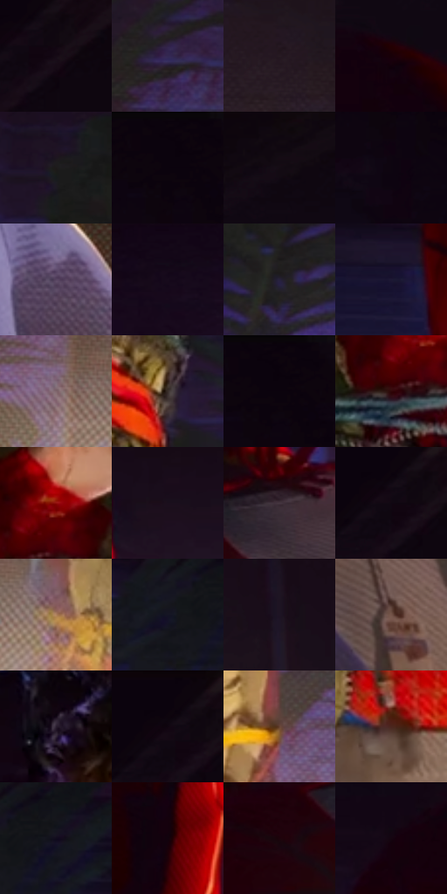

# 电影参考 271

- 状态：常规／活跃；来源世界：miles-home。
- 视角：low-angle；景别：medium；场景：interior。
- 时段：interior-time-unknown（外观依据，中置信度；具体时间／晨昏未知）；光照：interior-mixed。
- 材质候选：skin, hair, fabric, wood, metal, paint（帧级，不是像素分割）。
- 明暗组：very-dark；L* P5/P50/P95：1.55927 / 8.51054 / 45.78676。
- 资格门禁：无附加门禁。
- 原截图 SHA-256：`f2c42bcd59ed07961250510b95c54f90d424ade08f06debcb7aa6acc4da5ce72`；尺寸：2880 × 1206。
- sRGB 像素 SHA-256：`fe914c6190efedcab8be1dd13a6ba10bfa8f18d4d5854cc4f8d8c37d573074ba`。

## 观察与迁移

冷蓝暗部与暖灯双侧作用，明亮灯晕不掩盖人物结构。

271  /  表情／侧面；衣物和绳索  /  鼻额下颌侧轮廓明确，咧嘴时口形变大；绳索紧边与布褶分开  /  只学表情构造，不把惊恐咧嘴变成默认表情

本公开版保存32个128×128原像素色卡上下文；图集格子并非原场景相邻位置。原rect、图集tile和像素SHA见 `data/palette-crops.json`。上下文不足时不得批准替色，不能以小样推断完整构图。

## 实测色卡

颜色比例分母为保留采样像素，不是材料面积；全部 32 色参与全库匹配。表内四舍五入仅用于阅读，原精度在 JSON。

| ID | HEX | Lab | 原图 xy | 像素数 | 比例 | 明度角色 |
| --- | --- | --- | --- | ---: | ---: | --- |
| 271-S01 | #160B16 | [4.226173, 6.171262, -4.410634] | [1652, 92] | 9633 | 4.982260% | deep-shadow |
| 271-S02 | #342953 | [19.803449, 16.191828, -23.914915] | [520, 680] | 9130 | 4.722104% | deep-shadow |
| 271-S03 | #271B22 | [11.488828, 7.41117, -2.493309] | [2632, 576] | 9056 | 4.683831% | deep-shadow |
| 271-S04 | #180008 | [1.912984, 8.981668, -0.254657] | [2052, 240] | 8551 | 4.422641% | deep-shadow |
| 271-S05 | #1D1A1A | [9.598013, 1.461867, 0.529435] | [196, 512] | 8377 | 4.332647% | deep-shadow |
| 271-S06 | #0A020C | [1.214914, 3.498057, -3.08968] | [56, 28] | 8192 | 4.236964% | deep-shadow |
| 271-S07 | #0F070F | [2.601625, 3.499884, -2.501371] | [2168, 28] | 7973 | 4.123695% | deep-shadow |
| 271-S08 | #130815 | [3.308482, 5.841174, -5.082098] | [32, 164] | 7955 | 4.114386% | deep-shadow |
| 271-S09 | #574461 | [31.860628, 14.230579, -13.985388] | [2644, 1028] | 7880 | 4.075595% | shadow |
| 271-S10 | #170B1C | [4.564826, 8.284864, -8.54966] | [1384, 304] | 7695 | 3.979912% | deep-shadow |
| 271-S11 | #26213B | [14.487556, 9.606549, -15.934906] | [308, 716] | 7088 | 3.665967% | deep-shadow |
| 271-S12 | #1D1834 | [10.276715, 10.829279, -17.648721] | [1672, 540] | 6910 | 3.573904% | deep-shadow |
| 271-S13 | #80676E | [46.198764, 11.199526, -0.138597] | [552, 1088] | 6761 | 3.496840% | midtone |
| 271-S14 | #392E2B | [20.037375, 4.423971, 3.809585] | [1132, 664] | 6410 | 3.315300% | shadow |
| 271-S15 | #0D050D | [2.015924, 3.308332, -2.364501] | [80, 28] | 6375 | 3.297198% | deep-shadow |
| 271-S16 | #300608 | [7.012749, 21.234309, 7.66278] | [928, 496] | 6215 | 3.214445% | deep-shadow |
| 271-S17 | #900F0C | [30.155681, 50.062648, 38.468609] | [968, 428] | 6203 | 3.208238% | shadow |
| 271-S18 | #1B0F1D | [5.992334, 8.766834, -7.147133] | [2272, 336] | 6165 | 3.188584% | deep-shadow |
| 271-S19 | #453641 | [24.593078, 8.908225, -4.290263] | [2128, 760] | 6100 | 3.154966% | shadow |
| 271-S20 | #100712 | [2.762257, 4.43107, -3.964283] | [1620, 80] | 5860 | 3.030836% | deep-shadow |
| 271-S21 | #B28460 | [58.801683, 13.113486, 26.307835] | [692, 1104] | 5808 | 3.003941% | midtone |
| 271-S22 | #151424 | [7.109691, 5.290277, -10.860553] | [1376, 532] | 5226 | 2.702926% | deep-shadow |
| 271-S23 | #1E1424 | [8.16213, 9.085455, -9.146803] | [2784, 420] | 5118 | 2.647068% | deep-shadow |
| 271-S24 | #745449 | [38.786629, 11.691026, 11.662425] | [2384, 1084] | 5089 | 2.632069% | shadow |
| 271-S25 | #2A1E30 | [13.437016, 10.053054, -9.707238] | [916, 200] | 4625 | 2.392085% | deep-shadow |
| 271-S26 | #100410 | [2.117483, 5.23544, -3.741907] | [1612, 64] | 4402 | 2.276747% | deep-shadow |
| 271-S27 | #664434 | [32.274838, 12.553577, 15.608427] | [1116, 1104] | 3801 | 1.965906% | shadow |
| 271-S28 | #4B261E | [19.948333, 16.458608, 12.985045] | [872, 916] | 2657 | 1.374220% | deep-shadow |
| 271-S29 | #100C1D | [4.17136, 5.240587, -9.991907] | [1460, 516] | 2397 | 1.239746% | deep-shadow |
| 271-S30 | #12030C | [1.989909, 5.693789, -1.888566] | [2140, 440] | 2359 | 1.220092% | deep-shadow |
| 271-S31 | #1D030B | [3.166677, 10.916593, 0.416328] | [1996, 816] | 2097 | 1.084584% | deep-shadow |
| 271-S32 | #150510 | [2.758765, 6.831501, -2.752085] | [1772, 272] | 1238 | 0.640303% | deep-shadow |

## 色阶与空间分布

- 采样 ROI：`[0.01, 0.02, 0.98, 0.94]`；步长：4；样本数：193346。
- 排除区：`[]`。
- 深暗、暗、中、亮、高光五段计数：`[145424, 33062, 12728, 2028, 104]`。
- RGB 各 256 箱、L* 100 箱、13×5 色相明度表和 3×3 空间统计全部保存在 [总数据](../film-library.json)。
- [可视化档案](../../references/library.html)按需绘制直方图，不存 2,094 张重复图表图片。

## 纹理特征占比

**这是分块图像特征的面积占比，不是波点／排线／丝网／错版的精确语义覆盖率。** 窗格、发丝、织物也会产生方向或周期特征。
原图 ROI 像素 3098546；已测块覆盖 3098546（100.0000%）；未测 0。

| 特征 | 块覆盖像素 | 占已测面积 | 阈值敏感范围 |
| --- | ---: | ---: | --- |
| low-contrast | 1187328 | 38.3189% | 27.7519% ~ 45.0152% |
| directional-structure | 267520 | 8.6337% | 1.9374% ~ 19.7378% |
| periodic-structure | 1485362 | 47.9374% | 43.3561% ~ 51.4528% |
| mixed-detail | 158336 | 5.1100% | 1.0575% ~ 9.6913% |

阈值敏感范围不是统计置信区间。逐块坐标、尺度、对比、方向一致性、频谱集中度、频率与角度见 [全量特征记录](../texture-features.jsonl)，以帧号定位。
四种印刷层的真实像素覆盖仍标为 `null`，不能填 0，也不能拿上表代替。不得据这些代理测量删除唯一证据。

[测量方法与保留策略](../../references/library-retention.md) · [分类索引](../archive/README.md)
