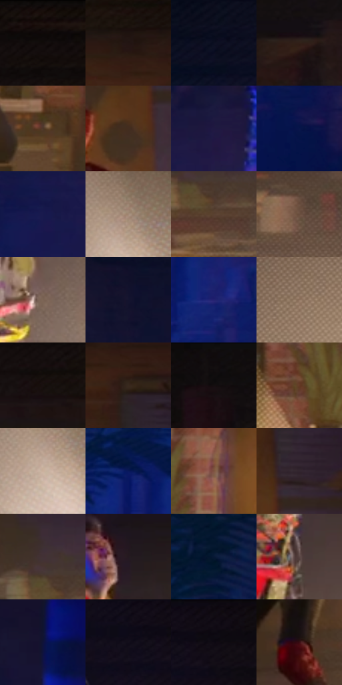

# 电影参考 272

- 状态：常规／活跃；来源世界：miles-home。
- 视角：near-level；景别：environment-wide；场景：interior。
- 时段：interior-time-unknown（外观依据，中置信度；具体时间／晨昏未知）；光照：interior-mixed。
- 材质候选：skin, hair, fabric, wood, metal, paint（帧级，不是像素分割）。
- 明暗组：very-dark；L* P5/P50/P95：3.88163 / 14.57118 / 57.76751。
- 资格门禁：无附加门禁。
- 原截图 SHA-256：`2582dad0faec446e58acc67f82856fa9d42a87eaf9e8ab25854296fbcb7d045c`；尺寸：2880 × 1206。
- sRGB 像素 SHA-256：`e7ad553f3d70f092a5732eb22baff555254c2b3904528540a9309754268db39b`。

## 观察与迁移

冷蓝暗部与暖灯双侧作用，明亮灯晕不掩盖人物结构。

272  /  室内空间；冷暖照明  /  地灯亮锥、冷侧环境和深暗家具形成不同区域，空间面仍可读  /  不把冷暖配方强制套所有室内，不凭单帧断言闪烁或故障

本公开版保存32个128×128原像素色卡上下文；图集格子并非原场景相邻位置。原rect、图集tile和像素SHA见 `data/palette-crops.json`。上下文不足时不得批准替色，不能以小样推断完整构图。

## 实测色卡

颜色比例分母为保留采样像素，不是材料面积；全部 32 色参与全库匹配。表内四舍五入仅用于阅读，原精度在 JSON。

| ID | HEX | Lab | 原图 xy | 像素数 | 比例 | 明度角色 |
| --- | --- | --- | --- | ---: | ---: | --- |
| 272-S01 | #140D0C | [4.183477, 2.399614, 1.336352] | [1420, 44] | 10977 | 5.677387% | deep-shadow |
| 272-S02 | #221412 | [7.986297, 6.86339, 3.913214] | [2044, 212] | 10533 | 5.447747% | deep-shadow |
| 272-S03 | #0B0F21 | [4.720225, 3.546003, -12.311202] | [448, 72] | 9639 | 4.985363% | deep-shadow |
| 272-S04 | #312018 | [14.128344, 6.969773, 8.716633] | [2660, 224] | 7905 | 4.088525% | deep-shadow |
| 272-S05 | #4D3728 | [25.148617, 7.577575, 13.241566] | [1748, 700] | 7888 | 4.079733% | shadow |
| 272-S06 | #432D1F | [20.709338, 8.125724, 13.077285] | [2084, 564] | 7723 | 3.994393% | shadow |
| 272-S07 | #1F1942 | [11.822568, 15.671372, -25.142743] | [692, 460] | 7555 | 3.907503% | deep-shadow |
| 272-S08 | #09154A | [9.708716, 17.764615, -34.245342] | [428, 924] | 7554 | 3.906985% | deep-shadow |
| 272-S09 | #19194D | [12.205446, 18.448898, -32.196074] | [544, 576] | 7360 | 3.806647% | deep-shadow |
| 272-S10 | #A38975 | [58.940299, 6.72058, 14.404822] | [1304, 848] | 7281 | 3.765788% | midtone |
| 272-S11 | #5A4231 | [30.138135, 7.871597, 14.387954] | [2376, 724] | 7155 | 3.700620% | shadow |
| 272-S12 | #694E3E | [35.597092, 8.985223, 13.887711] | [2548, 760] | 6993 | 3.616832% | shadow |
| 272-S13 | #7C6455 | [44.313058, 7.251346, 12.15487] | [1028, 788] | 6739 | 3.485461% | midtone |
| 272-S14 | #14132E | [7.331686, 9.514148, -18.002844] | [468, 248] | 6553 | 3.389261% | deep-shadow |
| 272-S15 | #232271 | [18.770664, 27.519098, -45.402066] | [232, 796] | 6432 | 3.326679% | deep-shadow |
| 272-S16 | #917460 | [51.101136, 8.334613, 15.365458] | [2552, 988] | 6366 | 3.292543% | midtone |
| 272-S17 | #181010 | [5.439722, 3.404959, 1.200395] | [1368, 176] | 6162 | 3.187033% | deep-shadow |
| 272-S18 | #39291E | [18.141598, 5.675816, 10.112532] | [2116, 288] | 5981 | 3.093418% | deep-shadow |
| 272-S19 | #0F0B0D | [3.341898, 1.542835, -0.410945] | [2456, 44] | 5592 | 2.892224% | deep-shadow |
| 272-S20 | #643A25 | [29.081287, 16.28994, 20.816162] | [1660, 548] | 5477 | 2.832745% | shadow |
| 272-S21 | #CAB09D | [73.5734, 6.379895, 13.188472] | [1280, 904] | 5332 | 2.757750% | light |
| 272-S22 | #09185C | [12.504074, 23.216471, -41.935988] | [140, 712] | 5007 | 2.589658% | deep-shadow |
| 272-S23 | #7E543E | [39.790286, 14.770383, 19.924457] | [1796, 504] | 4899 | 2.533800% | shadow |
| 272-S24 | #33252E | [16.622775, 8.475241, -3.34821] | [2152, 468] | 4769 | 2.466563% | deep-shadow |
| 272-S25 | #433135 | [22.468758, 8.906483, 0.638371] | [2344, 648] | 4616 | 2.387430% | shadow |
| 272-S26 | #251921 | [10.545761, 7.70595, -3.185967] | [1076, 292] | 4404 | 2.277782% | deep-shadow |
| 272-S27 | #071735 | [8.261181, 6.298717, -21.696238] | [156, 416] | 4272 | 2.209510% | deep-shadow |
| 272-S28 | #5B4745 | [32.169758, 8.173594, 4.454522] | [1040, 544] | 4107 | 2.124171% | shadow |
| 272-S29 | #0F1239 | [7.492456, 13.576374, -25.810675] | [756, 300] | 3898 | 2.016075% | deep-shadow |
| 272-S30 | #120E1B | [4.713354, 4.436708, -7.594738] | [968, 72] | 2366 | 1.223713% | deep-shadow |
| 272-S31 | #100C15 | [3.859267, 3.047483, -4.308489] | [1052, 36] | 1036 | 0.535827% | deep-shadow |
| 272-S32 | #3B0E13 | [11.213607, 22.518904, 8.524753] | [2000, 948] | 775 | 0.400836% | deep-shadow |

## 色阶与空间分布

- 采样 ROI：`[0.01, 0.02, 0.98, 0.94]`；步长：4；样本数：193346。
- 排除区：`[]`。
- 深暗、暗、中、亮、高光五段计数：`[119290, 46483, 19480, 6999, 1094]`。
- RGB 各 256 箱、L* 100 箱、13×5 色相明度表和 3×3 空间统计全部保存在 [总数据](../film-library.json)。
- [可视化档案](../../references/library.html)按需绘制直方图，不存 2,094 张重复图表图片。

## 纹理特征占比

**这是分块图像特征的面积占比，不是波点／排线／丝网／错版的精确语义覆盖率。** 窗格、发丝、织物也会产生方向或周期特征。
原图 ROI 像素 3098546；已测块覆盖 3098546（100.0000%）；未测 0。

| 特征 | 块覆盖像素 | 占已测面积 | 阈值敏感范围 |
| --- | ---: | ---: | --- |
| low-contrast | 587008 | 18.9446% | 14.7145% ~ 24.5793% |
| directional-structure | 196352 | 6.3369% | 1.4045% ~ 19.3784% |
| periodic-structure | 2137778 | 68.9929% | 64.8496% ~ 68.9929% |
| mixed-detail | 177408 | 5.7255% | 1.0575% ~ 7.6026% |

阈值敏感范围不是统计置信区间。逐块坐标、尺度、对比、方向一致性、频谱集中度、频率与角度见 [全量特征记录](../texture-features.jsonl)，以帧号定位。
四种印刷层的真实像素覆盖仍标为 `null`，不能填 0，也不能拿上表代替。不得据这些代理测量删除唯一证据。

[测量方法与保留策略](../../references/library-retention.md) · [分类索引](../archive/README.md)
