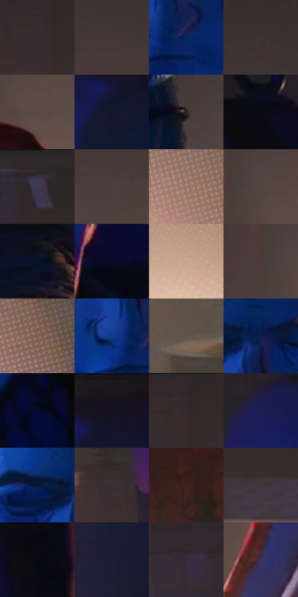

# 电影参考 273

- 状态：常规／活跃；来源世界：miles-home。
- 视角：high-angle；景别：medium；场景：interior。
- 时段：interior-time-unknown（外观依据，中置信度；具体时间／晨昏未知）；光照：interior-mixed。
- 材质候选：skin, hair, fabric, wood, metal, paint（帧级，不是像素分割）。
- 明暗组：very-dark；L* P5/P50/P95：3.20097 / 19.06639 / 53.30928。
- 资格门禁：无附加门禁。
- 原截图 SHA-256：`74305bd5d4fbbc8285d810ccb4b01f40fd0b3db73eea03148265497c5f23c768`；尺寸：2880 × 1206。
- sRGB 像素 SHA-256：`363f8f7af20444fa016cb641590d283b73fdf8ed72725a5110257ec8c5141666`。

## 观察与迁移

冷蓝暗部与暖灯双侧作用，明亮灯晕不掩盖人物结构。

273  /  成人面部；蓝面暖边与发束  /  彼得眉眼鼻唇选择性结构线、较长面部与下颌，发束先块后线  /  不复制角色脸、胡茬或疲态；冷光不是固有肤色

本公开版保存32个128×128原像素色卡上下文；图集格子并非原场景相邻位置。原rect、图集tile和像素SHA见 `data/palette-crops.json`。上下文不足时不得批准替色，不能以小样推断完整构图。

## 实测色卡

颜色比例分母为保留采样像素，不是材料面积；全部 32 色参与全库匹配。表内四舍五入仅用于阅读，原精度在 JSON。

| ID | HEX | Lab | 原图 xy | 像素数 | 比例 | 明度角色 |
| --- | --- | --- | --- | ---: | ---: | --- |
| 273-S01 | #372C2E | [19.270214, 5.447359, 0.605027] | [2268, 88] | 11146 | 5.764795% | deep-shadow |
| 273-S02 | #433836 | [24.601914, 4.451472, 3.048502] | [2512, 292] | 10301 | 5.327754% | shadow |
| 273-S03 | #0B2261 | [15.890648, 18.18045, -39.707945] | [1232, 580] | 8731 | 4.515739% | deep-shadow |
| 273-S04 | #3E3232 | [22.073095, 5.392069, 2.026541] | [2432, 192] | 8459 | 4.375058% | shadow |
| 273-S05 | #5B4943 | [32.689257, 6.575074, 6.469575] | [2396, 560] | 8113 | 4.196104% | shadow |
| 273-S06 | #121730 | [8.608294, 6.654239, -17.452959] | [764, 136] | 7794 | 4.031115% | deep-shadow |
| 273-S07 | #2D2022 | [13.864741, 6.671021, 1.086587] | [1740, 948] | 7751 | 4.008875% | deep-shadow |
| 273-S08 | #0B0B14 | [3.260768, 1.671335, -4.548886] | [1528, 76] | 7639 | 3.950948% | deep-shadow |
| 273-S09 | #2E262B | [16.213105, 4.839419, -1.900173] | [40, 32] | 7530 | 3.894572% | deep-shadow |
| 273-S10 | #4C3F3B | [27.86543, 4.873196, 4.548935] | [2448, 380] | 7507 | 3.882677% | shadow |
| 273-S11 | #9D7969 | [53.88236, 11.674263, 14.174077] | [92, 1004] | 7095 | 3.669587% | midtone |
| 273-S12 | #52443F | [30.125728, 5.062183, 5.25914] | [2344, 488] | 6862 | 3.549078% | shadow |
| 273-S13 | #061225 | [5.463412, 2.061267, -14.257626] | [1244, 120] | 6755 | 3.493737% | deep-shadow |
| 273-S14 | #080A26 | [3.690779, 6.965328, -17.767245] | [1384, 504] | 6670 | 3.449774% | deep-shadow |
| 273-S15 | #C9A390 | [69.914026, 11.179255, 15.161221] | [2792, 1000] | 6126 | 3.168413% | light |
| 273-S16 | #493A37 | [25.917534, 6.04502, 4.357087] | [2288, 488] | 6074 | 3.141518% | shadow |
| 273-S17 | #795E53 | [42.300856, 9.25293, 10.514577] | [232, 1036] | 5857 | 3.029284% | midtone |
| 273-S18 | #13388E | [26.502272, 21.929356, -51.097393] | [1164, 560] | 5800 | 2.999803% | shadow |
| 273-S19 | #60524C | [36.067826, 4.688511, 5.659808] | [40, 452] | 5732 | 2.964633% | shadow |
| 273-S20 | #0A1F4A | [12.851814, 10.152138, -29.120751] | [1204, 412] | 5655 | 2.924808% | deep-shadow |
| 273-S21 | #070935 | [4.493701, 14.534191, -27.766872] | [1336, 720] | 5165 | 2.671377% | deep-shadow |
| 273-S22 | #19121A | [6.448419, 5.124638, -4.167501] | [800, 40] | 5024 | 2.598450% | deep-shadow |
| 273-S23 | #33272A | [17.094156, 6.22134, 0.169313] | [2288, 36] | 5022 | 2.597416% | deep-shadow |
| 273-S24 | #1A1E54 | [14.332884, 17.750962, -33.509609] | [608, 108] | 4506 | 2.330537% | deep-shadow |
| 273-S25 | #09173A | [8.791681, 8.995062, -24.443177] | [1116, 404] | 4009 | 2.073485% | deep-shadow |
| 273-S26 | #3B3033 | [21.142709, 5.581079, -0.048504] | [504, 460] | 3743 | 1.935908% | shadow |
| 273-S27 | #421F1D | [16.637189, 16.60858, 9.016545] | [2268, 996] | 3695 | 1.911082% | deep-shadow |
| 273-S28 | #403540 | [23.692664, 7.247102, -5.023642] | [44, 264] | 3612 | 1.868153% | shadow |
| 273-S29 | #070912 | [2.567184, 0.996383, -4.319576] | [1584, 272] | 3579 | 1.851086% | deep-shadow |
| 273-S30 | #1E1D31 | [11.799986, 6.391136, -13.073765] | [676, 656] | 3403 | 1.760057% | deep-shadow |
| 273-S31 | #332B39 | [18.915532, 6.943177, -7.589784] | [240, 116] | 2243 | 1.160096% | deep-shadow |
| 273-S32 | #392E5C | [22.289597, 17.110235, -25.914361] | [2056, 1040] | 1748 | 0.904079% | shadow |

## 色阶与空间分布

- 采样 ROI：`[0.01, 0.02, 0.98, 0.94]`；步长：4；样本数：193346。
- 排除区：`[]`。
- 深暗、暗、中、亮、高光五段计数：`[103938, 71769, 11035, 5806, 798]`。
- RGB 各 256 箱、L* 100 箱、13×5 色相明度表和 3×3 空间统计全部保存在 [总数据](../film-library.json)。
- [可视化档案](../../references/library.html)按需绘制直方图，不存 2,094 张重复图表图片。

## 纹理特征占比

**这是分块图像特征的面积占比，不是波点／排线／丝网／错版的精确语义覆盖率。** 窗格、发丝、织物也会产生方向或周期特征。
原图 ROI 像素 3098546；已测块覆盖 3098546（100.0000%）；未测 0。

| 特征 | 块覆盖像素 | 占已测面积 | 阈值敏感范围 |
| --- | ---: | ---: | --- |
| low-contrast | 969216 | 31.2797% | 21.5884% ~ 39.0294% |
| directional-structure | 414976 | 13.3926% | 4.5812% ~ 25.9879% |
| periodic-structure | 1487922 | 48.0200% | 45.3886% ~ 49.4287% |
| mixed-detail | 226432 | 7.3077% | 2.9950% ~ 11.0008% |

阈值敏感范围不是统计置信区间。逐块坐标、尺度、对比、方向一致性、频谱集中度、频率与角度见 [全量特征记录](../texture-features.jsonl)，以帧号定位。
四种印刷层的真实像素覆盖仍标为 `null`，不能填 0，也不能拿上表代替。不得据这些代理测量删除唯一证据。

[测量方法与保留策略](../../references/library-retention.md) · [分类索引](../archive/README.md)
