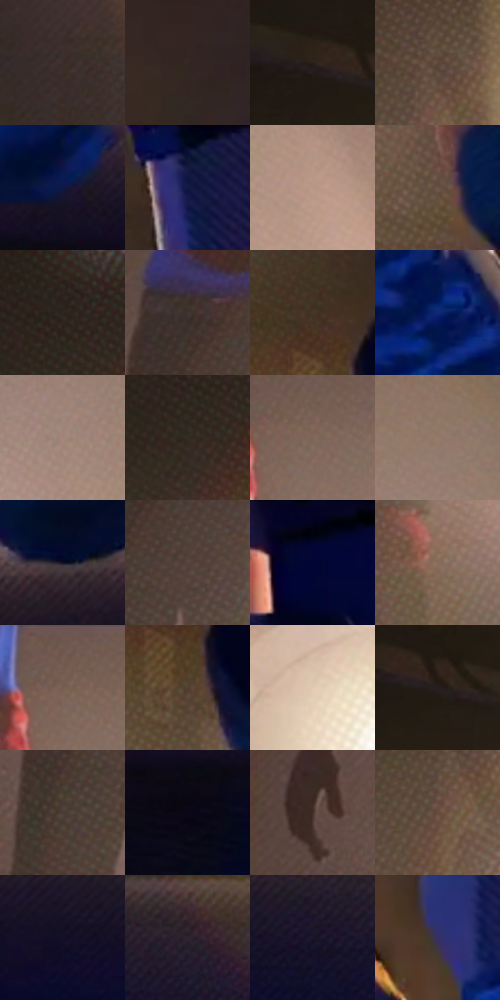

# 电影参考 274

- 状态：常规／活跃；来源世界：miles-home。
- 视角：low-angle；景别：detail；场景：interior。
- 时段：interior-time-unknown（外观依据，中置信度；具体时间／晨昏未知）；光照：interior-mixed。
- 材质候选：skin, hair, fabric, wood, metal, paint（帧级，不是像素分割）。
- 明暗组：dark；L* P5/P50/P95：3.47014 / 21.51883 / 63.35199。
- 资格门禁：无附加门禁。
- 原截图 SHA-256：`82c4bac24df5355adf203aedc095438493bd29be49b8f5cf6e5a2003c3a835bf`；尺寸：2880 × 1200。
- sRGB 像素 SHA-256：`4ea7368051dee604178cae88619d45330f8b384edfc0872b64efb0fefe77643a`。

## 观察与迁移

冷蓝暗部与暖灯双侧作用，明亮灯晕不掩盖人物结构。

274  /  鞋与腿部材质；灯光  /  鞋面、鞋底、鞋带和腿部受光分别概括；亮锥细网目不等于表面织纹  /  无面部造型证据，不添加鞋带或灯具

本公开版保存32个128×128原像素色卡上下文；图集格子并非原场景相邻位置。原rect、图集tile和像素SHA见 `data/palette-crops.json`。上下文不足时不得批准替色，不能以小样推断完整构图。

## 实测色卡

颜色比例分母为保留采样像素，不是材料面积；全部 32 色参与全库匹配。表内四舍五入仅用于阅读，原精度在 JSON。

| ID | HEX | Lab | 原图 xy | 像素数 | 比例 | 明度角色 |
| --- | --- | --- | --- | ---: | ---: | --- |
| 274-S01 | #3A2E2A | [20.127076, 4.712381, 4.639656] | [1852, 592] | 9587 | 4.976434% | shadow |
| 274-S02 | #332724 | [16.904109, 5.046953, 4.118151] | [1468, 316] | 8708 | 4.520161% | deep-shadow |
| 274-S03 | #20191A | [9.616704, 3.690853, 0.60141] | [36, 352] | 8312 | 4.314605% | deep-shadow |
| 274-S04 | #5D493C | [32.742037, 6.370204, 11.01587] | [632, 484] | 8153 | 4.232071% | shadow |
| 274-S05 | #0F1846 | [10.533964, 14.533806, -30.095618] | [1508, 1000] | 8106 | 4.207674% | deep-shadow |
| 274-S06 | #07102E | [5.536452, 7.508046, -20.914926] | [900, 24] | 7744 | 4.019767% | deep-shadow |
| 274-S07 | #B79786 | [64.901496, 9.321081, 13.436775] | [2788, 512] | 7059 | 3.664196% | light |
| 274-S08 | #685346 | [37.063444, 6.592914, 10.91905] | [992, 852] | 6763 | 3.510548% | shadow |
| 274-S09 | #2E251D | [15.449247, 2.712685, 6.91709] | [508, 260] | 6663 | 3.458640% | deep-shadow |
| 274-S10 | #3E332E | [22.2639, 3.967472, 5.00827] | [2104, 180] | 6613 | 3.432686% | shadow |
| 274-S11 | #483629 | [24.246212, 5.947769, 11.270419] | [772, 196] | 6548 | 3.398945% | shadow |
| 274-S12 | #0F2777 | [19.572744, 24.149203, -47.985325] | [1432, 624] | 6530 | 3.389602% | deep-shadow |
| 274-S13 | #A38676 | [58.175199, 8.554662, 12.768617] | [2560, 316] | 6511 | 3.379739% | midtone |
| 274-S14 | #362C25 | [18.882762, 3.251153, 6.257762] | [496, 332] | 6472 | 3.359495% | deep-shadow |
| 274-S15 | #7E6555 | [44.800549, 7.514448, 12.86239] | [2404, 80] | 6452 | 3.349113% | midtone |
| 274-S16 | #947A69 | [53.206575, 7.393103, 13.092638] | [2576, 176] | 6414 | 3.329388% | midtone |
| 274-S17 | #120E1F | [4.892104, 5.692796, -10.451893] | [1136, 960] | 6406 | 3.325236% | deep-shadow |
| 274-S18 | #54433C | [29.974736, 6.081281, 7.012152] | [2160, 272] | 6348 | 3.295129% | shadow |
| 274-S19 | #04062E | [3.190743, 11.158164, -24.65372] | [1064, 44] | 5950 | 3.088535% | deep-shadow |
| 274-S20 | #8A6C5B | [48.114313, 9.346849, 14.070821] | [2268, 552] | 5945 | 3.085939% | midtone |
| 274-S21 | #725B4D | [40.566598, 7.151771, 11.637035] | [2380, 40] | 5627 | 2.920871% | midtone |
| 274-S22 | #533E30 | [28.108844, 6.990604, 12.156901] | [796, 296] | 5462 | 2.835223% | shadow |
| 274-S23 | #E2C8B1 | [82.192036, 5.565904, 14.860528] | [2780, 704] | 5335 | 2.769299% | highlight |
| 274-S24 | #261E20 | [12.253658, 4.306415, 0.088709] | [124, 372] | 5105 | 2.649911% | deep-shadow |
| 274-S25 | #493B35 | [26.161957, 5.041005, 6.024518] | [2076, 344] | 5046 | 2.619285% | shadow |
| 274-S26 | #090818 | [2.688848, 3.333265, -8.268135] | [1444, 1104] | 4793 | 2.487957% | deep-shadow |
| 274-S27 | #422D26 | [20.732263, 8.571696, 8.368372] | [1944, 260] | 4681 | 2.429820% | shadow |
| 274-S28 | #6A4B3C | [34.849092, 11.024295, 14.139999] | [608, 552] | 4157 | 2.157822% | shadow |
| 274-S29 | #151027 | [6.11045, 8.911241, -14.684801] | [2000, 1048] | 3377 | 1.752938% | deep-shadow |
| 274-S30 | #2D2330 | [15.34692, 7.735928, -6.757744] | [2312, 996] | 3195 | 1.658465% | deep-shadow |
| 274-S31 | #19172C | [9.002028, 7.4089, -13.845513] | [2188, 1040] | 2317 | 1.202712% | deep-shadow |
| 274-S32 | #353166 | [23.380159, 17.153015, -30.737715] | [1200, 416] | 2269 | 1.177796% | shadow |

## 色阶与空间分布

- 采样 ROI：`[0.01, 0.02, 0.98, 0.94]`；步长：4；样本数：192648。
- 排除区：`[]`。
- 深暗、暗、中、亮、高光五段计数：`[87916, 62959, 28297, 10962, 2514]`。
- RGB 各 256 箱、L* 100 箱、13×5 色相明度表和 3×3 空间统计全部保存在 [总数据](../film-library.json)。
- [可视化档案](../../references/library.html)按需绘制直方图，不存 2,094 张重复图表图片。

## 纹理特征占比

**这是分块图像特征的面积占比，不是波点／排线／丝网／错版的精确语义覆盖率。** 窗格、发丝、织物也会产生方向或周期特征。
原图 ROI 像素 3084576；已测块覆盖 3084576（100.0000%）；未测 0。

| 特征 | 块覆盖像素 | 占已测面积 | 阈值敏感范围 |
| --- | ---: | ---: | --- |
| low-contrast | 329728 | 10.6896% | 8.6313% ~ 15.6028% |
| directional-structure | 425984 | 13.8101% | 7.4362% ~ 22.8398% |
| periodic-structure | 2180128 | 70.6784% | 66.6034% ~ 70.6784% |
| mixed-detail | 148736 | 4.8219% | 1.9255% ~ 7.3864% |

阈值敏感范围不是统计置信区间。逐块坐标、尺度、对比、方向一致性、频谱集中度、频率与角度见 [全量特征记录](../texture-features.jsonl)，以帧号定位。
四种印刷层的真实像素覆盖仍标为 `null`，不能填 0，也不能拿上表代替。不得据这些代理测量删除唯一证据。

[测量方法与保留策略](../../references/library-retention.md) · [分类索引](../archive/README.md)
