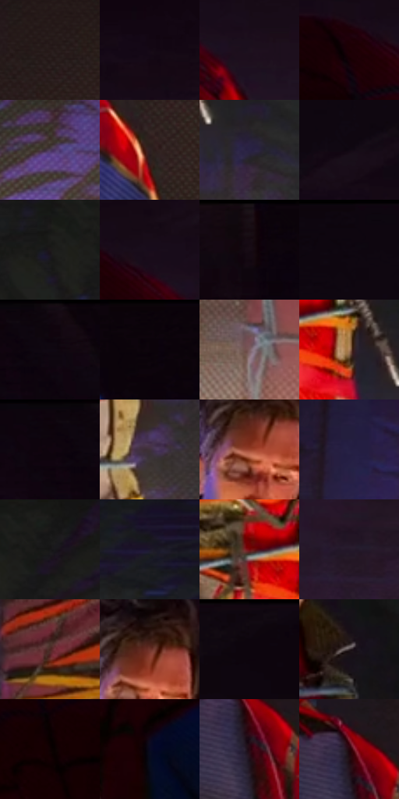

# 电影参考 275

- 状态：常规／活跃；来源世界：miles-home。
- 视角：near-level；景别：medium；场景：interior。
- 时段：interior-time-unknown（外观依据，中置信度；具体时间／晨昏未知）；光照：interior-mixed。
- 材质候选：skin, hair, fabric, wood, metal, paint（帧级，不是像素分割）。
- 明暗组：very-dark；L* P5/P50/P95：1.58086 / 8.44079 / 44.97478。
- 资格门禁：无附加门禁。
- 原截图 SHA-256：`7e94028737b78923e8f3dffbae6ad60fdcddbd6a34bdbb3f63134c7743a84a3a`；尺寸：2880 × 1210。
- sRGB 像素 SHA-256：`2a5627565e1f1ee7c23ab71bd5d06ec0adcd97903c05e6fb04828e46cc80e67e`。

## 观察与迁移

冷蓝暗部与暖灯双侧作用，明亮灯晕不掩盖人物结构。

275  /  双人中景；服装与五金  /  成人眉口简形仍读出神态，绳圈、拉链和宽衣褶按尺度区别  /  不将绑定道具和服装内容带入原照

本公开版保存32个128×128原像素色卡上下文；图集格子并非原场景相邻位置。原rect、图集tile和像素SHA见 `data/palette-crops.json`。上下文不足时不得批准替色，不能以小样推断完整构图。

## 实测色卡

颜色比例分母为保留采样像素，不是材料面积；全部 32 色参与全库匹配。表内四舍五入仅用于阅读，原精度在 JSON。

| ID | HEX | Lab | 原图 xy | 像素数 | 比例 | 明度角色 |
| --- | --- | --- | --- | ---: | ---: | --- |
| 275-S01 | #281C1B | [11.694415, 5.713065, 2.984282] | [2448, 764] | 13475 | 6.944301% | deep-shadow |
| 275-S02 | #150815 | [3.498077, 6.691459, -4.782503] | [472, 232] | 10857 | 5.595123% | deep-shadow |
| 275-S03 | #1D101E | [6.553894, 9.585115, -7.049277] | [2216, 352] | 10057 | 5.182845% | deep-shadow |
| 275-S04 | #1B0004 | [2.184625, 9.998687, 1.813347] | [2056, 328] | 9710 | 5.004020% | deep-shadow |
| 275-S05 | #4D3B58 | [27.873219, 14.153378, -14.404342] | [420, 904] | 8627 | 4.445899% | shadow |
| 275-S06 | #2F2224 | [14.821758, 6.614721, 1.066056] | [2392, 1088] | 8095 | 4.171734% | deep-shadow |
| 275-S07 | #2A2344 | [16.062224, 12.434015, -19.703092] | [1332, 920] | 7996 | 4.120715% | deep-shadow |
| 275-S08 | #110813 | [3.069963, 4.607909, -4.126862] | [1900, 192] | 6936 | 3.574447% | deep-shadow |
| 275-S09 | #1E191A | [9.367971, 2.697238, 0.209037] | [304, 524] | 6914 | 3.563109% | deep-shadow |
| 275-S10 | #180C1B | [4.844192, 8.03823, -7.335746] | [2132, 300] | 6753 | 3.480139% | deep-shadow |
| 275-S11 | #170C15 | [4.509848, 5.965167, -3.280452] | [732, 64] | 6628 | 3.415720% | deep-shadow |
| 275-S12 | #0F0710 | [2.627999, 3.685212, -3.005762] | [1900, 28] | 6583 | 3.392530% | deep-shadow |
| 275-S13 | #0E050D | [2.086373, 3.624279, -2.253179] | [128, 32] | 6353 | 3.274000% | deep-shadow |
| 275-S14 | #0A030A | [1.36919, 2.80375, -2.003896] | [988, 28] | 6336 | 3.265239% | deep-shadow |
| 275-S15 | #7E6064 | [43.831695, 12.828733, 2.436699] | [668, 1056] | 6239 | 3.215250% | midtone |
| 275-S16 | #AB815D | [57.221696, 11.530053, 25.769161] | [1216, 840] | 6199 | 3.194636% | midtone |
| 275-S17 | #0E040F | [1.939333, 4.369434, -3.477351] | [36, 48] | 6104 | 3.145678% | deep-shadow |
| 275-S18 | #3F313A | [22.156302, 8.163234, -3.272889] | [1248, 1032] | 6058 | 3.121972% | shadow |
| 275-S19 | #9B442E | [40.084655, 34.788022, 30.664508] | [1120, 328] | 5847 | 3.013234% | midtone |
| 275-S20 | #241C37 | [12.48914, 11.266147, -16.255715] | [36, 656] | 5620 | 2.896250% | deep-shadow |
| 275-S21 | #171618 | [7.424387, 0.977899, -1.217525] | [396, 504] | 5087 | 2.621570% | deep-shadow |
| 275-S22 | #1B162B | [8.834, 8.562562, -13.355171] | [1476, 760] | 4745 | 2.445322% | deep-shadow |
| 275-S23 | #74080E | [23.403818, 43.36328, 29.13906] | [1132, 796] | 4560 | 2.349982% | shadow |
| 275-S24 | #24192A | [10.831259, 9.568984, -9.424074] | [2312, 560] | 4071 | 2.097978% | deep-shadow |
| 275-S25 | #4B2622 | [20.035676, 16.889497, 10.37306] | [728, 768] | 3997 | 2.059842% | shadow |
| 275-S26 | #6D3329 | [28.850092, 24.8064, 18.313745] | [1136, 292] | 3964 | 2.042836% | shadow |
| 275-S27 | #110A10 | [3.375379, 3.19726, -1.895327] | [2700, 28] | 3654 | 1.883078% | deep-shadow |
| 275-S28 | #342A2C | [18.223011, 5.02414, 0.427514] | [1216, 516] | 3369 | 1.736204% | deep-shadow |
| 275-S29 | #0F0102 | [1.153324, 3.993043, 0.979561] | [1928, 420] | 3360 | 1.731566% | deep-shadow |
| 275-S30 | #090A22 | [3.528351, 5.675691, -14.92129] | [1640, 1128] | 2620 | 1.350209% | deep-shadow |
| 275-S31 | #260A13 | [6.10873, 15.187071, 0.627905] | [2156, 948] | 1681 | 0.866298% | deep-shadow |
| 275-S32 | #24060C | [4.805228, 14.475349, 2.489591] | [2148, 896] | 1549 | 0.798273% | deep-shadow |

## 色阶与空间分布

- 采样 ROI：`[0.01, 0.02, 0.98, 0.94]`；步长：4；样本数：194044。
- 排除区：`[]`。
- 深暗、暗、中、亮、高光五段计数：`[153271, 26977, 12225, 1511, 60]`。
- RGB 各 256 箱、L* 100 箱、13×5 色相明度表和 3×3 空间统计全部保存在 [总数据](../film-library.json)。
- [可视化档案](../../references/library.html)按需绘制直方图，不存 2,094 张重复图表图片。

## 纹理特征占比

**这是分块图像特征的面积占比，不是波点／排线／丝网／错版的精确语义覆盖率。** 窗格、发丝、织物也会产生方向或周期特征。
原图 ROI 像素 3109722；已测块覆盖 3109722（100.0000%）；未测 0。

| 特征 | 块覆盖像素 | 占已测面积 | 阈值敏感范围 |
| --- | ---: | ---: | --- |
| low-contrast | 1117824 | 35.9461% | 27.1705% ~ 44.3759% |
| directional-structure | 240768 | 7.7424% | 1.4201% ~ 17.5923% |
| periodic-structure | 1538138 | 49.4622% | 42.7735% ~ 52.6028% |
| mixed-detail | 212992 | 6.8492% | 2.6343% ~ 11.4305% |

阈值敏感范围不是统计置信区间。逐块坐标、尺度、对比、方向一致性、频谱集中度、频率与角度见 [全量特征记录](../texture-features.jsonl)，以帧号定位。
四种印刷层的真实像素覆盖仍标为 `null`，不能填 0，也不能拿上表代替。不得据这些代理测量删除唯一证据。

[测量方法与保留策略](../../references/library-retention.md) · [分类索引](../archive/README.md)
