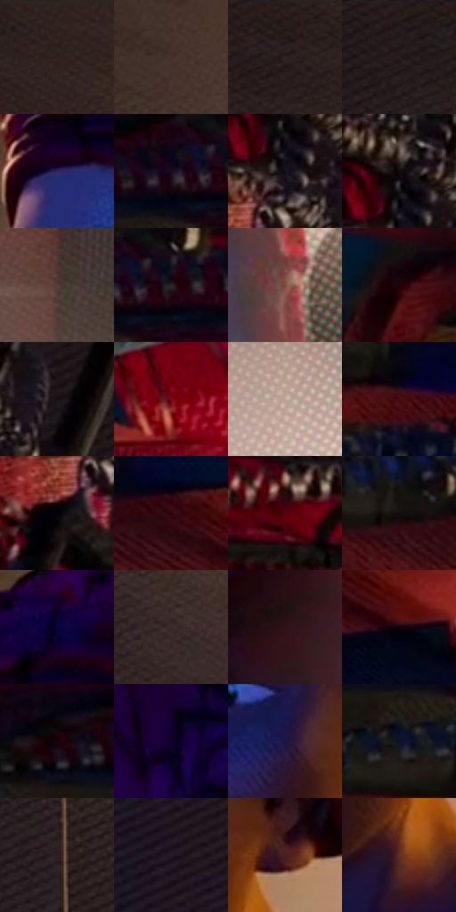

# 电影参考 276

- 状态：常规／活跃；来源世界：miles-home。
- 视角：near-level；景别：medium；场景：interior。
- 时段：interior-time-unknown（外观依据，中置信度；具体时间／晨昏未知）；光照：interior-mixed。
- 材质候选：skin, hair, fabric, wood, metal, paint（帧级，不是像素分割）。
- 明暗组：very-dark；L* P5/P50/P95：1.55394 / 10.88411 / 51.49997。
- 资格门禁：无附加门禁。
- 原截图 SHA-256：`59474294e81d75f427ef660354148157e49812b5bb581e58ae3692f34446327e`；尺寸：2880 × 1196。
- sRGB 像素 SHA-256：`5c7ccaca071dab0afcb65098b90426772022bd4c92e29e93dafc70f8dde0831f`。

## 观察与迁移

冷蓝暗部与暖灯双侧作用，明亮灯晕不掩盖人物结构。

276  /  少年面部近景；蓝金混合光  /  眼睑下垂、眉形简洁，鼻唇保有圆润体积，颊面柔和且有边界  /  不统一画成彼得的长脸，不移植帽子或少年年龄

本公开版保存32个128×128原像素色卡上下文；图集格子并非原场景相邻位置。原rect、图集tile和像素SHA见 `data/palette-crops.json`。上下文不足时不得批准替色，不能以小样推断完整构图。

## 实测色卡

颜色比例分母为保留采样像素，不是材料面积；全部 32 色参与全库匹配。表内四舍五入仅用于阅读，原精度在 JSON。

| ID | HEX | Lab | 原图 xy | 像素数 | 比例 | 明度角色 |
| --- | --- | --- | --- | ---: | ---: | --- |
| 276-S01 | #312322 | [15.332331, 6.493582, 3.264461] | [1616, 44] | 14101 | 7.319567% | deep-shadow |
| 276-S02 | #44312B | [22.303064, 7.626262, 7.194378] | [1748, 452] | 9046 | 4.695611% | shadow |
| 276-S03 | #291E1E | [12.568373, 5.351842, 2.054537] | [1472, 36] | 8484 | 4.403887% | deep-shadow |
| 276-S04 | #24191B | [10.179582, 5.897917, 0.735438] | [1344, 24] | 8462 | 4.392467% | deep-shadow |
| 276-S05 | #2D2861 | [19.794962, 19.597569, -33.266416] | [2080, 176] | 8050 | 4.178606% | deep-shadow |
| 276-S06 | #0D061A | [2.62303, 5.796101, -9.928651] | [320, 56] | 8021 | 4.163552% | deep-shadow |
| 276-S07 | #150F18 | [5.121944, 4.340856, -4.605407] | [840, 132] | 7711 | 4.002637% | deep-shadow |
| 276-S08 | #1D1415 | [7.368166, 4.74901, 0.979025] | [836, 60] | 7412 | 3.847432% | deep-shadow |
| 276-S09 | #533E38 | [28.300801, 8.176073, 7.236577] | [2744, 176] | 7298 | 3.788256% | shadow |
| 276-S10 | #1E151F | [8.229526, 6.950372, -5.262881] | [392, 32] | 7281 | 3.779432% | deep-shadow |
| 276-S11 | #7C4D42 | [37.819364, 18.503379, 14.823036] | [2736, 1080] | 7183 | 3.728562% | shadow |
| 276-S12 | #1F030B | [3.438618, 12.136178, 0.846045] | [96, 644] | 6719 | 3.487708% | deep-shadow |
| 276-S13 | #1F171A | [8.812821, 4.684456, -0.587848] | [968, 32] | 6535 | 3.392197% | deep-shadow |
| 276-S14 | #770815 | [24.164566, 44.444151, 26.037508] | [832, 756] | 6428 | 3.336655% | shadow |
| 276-S15 | #C4A799 | [70.645913, 8.368514, 11.166924] | [2764, 628] | 6254 | 3.246335% | light |
| 276-S16 | #460C12 | [13.285533, 27.577097, 12.364309] | [436, 260] | 6240 | 3.239068% | deep-shadow |
| 276-S17 | #030209 | [0.745164, 1.234771, -2.55676] | [780, 232] | 6105 | 3.168992% | deep-shadow |
| 276-S18 | #2E040A | [6.230633, 21.408671, 5.654555] | [492, 396] | 5950 | 3.088535% | deep-shadow |
| 276-S19 | #9D7B69 | [54.401763, 10.531239, 14.892517] | [652, 28] | 5391 | 2.798368% | midtone |
| 276-S20 | #140F0F | [4.741158, 1.911006, 0.673953] | [340, 380] | 5349 | 2.776567% | deep-shadow |
| 276-S21 | #1D002A | [3.869644, 21.086532, -20.411497] | [2140, 28] | 5321 | 2.762032% | deep-shadow |
| 276-S22 | #392B2A | [19.076626, 6.278498, 3.127836] | [1692, 696] | 5091 | 2.642644% | deep-shadow |
| 276-S23 | #301019 | [9.555952, 17.445927, 1.591395] | [2492, 788] | 4880 | 2.533117% | deep-shadow |
| 276-S24 | #12010A | [1.555951, 6.201163, -1.661736] | [596, 460] | 4287 | 2.225302% | deep-shadow |
| 276-S25 | #0A070D | [2.218003, 1.654767, -2.092222] | [196, 40] | 4165 | 2.161974% | deep-shadow |
| 276-S26 | #120230 | [3.480962, 17.949966, -25.637927] | [2004, 1120] | 4165 | 2.161974% | deep-shadow |
| 276-S27 | #1C153F | [10.122317, 16.709479, -25.785131] | [2284, 468] | 3396 | 1.762801% | deep-shadow |
| 276-S28 | #0E1327 | [6.373018, 4.483528, -14.318479] | [284, 172] | 3110 | 1.614343% | deep-shadow |
| 276-S29 | #2B2026 | [13.748345, 6.575975, -2.007644] | [1448, 656] | 2852 | 1.480420% | deep-shadow |
| 276-S30 | #241925 | [10.586331, 8.232169, -6.108843] | [1192, 956] | 2797 | 1.451871% | deep-shadow |
| 276-S31 | #4B1E1F | [18.025615, 21.463032, 9.751252] | [2408, 484] | 2294 | 1.190773% | deep-shadow |
| 276-S32 | #603025 | [25.965826, 20.550884, 16.778311] | [2344, 620] | 2270 | 1.178315% | shadow |

## 色阶与空间分布

- 采样 ROI：`[0.01, 0.02, 0.98, 0.94]`；步长：4；样本数：192648。
- 排除区：`[]`。
- 深暗、暗、中、亮、高光五段计数：`[144794, 34439, 6107, 6212, 1096]`。
- RGB 各 256 箱、L* 100 箱、13×5 色相明度表和 3×3 空间统计全部保存在 [总数据](../film-library.json)。
- [可视化档案](../../references/library.html)按需绘制直方图，不存 2,094 张重复图表图片。

## 纹理特征占比

**这是分块图像特征的面积占比，不是波点／排线／丝网／错版的精确语义覆盖率。** 窗格、发丝、织物也会产生方向或周期特征。
原图 ROI 像素 3076194；已测块覆盖 3076194（100.0000%）；未测 0。

| 特征 | 块覆盖像素 | 占已测面积 | 阈值敏感范围 |
| --- | ---: | ---: | --- |
| low-contrast | 242560 | 7.8851% | 4.0486% ~ 14.3845% |
| directional-structure | 540672 | 17.5760% | 3.1956% ~ 33.6624% |
| periodic-structure | 2119266 | 68.8925% | 60.3708% ~ 74.6430% |
| mixed-detail | 173696 | 5.6465% | 1.9182% ~ 7.7769% |

阈值敏感范围不是统计置信区间。逐块坐标、尺度、对比、方向一致性、频谱集中度、频率与角度见 [全量特征记录](../texture-features.jsonl)，以帧号定位。
四种印刷层的真实像素覆盖仍标为 `null`，不能填 0，也不能拿上表代替。不得据这些代理测量删除唯一证据。

[测量方法与保留策略](../../references/library-retention.md) · [分类索引](../archive/README.md)
