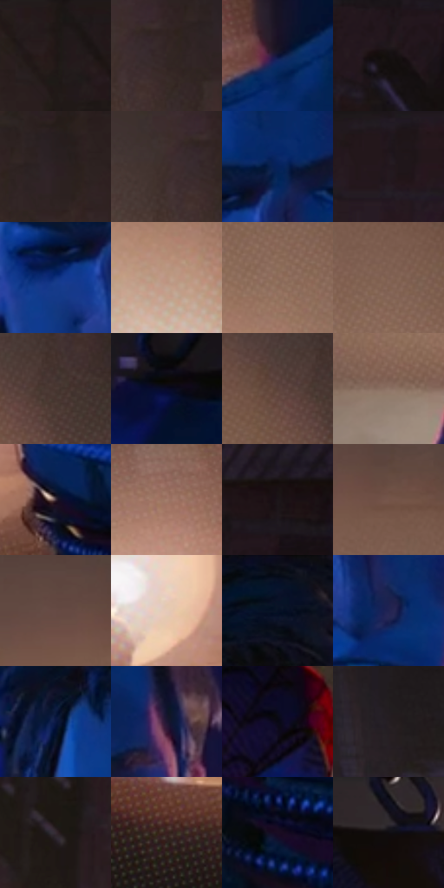

# 电影参考 277

- 状态：常规／活跃；来源世界：miles-home。
- 视角：high-angle；景别：medium；场景：interior。
- 时段：interior-time-unknown（外观依据，中置信度；具体时间／晨昏未知）；光照：interior-mixed。
- 材质候选：skin, hair, fabric, wood, metal, paint（帧级，不是像素分割）。
- 明暗组：very-dark；L* P5/P50/P95：4.33182 / 16.40451 / 62.50752。
- 资格门禁：无附加门禁。
- 原截图 SHA-256：`1aa20a2ea6d1192a01b07ed3602aca05a66588ca2aa8dc6108afec683e34dafd`；尺寸：2878 × 1206。
- sRGB 像素 SHA-256：`4f2e6f37b4d572a3ab8ba5e7d297c58b6935e60710774128faea7d4e15c918cb`。

## 观察与迁移

冷蓝暗部与暖灯双侧作用，明亮灯晕不掩盖人物结构。

277  /  双人面部对照；景深与视角  /  彼得较长的鼻颌和迈尔斯较圆的颊部同时成立，共用笔法而不同脸型  /  同风格不等于同一脸模；近大远小不当成头身比例规定

本公开版保存32个128×128原像素色卡上下文；图集格子并非原场景相邻位置。原rect、图集tile和像素SHA见 `data/palette-crops.json`。上下文不足时不得批准替色，不能以小样推断完整构图。

## 实测色卡

颜色比例分母为保留采样像素，不是材料面积；全部 32 色参与全库匹配。表内四舍五入仅用于阅读，原精度在 JSON。

| ID | HEX | Lab | 原图 xy | 像素数 | 比例 | 明度角色 |
| --- | --- | --- | --- | ---: | ---: | --- |
| 277-S01 | #1E1716 | [8.53992, 3.295133, 1.999487] | [2348, 28] | 10371 | 5.363959% | deep-shadow |
| 277-S02 | #332725 | [16.933848, 5.232773, 3.457545] | [2176, 192] | 9690 | 5.011741% | deep-shadow |
| 277-S03 | #0D1137 | [6.884769, 12.918771, -25.352386] | [588, 620] | 8954 | 4.631076% | deep-shadow |
| 277-S04 | #151010 | [5.125627, 1.996325, 0.704067] | [2736, 168] | 8708 | 4.503843% | deep-shadow |
| 277-S05 | #2C2123 | [14.085461, 5.683509, 0.668685] | [2248, 156] | 8284 | 4.284547% | deep-shadow |
| 277-S06 | #3D2E2A | [20.492474, 6.139282, 5.207688] | [2120, 192] | 7914 | 4.093180% | shadow |
| 277-S07 | #07215A | [14.793558, 15.492057, -36.843225] | [932, 300] | 7719 | 3.992325% | deep-shadow |
| 277-S08 | #24191E | [10.289947, 6.546342, -1.34417] | [2528, 60] | 7647 | 3.955086% | deep-shadow |
| 277-S09 | #0E317E | [22.983882, 19.857033, -46.853164] | [860, 368] | 7385 | 3.819577% | shadow |
| 277-S10 | #BC9480 | [64.508709, 12.130478, 16.317579] | [1884, 528] | 7021 | 3.631314% | light |
| 277-S11 | #8C6959 | [47.496067, 11.678007, 14.437332] | [1912, 400] | 6929 | 3.583731% | midtone |
| 277-S12 | #7F6052 | [43.489146, 10.491324, 12.870182] | [1912, 316] | 6831 | 3.533044% | midtone |
| 277-S13 | #4C3934 | [25.894811, 7.555748, 6.358933] | [2120, 284] | 6586 | 3.406329% | shadow |
| 277-S14 | #0A0B27 | [4.067549, 7.492679, -17.937778] | [648, 76] | 6512 | 3.368055% | deep-shadow |
| 277-S15 | #5B413A | [30.183006, 10.203956, 8.71553] | [2060, 288] | 6319 | 3.268234% | shadow |
| 277-S16 | #8F7466 | [51.025441, 8.350747, 11.723437] | [1716, 956] | 6097 | 3.153414% | midtone |
| 277-S17 | #40313B | [22.311173, 8.81171, -3.70888] | [500, 936] | 6096 | 3.152897% | shadow |
| 277-S18 | #A37D6B | [55.600541, 12.129156, 15.494828] | [324, 580] | 5976 | 3.090832% | midtone |
| 277-S19 | #1C1519 | [7.708844, 4.461012, -1.497049] | [2804, 76] | 5926 | 3.064972% | deep-shadow |
| 277-S20 | #745549 | [39.056307, 11.085267, 12.034402] | [1816, 216] | 5712 | 2.954289% | shadow |
| 277-S21 | #664B44 | [34.548702, 10.343687, 8.634967] | [1732, 184] | 5179 | 2.678618% | shadow |
| 277-S22 | #E6CAB8 | [83.192628, 7.018813, 12.598706] | [364, 848] | 5131 | 2.653792% | highlight |
| 277-S23 | #0A142D | [6.812768, 5.403556, -18.132811] | [952, 40] | 4784 | 2.474321% | deep-shadow |
| 277-S24 | #202352 | [16.095253, 14.578472, -29.280085] | [972, 440] | 4506 | 2.330537% | deep-shadow |
| 277-S25 | #0B1843 | [10.026574, 12.597892, -28.828299] | [796, 164] | 4360 | 2.255025% | deep-shadow |
| 277-S26 | #1E1732 | [9.946321, 11.231547, -16.714334] | [1068, 244] | 4357 | 2.253473% | deep-shadow |
| 277-S27 | #090815 | [2.582262, 2.584269, -6.229659] | [2140, 1080] | 4107 | 2.124171% | deep-shadow |
| 277-S28 | #251E22 | [12.204319, 4.287749, -1.462133] | [144, 124] | 3791 | 1.960734% | deep-shadow |
| 277-S29 | #362B32 | [18.98113, 6.543157, -2.606631] | [2548, 888] | 3046 | 1.575414% | deep-shadow |
| 277-S30 | #391F1F | [15.21704, 12.633915, 5.408994] | [328, 1044] | 2841 | 1.469386% | deep-shadow |
| 277-S31 | #1A0C23 | [5.455085, 11.741419, -12.609307] | [636, 1056] | 2632 | 1.361290% | deep-shadow |
| 277-S32 | #10101F | [5.235876, 3.902921, -9.946792] | [1244, 32] | 1935 | 1.000796% | deep-shadow |

## 色阶与空间分布

- 采样 ROI：`[0.01, 0.02, 0.98, 0.94]`；步长：4；样本数：193346。
- 排除区：`[]`。
- 深暗、暗、中、亮、高光五段计数：`[113876, 39540, 28640, 7742, 3548]`。
- RGB 各 256 箱、L* 100 箱、13×5 色相明度表和 3×3 空间统计全部保存在 [总数据](../film-library.json)。
- [可视化档案](../../references/library.html)按需绘制直方图，不存 2,094 张重复图表图片。

## 纹理特征占比

**这是分块图像特征的面积占比，不是波点／排线／丝网／错版的精确语义覆盖率。** 窗格、发丝、织物也会产生方向或周期特征。
原图 ROI 像素 3096328；已测块覆盖 3096328（100.0000%）；未测 0。

| 特征 | 块覆盖像素 | 占已测面积 | 阈值敏感范围 |
| --- | ---: | ---: | --- |
| low-contrast | 199304 | 6.4368% | 3.2619% ~ 12.3111% |
| directional-structure | 240256 | 7.7594% | 4.0554% ~ 15.5973% |
| periodic-structure | 2323840 | 75.0515% | 65.6551% ~ 77.0854% |
| mixed-detail | 332928 | 10.7523% | 4.0554% ~ 17.9785% |

阈值敏感范围不是统计置信区间。逐块坐标、尺度、对比、方向一致性、频谱集中度、频率与角度见 [全量特征记录](../texture-features.jsonl)，以帧号定位。
四种印刷层的真实像素覆盖仍标为 `null`，不能填 0，也不能拿上表代替。不得据这些代理测量删除唯一证据。

[测量方法与保留策略](../../references/library-retention.md) · [分类索引](../archive/README.md)
