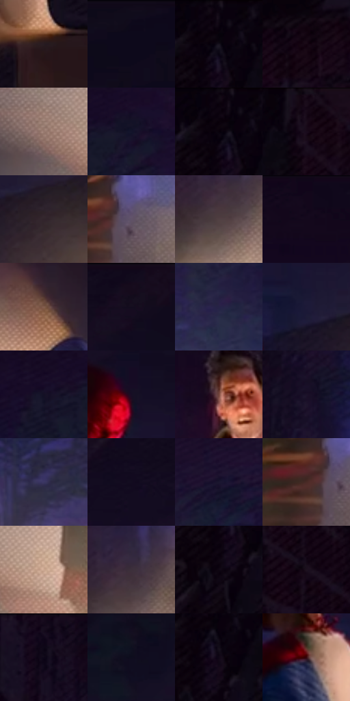

# 电影参考 278

- 状态：常规／活跃；来源世界：miles-home。
- 视角：near-level；景别：environment-wide；场景：interior。
- 时段：interior-time-unknown（外观依据，中置信度；具体时间／晨昏未知）；光照：interior-mixed。
- 材质候选：skin, hair, fabric, wood, metal, paint（帧级，不是像素分割）。
- 明暗组：very-dark；L* P5/P50/P95：2.01592 / 7.45473 / 51.67588。
- 资格门禁：无附加门禁。
- 原截图 SHA-256：`9d2d9f0d531b44c6cc519abed1ba0e6482c463707a887fd5e29981926be7a1c3`；尺寸：2880 × 1206。
- sRGB 像素 SHA-256：`86a6d43a0187f07eaf82e412e85a45be8879908baadd7d742dac5c3abaea7da4`。

## 观察与迁移

冷蓝暗部与暖灯双侧作用，明亮灯晕不掩盖人物结构。

278  /  室内全景；灯光与布料  /  全身与小脸维持同一绘制语法，暖灯锥与冷墙分层  /  不为小脸补不存在的近景特征，不移植整套房间

本公开版保存32个128×128原像素色卡上下文；图集格子并非原场景相邻位置。原rect、图集tile和像素SHA见 `data/palette-crops.json`。上下文不足时不得批准替色，不能以小样推断完整构图。

## 实测色卡

颜色比例分母为保留采样像素，不是材料面积；全部 32 色参与全库匹配。表内四舍五入仅用于阅读，原精度在 JSON。

| ID | HEX | Lab | 原图 xy | 像素数 | 比例 | 明度角色 |
| --- | --- | --- | --- | ---: | ---: | --- |
| 278-S01 | #271B21 | [11.449626, 7.185804, -1.813114] | [2272, 796] | 9090 | 4.701416% | deep-shadow |
| 278-S02 | #0F0A1B | [3.592936, 5.130661, -9.281923] | [2628, 28] | 8449 | 4.369886% | deep-shadow |
| 278-S03 | #0E0712 | [2.610481, 3.750393, -4.204118] | [84, 32] | 7965 | 4.119558% | deep-shadow |
| 278-S04 | #160612 | [3.112077, 7.279836, -3.387983] | [84, 824] | 7343 | 3.797855% | deep-shadow |
| 278-S05 | #97796E | [53.363753, 9.928975, 10.452601] | [1468, 1056] | 7330 | 3.791131% | midtone |
| 278-S06 | #13132A | [6.967159, 7.53054, -15.610182] | [888, 320] | 7250 | 3.749754% | deep-shadow |
| 278-S07 | #0B030D | [1.493487, 3.525176, -3.143006] | [68, 28] | 7223 | 3.735790% | deep-shadow |
| 278-S08 | #180A19 | [4.349192, 8.316941, -6.483262] | [204, 60] | 6975 | 3.607522% | deep-shadow |
| 278-S09 | #31242B | [15.94862, 7.610492, -2.250693] | [2072, 436] | 6818 | 3.526321% | deep-shadow |
| 278-S10 | #605269 | [37.006371, 10.598976, -11.105488] | [1312, 856] | 6764 | 3.498391% | shadow |
| 278-S11 | #504042 | [28.81376, 7.295669, 1.39921] | [636, 932] | 6663 | 3.446154% | shadow |
| 278-S12 | #13071B | [3.338029, 7.827225, -9.622153] | [924, 28] | 6525 | 3.374779% | deep-shadow |
| 278-S13 | #836050 | [43.902884, 11.946858, 14.713216] | [2320, 528] | 6457 | 3.339609% | midtone |
| 278-S14 | #130B1C | [4.169854, 6.513516, -9.180317] | [1924, 28] | 6289 | 3.252718% | deep-shadow |
| 278-S15 | #272246 | [15.578693, 12.85607, -21.870786] | [1440, 520] | 6288 | 3.252201% | deep-shadow |
| 278-S16 | #1D1937 | [10.793091, 11.134287, -18.990895] | [1936, 396] | 6227 | 3.220651% | deep-shadow |
| 278-S17 | #141025 | [5.897121, 7.663652, -13.50674] | [772, 332] | 6163 | 3.187550% | deep-shadow |
| 278-S18 | #170D24 | [5.396005, 10.152049, -13.495561] | [1824, 232] | 5994 | 3.100142% | deep-shadow |
| 278-S19 | #714339 | [33.607807, 18.670886, 14.507153] | [1076, 212] | 5976 | 3.090832% | shadow |
| 278-S20 | #1B1228 | [7.396274, 10.553623, -13.378175] | [612, 572] | 5934 | 3.069109% | deep-shadow |
| 278-S21 | #3B3662 | [25.105859, 14.160476, -25.36276] | [828, 700] | 5768 | 2.983253% | shadow |
| 278-S22 | #120C1F | [4.430257, 6.636286, -11.151345] | [1716, 96] | 5727 | 2.962047% | deep-shadow |
| 278-S23 | #1B162E | [9.025121, 9.5813, -15.268003] | [1480, 308] | 5632 | 2.912913% | deep-shadow |
| 278-S24 | #492B26 | [21.148971, 13.233623, 9.097802] | [1260, 868] | 5319 | 2.751027% | shadow |
| 278-S25 | #CCA791 | [71.228649, 10.310049, 16.488417] | [1600, 1084] | 5295 | 2.738614% | light |
| 278-S26 | #3C303B | [21.544085, 7.776206, -4.902647] | [656, 884] | 5119 | 2.647585% | shadow |
| 278-S27 | #120D18 | [4.357412, 4.084175, -5.755216] | [48, 156] | 4577 | 2.367259% | deep-shadow |
| 278-S28 | #1D101F | [6.600769, 9.879365, -7.748202] | [252, 208] | 4378 | 2.264334% | deep-shadow |
| 278-S29 | #170D1F | [5.139166, 8.347219, -10.031589] | [544, 28] | 4365 | 2.257611% | deep-shadow |
| 278-S30 | #0E0D1E | [4.289934, 4.419464, -10.612943] | [2800, 332] | 4039 | 2.089001% | deep-shadow |
| 278-S31 | #100716 | [2.890965, 5.335512, -6.425825] | [92, 104] | 3389 | 1.752816% | deep-shadow |
| 278-S32 | #36050B | [8.281876, 24.438672, 8.451766] | [1740, 408] | 2015 | 1.042173% | deep-shadow |

## 色阶与空间分布

- 采样 ROI：`[0.01, 0.02, 0.98, 0.94]`；步长：4；样本数：193346。
- 排除区：`[]`。
- 深暗、暗、中、亮、高光五段计数：`[142531, 30680, 14578, 4491, 1066]`。
- RGB 各 256 箱、L* 100 箱、13×5 色相明度表和 3×3 空间统计全部保存在 [总数据](../film-library.json)。
- [可视化档案](../../references/library.html)按需绘制直方图，不存 2,094 张重复图表图片。

## 纹理特征占比

**这是分块图像特征的面积占比，不是波点／排线／丝网／错版的精确语义覆盖率。** 窗格、发丝、织物也会产生方向或周期特征。
原图 ROI 像素 3098546；已测块覆盖 3098546（100.0000%）；未测 0。

| 特征 | 块覆盖像素 | 占已测面积 | 阈值敏感范围 |
| --- | ---: | ---: | --- |
| low-contrast | 786610 | 25.3864% | 21.1563% ~ 35.1644% |
| directional-structure | 125568 | 4.0525% | 0.0000% ~ 10.3977% |
| periodic-structure | 1973504 | 63.6913% | 54.4421% ~ 65.8022% |
| mixed-detail | 212864 | 6.8698% | 2.6438% ~ 10.3935% |

阈值敏感范围不是统计置信区间。逐块坐标、尺度、对比、方向一致性、频谱集中度、频率与角度见 [全量特征记录](../texture-features.jsonl)，以帧号定位。
四种印刷层的真实像素覆盖仍标为 `null`，不能填 0，也不能拿上表代替。不得据这些代理测量删除唯一证据。

[测量方法与保留策略](../../references/library-retention.md) · [分类索引](../archive/README.md)
