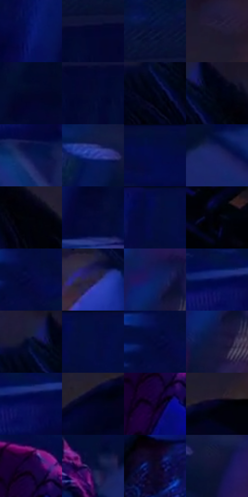

# 电影参考 279

- 状态：常规／活跃；来源世界：miles-home。
- 视角：high-angle；景别：medium；场景：portrait。
- 时段：interior-time-unknown（外观依据，中置信度；具体时间／晨昏未知）；光照：cool-interior。
- 材质候选：skin, hair, fabric, paint（帧级，不是像素分割）。
- 明暗组：very-dark；L* P5/P50/P95：0.54717 / 5.40102 / 19.35519。
- 资格门禁：无附加门禁。
- 原截图 SHA-256：`691a6e897605b7c2078c952ec060a50f251379130956bf74e8c77fd36411e792`；尺寸：2880 × 1206。
- sRGB 像素 SHA-256：`09b13ad20b87bc11e42cd0d7773c247383e60ca489568d8dbaadbb8e8492805b`。

## 观察与迁移

俯视蓝光人物，鼻唇眉眼仍是面部体块不是边缘描线。

279  /  俯角侧脸；鼻唇下颌与头发  /  额鼻唇颏的连续轮廓、仰脸口形和大束头发，蓝暗中仍有体积  /  角度影响鼻长与眼距，不据此编固定五官参数

本公开版保存32个128×128原像素色卡上下文；图集格子并非原场景相邻位置。原rect、图集tile和像素SHA见 `data/palette-crops.json`。上下文不足时不得批准替色，不能以小样推断完整构图。

## 实测色卡

颜色比例分母为保留采样像素，不是材料面积；全部 32 色参与全库匹配。表内四舍五入仅用于阅读，原精度在 JSON。

| ID | HEX | Lab | 原图 xy | 像素数 | 比例 | 明度角色 |
| --- | --- | --- | --- | ---: | ---: | --- |
| 279-S01 | #061468 | [12.848013, 30.49686, -49.349214] | [1164, 104] | 12368 | 6.396822% | deep-shadow |
| 279-S02 | #02062F | [3.146169, 11.141427, -25.483498] | [204, 176] | 11260 | 5.823756% | deep-shadow |
| 279-S03 | #060E34 | [5.425318, 11.503095, -25.535208] | [168, 88] | 10986 | 5.682042% | deep-shadow |
| 279-S04 | #1D1830 | [10.013986, 9.454681, -15.15752] | [2556, 148] | 10853 | 5.613253% | deep-shadow |
| 279-S05 | #020628 | [2.676346, 7.839932, -20.911609] | [1476, 548] | 9644 | 4.987949% | deep-shadow |
| 279-S06 | #040A30 | [4.120815, 10.580194, -24.671233] | [116, 224] | 8523 | 4.408159% | deep-shadow |
| 279-S07 | #010219 | [1.084188, 3.913607, -11.455194] | [2108, 232] | 8451 | 4.370921% | deep-shadow |
| 279-S08 | #010211 | [0.815878, 2.028173, -6.323771] | [2168, 184] | 7929 | 4.100938% | deep-shadow |
| 279-S09 | #0A174D | [10.652205, 17.663839, -34.773965] | [1096, 396] | 7634 | 3.948362% | deep-shadow |
| 279-S10 | #223291 | [25.757397, 28.681945, -54.144399] | [1452, 208] | 7478 | 3.867678% | shadow |
| 279-S11 | #030D3B | [5.625959, 15.259835, -30.319723] | [1012, 28] | 7464 | 3.860437% | deep-shadow |
| 279-S12 | #1C2569 | [18.318647, 21.366021, -40.966405] | [864, 460] | 6573 | 3.399605% | deep-shadow |
| 279-S13 | #02020C | [0.748444, 1.406063, -3.826788] | [2252, 260] | 6063 | 3.135829% | deep-shadow |
| 279-S14 | #030835 | [4.064388, 13.888754, -28.470354] | [1288, 136] | 5725 | 2.961013% | deep-shadow |
| 279-S15 | #040D45 | [6.712714, 20.676526, -35.680281] | [564, 44] | 5262 | 2.721546% | deep-shadow |
| 279-S16 | #010106 | [0.373108, 0.695202, -1.892085] | [2796, 328] | 5138 | 2.657412% | deep-shadow |
| 279-S17 | #04083E | [4.942164, 19.513312, -33.59339] | [884, 88] | 4979 | 2.575176% | deep-shadow |
| 279-S18 | #2B1F40 | [14.754997, 14.35447, -18.982376] | [1896, 376] | 4723 | 2.442771% | deep-shadow |
| 279-S19 | #0D1E61 | [14.826877, 21.30835, -41.447419] | [1712, 92] | 4716 | 2.439151% | deep-shadow |
| 279-S20 | #020F4F | [8.29591, 23.59411, -40.049869] | [1040, 264] | 4567 | 2.362087% | deep-shadow |
| 279-S21 | #05102F | [5.491879, 7.491309, -21.736948] | [2100, 164] | 4447 | 2.300022% | deep-shadow |
| 279-S22 | #040E40 | [6.412339, 17.583472, -32.62497] | [608, 28] | 4363 | 2.256576% | deep-shadow |
| 279-S23 | #040939 | [4.665185, 16.153348, -30.425716] | [856, 84] | 4227 | 2.186236% | deep-shadow |
| 279-S24 | #15173E | [9.952749, 13.126285, -25.382014] | [1716, 176] | 4039 | 2.089001% | deep-shadow |
| 279-S25 | #080A52 | [7.927707, 28.413662, -42.716182] | [1076, 280] | 3807 | 1.969009% | deep-shadow |
| 279-S26 | #010423 | [1.938288, 6.358611, -18.182783] | [2464, 308] | 3660 | 1.892979% | deep-shadow |
| 279-S27 | #12032C | [3.392162, 15.547547, -22.765015] | [904, 824] | 3558 | 1.840224% | deep-shadow |
| 279-S28 | #02031E | [1.551211, 5.268763, -14.805285] | [2552, 256] | 3488 | 1.804020% | deep-shadow |
| 279-S29 | #1C023F | [5.86327, 28.253158, -32.724927] | [912, 748] | 3301 | 1.707302% | deep-shadow |
| 279-S30 | #080F3C | [6.498048, 15.649697, -29.609445] | [728, 460] | 2901 | 1.500419% | deep-shadow |
| 279-S31 | #0D0622 | [2.992425, 8.391876, -15.720803] | [1756, 972] | 2791 | 1.443526% | deep-shadow |
| 279-S32 | #111236 | [7.389166, 12.728448, -23.795552] | [1560, 240] | 2428 | 1.255780% | deep-shadow |

## 色阶与空间分布

- 采样 ROI：`[0.01, 0.02, 0.98, 0.94]`；步长：4；样本数：193346。
- 排除区：`[]`。
- 深暗、暗、中、亮、高光五段计数：`[184583, 8703, 60, 0, 0]`。
- RGB 各 256 箱、L* 100 箱、13×5 色相明度表和 3×3 空间统计全部保存在 [总数据](../film-library.json)。
- [可视化档案](../../references/library.html)按需绘制直方图，不存 2,094 张重复图表图片。

## 纹理特征占比

**这是分块图像特征的面积占比，不是波点／排线／丝网／错版的精确语义覆盖率。** 窗格、发丝、织物也会产生方向或周期特征。
原图 ROI 像素 3098546；已测块覆盖 3098546（100.0000%）；未测 0。

| 特征 | 块覆盖像素 | 占已测面积 | 阈值敏感范围 |
| --- | ---: | ---: | --- |
| low-contrast | 909362 | 29.3480% | 23.2714% ~ 37.2795% |
| directional-structure | 322176 | 10.3977% | 3.5237% ~ 23.9679% |
| periodic-structure | 1746944 | 56.3795% | 52.5046% ~ 56.3795% |
| mixed-detail | 120064 | 3.8748% | 0.0000% ~ 6.6922% |

阈值敏感范围不是统计置信区间。逐块坐标、尺度、对比、方向一致性、频谱集中度、频率与角度见 [全量特征记录](../texture-features.jsonl)，以帧号定位。
四种印刷层的真实像素覆盖仍标为 `null`，不能填 0，也不能拿上表代替。不得据这些代理测量删除唯一证据。

[测量方法与保留策略](../../references/library-retention.md) · [分类索引](../archive/README.md)
