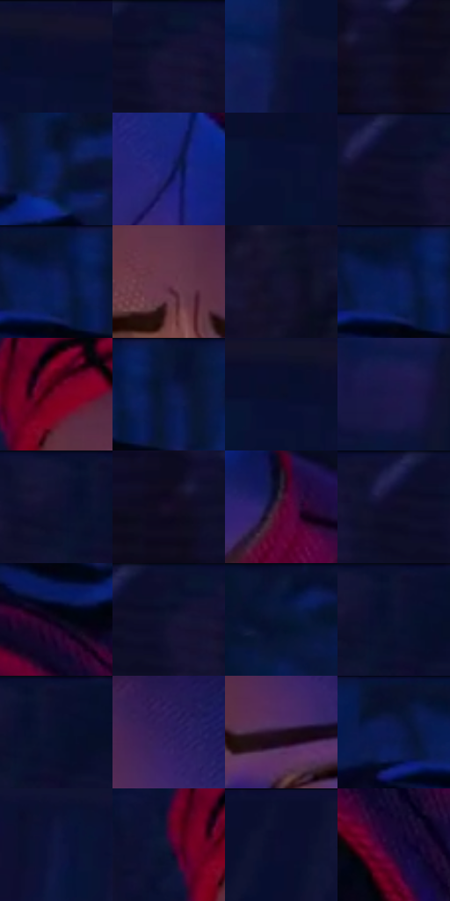

# 电影参考 280

- 状态：常规／活跃；来源世界：miles-home。
- 视角：high-angle；景别：close-up；场景：portrait。
- 时段：interior-time-unknown（外观依据，中置信度；具体时间／晨昏未知）；光照：cool-interior。
- 材质候选：skin, hair, fabric, paint（帧级，不是像素分割）。
- 明暗组：very-dark；L* P5/P50/P95：4.2165 / 7.12667 / 24.19346。
- 资格门禁：无附加门禁。
- 原截图 SHA-256：`a9527dee889e80d7a09765b583a0a1fad38fca18542b11e0c4bebf3c9098045d`；尺寸：2880 × 1210。
- sRGB 像素 SHA-256：`5de9dafa07db5754c77f187d8d75eeb11519f60ffa460dd28be12e2a30a56eed`。

## 观察与迁移

俯视蓝光人物，鼻唇眉眼仍是面部体块不是边缘描线。

280  /  少年面部近景；表情线  /  眯眼、眉间少量短线、鼻体与唇形协同表达神态，皮肤非硬切纸片  /  迁移画法而非眯眼表情；不以满脸排线替代面部设计

本公开版保存32个128×128原像素色卡上下文；图集格子并非原场景相邻位置。原rect、图集tile和像素SHA见 `data/palette-crops.json`。上下文不足时不得批准替色，不能以小样推断完整构图。

## 实测色卡

颜色比例分母为保留采样像素，不是材料面积；全部 32 色参与全库匹配。表内四舍五入仅用于阅读，原精度在 JSON。

| ID | HEX | Lab | 原图 xy | 像素数 | 比例 | 明度角色 |
| --- | --- | --- | --- | ---: | ---: | --- |
| 280-S01 | #11112B | [6.27272, 8.487966, -17.465471] | [2572, 40] | 13298 | 6.853085% | deep-shadow |
| 280-S02 | #08102E | [5.594761, 7.769546, -20.818659] | [240, 32] | 10766 | 5.548226% | deep-shadow |
| 280-S03 | #0E1436 | [7.767448, 10.543613, -23.196522] | [2180, 260] | 10193 | 5.252932% | deep-shadow |
| 280-S04 | #111026 | [5.687599, 6.870204, -14.613331] | [136, 348] | 8808 | 4.539177% | deep-shadow |
| 280-S05 | #0D1E5C | [14.324202, 19.193227, -38.940435] | [1432, 104] | 8258 | 4.255736% | deep-shadow |
| 280-S06 | #1F2677 | [20.079466, 26.519409, -47.124895] | [1360, 808] | 8151 | 4.200594% | shadow |
| 280-S07 | #0A1032 | [6.009631, 10.357805, -23.112717] | [2516, 116] | 8083 | 4.165550% | deep-shadow |
| 280-S08 | #0D0E27 | [4.932633, 6.966174, -16.573431] | [184, 56] | 7969 | 4.106801% | deep-shadow |
| 280-S09 | #09153B | [8.218262, 11.055576, -26.090152] | [1280, 36] | 7394 | 3.810476% | deep-shadow |
| 280-S10 | #68374E | [29.97584, 24.987582, -4.366772] | [1036, 480] | 7303 | 3.763579% | shadow |
| 280-S11 | #141330 | [7.477447, 10.326332, -19.24741] | [364, 696] | 7201 | 3.711014% | deep-shadow |
| 280-S12 | #071435 | [7.248023, 8.622862, -23.329093] | [1272, 28] | 7105 | 3.661541% | deep-shadow |
| 280-S13 | #760225 | [23.769605, 46.117047, 14.801982] | [956, 328] | 6670 | 3.437365% | shadow |
| 280-S14 | #0B1848 | [10.498824, 14.82185, -31.557526] | [1356, 60] | 6287 | 3.239987% | deep-shadow |
| 280-S15 | #080F29 | [4.997882, 5.945631, -18.010173] | [2512, 76] | 5853 | 3.016326% | deep-shadow |
| 280-S16 | #1C1748 | [11.465749, 18.597605, -29.928303] | [2076, 836] | 5749 | 2.962730% | deep-shadow |
| 280-S17 | #101332 | [7.281482, 10.009531, -21.051025] | [420, 36] | 5648 | 2.910680% | deep-shadow |
| 280-S18 | #0F0B20 | [4.021118, 6.315771, -12.575403] | [36, 348] | 5578 | 2.874606% | deep-shadow |
| 280-S19 | #4A092B | [14.54649, 32.398739, -3.877209] | [1536, 880] | 5553 | 2.861722% | deep-shadow |
| 280-S20 | #100D2C | [5.237274, 10.690639, -19.857276] | [152, 56] | 4845 | 2.496856% | deep-shadow |
| 280-S21 | #0A071A | [2.629031, 4.543097, -9.941918] | [1320, 192] | 4750 | 2.447898% | deep-shadow |
| 280-S22 | #0D132F | [6.833048, 7.819584, -19.570942] | [220, 40] | 4729 | 2.437076% | deep-shadow |
| 280-S23 | #0A1738 | [8.676861, 8.256348, -23.187555] | [1772, 28] | 4324 | 2.228361% | deep-shadow |
| 280-S24 | #0B1330 | [6.776483, 7.768569, -20.407492] | [460, 32] | 4270 | 2.200532% | deep-shadow |
| 280-S25 | #0C102F | [5.906607, 9.350385, -21.05146] | [480, 28] | 4011 | 2.067057% | deep-shadow |
| 280-S26 | #2E1E5E | [17.071532, 25.531036, -35.684948] | [1180, 412] | 3938 | 2.029437% | deep-shadow |
| 280-S27 | #1F0C21 | [5.998681, 13.670192, -10.180145] | [1152, 520] | 3703 | 1.908330% | deep-shadow |
| 280-S28 | #06122F | [6.110473, 6.608223, -20.747713] | [1192, 36] | 3620 | 1.865556% | deep-shadow |
| 280-S29 | #0F1740 | [9.67529, 12.719614, -27.271424] | [2544, 344] | 3277 | 1.688792% | deep-shadow |
| 280-S30 | #1F1231 | [8.530202, 14.92194, -18.227368] | [880, 340] | 2857 | 1.472346% | deep-shadow |
| 280-S31 | #0B0D2E | [5.023884, 10.087324, -21.715496] | [2816, 48] | 2346 | 1.209004% | deep-shadow |
| 280-S32 | #190A35 | [6.149102, 19.376466, -25.025123] | [1428, 392] | 1507 | 0.776628% | deep-shadow |

## 色阶与空间分布

- 采样 ROI：`[0.01, 0.02, 0.98, 0.94]`；步长：4；样本数：194044。
- 排除区：`[]`。
- 深暗、暗、中、亮、高光五段计数：`[175743, 17635, 664, 2, 0]`。
- RGB 各 256 箱、L* 100 箱、13×5 色相明度表和 3×3 空间统计全部保存在 [总数据](../film-library.json)。
- [可视化档案](../../references/library.html)按需绘制直方图，不存 2,094 张重复图表图片。

## 纹理特征占比

**这是分块图像特征的面积占比，不是波点／排线／丝网／错版的精确语义覆盖率。** 窗格、发丝、织物也会产生方向或周期特征。
原图 ROI 像素 3109722；已测块覆盖 3109722（100.0000%）；未测 0。

| 特征 | 块覆盖像素 | 占已测面积 | 阈值敏感范围 |
| --- | ---: | ---: | --- |
| low-contrast | 1554010 | 49.9726% | 41.1971% ~ 57.7151% |
| directional-structure | 158848 | 5.1081% | 1.0537% ~ 10.5826% |
| periodic-structure | 1380480 | 44.3924% | 40.7043% ~ 47.6935% |
| mixed-detail | 16384 | 0.5269% | 0.5269% ~ 0.5269% |

阈值敏感范围不是统计置信区间。逐块坐标、尺度、对比、方向一致性、频谱集中度、频率与角度见 [全量特征记录](../texture-features.jsonl)，以帧号定位。
四种印刷层的真实像素覆盖仍标为 `null`，不能填 0，也不能拿上表代替。不得据这些代理测量删除唯一证据。

[测量方法与保留策略](../../references/library-retention.md) · [分类索引](../archive/README.md)
