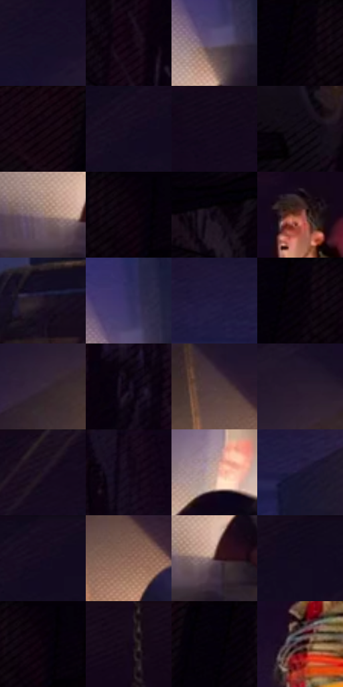

# 电影参考 281

- 状态：常规／活跃；来源世界：miles-home。
- 视角：low-angle；景别：environment-wide；场景：interior。
- 时段：interior-time-unknown（外观依据，中置信度；具体时间／晨昏未知）；光照：interior-mixed。
- 材质候选：skin, hair, fabric, wood, metal, paint（帧级，不是像素分割）。
- 明暗组：very-dark；L* P5/P50/P95：0.52793 / 5.37373 / 52.46517。
- 资格门禁：无附加门禁。
- 原截图 SHA-256：`4227e8b1ed9e60a4ff7db8cb200944c8fa33371d083910839615a3bb2a91d1ac`；尺寸：2880 × 1210。
- sRGB 像素 SHA-256：`e2791d4dc071075518cf1c13286b82119b9ba285338d42e9ab894bdafd66a6a7`。

## 观察与迁移

冷蓝暗部与暖灯双侧作用，明亮灯晕不掩盖人物结构。

281  /  双人全景；光源与远景简化  /  地灯、人物暗部和墙面有因果关系，小脸保留少数识别形  /  不移植姿势、绳索或家具，不把灯锥当皮肤高光

本公开版保存32个128×128原像素色卡上下文；图集格子并非原场景相邻位置。原rect、图集tile和像素SHA见 `data/palette-crops.json`。上下文不足时不得批准替色，不能以小样推断完整构图。

## 实测色卡

颜色比例分母为保留采样像素，不是材料面积；全部 32 色参与全库匹配。表内四舍五入仅用于阅读，原精度在 JSON。

| ID | HEX | Lab | 原图 xy | 像素数 | 比例 | 明度角色 |
| --- | --- | --- | --- | ---: | ---: | --- |
| 281-S01 | #181029 | [6.547449, 10.971497, -15.486322] | [2284, 240] | 9223 | 4.753046% | deep-shadow |
| 281-S02 | #150716 | [3.336169, 7.332134, -5.722321] | [724, 128] | 7884 | 4.062996% | deep-shadow |
| 281-S03 | #605474 | [38.000501, 11.97231, -16.41372] | [2124, 920] | 7861 | 4.051143% | shadow |
| 281-S04 | #06010A | [0.743799, 2.558874, -2.945086] | [208, 28] | 7607 | 3.920245% | deep-shadow |
| 281-S05 | #11040F | [2.172538, 5.415295, -3.108845] | [44, 64] | 7550 | 3.890870% | deep-shadow |
| 281-S06 | #160C21 | [4.907743, 9.027354, -11.944607] | [2672, 80] | 7300 | 3.762033% | deep-shadow |
| 281-S07 | #15091B | [3.91978, 7.876389, -8.740113] | [1884, 28] | 7290 | 3.756880% | deep-shadow |
| 281-S08 | #110A16 | [3.560627, 4.499014, -5.438199] | [672, 400] | 7208 | 3.714621% | deep-shadow |
| 281-S09 | #947A7C | [53.676071, 10.389521, 2.692454] | [2032, 1052] | 7036 | 3.625982% | midtone |
| 281-S10 | #0A010A | [0.977034, 3.604871, -2.576532] | [292, 28] | 6965 | 3.589392% | deep-shadow |
| 281-S11 | #0D0612 | [2.343953, 3.835007, -4.601759] | [568, 64] | 6923 | 3.567748% | deep-shadow |
| 281-S12 | #833C2F | [34.525922, 29.442988, 22.458808] | [1448, 196] | 6877 | 3.544042% | shadow |
| 281-S13 | #221624 | [9.330874, 9.305706, -7.302664] | [2368, 944] | 6765 | 3.486323% | deep-shadow |
| 281-S14 | #332F5C | [21.97807, 14.639556, -26.445888] | [2132, 852] | 6762 | 3.484777% | shadow |
| 281-S15 | #221C3E | [12.723976, 12.9309, -20.865565] | [2076, 420] | 6594 | 3.398198% | deep-shadow |
| 281-S16 | #040006 | [0.351956, 1.88026, -1.901987] | [216, 28] | 6466 | 3.332234% | deep-shadow |
| 281-S17 | #372937 | [18.68794, 9.508537, -6.503874] | [2428, 360] | 6457 | 3.327596% | deep-shadow |
| 281-S18 | #0A030D | [1.433691, 3.257009, -3.237494] | [816, 36] | 6307 | 3.250294% | deep-shadow |
| 281-S19 | #503C40 | [27.593694, 9.503306, 0.937717] | [2628, 344] | 6259 | 3.225557% | shadow |
| 281-S20 | #281C2E | [12.473288, 10.132826, -9.768872] | [2508, 252] | 6028 | 3.106512% | deep-shadow |
| 281-S21 | #1B101E | [6.299089, 8.538022, -7.458813] | [2072, 28] | 5827 | 3.002927% | deep-shadow |
| 281-S22 | #110415 | [2.349989, 6.662262, -6.502607] | [972, 56] | 5589 | 2.880275% | deep-shadow |
| 281-S23 | #C9A99E | [71.733493, 9.932162, 10.024778] | [1116, 928] | 5311 | 2.737008% | light |
| 281-S24 | #1A1530 | [8.73299, 10.700575, -17.207445] | [2232, 476] | 5228 | 2.694234% | deep-shadow |
| 281-S25 | #180A1F | [4.608703, 10.14055, -10.824562] | [2704, 52] | 5149 | 2.653522% | deep-shadow |
| 281-S26 | #856050 | [44.135862, 12.808849, 15.069143] | [2676, 428] | 5127 | 2.642184% | midtone |
| 281-S27 | #3E2223 | [16.939841, 13.573469, 5.092041] | [2088, 1060] | 4399 | 2.267012% | deep-shadow |
| 281-S28 | #110A1D | [3.83855, 6.452003, -10.482185] | [2484, 32] | 4303 | 2.217538% | deep-shadow |
| 281-S29 | #070008 | [0.566456, 2.942846, -2.382419] | [308, 28] | 4157 | 2.142298% | deep-shadow |
| 281-S30 | #170B1C | [4.564826, 8.284864, -8.54966] | [1552, 28] | 3359 | 1.731051% | deep-shadow |
| 281-S31 | #040009 | [0.411316, 2.297392, -3.037258] | [172, 28] | 3115 | 1.605306% | deep-shadow |
| 281-S32 | #2D1018 | [8.946006, 15.977641, 1.401735] | [1420, 348] | 1118 | 0.576158% | deep-shadow |

## 色阶与空间分布

- 采样 ROI：`[0.01, 0.02, 0.98, 0.94]`；步长：4；样本数：194044。
- 排除区：`[]`。
- 深暗、暗、中、亮、高光五段计数：`[148515, 25364, 14461, 4852, 852]`。
- RGB 各 256 箱、L* 100 箱、13×5 色相明度表和 3×3 空间统计全部保存在 [总数据](../film-library.json)。
- [可视化档案](../../references/library.html)按需绘制直方图，不存 2,094 张重复图表图片。

## 纹理特征占比

**这是分块图像特征的面积占比，不是波点／排线／丝网／错版的精确语义覆盖率。** 窗格、发丝、织物也会产生方向或周期特征。
原图 ROI 像素 3109722；已测块覆盖 3109722（100.0000%）；未测 0。

| 特征 | 块覆盖像素 | 占已测面积 | 阈值敏感范围 |
| --- | ---: | ---: | --- |
| low-contrast | 959066 | 30.8409% | 24.2427% ~ 35.4221% |
| directional-structure | 211584 | 6.8040% | 2.0169% ~ 18.4402% |
| periodic-structure | 1752448 | 56.3538% | 49.7104% ~ 56.3538% |
| mixed-detail | 186624 | 6.0013% | 2.4738% ~ 12.8505% |

阈值敏感范围不是统计置信区间。逐块坐标、尺度、对比、方向一致性、频谱集中度、频率与角度见 [全量特征记录](../texture-features.jsonl)，以帧号定位。
四种印刷层的真实像素覆盖仍标为 `null`，不能填 0，也不能拿上表代替。不得据这些代理测量删除唯一证据。

[测量方法与保留策略](../../references/library-retention.md) · [分类索引](../archive/README.md)
