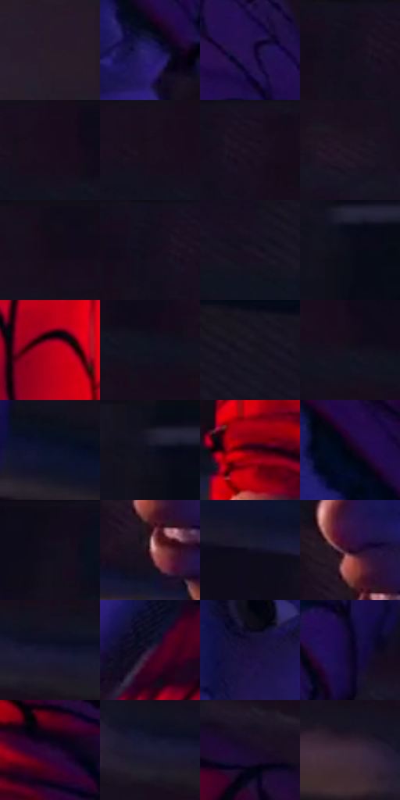

# 电影参考 282

- 状态：常规／活跃；来源世界：miles-home。
- 视角：near-level；景别：close-up；场景：portrait。
- 时段：interior-time-unknown（外观依据，中置信度；具体时间／晨昏未知）；光照：interior-mixed。
- 材质候选：skin, hair, fabric, paint（帧级，不是像素分割）。
- 明暗组：very-dark；L* P5/P50/P95：3.65192 / 6.54449 / 25.34819。
- 资格门禁：无附加门禁。
- 原截图 SHA-256：`e8c9c2ef07e4ce474a5fb352f5ebab12e115f286684edb20c67db31c60f42c28`；尺寸：2880 × 1200。
- sRGB 像素 SHA-256：`80f60b2438178cb614c65c6acd472bf55980603ccbc6a390ff56d4664aa5bb45`。

## 观察与迁移

同室混合光的不同人脸、头向与表情，造型不能统一。

282  /  少年侧近景；说话口形  /  鼻尖、上唇、张口与眼睑有体积，脸颊转折不粗黑封闭  /  不把说话表情、手势或头饰复制给用户

本公开版保存32个128×128原像素色卡上下文；图集格子并非原场景相邻位置。原rect、图集tile和像素SHA见 `data/palette-crops.json`。上下文不足时不得批准替色，不能以小样推断完整构图。

## 实测色卡

颜色比例分母为保留采样像素，不是材料面积；全部 32 色参与全库匹配。表内四舍五入仅用于阅读，原精度在 JSON。

| ID | HEX | Lab | 原图 xy | 像素数 | 比例 | 明度角色 |
| --- | --- | --- | --- | ---: | ---: | --- |
| 282-S01 | #281B29 | [11.925099, 9.545389, -6.96847] | [276, 944] | 14373 | 7.460757% | deep-shadow |
| 282-S02 | #251C65 | [16.320852, 27.446967, -41.581286] | [1660, 576] | 12640 | 6.561189% | deep-shadow |
| 282-S03 | #200F4A | [10.130096, 25.456219, -33.479922] | [1776, 192] | 11333 | 5.882750% | deep-shadow |
| 282-S04 | #15101F | [5.68108, 5.899543, -9.229764] | [748, 24] | 11211 | 5.819422% | deep-shadow |
| 282-S05 | #180C1C | [4.886705, 8.336976, -8.058182] | [2092, 24] | 10691 | 5.549500% | deep-shadow |
| 282-S06 | #190F1E | [5.799748, 8.018539, -8.235711] | [2056, 24] | 10237 | 5.313837% | deep-shadow |
| 282-S07 | #180F21 | [5.832031, 8.53216, -10.512769] | [804, 24] | 9855 | 5.115548% | deep-shadow |
| 282-S08 | #201525 | [8.7983, 9.46188, -8.893441] | [720, 528] | 9624 | 4.995640% | deep-shadow |
| 282-S09 | #120C1A | [4.21042, 5.091475, -7.549443] | [480, 24] | 8995 | 4.669137% | deep-shadow |
| 282-S10 | #130E1D | [4.888815, 5.443434, -8.890064] | [744, 28] | 8103 | 4.206117% | deep-shadow |
| 282-S11 | #1A1423 | [7.599091, 7.085103, -9.30346] | [2696, 128] | 7621 | 3.955920% | deep-shadow |
| 282-S12 | #0B0D19 | [3.876566, 2.025023, -7.306691] | [84, 92] | 6674 | 3.464349% | deep-shadow |
| 282-S13 | #B7011A | [38.140319, 62.678224, 41.46354] | [1368, 996] | 6495 | 3.371434% | shadow |
| 282-S14 | #111222 | [6.027147, 4.174482, -11.039487] | [2192, 128] | 6018 | 3.123832% | deep-shadow |
| 282-S15 | #171521 | [7.481772, 4.406517, -7.997264] | [2804, 24] | 5756 | 2.987833% | deep-shadow |
| 282-S16 | #12111E | [5.629438, 3.76137, -8.561687] | [2132, 104] | 5618 | 2.916199% | deep-shadow |
| 282-S17 | #0B112B | [5.838785, 6.55226, -18.179345] | [1920, 352] | 5375 | 2.790063% | deep-shadow |
| 282-S18 | #161325 | [6.954111, 6.744656, -11.850148] | [56, 52] | 5284 | 2.742826% | deep-shadow |
| 282-S19 | #5C001B | [17.250538, 39.048093, 12.230391] | [1196, 220] | 4405 | 2.286554% | deep-shadow |
| 282-S20 | #050514 | [1.727962, 2.509248, -6.829274] | [1532, 412] | 3764 | 1.953823% | deep-shadow |
| 282-S21 | #130C1F | [4.519251, 7.035399, -11.008105] | [2432, 52] | 3329 | 1.728022% | deep-shadow |
| 282-S22 | #774950 | [36.493374, 20.593183, 4.12162] | [1184, 768] | 3039 | 1.577488% | shadow |
| 282-S23 | #100E22 | [4.875048, 5.996536, -12.815243] | [2308, 472] | 3038 | 1.576969% | deep-shadow |
| 282-S24 | #280620 | [6.194314, 20.790398, -8.978299] | [1176, 684] | 3019 | 1.567107% | deep-shadow |
| 282-S25 | #171530 | [8.410126, 9.730274, -17.740812] | [660, 204] | 2702 | 1.402558% | deep-shadow |
| 282-S26 | #311D3C | [14.723518, 16.691465, -16.174264] | [1748, 860] | 2508 | 1.301856% | deep-shadow |
| 282-S27 | #190F3B | [7.804461, 18.806266, -26.702722] | [1312, 588] | 2425 | 1.258772% | deep-shadow |
| 282-S28 | #0E062A | [3.529442, 11.986433, -21.050797] | [1776, 468] | 2393 | 1.242162% | deep-shadow |
| 282-S29 | #270A34 | [8.096544, 23.335607, -21.052014] | [1352, 208] | 2336 | 1.212574% | deep-shadow |
| 282-S30 | #1D1C38 | [11.804783, 9.236167, -18.100199] | [616, 212] | 1648 | 0.855446% | deep-shadow |
| 282-S31 | #190929 | [5.077695, 14.87735, -17.786792] | [1892, 784] | 1230 | 0.638470% | deep-shadow |
| 282-S32 | #3D2A3C | [19.940964, 12.497147, -7.990563] | [504, 180] | 909 | 0.471845% | deep-shadow |

## 色阶与空间分布

- 采样 ROI：`[0.01, 0.02, 0.98, 0.94]`；步长：4；样本数：192648。
- 排除区：`[]`。
- 深暗、暗、中、亮、高光五段计数：`[179160, 9453, 3911, 124, 0]`。
- RGB 各 256 箱、L* 100 箱、13×5 色相明度表和 3×3 空间统计全部保存在 [总数据](../film-library.json)。
- [可视化档案](../../references/library.html)按需绘制直方图，不存 2,094 张重复图表图片。

## 纹理特征占比

**这是分块图像特征的面积占比，不是波点／排线／丝网／错版的精确语义覆盖率。** 窗格、发丝、织物也会产生方向或周期特征。
原图 ROI 像素 3084576；已测块覆盖 3084576（100.0000%）；未测 0。

| 特征 | 块覆盖像素 | 占已测面积 | 阈值敏感范围 |
| --- | ---: | ---: | --- |
| low-contrast | 1243904 | 40.3266% | 32.0106% ~ 44.2283% |
| directional-structure | 567584 | 18.4007% | 8.1002% ~ 27.6711% |
| periodic-structure | 1240320 | 40.2104% | 40.2104% ~ 42.5591% |
| mixed-detail | 32768 | 1.0623% | 0.0000% ~ 5.1124% |

阈值敏感范围不是统计置信区间。逐块坐标、尺度、对比、方向一致性、频谱集中度、频率与角度见 [全量特征记录](../texture-features.jsonl)，以帧号定位。
四种印刷层的真实像素覆盖仍标为 `null`，不能填 0，也不能拿上表代替。不得据这些代理测量删除唯一证据。

[测量方法与保留策略](../../references/library-retention.md) · [分类索引](../archive/README.md)
