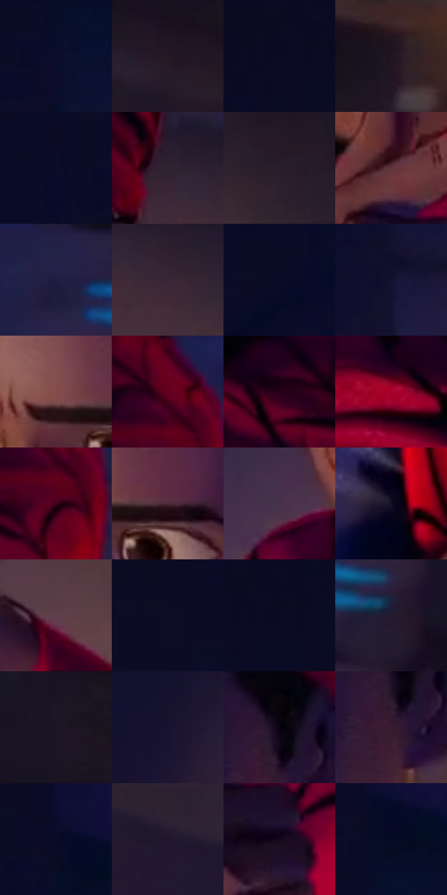

# 电影参考 283

- 状态：常规／活跃；来源世界：miles-home。
- 视角：high-angle；景别：close-up；场景：portrait。
- 时段：interior-time-unknown（外观依据，中置信度；具体时间／晨昏未知）；光照：interior-mixed。
- 材质候选：skin, hair, fabric, paint（帧级，不是像素分割）。
- 明暗组：very-dark；L* P5/P50/P95：3.63818 / 9.66823 / 33.45794。
- 资格门禁：无附加门禁。
- 原截图 SHA-256：`d78f4bcd2798aa3f24880dcfbc3e4379648a8b80bc26bba93b2e28b421558284`；尺寸：2880 × 1198。
- sRGB 像素 SHA-256：`a0bd220f377decce49fff016675524138bdad54cba9d32a42d5eddc0495c020c`。

## 观察与迁移

同室混合光的不同人脸、头向与表情，造型不能统一。

283  /  少年近正面；眉眼与鼻侧暗形  /  较睁开的眼睛、非对称眉形、压紧的嘴唇；同角色不同表情范围  /  不默认托腮、忧虑或内心字幕；眼睛不机械统一放大

本公开版保存32个128×128原像素色卡上下文；图集格子并非原场景相邻位置。原rect、图集tile和像素SHA见 `data/palette-crops.json`。上下文不足时不得批准替色，不能以小样推断完整构图。

## 实测色卡

颜色比例分母为保留采样像素，不是材料面积；全部 32 色参与全库匹配。表内四舍五入仅用于阅读，原精度在 JSON。

| ID | HEX | Lab | 原图 xy | 像素数 | 比例 | 明度角色 |
| --- | --- | --- | --- | ---: | ---: | --- |
| 283-S01 | #0B0E2C | [5.12167, 8.625775, -20.062915] | [948, 240] | 11551 | 5.995910% | deep-shadow |
| 283-S02 | #251925 | [10.720016, 8.676048, -5.893407] | [2208, 304] | 10548 | 5.475271% | deep-shadow |
| 283-S03 | #0B0C21 | [4.009339, 4.998247, -13.397244] | [556, 36] | 10307 | 5.350172% | deep-shadow |
| 283-S04 | #1E1521 | [8.325498, 7.488855, -6.631336] | [2668, 60] | 9890 | 5.133715% | deep-shadow |
| 283-S05 | #0B0D29 | [4.688352, 7.729513, -18.483862] | [844, 132] | 9847 | 5.111395% | deep-shadow |
| 283-S06 | #2F2232 | [15.375176, 9.799956, -8.11275] | [1716, 400] | 9290 | 4.822267% | deep-shadow |
| 283-S07 | #291D2A | [12.717939, 8.787149, -6.480166] | [2032, 516] | 8249 | 4.281903% | deep-shadow |
| 283-S08 | #60343C | [27.489382, 20.799983, 3.701646] | [1484, 884] | 8063 | 4.185354% | shadow |
| 283-S09 | #262248 | [15.612048, 13.239895, -23.201855] | [1904, 44] | 7586 | 3.937752% | deep-shadow |
| 283-S10 | #382635 | [17.846608, 11.533833, -6.368235] | [1804, 452] | 7540 | 3.913874% | deep-shadow |
| 283-S11 | #090D26 | [4.388269, 5.921067, -16.677794] | [420, 616] | 7019 | 3.643433% | deep-shadow |
| 283-S12 | #121131 | [6.785278, 11.497144, -21.101278] | [964, 448] | 6934 | 3.599311% | deep-shadow |
| 283-S13 | #844C49 | [38.823402, 23.295762, 12.037212] | [1256, 388] | 6291 | 3.265541% | shadow |
| 283-S14 | #690123 | [20.624279, 42.765318, 11.509322] | [1684, 36] | 6233 | 3.235435% | shadow |
| 283-S15 | #250019 | [4.18769, 20.249435, -6.50405] | [1548, 128] | 5677 | 2.946825% | deep-shadow |
| 283-S16 | #A6012B | [34.611699, 58.924021, 26.611734] | [1276, 84] | 5664 | 2.940077% | shadow |
| 283-S17 | #40021D | [10.721869, 30.646865, 0.669315] | [1692, 140] | 5580 | 2.896474% | deep-shadow |
| 283-S18 | #4B2A35 | [21.613076, 17.028552, -0.479706] | [1344, 404] | 5570 | 2.891284% | shadow |
| 283-S19 | #463249 | [23.883329, 13.782268, -10.700365] | [1096, 636] | 4884 | 2.535194% | shadow |
| 283-S20 | #131023 | [5.693917, 6.471773, -12.302403] | [1136, 1096] | 4879 | 2.532598% | deep-shadow |
| 283-S21 | #5E414C | [31.072759, 14.481831, -1.596554] | [1676, 648] | 4801 | 2.492110% | shadow |
| 283-S22 | #0D0D25 | [4.579148, 6.630907, -15.596408] | [256, 616] | 4558 | 2.365973% | deep-shadow |
| 283-S23 | #0A0A24 | [3.69394, 6.691057, -16.212242] | [596, 24] | 4550 | 2.361821% | deep-shadow |
| 283-S24 | #261B31 | [12.074877, 10.903087, -12.577187] | [2068, 132] | 4488 | 2.329637% | deep-shadow |
| 283-S25 | #1C1524 | [8.223152, 7.489432, -9.073383] | [2264, 112] | 4433 | 2.301088% | deep-shadow |
| 283-S26 | #181330 | [7.88829, 11.58174, -18.567435] | [892, 680] | 3635 | 1.886861% | deep-shadow |
| 283-S27 | #0A0211 | [1.340657, 4.381667, -5.494524] | [1544, 404] | 3543 | 1.839106% | deep-shadow |
| 283-S28 | #371B31 | [14.501455, 17.656804, -8.632153] | [1536, 468] | 2933 | 1.522466% | deep-shadow |
| 283-S29 | #070B27 | [3.892623, 6.708181, -18.223749] | [944, 108] | 2889 | 1.499626% | deep-shadow |
| 283-S30 | #21162C | [9.632933, 11.155043, -12.788792] | [2504, 1108] | 2740 | 1.422283% | deep-shadow |
| 283-S31 | #14081B | [3.626955, 7.843062, -9.184321] | [1556, 1004] | 1839 | 0.954591% | deep-shadow |
| 283-S32 | #040B24 | [3.545165, 4.711288, -16.47059] | [972, 148] | 637 | 0.330655% | deep-shadow |

## 色阶与空间分布

- 采样 ROI：`[0.01, 0.02, 0.98, 0.94]`；步长：4；样本数：192648。
- 排除区：`[]`。
- 深暗、暗、中、亮、高光五段计数：`[154008, 36270, 2349, 21, 0]`。
- RGB 各 256 箱、L* 100 箱、13×5 色相明度表和 3×3 空间统计全部保存在 [总数据](../film-library.json)。
- [可视化档案](../../references/library.html)按需绘制直方图，不存 2,094 张重复图表图片。

## 纹理特征占比

**这是分块图像特征的面积占比，不是波点／排线／丝网／错版的精确语义覆盖率。** 窗格、发丝、织物也会产生方向或周期特征。
原图 ROI 像素 3081782；已测块覆盖 3081782（100.0000%）；未测 0。

| 特征 | 块覆盖像素 | 占已测面积 | 阈值敏感范围 |
| --- | ---: | ---: | --- |
| low-contrast | 1454262 | 47.1890% | 43.3429% ~ 49.8472% |
| directional-structure | 358016 | 11.6172% | 3.8461% ~ 15.8703% |
| periodic-structure | 1193856 | 38.7391% | 38.7391% ~ 41.1938% |
| mixed-detail | 75648 | 2.4547% | 1.0633% ~ 5.1129% |

阈值敏感范围不是统计置信区间。逐块坐标、尺度、对比、方向一致性、频谱集中度、频率与角度见 [全量特征记录](../texture-features.jsonl)，以帧号定位。
四种印刷层的真实像素覆盖仍标为 `null`，不能填 0，也不能拿上表代替。不得据这些代理测量删除唯一证据。

[测量方法与保留策略](../../references/library-retention.md) · [分类索引](../archive/README.md)
