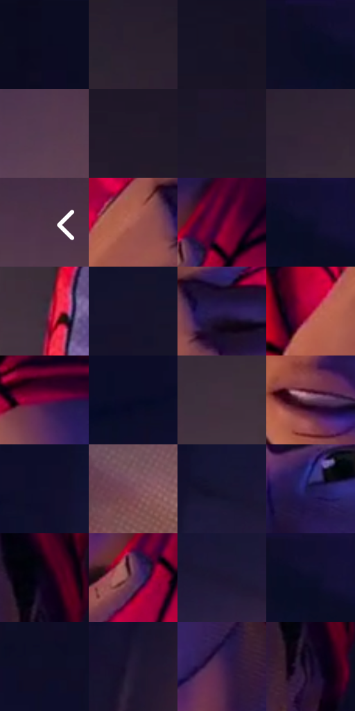

# 电影参考 284

- 状态：常规／活跃；来源世界：miles-home。
- 视角：near-level；景别：close-up；场景：portrait。
- 时段：interior-time-unknown（外观依据，中置信度；具体时间／晨昏未知）；光照：interior-mixed。
- 材质候选：skin, hair, fabric, paint（帧级，不是像素分割）。
- 明暗组：very-dark；L* P5/P50/P95：3.7784 / 11.14256 / 40.73189。
- 资格门禁：无附加门禁。
- 原截图 SHA-256：`459acd1fbe768c86f5fcb6ee3556b1f79c2687ed1a0983764e6b845595b3223f`；尺寸：2880 × 1202。
- sRGB 像素 SHA-256：`0ac1ecfcb42ae18d4414dfff41232a05a2259d32308dc15cb6b845f8bc395b3b`。

## 观察与迁移

同室混合光的不同人脸、头向与表情，造型不能统一。

284  /  裸脸／表情  /  眉口与鼻翼一起表达说话；暖冷脸面仍有体积，不冻结为固定眼睛比例

本公开版保存32个128×128原像素色卡上下文；图集格子并非原场景相邻位置。原rect、图集tile和像素SHA见 `data/palette-crops.json`。上下文不足时不得批准替色，不能以小样推断完整构图。

## 实测色卡

颜色比例分母为保留采样像素，不是材料面积；全部 32 色参与全库匹配。表内四舍五入仅用于阅读，原精度在 JSON。

| ID | HEX | Lab | 原图 xy | 像素数 | 比例 | 明度角色 |
| --- | --- | --- | --- | ---: | ---: | --- |
| 284-S01 | #0B0B22 | [3.847533, 5.794583, -14.421738] | [1768, 76] | 11098 | 5.760766% | deep-shadow |
| 284-S02 | #2A1F2F | [13.694521, 9.067135, -8.593388] | [860, 580] | 10729 | 5.569225% | deep-shadow |
| 284-S03 | #181325 | [7.167512, 7.593358, -11.502096] | [648, 72] | 9585 | 4.975396% | deep-shadow |
| 284-S04 | #0B0C27 | [4.340505, 7.325386, -17.507371] | [2520, 44] | 9127 | 4.737656% | deep-shadow |
| 284-S05 | #523B50 | [28.11727, 14.218005, -8.761341] | [2680, 688] | 9022 | 4.683153% | shadow |
| 284-S06 | #22192A | [10.575895, 8.742556, -9.839215] | [756, 360] | 8761 | 4.547672% | deep-shadow |
| 284-S07 | #1E172A | [9.449222, 8.628036, -11.626615] | [468, 288] | 8721 | 4.526909% | deep-shadow |
| 284-S08 | #332436 | [16.660257, 11.062207, -8.931022] | [196, 760] | 8157 | 4.234147% | deep-shadow |
| 284-S09 | #4A3346 | [24.531576, 14.045222, -7.664143] | [2820, 596] | 7225 | 3.750363% | shadow |
| 284-S10 | #A95E55 | [48.383767, 29.50565, 18.617419] | [1248, 988] | 7062 | 3.665753% | midtone |
| 284-S11 | #540030 | [15.997199, 38.70857, -5.10423] | [1532, 752] | 6881 | 3.571799% | deep-shadow |
| 284-S12 | #0D0E2A | [5.119389, 8.278522, -18.553183] | [2576, 64] | 6518 | 3.383373% | deep-shadow |
| 284-S13 | #382B3D | [19.661261, 10.008387, -9.160288] | [852, 932] | 6434 | 3.339770% | deep-shadow |
| 284-S14 | #16122B | [7.023652, 9.699704, -16.248809] | [108, 132] | 6350 | 3.296167% | deep-shadow |
| 284-S15 | #2A1B4E | [14.546549, 21.298117, -29.005936] | [1348, 980] | 6263 | 3.251007% | deep-shadow |
| 284-S16 | #A90237 | [35.512091, 60.093366, 20.157879] | [1136, 1060] | 6242 | 3.240106% | shadow |
| 284-S17 | #2D0120 | [6.178711, 25.603229, -8.913079] | [1212, 40] | 6112 | 3.172626% | deep-shadow |
| 284-S18 | #090A25 | [3.691581, 6.822724, -16.992164] | [2252, 300] | 5918 | 3.071924% | deep-shadow |
| 284-S19 | #40303F | [22.170206, 10.375829, -6.633609] | [452, 824] | 5861 | 3.042336% | shadow |
| 284-S20 | #624054 | [31.587225, 18.219363, -5.941809] | [1224, 544] | 5744 | 2.981604% | shadow |
| 284-S21 | #100F2B | [5.656122, 9.22644, -18.44453] | [2440, 256] | 5299 | 2.750613% | deep-shadow |
| 284-S22 | #7A4B5B | [37.708995, 22.293056, -0.984302] | [2764, 940] | 5258 | 2.729330% | shadow |
| 284-S23 | #17142F | [8.018103, 10.131211, -17.630114] | [2512, 380] | 4892 | 2.539346% | deep-shadow |
| 284-S24 | #1B1747 | [11.279569, 18.001623, -29.538893] | [1308, 320] | 4510 | 2.341057% | deep-shadow |
| 284-S25 | #0D0418 | [2.152922, 6.04945, -9.020913] | [1520, 228] | 4381 | 2.274096% | deep-shadow |
| 284-S26 | #623354 | [28.392882, 26.126992, -10.758986] | [1480, 812] | 3532 | 1.833396% | shadow |
| 284-S27 | #1E1532 | [9.341419, 12.722306, -17.674506] | [2600, 416] | 2937 | 1.524542% | deep-shadow |
| 284-S28 | #111031 | [6.426269, 11.812622, -21.680542] | [2568, 44] | 2647 | 1.374009% | deep-shadow |
| 284-S29 | #0E0E25 | [4.886501, 6.462891, -15.114134] | [2416, 112] | 2579 | 1.338711% | deep-shadow |
| 284-S30 | #241935 | [11.465413, 12.823585, -16.436081] | [2212, 816] | 2225 | 1.154956% | deep-shadow |
| 284-S31 | #45214F | [19.710641, 25.72986, -21.229215] | [1404, 616] | 1524 | 0.791080% | deep-shadow |
| 284-S32 | #170827 | [4.5372, 13.471325, -17.125831] | [1520, 308] | 1054 | 0.547112% | deep-shadow |

## 色阶与空间分布

- 采样 ROI：`[0.01, 0.02, 0.98, 0.94]`；步长：4；样本数：192648。
- 排除区：`[]`。
- 深暗、暗、中、亮、高光五段计数：`[138222, 44229, 10086, 111, 0]`。
- RGB 各 256 箱、L* 100 箱、13×5 色相明度表和 3×3 空间统计全部保存在 [总数据](../film-library.json)。
- [可视化档案](../../references/library.html)按需绘制直方图，不存 2,094 张重复图表图片。

## 纹理特征占比

**这是分块图像特征的面积占比，不是波点／排线／丝网／错版的精确语义覆盖率。** 窗格、发丝、织物也会产生方向或周期特征。
原图 ROI 像素 3087370；已测块覆盖 3087370（100.0000%）；未测 0。

| 特征 | 块覆盖像素 | 占已测面积 | 阈值敏感范围 |
| --- | ---: | ---: | --- |
| low-contrast | 1611904 | 52.2096% | 44.5355% ~ 56.5960% |
| directional-structure | 326016 | 10.5597% | 2.2637% ~ 20.0580% |
| periodic-structure | 1106314 | 35.8335% | 35.0707% ~ 39.2125% |
| mixed-detail | 43136 | 1.3972% | 0.3358% ~ 1.9279% |

阈值敏感范围不是统计置信区间。逐块坐标、尺度、对比、方向一致性、频谱集中度、频率与角度见 [全量特征记录](../texture-features.jsonl)，以帧号定位。
四种印刷层的真实像素覆盖仍标为 `null`，不能填 0，也不能拿上表代替。不得据这些代理测量删除唯一证据。

[测量方法与保留策略](../../references/library-retention.md) · [分类索引](../archive/README.md)
