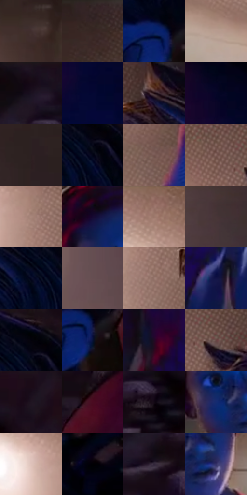

# 电影参考 285

- 状态：常规／活跃；来源世界：miles-home。
- 视角：high-angle；景别：medium；场景：portrait。
- 时段：interior-time-unknown（外观依据，中置信度；具体时间／晨昏未知）；光照：interior-mixed。
- 材质候选：skin, hair, fabric, paint（帧级，不是像素分割）。
- 明暗组：very-dark；L* P5/P50/P95：0.88293 / 16.55751 / 65.16718。
- 资格门禁：无附加门禁。
- 原截图 SHA-256：`f503604db8f82ea7fa38597403125e9bb2dd356b859f13bebfdbd828a82c1e1a`；尺寸：2880 × 1206。
- sRGB 像素 SHA-256：`06eedefb27014d31598d8fa7b612c1302e75f4281fff24b9dfc06f8220a80e75`。

## 观察与迁移

同室混合光的不同人脸、头向与表情，造型不能统一。

285  /  双人／混合光  /  前景侧脸、后景人物与暖灯分层；近大远小不是头身比模板

本公开版保存32个128×128原像素色卡上下文；图集格子并非原场景相邻位置。原rect、图集tile和像素SHA见 `data/palette-crops.json`。上下文不足时不得批准替色，不能以小样推断完整构图。

## 实测色卡

颜色比例分母为保留采样像素，不是材料面积；全部 32 色参与全库匹配。表内四舍五入仅用于阅读，原精度在 JSON。

| ID | HEX | Lab | 原图 xy | 像素数 | 比例 | 明度角色 |
| --- | --- | --- | --- | ---: | ---: | --- |
| 285-S01 | #412E2E | [21.11413, 8.716774, 3.42304] | [204, 272] | 11135 | 5.759105% | shadow |
| 285-S02 | #362728 | [17.407239, 7.231676, 2.077317] | [788, 32] | 10253 | 5.302928% | deep-shadow |
| 285-S03 | #07216A | [16.370133, 22.458674, -44.847531] | [2124, 596] | 10123 | 5.235691% | deep-shadow |
| 285-S04 | #B79B8F | [66.131739, 8.440895, 10.143367] | [1316, 648] | 9054 | 4.682797% | light |
| 285-S05 | #190D18 | [5.062892, 7.248065, -4.640429] | [2428, 32] | 7932 | 4.102490% | deep-shadow |
| 285-S06 | #040733 | [3.76387, 13.407161, -27.47282] | [2692, 656] | 7630 | 3.946293% | deep-shadow |
| 285-S07 | #543A3D | [27.430405, 12.013673, 2.738902] | [1828, 60] | 7205 | 3.726480% | shadow |
| 285-S08 | #050628 | [2.851272, 8.62443, -20.625292] | [2624, 424] | 7098 | 3.671139% | deep-shadow |
| 285-S09 | #2C1F21 | [13.383599, 6.700167, 1.097461] | [504, 440] | 7024 | 3.632865% | deep-shadow |
| 285-S10 | #020315 | [1.193711, 2.756577, -8.306219] | [2068, 180] | 6812 | 3.523217% | deep-shadow |
| 285-S11 | #775853 | [40.453563, 12.007984, 7.889318] | [1608, 636] | 6607 | 3.417190% | midtone |
| 285-S12 | #81615B | [44.193615, 12.039355, 8.454887] | [1580, 72] | 6526 | 3.375296% | midtone |
| 285-S13 | #AA877C | [59.278992, 11.66262, 10.996178] | [1524, 232] | 6143 | 3.177206% | midtone |
| 285-S14 | #150931 | [5.207495, 16.711064, -23.609635] | [840, 452] | 6124 | 3.167379% | deep-shadow |
| 285-S15 | #946C63 | [49.402572, 14.631238, 11.300988] | [1376, 36] | 6043 | 3.125485% | midtone |
| 285-S16 | #483537 | [24.321776, 8.874057, 2.052099] | [328, 652] | 5920 | 3.061868% | shadow |
| 285-S17 | #04071F | [2.499015, 4.518912, -14.16181] | [2004, 192] | 5854 | 3.027733% | deep-shadow |
| 285-S18 | #664E51 | [35.728943, 10.600305, 2.119237] | [120, 900] | 5831 | 3.015837% | shadow |
| 285-S19 | #9B7B71 | [54.373048, 10.848504, 10.190085] | [1564, 332] | 5804 | 3.001872% | midtone |
| 285-S20 | #131346 | [9.370682, 18.959846, -31.982314] | [1040, 972] | 5742 | 2.969805% | deep-shadow |
| 285-S21 | #03020C | [0.806752, 1.667562, -3.734649] | [2064, 124] | 5620 | 2.906706% | deep-shadow |
| 285-S22 | #051034 | [5.877396, 10.19003, -24.811121] | [2156, 640] | 5091 | 2.633103% | deep-shadow |
| 285-S23 | #240825 | [6.163737, 19.195044, -12.932779] | [780, 1076] | 4991 | 2.581383% | deep-shadow |
| 285-S24 | #684444 | [32.908718, 15.550312, 6.363067] | [1664, 96] | 4961 | 2.565866% | shadow |
| 285-S25 | #201521 | [8.595656, 8.379462, -6.194848] | [2620, 72] | 4587 | 2.372431% | deep-shadow |
| 285-S26 | #4A0B21 | [14.43109, 30.592369, 3.302794] | [2364, 392] | 4568 | 2.362604% | deep-shadow |
| 285-S27 | #110814 | [3.10147, 4.829314, -4.729443] | [2496, 164] | 4379 | 2.264852% | deep-shadow |
| 285-S28 | #152B71 | [20.357082, 19.388768, -42.841514] | [868, 600] | 4107 | 2.124171% | shadow |
| 285-S29 | #E0C4BB | [81.245704, 8.438629, 8.151934] | [1428, 204] | 4041 | 2.090035% | highlight |
| 285-S30 | #010003 | [0.117669, 0.678631, -1.043132] | [2820, 316] | 3888 | 2.010903% | deep-shadow |
| 285-S31 | #33263B | [17.487227, 10.950373, -11.158914] | [2376, 204] | 1137 | 0.588065% | deep-shadow |
| 285-S32 | #343268 | [23.705899, 16.879548, -31.517893] | [964, 624] | 1116 | 0.577204% | shadow |

## 色阶与空间分布

- 采样 ROI：`[0.01, 0.02, 0.98, 0.94]`；步长：4；样本数：193346。
- 排除区：`[]`。
- 深暗、暗、中、亮、高光五段计数：`[111420, 40894, 25613, 13489, 1930]`。
- RGB 各 256 箱、L* 100 箱、13×5 色相明度表和 3×3 空间统计全部保存在 [总数据](../film-library.json)。
- [可视化档案](../../references/library.html)按需绘制直方图，不存 2,094 张重复图表图片。

## 纹理特征占比

**这是分块图像特征的面积占比，不是波点／排线／丝网／错版的精确语义覆盖率。** 窗格、发丝、织物也会产生方向或周期特征。
原图 ROI 像素 3098546；已测块覆盖 3098546（100.0000%）；未测 0。

| 特征 | 块覆盖像素 | 占已测面积 | 阈值敏感范围 |
| --- | ---: | ---: | --- |
| low-contrast | 611634 | 19.7394% | 13.4066% ~ 23.2631% |
| directional-structure | 425856 | 13.7437% | 4.0525% ~ 23.7861% |
| periodic-structure | 1919104 | 61.9356% | 60.6922% ~ 63.3443% |
| mixed-detail | 141952 | 4.5812% | 2.1151% ~ 9.3401% |

阈值敏感范围不是统计置信区间。逐块坐标、尺度、对比、方向一致性、频谱集中度、频率与角度见 [全量特征记录](../texture-features.jsonl)，以帧号定位。
四种印刷层的真实像素覆盖仍标为 `null`，不能填 0，也不能拿上表代替。不得据这些代理测量删除唯一证据。

[测量方法与保留策略](../../references/library-retention.md) · [分类索引](../archive/README.md)
