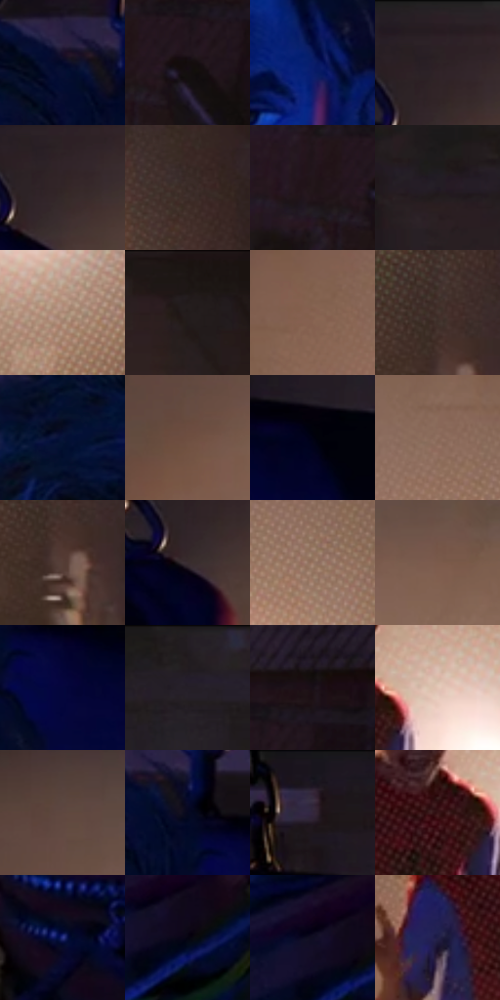

# 电影参考 286

- 状态：常规／活跃；来源世界：miles-home。
- 视角：high-angle；景别：medium；场景：portrait。
- 时段：interior-time-unknown（外观依据，中置信度；具体时间／晨昏未知）；光照：interior-mixed。
- 材质候选：skin, hair, fabric, paint（帧级，不是像素分割）。
- 明暗组：very-dark；L* P5/P50/P95：1.96918 / 14.24457 / 58.64231。
- 资格门禁：无附加门禁。
- 原截图 SHA-256：`4e090784760808e634f2498cfaae5e409985aa65cc3a5245ed7368abd16afdf1`；尺寸：2880 × 1208。
- sRGB 像素 SHA-256：`b7f373bb2a9a6b7c389b9c4c5cb522d46f0c48fa89a481c6c34a30280f2e65ca`。

## 观察与迁移

同室混合光的不同人脸、头向与表情，造型不能统一。

286  /  裸脸／室内  /  眉眼下垂与鼻颊体面；暖背景与冷面部不要求整图蓝化

本公开版保存32个128×128原像素色卡上下文；图集格子并非原场景相邻位置。原rect、图集tile和像素SHA见 `data/palette-crops.json`。上下文不足时不得批准替色，不能以小样推断完整构图。

## 实测色卡

颜色比例分母为保留采样像素，不是材料面积；全部 32 色参与全库匹配。表内四舍五入仅用于阅读，原精度在 JSON。

| ID | HEX | Lab | 原图 xy | 像素数 | 比例 | 明度角色 |
| --- | --- | --- | --- | ---: | ---: | --- |
| 286-S01 | #04092A | [3.507297, 8.047365, -21.127475] | [900, 88] | 11251 | 5.819102% | deep-shadow |
| 286-S02 | #140D0E | [4.230083, 2.727122, 0.445004] | [2552, 232] | 10078 | 5.212417% | deep-shadow |
| 286-S03 | #0A1D69 | [15.290348, 25.106323, -45.965721] | [936, 316] | 9900 | 5.120354% | deep-shadow |
| 286-S04 | #2A2124 | [13.86995, 4.945601, -0.397519] | [1356, 56] | 8986 | 4.647627% | deep-shadow |
| 286-S05 | #322627 | [16.557276, 5.837304, 1.490653] | [1364, 100] | 8893 | 4.599526% | deep-shadow |
| 286-S06 | #3C2B27 | [19.370832, 7.18081, 5.672212] | [2164, 356] | 8585 | 4.440226% | deep-shadow |
| 286-S07 | #211619 | [8.716733, 6.201591, 0.061398] | [2472, 236] | 8493 | 4.392643% | deep-shadow |
| 286-S08 | #251C22 | [11.547961, 5.745452, -2.433788] | [32, 76] | 8133 | 4.206449% | deep-shadow |
| 286-S09 | #B08C79 | [61.105209, 10.836764, 15.343383] | [1868, 808] | 7688 | 3.976291% | light |
| 286-S10 | #1B1412 | [7.018823, 2.981694, 2.384427] | [2144, 28] | 7458 | 3.857333% | deep-shadow |
| 286-S11 | #866351 | [45.063305, 11.595936, 15.75307] | [1520, 412] | 7330 | 3.791131% | midtone |
| 286-S12 | #47352F | [23.970851, 7.036285, 6.892639] | [2168, 920] | 7260 | 3.754926% | shadow |
| 286-S13 | #061237 | [6.747919, 10.800623, -25.59431] | [724, 128] | 6826 | 3.530458% | deep-shadow |
| 286-S14 | #6E4F41 | [36.53533, 11.011252, 13.401832] | [1536, 244] | 6410 | 3.315300% | shadow |
| 286-S15 | #010211 | [0.815878, 2.028173, -6.323771] | [1180, 168] | 6273 | 3.244443% | deep-shadow |
| 286-S16 | #8D6D5D | [48.74928, 10.304345, 13.817785] | [1764, 312] | 6245 | 3.229961% | midtone |
| 286-S17 | #563E35 | [28.593168, 9.095674, 9.648116] | [2180, 984] | 6002 | 3.104279% | shadow |
| 286-S18 | #3A2E31 | [20.343282, 6.070791, 0.141528] | [1336, 148] | 5995 | 3.100659% | shadow |
| 286-S19 | #9B7764 | [53.040768, 11.324051, 15.875414] | [1880, 412] | 5991 | 3.098590% | midtone |
| 286-S20 | #7B5B4B | [41.535215, 10.800676, 14.343851] | [1732, 212] | 5598 | 2.895328% | midtone |
| 286-S21 | #04063C | [4.355377, 19.221744, -33.10642] | [1024, 192] | 5296 | 2.739131% | deep-shadow |
| 286-S22 | #211B1F | [10.602659, 3.868855, -1.670227] | [288, 28] | 5080 | 2.627414% | deep-shadow |
| 286-S23 | #180F17 | [5.399147, 5.49024, -3.4035] | [2608, 152] | 4735 | 2.448977% | deep-shadow |
| 286-S24 | #E3C4B4 | [81.350851, 8.481357, 12.084671] | [1796, 596] | 4673 | 2.416911% | highlight |
| 286-S25 | #5F473F | [32.477369, 8.973689, 8.78398] | [1580, 128] | 4431 | 2.291746% | shadow |
| 286-S26 | #05081F | [2.753402, 4.379851, -13.771707] | [956, 116] | 3679 | 1.902806% | deep-shadow |
| 286-S27 | #1C1521 | [8.066414, 6.606303, -7.050505] | [1100, 36] | 2918 | 1.509211% | deep-shadow |
| 286-S28 | #381618 | [12.48509, 17.137025, 6.677087] | [1704, 620] | 2591 | 1.340085% | deep-shadow |
| 286-S29 | #2A3384 | [25.336695, 24.194346, -46.734428] | [668, 1080] | 2137 | 1.105272% | shadow |
| 286-S30 | #050311 | [1.245191, 2.67361, -5.668899] | [1268, 1108] | 2123 | 1.098032% | deep-shadow |
| 286-S31 | #100D22 | [4.638144, 6.480498, -13.178716] | [1228, 1080] | 1420 | 0.734435% | deep-shadow |
| 286-S32 | #211F47 | [14.162838, 13.640513, -24.856561] | [1592, 668] | 868 | 0.448936% | deep-shadow |

## 色阶与空间分布

- 采样 ROI：`[0.01, 0.02, 0.98, 0.94]`；步长：4；样本数：193346。
- 排除区：`[]`。
- 深暗、暗、中、亮、高光五段计数：`[122528, 34133, 27843, 6188, 2654]`。
- RGB 各 256 箱、L* 100 箱、13×5 色相明度表和 3×3 空间统计全部保存在 [总数据](../film-library.json)。
- [可视化档案](../../references/library.html)按需绘制直方图，不存 2,094 张重复图表图片。

## 纹理特征占比

**这是分块图像特征的面积占比，不是波点／排线／丝网／错版的精确语义覆盖率。** 窗格、发丝、织物也会产生方向或周期特征。
原图 ROI 像素 3104134；已测块覆盖 3104134（100.0000%）；未测 0。

| 特征 | 块覆盖像素 | 占已测面积 | 阈值敏感范围 |
| --- | ---: | ---: | --- |
| low-contrast | 349184 | 11.2490% | 4.1318% ~ 15.9292% |
| directional-structure | 120576 | 3.8844% | 1.5834% ~ 13.9128% |
| periodic-structure | 2415494 | 77.8154% | 68.0261% ~ 78.4298% |
| mixed-detail | 218880 | 7.0512% | 3.5256% ~ 14.4612% |

阈值敏感范围不是统计置信区间。逐块坐标、尺度、对比、方向一致性、频谱集中度、频率与角度见 [全量特征记录](../texture-features.jsonl)，以帧号定位。
四种印刷层的真实像素覆盖仍标为 `null`，不能填 0，也不能拿上表代替。不得据这些代理测量删除唯一证据。

[测量方法与保留策略](../../references/library-retention.md) · [分类索引](../archive/README.md)
