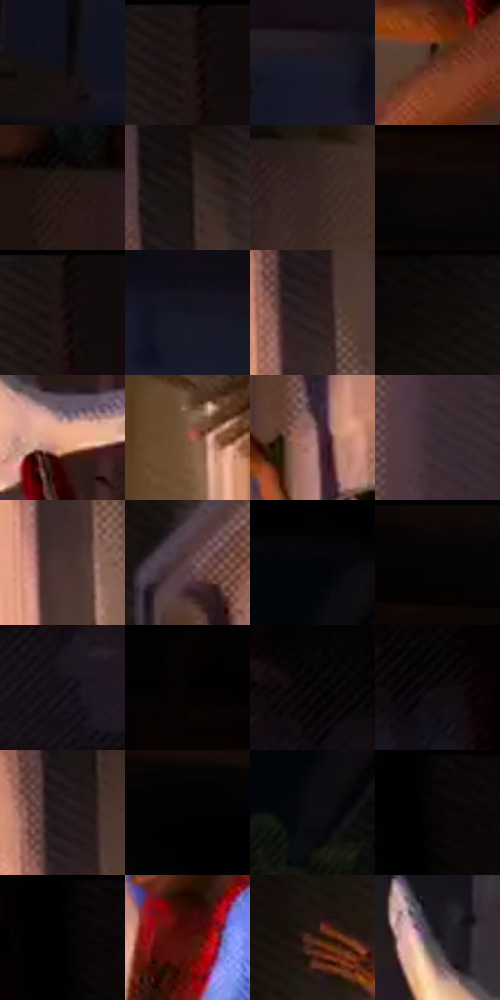

# 电影参考 287

- 状态：条件／活跃；来源世界：miles-home。
- 视角：near-level；景别：full-body；场景：interior。
- 时段：interior-time-unknown（外观依据，中置信度；具体时间／晨昏未知）；光照：interior-mixed。
- 材质候选：skin, fabric, paint, wood（帧级，不是像素分割）。
- 明暗组：very-dark；L* P5/P50/P95：0.7618 / 7.9339 / 56.90952。
- 资格门禁：motion。
- 原截图 SHA-256：`ac5d0bd544ab7cef4b5744875ddce6aea12ff93eeab519c8fcf6279112eaea31`；尺寸：2880 × 1212。
- sRGB 像素 SHA-256：`77b46348b6ca28f8d2cc00447f403e81d603d982079e099a72559b4ce206e83d`。

## 观察与迁移

门口人物悬空与墙影，原姿态和光源关系保留。

287  /  姿态／投影  /  门面投影、肢体透视和袜子分开；不借入悬挂姿势或缺鞋状态

本公开版保存32个128×128原像素色卡上下文；图集格子并非原场景相邻位置。原rect、图集tile和像素SHA见 `data/palette-crops.json`。上下文不足时不得批准替色，不能以小样推断完整构图。

## 实测色卡

颜色比例分母为保留采样像素，不是材料面积；全部 32 色参与全库匹配。表内四舍五入仅用于阅读，原精度在 JSON。

| ID | HEX | Lab | 原图 xy | 像素数 | 比例 | 明度角色 |
| --- | --- | --- | --- | ---: | ---: | --- |
| 287-S01 | #0F0F19 | [4.637299, 2.264662, -6.160638] | [252, 800] | 8904 | 4.588650% | deep-shadow |
| 287-S02 | #1E1514 | [7.794483, 4.374719, 2.293429] | [2336, 40] | 8880 | 4.576282% | deep-shadow |
| 287-S03 | #1B1C2A | [10.781552, 3.675736, -9.585663] | [356, 556] | 8643 | 4.454144% | deep-shadow |
| 287-S04 | #66392B | [29.225399, 18.363321, 17.300421] | [1312, 948] | 8624 | 4.444353% | shadow |
| 287-S05 | #281915 | [10.561863, 6.83896, 5.773663] | [1288, 628] | 8156 | 4.203170% | deep-shadow |
| 287-S06 | #181010 | [5.439722, 3.404959, 1.200395] | [2060, 156] | 7808 | 4.023830% | deep-shadow |
| 287-S07 | #362725 | [17.315513, 6.680871, 4.052639] | [1496, 664] | 7751 | 3.994455% | deep-shadow |
| 287-S08 | #0F0604 | [2.173287, 2.268328, 1.654304] | [812, 28] | 7725 | 3.981056% | deep-shadow |
| 287-S09 | #150B0B | [3.82061, 3.577332, 1.260894] | [2344, 40] | 7656 | 3.945497% | deep-shadow |
| 287-S10 | #151623 | [7.719231, 3.520148, -9.162652] | [744, 560] | 7292 | 3.757911% | deep-shadow |
| 287-S11 | #2E2020 | [13.933173, 6.769979, 2.647417] | [2048, 308] | 7131 | 3.674940% | deep-shadow |
| 287-S12 | #0D0909 | [2.715947, 1.113787, 0.392792] | [1620, 36] | 6492 | 3.345633% | deep-shadow |
| 287-S13 | #E9AB91 | [75.13737, 19.43184, 22.337463] | [1028, 928] | 6488 | 3.343572% | light |
| 287-S14 | #8A5442 | [41.43548, 20.429158, 19.9698] | [1644, 1068] | 6370 | 3.282761% | midtone |
| 287-S15 | #AA7C7E | [56.554449, 18.170974, 5.974342] | [1744, 332] | 6199 | 3.194636% | midtone |
| 287-S16 | #382A32 | [18.915873, 8.118574, -2.676839] | [2244, 928] | 6117 | 3.152378% | deep-shadow |
| 287-S17 | #4A3432 | [24.136628, 9.575452, 5.173165] | [2044, 480] | 5864 | 3.021995% | shadow |
| 287-S18 | #5F444A | [31.947462, 12.657128, 0.986503] | [1708, 172] | 5727 | 2.951392% | shadow |
| 287-S19 | #050509 | [1.450015, 0.556088, -1.513529] | [1292, 228] | 5726 | 2.950877% | deep-shadow |
| 287-S20 | #090505 | [1.604102, 1.04591, 0.368719] | [540, 36] | 5688 | 2.931294% | deep-shadow |
| 287-S21 | #141016 | [5.214127, 2.864191, -2.991684] | [2432, 224] | 5227 | 2.693719% | deep-shadow |
| 287-S22 | #060202 | [0.781582, 1.045962, 0.36862] | [60, 28] | 5165 | 2.661767% | deep-shadow |
| 287-S23 | #08080A | [2.232962, 0.277948, -0.756583] | [2632, 112] | 5165 | 2.661767% | deep-shadow |
| 287-S24 | #0F0C0F | [3.604098, 1.45197, -1.037535] | [2668, 144] | 5159 | 2.658675% | deep-shadow |
| 287-S25 | #271E22 | [12.450916, 5.233917, -1.070692] | [2032, 248] | 5100 | 2.628270% | deep-shadow |
| 287-S26 | #020203 | [0.568134, 0.139009, -0.378358] | [1196, 128] | 4850 | 2.499433% | deep-shadow |
| 287-S27 | #0C0C12 | [3.475611, 1.086537, -2.957307] | [1308, 304] | 4752 | 2.448929% | deep-shadow |
| 287-S28 | #060304 | [1.017234, 0.92349, -0.101909] | [2796, 32] | 4250 | 2.190225% | deep-shadow |
| 287-S29 | #010000 | [0.058309, 0.261499, 0.092139] | [2776, 48] | 3434 | 1.769702% | deep-shadow |
| 287-S30 | #4A0E09 | [14.344792, 27.755732, 18.377157] | [1796, 660] | 3308 | 1.704768% | deep-shadow |
| 287-S31 | #422218 | [17.313382, 14.138529, 13.379336] | [1576, 288] | 2478 | 1.277030% | deep-shadow |
| 287-S32 | #1D1921 | [9.531809, 4.024515, -4.811079] | [932, 812] | 1915 | 0.986890% | deep-shadow |

## 色阶与空间分布

- 采样 ROI：`[0.01, 0.02, 0.98, 0.94]`；步长：4；样本数：194044。
- 排除区：`[]`。
- 深暗、暗、中、亮、高光五段计数：`[151450, 25809, 8210, 7215, 1360]`。
- RGB 各 256 箱、L* 100 箱、13×5 色相明度表和 3×3 空间统计全部保存在 [总数据](../film-library.json)。
- [可视化档案](../../references/library.html)按需绘制直方图，不存 2,094 张重复图表图片。

## 纹理特征占比

**这是分块图像特征的面积占比，不是波点／排线／丝网／错版的精确语义覆盖率。** 窗格、发丝、织物也会产生方向或周期特征。
原图 ROI 像素 3115310；已测块覆盖 3115310（100.0000%）；未测 0。

| 特征 | 块覆盖像素 | 占已测面积 | 阈值敏感范围 |
| --- | ---: | ---: | --- |
| low-contrast | 889134 | 28.5408% | 17.3938% ~ 36.3392% |
| directional-structure | 596736 | 19.1549% | 6.1590% ~ 35.8323% |
| periodic-structure | 1613056 | 51.7783% | 46.7739% ~ 53.8204% |
| mixed-detail | 16384 | 0.5259% | 0.0000% ~ 3.6814% |

阈值敏感范围不是统计置信区间。逐块坐标、尺度、对比、方向一致性、频谱集中度、频率与角度见 [全量特征记录](../texture-features.jsonl)，以帧号定位。
四种印刷层的真实像素覆盖仍标为 `null`，不能填 0，也不能拿上表代替。不得据这些代理测量删除唯一证据。

[测量方法与保留策略](../../references/library-retention.md) · [分类索引](../archive/README.md)
