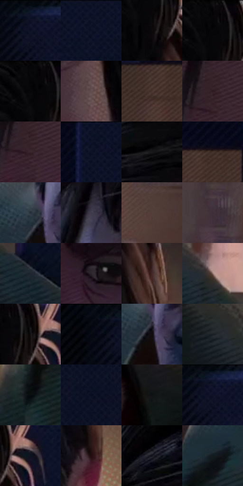

# 电影参考 288

- 状态：常规／活跃；来源世界：miles-home。
- 视角：near-level；景别：close-up；场景：portrait。
- 时段：interior-time-unknown（外观依据，中置信度；具体时间／晨昏未知）；光照：interior-mixed。
- 材质候选：skin, hair, fabric, paint（帧级，不是像素分割）。
- 明暗组：very-dark；L* P5/P50/P95：1.46906 / 7.74233 / 33.82246。
- 资格门禁：无附加门禁。
- 原截图 SHA-256：`efa92e18f3eba1d7246fa6ecf1deddc36c5d3ec4993e0dca0540c1a83538d363`；尺寸：2880 × 1208。
- sRGB 像素 SHA-256：`d92ec9e0602fa52572283acf21edbc8b903ea24b1c00d5a07e8e8ab44e52bd45`。

## 观察与迁移

同室混合光的不同人脸、头向与表情，造型不能统一。

288  /  面部／窗框  /  发束、鼻部选择性亮线、细胡茬与衣领排线不同；不新增瘀伤或胡须

本公开版保存32个128×128原像素色卡上下文；图集格子并非原场景相邻位置。原rect、图集tile和像素SHA见 `data/palette-crops.json`。上下文不足时不得批准替色，不能以小样推断完整构图。

## 实测色卡

颜色比例分母为保留采样像素，不是材料面积；全部 32 色参与全库匹配。表内四舍五入仅用于阅读，原精度在 JSON。

| ID | HEX | Lab | 原图 xy | 像素数 | 比例 | 明度角色 |
| --- | --- | --- | --- | ---: | ---: | --- |
| 288-S01 | #0E142B | [6.937465, 5.608012, -16.430729] | [364, 28] | 14331 | 7.412101% | deep-shadow |
| 288-S02 | #0B1125 | [5.46998, 3.960634, -14.224519] | [2612, 28] | 14005 | 7.243491% | deep-shadow |
| 288-S03 | #0D090B | [2.756025, 1.395419, -0.373704] | [1664, 136] | 11122 | 5.752382% | deep-shadow |
| 288-S04 | #050204 | [0.762847, 1.062551, -0.480366] | [1648, 28] | 9051 | 4.681245% | deep-shadow |
| 288-S05 | #080809 | [2.213175, 0.138905, -0.37816] | [1628, 28] | 8180 | 4.230757% | deep-shadow |
| 288-S06 | #624E4E | [35.194187, 8.378022, 3.180881] | [1576, 340] | 7995 | 4.135074% | shadow |
| 288-S07 | #4B3632 | [24.842329, 8.726921, 6.187245] | [2284, 264] | 7956 | 4.114903% | shadow |
| 288-S08 | #2E1C22 | [12.778319, 9.98372, -0.479457] | [1344, 408] | 7620 | 3.941121% | deep-shadow |
| 288-S09 | #38252C | [17.206703, 10.310411, -0.99892] | [1348, 448] | 7155 | 3.700620% | deep-shadow |
| 288-S10 | #0E1326 | [6.313943, 4.068403, -13.655501] | [2436, 32] | 6766 | 3.499426% | deep-shadow |
| 288-S11 | #19181B | [8.473205, 1.274975, -1.927666] | [1400, 136] | 6732 | 3.481841% | deep-shadow |
| 288-S12 | #43312B | [22.176167, 7.150876, 6.998531] | [2336, 212] | 6644 | 3.436327% | shadow |
| 288-S13 | #232E39 | [18.394034, -1.391924, -8.521917] | [1020, 540] | 6391 | 3.305473% | deep-shadow |
| 288-S14 | #3F3A4C | [25.577314, 6.459612, -10.182057] | [1108, 316] | 6126 | 3.168413% | shadow |
| 288-S15 | #543F3B | [28.788058, 8.471877, 5.986458] | [844, 300] | 6090 | 3.149794% | shadow |
| 288-S16 | #3D2E37 | [20.91202, 8.671377, -3.099271] | [748, 472] | 5526 | 2.858089% | shadow |
| 288-S17 | #1D262E | [14.649746, -1.537134, -6.544217] | [2424, 1132] | 5277 | 2.729304% | deep-shadow |
| 288-S18 | #2D252C | [15.813973, 5.328307, -3.21392] | [1424, 628] | 5067 | 2.620690% | deep-shadow |
| 288-S19 | #432827 | [19.464373, 12.524022, 5.944749] | [1744, 276] | 5019 | 2.595864% | deep-shadow |
| 288-S20 | #8F7069 | [50.03595, 11.121238, 8.567431] | [2320, 1024] | 4881 | 2.524490% | midtone |
| 288-S21 | #141115 | [5.453779, 2.064694, -1.938341] | [1704, 84] | 4766 | 2.465011% | deep-shadow |
| 288-S22 | #040710 | [1.943562, 0.615694, -4.087298] | [296, 28] | 4732 | 2.447426% | deep-shadow |
| 288-S23 | #120D0F | [4.073374, 2.088212, -0.322977] | [1044, 576] | 4521 | 2.338295% | deep-shadow |
| 288-S24 | #191F24 | [11.37291, -1.263158, -4.300225] | [2116, 940] | 4374 | 2.262266% | deep-shadow |
| 288-S25 | #090D10 | [3.462521, -0.584251, -1.834302] | [724, 904] | 3915 | 2.024867% | deep-shadow |
| 288-S26 | #080D1F | [3.959665, 3.057468, -11.930238] | [2556, 604] | 3838 | 1.985042% | deep-shadow |
| 288-S27 | #0F1214 | [5.281236, -0.662495, -1.565583] | [1732, 772] | 3764 | 1.946769% | deep-shadow |
| 288-S28 | #12152A | [7.515728, 5.787578, -14.751562] | [376, 44] | 3520 | 1.820570% | deep-shadow |
| 288-S29 | #0E131F | [5.943648, 1.466303, -8.887849] | [1764, 92] | 2598 | 1.343705% | deep-shadow |
| 288-S30 | #230D0F | [6.140133, 11.25484, 2.942882] | [1740, 480] | 2264 | 1.170958% | deep-shadow |
| 288-S31 | #0F1319 | [5.758195, -0.025175, -4.516757] | [1184, 152] | 1694 | 0.876149% | deep-shadow |
| 288-S32 | #121B1F | [9.085636, -2.795435, -4.093071] | [792, 736] | 1426 | 0.737538% | deep-shadow |

## 色阶与空间分布

- 采样 ROI：`[0.01, 0.02, 0.98, 0.94]`；步长：4；样本数：193346。
- 排除区：`[]`。
- 深暗、暗、中、亮、高光五段计数：`[146464, 41724, 4296, 860, 2]`。
- RGB 各 256 箱、L* 100 箱、13×5 色相明度表和 3×3 空间统计全部保存在 [总数据](../film-library.json)。
- [可视化档案](../../references/library.html)按需绘制直方图，不存 2,094 张重复图表图片。

## 纹理特征占比

**这是分块图像特征的面积占比，不是波点／排线／丝网／错版的精确语义覆盖率。** 窗格、发丝、织物也会产生方向或周期特征。
原图 ROI 像素 3104134；已测块覆盖 3104134（100.0000%）；未测 0。

| 特征 | 块覆盖像素 | 占已测面积 | 阈值敏感范围 |
| --- | ---: | ---: | --- |
| low-contrast | 449536 | 14.4818% | 12.3500% ~ 17.1209% |
| directional-structure | 737920 | 23.7722% | 8.8037% ~ 42.8724% |
| periodic-structure | 1758086 | 56.6369% | 44.4189% ~ 65.6097% |
| mixed-detail | 158592 | 5.1091% | 0.3587% ~ 8.4656% |

阈值敏感范围不是统计置信区间。逐块坐标、尺度、对比、方向一致性、频谱集中度、频率与角度见 [全量特征记录](../texture-features.jsonl)，以帧号定位。
四种印刷层的真实像素覆盖仍标为 `null`，不能填 0，也不能拿上表代替。不得据这些代理测量删除唯一证据。

[测量方法与保留策略](../../references/library-retention.md) · [分类索引](../archive/README.md)
