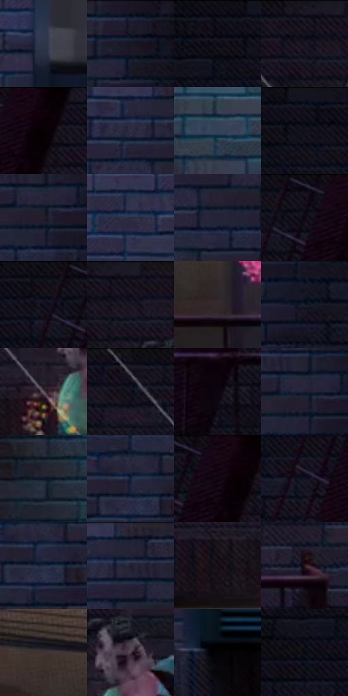

# 电影参考 289

- 状态：常规／活跃；来源世界：miles-home。
- 视角：near-level；景别：environment-wide；场景：city。
- 时段：night-appearance（外观依据，中置信度；具体时间／晨昏未知）；光照：night-mixed。
- 材质候选：skin, fabric, brick, metal, glass, sky（帧级，不是像素分割）。
- 明暗组：very-dark；L* P5/P50/P95：1.5495 / 10.04104 / 27.87499。
- 资格门禁：无附加门禁。
- 原截图 SHA-256：`118d35cf1b87d321b9bcc937eb1070780b8f39c8195be08fc2cc3a04e93d3721`；尺寸：2880 × 1208。
- sRGB 像素 SHA-256：`23f127ef244cf2bc2e49e31114281c6249b024ab2616a69b23978803b553f2f4`。

## 观察与迁移

消防梯与外墙冷夜光，栏杆、管道和楼体遮挡不能重排。

289  /  局部故障／动作  /  人物彩块分裂而栏杆砖墙稳定；只学习局部异常组织

本公开版保存32个128×128原像素色卡上下文；图集格子并非原场景相邻位置。原rect、图集tile和像素SHA见 `data/palette-crops.json`。上下文不足时不得批准替色，不能以小样推断完整构图。

## 实测色卡

颜色比例分母为保留采样像素，不是材料面积；全部 32 色参与全库匹配。表内四舍五入仅用于阅读，原精度在 JSON。

| ID | HEX | Lab | 原图 xy | 像素数 | 比例 | 明度角色 |
| --- | --- | --- | --- | ---: | ---: | --- |
| 289-S01 | #2C364E | [22.735989, 2.985441, -16.019597] | [2468, 564] | 9856 | 5.097597% | shadow |
| 289-S02 | #1D1B2A | [10.647181, 5.216947, -9.776277] | [252, 40] | 9430 | 4.877267% | deep-shadow |
| 289-S03 | #0F0C16 | [3.815719, 2.939052, -5.084798] | [528, 32] | 8565 | 4.429882% | deep-shadow |
| 289-S04 | #181723 | [8.379363, 3.977413, -8.118695] | [1152, 28] | 8446 | 4.368334% | deep-shadow |
| 289-S05 | #0D030A | [1.559266, 3.656194, -1.70354] | [872, 36] | 8363 | 4.325406% | deep-shadow |
| 289-S06 | #2E2D43 | [19.485737, 6.414656, -13.630892] | [76, 72] | 8102 | 4.190415% | deep-shadow |
| 289-S07 | #364157 | [27.44301, 1.718282, -14.599] | [1860, 260] | 7965 | 4.119558% | shadow |
| 289-S08 | #14131D | [6.351598, 3.061239, -6.684139] | [596, 36] | 7753 | 4.009910% | deep-shadow |
| 289-S09 | #221E2D | [12.338971, 5.925398, -9.311306] | [196, 132] | 7239 | 3.744065% | deep-shadow |
| 289-S10 | #272A3F | [17.672806, 4.76653, -13.746387] | [2508, 92] | 7177 | 3.711998% | deep-shadow |
| 289-S11 | #232437 | [14.925431, 5.046033, -12.455358] | [136, 160] | 7032 | 3.637003% | deep-shadow |
| 289-S12 | #130E19 | [4.721586, 4.268299, -5.997875] | [784, 48] | 6759 | 3.495805% | deep-shadow |
| 289-S13 | #0C0F1B | [4.506661, 1.884111, -7.951216] | [724, 52] | 6591 | 3.408915% | deep-shadow |
| 289-S14 | #1C1621 | [8.398551, 5.845453, -6.542697] | [1196, 36] | 5824 | 3.012216% | deep-shadow |
| 289-S15 | #33272D | [17.199685, 6.860442, -1.787692] | [1264, 760] | 5791 | 2.995149% | deep-shadow |
| 289-S16 | #141B2B | [9.852289, 2.221509, -11.810915] | [304, 212] | 5522 | 2.856020% | deep-shadow |
| 289-S17 | #604F5A | [35.629828, 9.21344, -3.772398] | [1204, 248] | 5501 | 2.845158% | shadow |
| 289-S18 | #080B16 | [3.151356, 1.35099, -6.109043] | [1024, 52] | 5294 | 2.738096% | deep-shadow |
| 289-S19 | #0E060F | [2.331489, 3.568313, -2.904715] | [608, 832] | 5170 | 2.673963% | deep-shadow |
| 289-S20 | #1D2134 | [13.210529, 4.082405, -13.034712] | [192, 112] | 5122 | 2.649137% | deep-shadow |
| 289-S21 | #0D1425 | [6.498211, 2.710523, -12.617934] | [1620, 84] | 4995 | 2.583451% | deep-shadow |
| 289-S22 | #122037 | [12.203926, 2.588319, -16.812362] | [64, 244] | 4947 | 2.558625% | deep-shadow |
| 289-S23 | #160712 | [3.308154, 6.879276, -3.101665] | [836, 36] | 4865 | 2.516214% | deep-shadow |
| 289-S24 | #141524 | [7.338282, 4.194763, -10.514293] | [720, 180] | 4610 | 2.384327% | deep-shadow |
| 289-S25 | #1B2C43 | [17.642421, 0.968536, -16.615117] | [76, 272] | 4468 | 2.310883% | deep-shadow |
| 289-S26 | #262333 | [14.696739, 5.672488, -9.952648] | [132, 48] | 4447 | 2.300022% | deep-shadow |
| 289-S27 | #1B1018 | [6.048175, 6.788788, -3.173143] | [1092, 296] | 4310 | 2.229164% | deep-shadow |
| 289-S28 | #28191F | [10.887978, 8.678546, -1.144179] | [1644, 760] | 4256 | 2.201235% | deep-shadow |
| 289-S29 | #403234 | [22.370528, 6.692705, 1.129343] | [1192, 648] | 3928 | 2.031591% | shadow |
| 289-S30 | #483745 | [25.381513, 10.375291, -5.743304] | [1276, 168] | 3851 | 1.991766% | shadow |
| 289-S31 | #050206 | [0.802421, 1.340638, -1.237213] | [2504, 900] | 3651 | 1.888325% | deep-shadow |
| 289-S32 | #06070D | [1.984768, 0.60877, -2.460776] | [476, 136] | 3516 | 1.818502% | deep-shadow |

## 色阶与空间分布

- 采样 ROI：`[0.01, 0.02, 0.98, 0.94]`；步长：4；样本数：193346。
- 排除区：`[]`。
- 深暗、暗、中、亮、高光五段计数：`[160284, 32030, 1013, 19, 0]`。
- RGB 各 256 箱、L* 100 箱、13×5 色相明度表和 3×3 空间统计全部保存在 [总数据](../film-library.json)。
- [可视化档案](../../references/library.html)按需绘制直方图，不存 2,094 张重复图表图片。

## 纹理特征占比

**这是分块图像特征的面积占比，不是波点／排线／丝网／错版的精确语义覆盖率。** 窗格、发丝、织物也会产生方向或周期特征。
原图 ROI 像素 3104134；已测块覆盖 3104134（100.0000%）；未测 0。

| 特征 | 块覆盖像素 | 占已测面积 | 阈值敏感范围 |
| --- | ---: | ---: | --- |
| low-contrast | 49792 | 1.6041% | 0.0000% ~ 2.6803% |
| directional-structure | 1412224 | 45.4949% | 11.6119% ~ 61.8283% |
| periodic-structure | 1505158 | 48.4888% | 35.7017% ~ 76.0175% |
| mixed-detail | 136960 | 4.4122% | 2.4700% ~ 9.6903% |

阈值敏感范围不是统计置信区间。逐块坐标、尺度、对比、方向一致性、频谱集中度、频率与角度见 [全量特征记录](../texture-features.jsonl)，以帧号定位。
四种印刷层的真实像素覆盖仍标为 `null`，不能填 0，也不能拿上表代替。不得据这些代理测量删除唯一证据。

[测量方法与保留策略](../../references/library-retention.md) · [分类索引](../archive/README.md)
