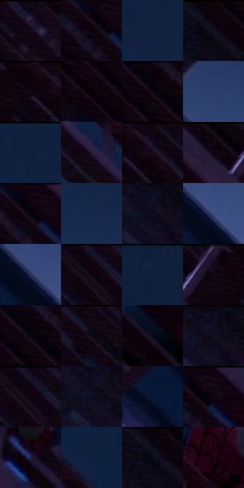

# 电影参考 290

- 状态：常规／活跃；来源世界：miles-home。
- 视角：low-angle；景别：environment-wide；场景：city。
- 时段：night-appearance（外观依据，中置信度；具体时间／晨昏未知）；光照：night-mixed。
- 材质候选：skin, fabric, brick, metal, glass, sky（帧级，不是像素分割）。
- 明暗组：very-dark；L* P5/P50/P95：0.70181 / 3.79485 / 27.65037。
- 资格门禁：无附加门禁。
- 原截图 SHA-256：`1b0526da5639a1d9a623b7b709afbe50288cebc1787611fa57377fe375b07e96`；尺寸：2880 × 1212。
- sRGB 像素 SHA-256：`d73c67173d51ccfcebdb9f5c267032849a756ba3c8710fb350058f7d7eef4f86`。

## 观察与迁移

消防梯与外墙冷夜光，栏杆、管道和楼体遮挡不能重排。

290  /  仰视／喷漆金属  /  栅格和弯曲消防梯保持结构；暗红栏杆不是高亮铬面

本公开版保存32个128×128原像素色卡上下文；图集格子并非原场景相邻位置。原rect、图集tile和像素SHA见 `data/palette-crops.json`。上下文不足时不得批准替色，不能以小样推断完整构图。

## 实测色卡

颜色比例分母为保留采样像素，不是材料面积；全部 32 色参与全库匹配。表内四舍五入仅用于阅读，原精度在 JSON。

| ID | HEX | Lab | 原图 xy | 像素数 | 比例 | 明度角色 |
| --- | --- | --- | --- | ---: | ---: | --- |
| 290-S01 | #170B1B | [4.522313, 7.986117, -7.824862] | [1456, 64] | 11572 | 5.963596% | deep-shadow |
| 290-S02 | #0B0108 | [0.997255, 3.59495, -1.725197] | [532, 76] | 9026 | 4.651522% | deep-shadow |
| 290-S03 | #132240 | [13.546384, 5.065408, -21.034198] | [2484, 384] | 8987 | 4.631424% | deep-shadow |
| 290-S04 | #0D040D | [1.819846, 3.708893, -2.650819] | [248, 28] | 8712 | 4.489703% | deep-shadow |
| 290-S05 | #0E000A | [1.041482, 5.173822, -2.451171] | [936, 36] | 8634 | 4.449506% | deep-shadow |
| 290-S06 | #060005 | [0.448787, 2.264215, -1.339287] | [476, 196] | 8033 | 4.139783% | deep-shadow |
| 290-S07 | #0A010A | [0.977034, 3.604871, -2.576532] | [396, 28] | 7952 | 4.098040% | deep-shadow |
| 290-S08 | #2E3E6B | [26.981692, 8.153445, -28.256007] | [2196, 792] | 7115 | 3.666694% | shadow |
| 290-S09 | #10203D | [12.479953, 4.637183, -20.63607] | [2072, 28] | 6880 | 3.545588% | deep-shadow |
| 290-S10 | #281B35 | [12.557238, 12.830972, -14.683857] | [1876, 188] | 6874 | 3.542496% | deep-shadow |
| 290-S11 | #0D0614 | [2.40566, 4.268628, -5.781908] | [1000, 32] | 6830 | 3.519820% | deep-shadow |
| 290-S12 | #12050F | [2.453803, 5.396775, -2.687916] | [732, 36] | 6660 | 3.432211% | deep-shadow |
| 290-S13 | #150715 | [3.301999, 7.092019, -5.068821] | [552, 32] | 6625 | 3.414174% | deep-shadow |
| 290-S14 | #19294D | [17.122762, 6.57515, -24.270595] | [2344, 540] | 6618 | 3.410567% | deep-shadow |
| 290-S15 | #0F0A19 | [3.512174, 4.563139, -7.806649] | [84, 72] | 6391 | 3.293583% | deep-shadow |
| 290-S16 | #3F4D7E | [33.711261, 9.043693, -29.48733] | [2312, 1012] | 6331 | 3.262662% | shadow |
| 290-S17 | #26315A | [21.381635, 8.972794, -26.140293] | [2240, 952] | 6176 | 3.182783% | shadow |
| 290-S18 | #12030F | [2.061647, 6.197896, -3.260552] | [1196, 56] | 6173 | 3.181237% | deep-shadow |
| 290-S19 | #111F3A | [11.987479, 4.348629, -19.293387] | [2584, 36] | 5153 | 2.655583% | deep-shadow |
| 290-S20 | #1F1328 | [8.220296, 11.405642, -12.049154] | [844, 28] | 5153 | 2.655583% | deep-shadow |
| 290-S21 | #09040F | [1.620499, 2.939544, -3.981168] | [404, 68] | 4787 | 2.466966% | deep-shadow |
| 290-S22 | #110513 | [2.481729, 5.80959, -4.985816] | [1308, 28] | 4682 | 2.412855% | deep-shadow |
| 290-S23 | #070818 | [2.572231, 2.810266, -8.452412] | [1272, 840] | 4663 | 2.403063% | deep-shadow |
| 290-S24 | #0D0C20 | [4.089771, 5.232234, -12.48439] | [92, 28] | 4593 | 2.366989% | deep-shadow |
| 290-S25 | #181328 | [7.344749, 8.660449, -13.483907] | [1204, 28] | 4300 | 2.215992% | deep-shadow |
| 290-S26 | #111025 | [5.630093, 6.466101, -13.942072] | [52, 80] | 4205 | 2.167034% | deep-shadow |
| 290-S27 | #091635 | [8.02859, 7.498919, -22.064944] | [2024, 916] | 3854 | 1.986147% | deep-shadow |
| 290-S28 | #140612 | [2.914635, 6.394365, -3.699976] | [580, 32] | 3743 | 1.928944% | deep-shadow |
| 290-S29 | #212244 | [14.869647, 10.341398, -21.650079] | [1296, 556] | 3647 | 1.879471% | deep-shadow |
| 290-S30 | #102141 | [13.103799, 5.600406, -22.449586] | [1980, 100] | 3546 | 1.827421% | deep-shadow |
| 290-S31 | #0A020F | [1.286651, 4.002165, -4.461666] | [232, 28] | 3126 | 1.610975% | deep-shadow |
| 290-S32 | #1F0413 | [3.841058, 13.185739, -2.814306] | [1528, 508] | 3003 | 1.547587% | deep-shadow |

## 色阶与空间分布

- 采样 ROI：`[0.01, 0.02, 0.98, 0.94]`；步长：4；样本数：194044。
- 排除区：`[]`。
- 深暗、暗、中、亮、高光五段计数：`[175785, 18046, 213, 0, 0]`。
- RGB 各 256 箱、L* 100 箱、13×5 色相明度表和 3×3 空间统计全部保存在 [总数据](../film-library.json)。
- [可视化档案](../../references/library.html)按需绘制直方图，不存 2,094 张重复图表图片。

## 纹理特征占比

**这是分块图像特征的面积占比，不是波点／排线／丝网／错版的精确语义覆盖率。** 窗格、发丝、织物也会产生方向或周期特征。
原图 ROI 像素 3115310；已测块覆盖 3115310（100.0000%）；未测 0。

| 特征 | 块覆盖像素 | 占已测面积 | 阈值敏感范围 |
| --- | ---: | ---: | --- |
| low-contrast | 661934 | 21.2478% | 18.4867% ~ 29.3297% |
| directional-structure | 770048 | 24.7182% | 6.8369% ~ 41.9215% |
| periodic-structure | 1604224 | 51.4948% | 38.5400% ~ 58.2003% |
| mixed-detail | 79104 | 2.5392% | 1.0518% ~ 5.6331% |

阈值敏感范围不是统计置信区间。逐块坐标、尺度、对比、方向一致性、频谱集中度、频率与角度见 [全量特征记录](../texture-features.jsonl)，以帧号定位。
四种印刷层的真实像素覆盖仍标为 `null`，不能填 0，也不能拿上表代替。不得据这些代理测量删除唯一证据。

[测量方法与保留策略](../../references/library-retention.md) · [分类索引](../archive/README.md)
