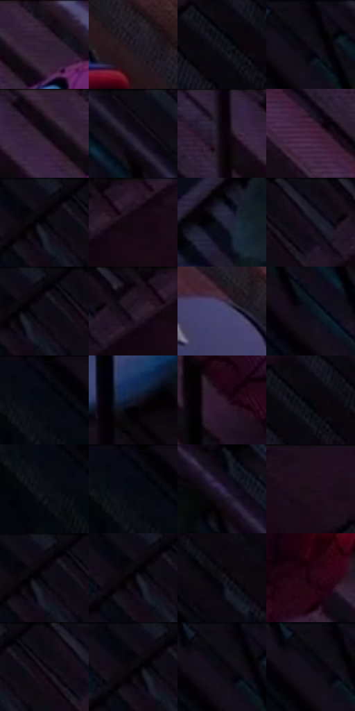

# 电影参考 291

- 状态：常规／活跃；来源世界：miles-home。
- 视角：high-angle；景别：environment-wide；场景：city。
- 时段：night-appearance（外观依据，中置信度；具体时间／晨昏未知）；光照：night-mixed。
- 材质候选：skin, fabric, brick, metal, glass, sky（帧级，不是像素分割）。
- 明暗组：very-dark；L* P5/P50/P95：0.86178 / 3.4122 / 20.36612。
- 资格门禁：无附加门禁。
- 原截图 SHA-256：`a52ed882619cbd6bf402da026723cbe2d7a996ce80ccf256061e2cf1021c452c`；尺寸：2880 × 1216。
- sRGB 像素 SHA-256：`765a8897d2023303eed3c5ca789e575987c1d343664fb2865907b15286b0270b`。

## 观察与迁移

消防梯与外墙冷夜光，栏杆、管道和楼体遮挡不能重排。

291  /  稳定对照／俯视  /  两人、台阶和砖墙的稳定关系，供292比较

本公开版保存32个128×128原像素色卡上下文；图集格子并非原场景相邻位置。原rect、图集tile和像素SHA见 `data/palette-crops.json`。上下文不足时不得批准替色，不能以小样推断完整构图。

## 实测色卡

颜色比例分母为保留采样像素，不是材料面积；全部 32 色参与全库匹配。表内四舍五入仅用于阅读，原精度在 JSON。

| ID | HEX | Lab | 原图 xy | 像素数 | 比例 | 明度角色 |
| --- | --- | --- | --- | ---: | ---: | --- |
| 291-S01 | #170F1A | [5.405273, 5.809691, -5.733051] | [1816, 28] | 11555 | 5.933491% | deep-shadow |
| 291-S02 | #1B1521 | [7.941278, 6.16855, -7.253148] | [2736, 208] | 8871 | 4.555258% | deep-shadow |
| 291-S03 | #0B0D16 | [3.765873, 1.247169, -5.190548] | [1272, 172] | 8754 | 4.495178% | deep-shadow |
| 291-S04 | #100D14 | [4.051379, 2.357249, -3.352129] | [240, 52] | 8698 | 4.466422% | deep-shadow |
| 291-S05 | #0A080F | [2.463119, 1.598801, -2.743758] | [1732, 52] | 8519 | 4.374506% | deep-shadow |
| 291-S06 | #09050D | [1.767538, 2.194389, -2.756996] | [372, 44] | 7528 | 3.865627% | deep-shadow |
| 291-S07 | #0A040A | [1.565267, 2.403189, -1.717578] | [1632, 28] | 7435 | 3.817872% | deep-shadow |
| 291-S08 | #451F3D | [18.286914, 22.97773, -11.105166] | [1548, 148] | 7431 | 3.815818% | deep-shadow |
| 291-S09 | #0D0912 | [2.932187, 2.633325, -3.742805] | [748, 36] | 7346 | 3.772170% | deep-shadow |
| 291-S10 | #140712 | [3.110713, 5.993804, -3.413658] | [1044, 64] | 7204 | 3.699253% | deep-shadow |
| 291-S11 | #1C1E2F | [11.82792, 4.231935, -11.599333] | [624, 684] | 6439 | 3.306426% | deep-shadow |
| 291-S12 | #100E1B | [4.546739, 3.689484, -7.860097] | [888, 28] | 6395 | 3.283832% | deep-shadow |
| 291-S13 | #05030A | [1.077646, 1.496253, -2.464589] | [772, 28] | 6205 | 3.186267% | deep-shadow |
| 291-S14 | #0E050D | [2.086373, 3.624279, -2.253179] | [980, 28] | 6160 | 3.163159% | deep-shadow |
| 291-S15 | #464475 | [31.161591, 14.022899, -27.86189] | [2564, 96] | 6131 | 3.148268% | shadow |
| 291-S16 | #090D1B | [3.839224, 2.062879, -8.960574] | [336, 188] | 5905 | 3.032217% | deep-shadow |
| 291-S17 | #050910 | [2.394026, 0.076072, -3.422523] | [76, 52] | 5852 | 3.005001% | deep-shadow |
| 291-S18 | #101627 | [7.500964, 3.160314, -12.544241] | [2232, 596] | 5749 | 2.952111% | deep-shadow |
| 291-S19 | #2F182C | [12.218424, 15.328911, -8.622171] | [2232, 420] | 5550 | 2.849925% | deep-shadow |
| 291-S20 | #06070C | [1.962068, 0.449257, -2.026644] | [1288, 160] | 5506 | 2.827331% | deep-shadow |
| 291-S21 | #090D12 | [3.519061, -0.186939, -2.915632] | [40, 108] | 5371 | 2.758008% | deep-shadow |
| 291-S22 | #070915 | [2.661722, 1.66071, -6.127618] | [68, 44] | 5297 | 2.720009% | deep-shadow |
| 291-S23 | #342949 | [19.211547, 13.155703, -18.098549] | [848, 540] | 5279 | 2.710766% | deep-shadow |
| 291-S24 | #20101E | [6.968331, 11.114554, -6.383093] | [1168, 40] | 5072 | 2.604472% | deep-shadow |
| 291-S25 | #060106 | [0.664651, 2.002698, -1.431392] | [756, 48] | 4581 | 2.352343% | deep-shadow |
| 291-S26 | #010105 | [0.353321, 0.556158, -1.513661] | [732, 72] | 4502 | 2.311777% | deep-shadow |
| 291-S27 | #131318 | [6.053245, 1.200734, -3.268242] | [1992, 856] | 4152 | 2.132052% | deep-shadow |
| 291-S28 | #240414 | [4.62943, 16.753454, -2.220901] | [2036, 320] | 4054 | 2.081729% | deep-shadow |
| 291-S29 | #0A0912 | [2.74211, 1.780881, -4.043161] | [828, 32] | 3919 | 2.012406% | deep-shadow |
| 291-S30 | #06050A | [1.52811, 0.956631, -1.799814] | [724, 52] | 3819 | 1.961056% | deep-shadow |
| 291-S31 | #05040D | [1.338225, 1.548952, -3.411868] | [220, 56] | 3417 | 1.754629% | deep-shadow |
| 291-S32 | #05060F | [1.779419, 1.092426, -3.777086] | [208, 44] | 2046 | 1.050621% | deep-shadow |

## 色阶与空间分布

- 采样 ROI：`[0.01, 0.02, 0.98, 0.94]`；步长：4；样本数：194742。
- 排除区：`[]`。
- 深暗、暗、中、亮、高光五段计数：`[184555, 9324, 863, 0, 0]`。
- RGB 各 256 箱、L* 100 箱、13×5 色相明度表和 3×3 空间统计全部保存在 [总数据](../film-library.json)。
- [可视化档案](../../references/library.html)按需绘制直方图，不存 2,094 张重复图表图片。

## 纹理特征占比

**这是分块图像特征的面积占比，不是波点／排线／丝网／错版的精确语义覆盖率。** 窗格、发丝、织物也会产生方向或周期特征。
原图 ROI 像素 3126486；已测块覆盖 3126486（100.0000%）；未测 0。

| 特征 | 块覆盖像素 | 占已测面积 | 阈值敏感范围 |
| --- | ---: | ---: | --- |
| low-contrast | 453504 | 14.5052% | 9.0110% ~ 20.6586% |
| directional-structure | 540672 | 17.2933% | 2.6202% ~ 34.0625% |
| periodic-structure | 2083158 | 66.6294% | 56.9265% ~ 74.7602% |
| mixed-detail | 49152 | 1.5721% | 0.0000% ~ 1.9611% |

阈值敏感范围不是统计置信区间。逐块坐标、尺度、对比、方向一致性、频谱集中度、频率与角度见 [全量特征记录](../texture-features.jsonl)，以帧号定位。
四种印刷层的真实像素覆盖仍标为 `null`，不能填 0，也不能拿上表代替。不得据这些代理测量删除唯一证据。

[测量方法与保留策略](../../references/library-retention.md) · [分类索引](../archive/README.md)
