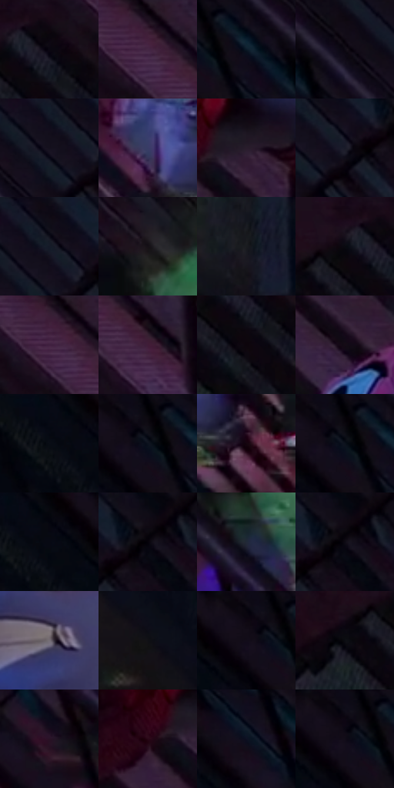

# 电影参考 292

- 状态：条件／活跃；来源世界：miles-home。
- 视角：high-angle；景别：environment-wide；场景：city。
- 时段：event-time-unknown（外观依据，中置信度；具体时间／晨昏未知）；光照：event-light。
- 材质候选：skin, fabric, brick, metal（帧级，不是像素分割）。
- 明暗组：very-dark；L* P5/P50/P95：1.14215 / 4.00685 / 26.99732。
- 资格门禁：glitch。
- 原截图 SHA-256：`9d162392de9f83de96171c1191d6c6b6a61cc4bbabc754278a9943d0f76ea905`；尺寸：2872 × 1184。
- sRGB 像素 SHA-256：`72e439815976e78a124c3d028431a0a82edcf3b108c9b21f9c4966f43585e2c5`。

## 观察与迁移

消防梯附近的局部彩色故障，区别于稳定砖面受光。

292  /  局部故障／对照  /  与291相近构图中，异常集中于下方彼得；不推断闪烁频率或动画周期

本公开版保存32个128×128原像素色卡上下文；图集格子并非原场景相邻位置。原rect、图集tile和像素SHA见 `data/palette-crops.json`。上下文不足时不得批准替色，不能以小样推断完整构图。

## 实测色卡

颜色比例分母为保留采样像素，不是材料面积；全部 32 色参与全库匹配。表内四舍五入仅用于阅读，原精度在 JSON。

| ID | HEX | Lab | 原图 xy | 像素数 | 比例 | 明度角色 |
| --- | --- | --- | --- | ---: | ---: | --- |
| 292-S01 | #0A060C | [1.999225, 1.895815, -1.944408] | [1312, 44] | 10386 | 5.466086% | deep-shadow |
| 292-S02 | #1B101E | [6.299089, 8.538022, -7.458813] | [1488, 24] | 8396 | 4.418761% | deep-shadow |
| 292-S03 | #080B16 | [3.151356, 1.35099, -6.109043] | [312, 36] | 8364 | 4.401920% | deep-shadow |
| 292-S04 | #0D0810 | [2.679569, 2.636573, -2.947792] | [424, 24] | 8125 | 4.276136% | deep-shadow |
| 292-S05 | #15101E | [5.634205, 5.570151, -8.527263] | [552, 92] | 7998 | 4.209296% | deep-shadow |
| 292-S06 | #393C66 | [26.906669, 10.775189, -25.115522] | [780, 948] | 7821 | 4.116142% | shadow |
| 292-S07 | #291D2C | [12.810227, 9.298247, -7.791475] | [2116, 288] | 7535 | 3.965623% | deep-shadow |
| 292-S08 | #191B29 | [10.187757, 3.319011, -9.784075] | [612, 100] | 7291 | 3.837207% | deep-shadow |
| 292-S09 | #0F0A14 | [3.33448, 3.314464, -4.408287] | [576, 24] | 7251 | 3.816155% | deep-shadow |
| 292-S10 | #151016 | [5.310875, 3.298079, -2.838805] | [1008, 492] | 7095 | 3.734053% | deep-shadow |
| 292-S11 | #191C1F | [10.077277, -0.572551, -2.545303] | [1664, 704] | 6449 | 3.394068% | deep-shadow |
| 292-S12 | #180815 | [3.812172, 8.100093, -4.286175] | [1256, 24] | 6293 | 3.311966% | deep-shadow |
| 292-S13 | #4A2B49 | [22.530882, 19.88574, -12.727498] | [1468, 60] | 6274 | 3.301966% | shadow |
| 292-S14 | #401C38 | [16.534236, 21.943093, -10.366537] | [1576, 132] | 6071 | 3.195129% | deep-shadow |
| 292-S15 | #0D050C | [1.993224, 3.14882, -1.93037] | [1300, 128] | 6046 | 3.181971% | deep-shadow |
| 292-S16 | #120A17 | [3.681338, 5.130685, -5.982985] | [1780, 56] | 5749 | 3.025662% | deep-shadow |
| 292-S17 | #05090F | [2.367653, -0.109256, -2.918132] | [40, 52] | 5536 | 2.913562% | deep-shadow |
| 292-S18 | #0D0E18 | [4.205475, 1.856365, -6.023723] | [252, 52] | 5535 | 2.913035% | deep-shadow |
| 292-S19 | #14050F | [2.635644, 6.212285, -2.400573] | [896, 1020] | 5325 | 2.802514% | deep-shadow |
| 292-S20 | #040106 | [0.548034, 1.4797, -1.615669] | [256, 28] | 5175 | 2.723570% | deep-shadow |
| 292-S21 | #05060F | [1.779419, 1.092426, -3.777086] | [104, 40] | 5174 | 2.723043% | deep-shadow |
| 292-S22 | #06030A | [1.135955, 1.757752, -2.37245] | [692, 56] | 5107 | 2.687782% | deep-shadow |
| 292-S23 | #222937 | [16.512024, 1.092202, -10.015433] | [1016, 628] | 4795 | 2.523578% | deep-shadow |
| 292-S24 | #08050A | [1.644728, 1.47963, -1.615537] | [696, 52] | 4725 | 2.486737% | deep-shadow |
| 292-S25 | #756E76 | [47.290205, 4.31343, -3.453108] | [2460, 88] | 4624 | 2.433582% | midtone |
| 292-S26 | #101014 | [4.79867, 0.830636, -2.260916] | [188, 652] | 4368 | 2.298851% | deep-shadow |
| 292-S27 | #09060F | [2.012654, 2.138423, -3.408532] | [216, 28] | 4355 | 2.292009% | deep-shadow |
| 292-S28 | #0B0D12 | [3.637165, 0.342727, -2.729006] | [1188, 116] | 4105 | 2.160435% | deep-shadow |
| 292-S29 | #291226 | [9.353084, 15.591837, -8.67442] | [816, 588] | 3890 | 2.047282% | deep-shadow |
| 292-S30 | #290717 | [6.190791, 18.974075, -1.947026] | [2040, 308] | 3748 | 1.972549% | deep-shadow |
| 292-S31 | #0D1021 | [5.111853, 3.596384, -11.700992] | [364, 184] | 3472 | 1.827291% | deep-shadow |
| 292-S32 | #0A0712 | [2.349954, 2.582002, -4.615797] | [228, 52] | 2930 | 1.542040% | deep-shadow |

## 色阶与空间分布

- 采样 ROI：`[0.01, 0.02, 0.98, 0.94]`；步长：4；样本数：190008。
- 排除区：`[]`。
- 深暗、暗、中、亮、高光五段计数：`[173024, 13518, 2910, 437, 119]`。
- RGB 各 256 箱、L* 100 箱、13×5 色相明度表和 3×3 空间统计全部保存在 [总数据](../film-library.json)。
- [可视化档案](../../references/library.html)按需绘制直方图，不存 2,094 张重复图表图片。

## 纹理特征占比

**这是分块图像特征的面积占比，不是波点／排线／丝网／错版的精确语义覆盖率。** 窗格、发丝、织物也会产生方向或周期特征。
原图 ROI 像素 3033954；已测块覆盖 3033954（100.0000%）；未测 0。

| 特征 | 块覆盖像素 | 占已测面积 | 阈值敏感范围 |
| --- | ---: | ---: | --- |
| low-contrast | 431488 | 14.2220% | 8.6741% ~ 16.3821% |
| directional-structure | 647552 | 21.3435% | 5.9402% ~ 39.8519% |
| periodic-structure | 1876834 | 61.8610% | 50.5205% ~ 69.7040% |
| mixed-detail | 78080 | 2.5735% | 0.9535% ~ 7.9738% |

阈值敏感范围不是统计置信区间。逐块坐标、尺度、对比、方向一致性、频谱集中度、频率与角度见 [全量特征记录](../texture-features.jsonl)，以帧号定位。
四种印刷层的真实像素覆盖仍标为 `null`，不能填 0，也不能拿上表代替。不得据这些代理测量删除唯一证据。

[测量方法与保留策略](../../references/library-retention.md) · [分类索引](../archive/README.md)
