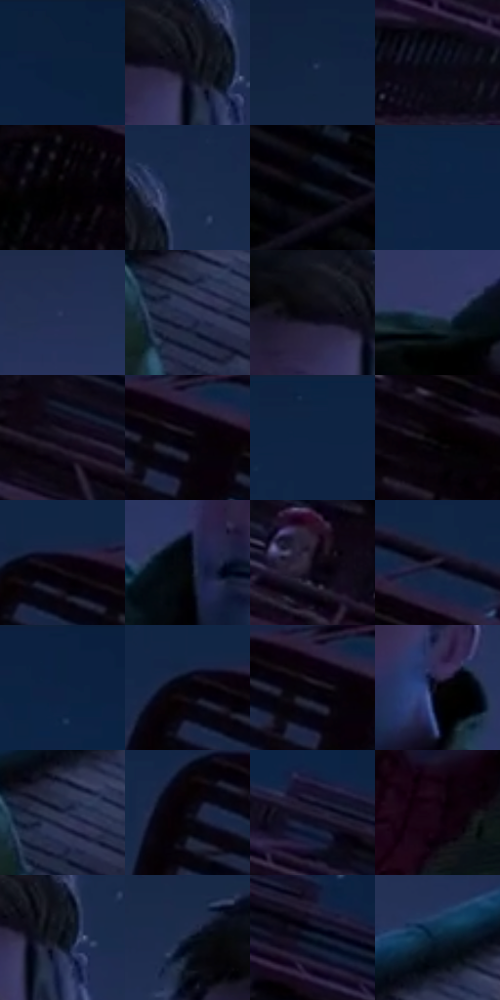

# 电影参考 293

- 状态：常规／活跃；来源世界：miles-home。
- 视角：low-angle；景别：medium；场景：city。
- 时段：night-appearance（外观依据，中置信度；具体时间／晨昏未知）；光照：night-mixed。
- 材质候选：skin, fabric, brick, metal, glass, sky（帧级，不是像素分割）。
- 明暗组：very-dark；L* P5/P50/P95：0.15619 / 6.36871 / 22.72547。
- 资格门禁：无附加门禁。
- 原截图 SHA-256：`5bf97be17e4f638ca661f8e58e2ab82ddc18e8d0a6b8425e409eda96b54de9e8`；尺寸：2880 × 1206。
- sRGB 像素 SHA-256：`f08d6951d57883312e533ae7958904b426953d2e48b0e3fe978a8dd77d3ba6bd`。

## 观察与迁移

消防梯与外墙冷夜光，栏杆、管道和楼体遮挡不能重排。

293  /  夜景／留白  /  大片蓝天空、近处人物与远处小人；不填满彩噪

本公开版保存32个128×128原像素色卡上下文；图集格子并非原场景相邻位置。原rect、图集tile和像素SHA见 `data/palette-crops.json`。上下文不足时不得批准替色，不能以小样推断完整构图。

## 实测色卡

颜色比例分母为保留采样像素，不是材料面积；全部 32 色参与全库匹配。表内四舍五入仅用于阅读，原精度在 JSON。

| ID | HEX | Lab | 原图 xy | 像素数 | 比例 | 明度角色 |
| --- | --- | --- | --- | ---: | ---: | --- |
| 293-S01 | #0A203C | [12.114013, 3.023433, -20.530718] | [2244, 28] | 10059 | 5.202590% | deep-shadow |
| 293-S02 | #0F0F1B | [4.718061, 2.832184, -7.614497] | [840, 300] | 9879 | 5.109493% | deep-shadow |
| 293-S03 | #152644 | [15.290841, 4.199092, -21.034919] | [836, 84] | 9336 | 4.828649% | deep-shadow |
| 293-S04 | #090E18 | [3.957089, 0.742421, -6.416218] | [2148, 392] | 8162 | 4.221448% | deep-shadow |
| 293-S05 | #020103 | [0.372056, 0.53957, -0.664676] | [2016, 572] | 7915 | 4.093697% | deep-shadow |
| 293-S06 | #1B2B4B | [17.775675, 4.785828, -21.867078] | [908, 240] | 7642 | 3.952500% | deep-shadow |
| 293-S07 | #131822 | [8.192863, 0.862908, -7.695099] | [1888, 964] | 7464 | 3.860437% | deep-shadow |
| 293-S08 | #0D2445 | [14.269213, 4.523267, -23.378229] | [1556, 44] | 7398 | 3.826301% | deep-shadow |
| 293-S09 | #283359 | [22.087463, 7.714448, -24.350988] | [492, 308] | 7336 | 3.794234% | shadow |
| 293-S10 | #262E4F | [19.762804, 7.082863, -21.377177] | [1120, 704] | 7267 | 3.758547% | deep-shadow |
| 293-S11 | #090610 | [2.039028, 2.323751, -3.912923] | [784, 292] | 7171 | 3.708895% | deep-shadow |
| 293-S12 | #333A63 | [25.654867, 9.404734, -25.188188] | [220, 616] | 7163 | 3.704757% | shadow |
| 293-S13 | #150F1F | [5.419732, 6.43344, -9.62594] | [2432, 564] | 7079 | 3.661312% | deep-shadow |
| 293-S14 | #040106 | [0.548034, 1.4797, -1.615669] | [1500, 336] | 6696 | 3.463221% | deep-shadow |
| 293-S15 | #0F2443 | [14.221351, 4.003848, -22.062654] | [1316, 32] | 6197 | 3.205135% | deep-shadow |
| 293-S16 | #000000 | [0.0, 0.0, 0.0] | [1800, 508] | 6170 | 3.191170% | deep-shadow |
| 293-S17 | #0A020C | [1.214914, 3.498057, -3.08968] | [1408, 288] | 5955 | 3.079971% | deep-shadow |
| 293-S18 | #04060D | [1.672073, 0.486332, -2.931371] | [644, 500] | 5945 | 3.074799% | deep-shadow |
| 293-S19 | #0D0714 | [2.601738, 3.868067, -5.49559] | [1976, 388] | 5507 | 2.848262% | deep-shadow |
| 293-S20 | #1A182A | [9.320414, 6.321685, -11.861539] | [1624, 300] | 5432 | 2.809471% | deep-shadow |
| 293-S21 | #0D2241 | [13.297456, 4.2649, -22.148891] | [2048, 60] | 5367 | 2.775853% | deep-shadow |
| 293-S22 | #040309 | [0.99955, 1.09571, -2.178304] | [1368, 296] | 5326 | 2.754647% | deep-shadow |
| 293-S23 | #040109 | [0.607394, 1.896831, -2.75094] | [1484, 332] | 5265 | 2.723097% | deep-shadow |
| 293-S24 | #000002 | [0.039574, 0.278088, -0.756847] | [840, 504] | 5249 | 2.714822% | deep-shadow |
| 293-S25 | #202642 | [15.934826, 6.37724, -18.582954] | [1124, 676] | 5170 | 2.673963% | deep-shadow |
| 293-S26 | #090913 | [2.714001, 1.731597, -4.712868] | [1348, 340] | 5009 | 2.590692% | deep-shadow |
| 293-S27 | #241F35 | [13.303319, 8.430527, -13.551589] | [2312, 328] | 4751 | 2.457253% | deep-shadow |
| 293-S28 | #170615 | [3.311298, 8.413642, -5.030605] | [724, 664] | 3499 | 1.809709% | deep-shadow |
| 293-S29 | #040A13 | [2.618535, 0.02354, -4.887242] | [872, 316] | 3220 | 1.665408% | deep-shadow |
| 293-S30 | #152136 | [12.692758, 2.259633, -15.316636] | [672, 244] | 3013 | 1.558346% | deep-shadow |
| 293-S31 | #0D1828 | [8.056914, 1.116226, -12.436727] | [2468, 408] | 1566 | 0.809947% | deep-shadow |
| 293-S32 | #092136 | [12.037142, -0.602503, -16.393181] | [1156, 576] | 138 | 0.071375% | deep-shadow |

## 色阶与空间分布

- 采样 ROI：`[0.01, 0.02, 0.98, 0.94]`；步长：4；样本数：193346。
- 排除区：`[]`。
- 深暗、暗、中、亮、高光五段计数：`[175641, 17694, 11, 0, 0]`。
- RGB 各 256 箱、L* 100 箱、13×5 色相明度表和 3×3 空间统计全部保存在 [总数据](../film-library.json)。
- [可视化档案](../../references/library.html)按需绘制直方图，不存 2,094 张重复图表图片。

## 纹理特征占比

**这是分块图像特征的面积占比，不是波点／排线／丝网／错版的精确语义覆盖率。** 窗格、发丝、织物也会产生方向或周期特征。
原图 ROI 像素 3098546；已测块覆盖 3098546（100.0000%）；未测 0。

| 特征 | 块覆盖像素 | 占已测面积 | 阈值敏感范围 |
| --- | ---: | ---: | --- |
| low-contrast | 922368 | 29.7678% | 24.7528% ~ 32.7586% |
| directional-structure | 810752 | 26.1656% | 14.2766% ~ 45.9256% |
| periodic-structure | 1316274 | 42.4804% | 27.8262% ~ 49.7922% |
| mixed-detail | 49152 | 1.5863% | 1.4954% ~ 3.1726% |

阈值敏感范围不是统计置信区间。逐块坐标、尺度、对比、方向一致性、频谱集中度、频率与角度见 [全量特征记录](../texture-features.jsonl)，以帧号定位。
四种印刷层的真实像素覆盖仍标为 `null`，不能填 0，也不能拿上表代替。不得据这些代理测量删除唯一证据。

[测量方法与保留策略](../../references/library-retention.md) · [分类索引](../archive/README.md)
