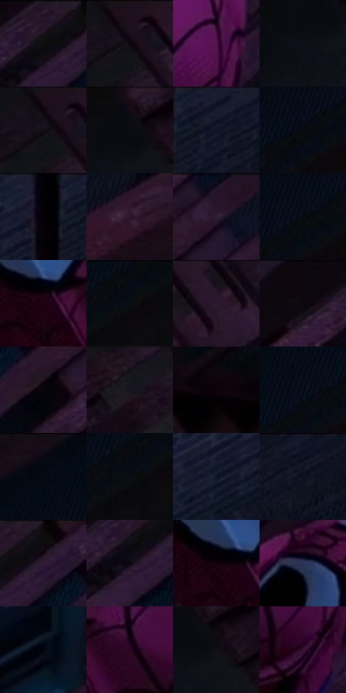

# 电影参考 294

- 状态：常规／活跃；来源世界：miles-home。
- 视角：high-angle；景别：medium；场景：city。
- 时段：night-appearance（外观依据，中置信度；具体时间／晨昏未知）；光照：night-mixed。
- 材质候选：skin, fabric, brick, metal, glass, sky（帧级，不是像素分割）。
- 明暗组：very-dark；L* P5/P50/P95：1.1148 / 4.41838 / 17.38355。
- 资格门禁：无附加门禁。
- 原截图 SHA-256：`67f22ca525900ce13049a64341315f4892ab3ac243458dc9ec08d4a5cc15af70`；尺寸：2880 × 1206。
- sRGB 像素 SHA-256：`a641af90bdf5e007a0fd166ef68815c3004f22cdae05a249fbeb7cf83823e2db`。

## 观察与迁移

消防梯与外墙冷夜光，栏杆、管道和楼体遮挡不能重排。

294  /  遮挡／俯视  /  前景头部及横栏较大，后景人物较小；透视比例不移植到正面照

本公开版保存32个128×128原像素色卡上下文；图集格子并非原场景相邻位置。原rect、图集tile和像素SHA见 `data/palette-crops.json`。上下文不足时不得批准替色，不能以小样推断完整构图。

## 实测色卡

颜色比例分母为保留采样像素，不是材料面积；全部 32 色参与全库匹配。表内四舍五入仅用于阅读，原精度在 JSON。

| ID | HEX | Lab | 原图 xy | 像素数 | 比例 | 明度角色 |
| --- | --- | --- | --- | ---: | ---: | --- |
| 294-S01 | #241526 | [9.41229, 11.417778, -8.648294] | [2536, 40] | 11664 | 6.032708% | deep-shadow |
| 294-S02 | #1C0F1B | [6.031148, 8.720666, -5.522221] | [1952, 48] | 9709 | 5.021568% | deep-shadow |
| 294-S03 | #54174F | [20.292389, 35.470084, -20.144667] | [2492, 756] | 9126 | 4.720036% | shadow |
| 294-S04 | #0D1017 | [4.678969, 0.554463, -4.572863] | [1576, 116] | 8433 | 4.361611% | deep-shadow |
| 294-S05 | #160B16 | [4.226173, 6.171262, -4.410634] | [1932, 28] | 8052 | 4.164555% | deep-shadow |
| 294-S06 | #150E16 | [4.800488, 4.34073, -3.584085] | [1612, 32] | 7805 | 4.036804% | deep-shadow |
| 294-S07 | #171A2C | [9.819555, 4.392911, -12.577349] | [364, 40] | 7587 | 3.924053% | deep-shadow |
| 294-S08 | #07090C | [2.412533, -0.090365, -1.361869] | [1224, 128] | 7261 | 3.755444% | deep-shadow |
| 294-S09 | #040104 | [0.50846, 1.201612, -0.858822] | [276, 64] | 6880 | 3.558388% | deep-shadow |
| 294-S10 | #2D152C | [11.107627, 16.55256, -10.359751] | [784, 104] | 6860 | 3.548043% | deep-shadow |
| 294-S11 | #2F1E37 | [14.449787, 13.91506, -13.087705] | [2764, 64] | 6609 | 3.418224% | deep-shadow |
| 294-S12 | #040913 | [2.422457, 0.424101, -5.17356] | [1268, 92] | 6604 | 3.415638% | deep-shadow |
| 294-S13 | #1B0010 | [2.443259, 11.816132, -3.133036] | [1972, 688] | 6467 | 3.344781% | deep-shadow |
| 294-S14 | #060A10 | [2.648413, -0.062989, -3.044066] | [1400, 28] | 6421 | 3.320989% | deep-shadow |
| 294-S15 | #16101A | [5.561936, 4.806315, -5.513648] | [2180, 32] | 6394 | 3.307025% | deep-shadow |
| 294-S16 | #0C080D | [2.537265, 1.806656, -1.61125] | [2412, 56] | 6177 | 3.194791% | deep-shadow |
| 294-S17 | #06050A | [1.52811, 0.956631, -1.799814] | [2688, 152] | 6168 | 3.190136% | deep-shadow |
| 294-S18 | #17151E | [7.336693, 3.42983, -5.935586] | [1948, 200] | 5605 | 2.898948% | deep-shadow |
| 294-S19 | #0B0109 | [1.017042, 3.733994, -2.103621] | [356, 776] | 5376 | 2.780507% | deep-shadow |
| 294-S20 | #060C1A | [3.398268, 1.449185, -8.838034] | [1244, 88] | 5341 | 2.762405% | deep-shadow |
| 294-S21 | #0F0B15 | [3.568388, 3.134397, -4.742561] | [1084, 28] | 5093 | 2.634138% | deep-shadow |
| 294-S22 | #0A0E13 | [3.844473, -0.197187, -3.055129] | [1368, 80] | 5031 | 2.602071% | deep-shadow |
| 294-S23 | #0D1424 | [6.442261, 2.317356, -11.947225] | [180, 112] | 4842 | 2.504319% | deep-shadow |
| 294-S24 | #0C1020 | [4.995112, 2.946098, -11.113125] | [540, 28] | 4763 | 2.463459% | deep-shadow |
| 294-S25 | #0D0A10 | [3.071725, 1.835452, -2.375156] | [2592, 36] | 4730 | 2.446391% | deep-shadow |
| 294-S26 | #0D0712 | [2.540031, 3.434446, -4.315441] | [2524, 100] | 4397 | 2.274161% | deep-shadow |
| 294-S27 | #14030D | [2.19445, 6.668811, -2.035355] | [1940, 672] | 4351 | 2.250370% | deep-shadow |
| 294-S28 | #2A3457 | [22.429872, 6.846368, -22.479723] | [1996, 464] | 4142 | 2.142273% | shadow |
| 294-S29 | #04060F | [1.721111, 0.830927, -3.869225] | [172, 328] | 4055 | 2.097276% | deep-shadow |
| 294-S30 | #2A0623 | [6.71999, 22.354575, -10.455089] | [2092, 696] | 2808 | 1.452319% | deep-shadow |
| 294-S31 | #0F1014 | [4.720952, 0.482091, -2.383725] | [1640, 88] | 2585 | 1.336981% | deep-shadow |
| 294-S32 | #381334 | [12.950915, 23.58178, -13.170321] | [2460, 900] | 2010 | 1.039587% | deep-shadow |

## 色阶与空间分布

- 采样 ROI：`[0.01, 0.02, 0.98, 0.94]`；步长：4；样本数：193346。
- 排除区：`[]`。
- 深暗、暗、中、亮、高光五段计数：`[186189, 7141, 16, 0, 0]`。
- RGB 各 256 箱、L* 100 箱、13×5 色相明度表和 3×3 空间统计全部保存在 [总数据](../film-library.json)。
- [可视化档案](../../references/library.html)按需绘制直方图，不存 2,094 张重复图表图片。

## 纹理特征占比

**这是分块图像特征的面积占比，不是波点／排线／丝网／错版的精确语义覆盖率。** 窗格、发丝、织物也会产生方向或周期特征。
原图 ROI 像素 3098546；已测块覆盖 3098546（100.0000%）；未测 0。

| 特征 | 块覆盖像素 | 占已测面积 | 阈值敏感范围 |
| --- | ---: | ---: | --- |
| low-contrast | 646784 | 20.8738% | 15.2391% ~ 27.3280% |
| directional-structure | 327680 | 10.5753% | 2.1151% ~ 28.3715% |
| periodic-structure | 2058546 | 66.4359% | 56.3894% ~ 66.5045% |
| mixed-detail | 65536 | 2.1151% | 0.0000% ~ 4.0525% |

阈值敏感范围不是统计置信区间。逐块坐标、尺度、对比、方向一致性、频谱集中度、频率与角度见 [全量特征记录](../texture-features.jsonl)，以帧号定位。
四种印刷层的真实像素覆盖仍标为 `null`，不能填 0，也不能拿上表代替。不得据这些代理测量删除唯一证据。

[测量方法与保留策略](../../references/library-retention.md) · [分类索引](../archive/README.md)
