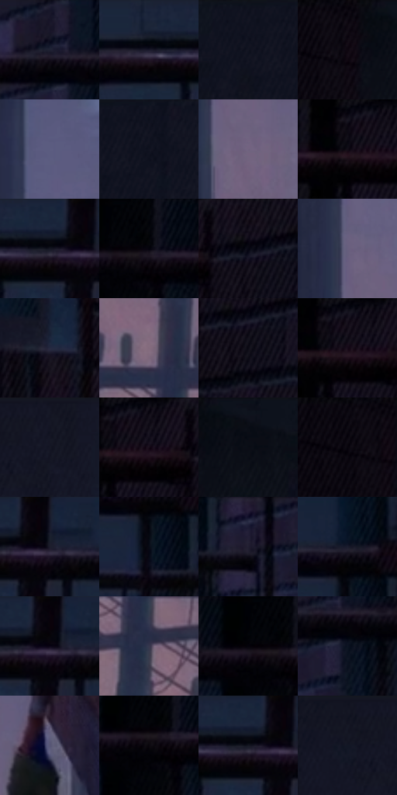

# 电影参考 295

- 状态：常规／活跃；来源世界：miles-home。
- 视角：near-level；景别：environment-wide；场景：city。
- 时段：night-appearance（外观依据，中置信度；具体时间／晨昏未知）；光照：night-mixed。
- 材质候选：skin, fabric, brick, metal, glass, sky（帧级，不是像素分割）。
- 明暗组：very-dark；L* P5/P50/P95：1.17311 / 6.76146 / 43.92002。
- 资格门禁：无附加门禁。
- 原截图 SHA-256：`de7726dd3960aa3037378440a2bed4e017c7e39c52839afaf4c308382e386454`；尺寸：2880 × 1208。
- sRGB 像素 SHA-256：`fcfdbd3c92eaff3a7c206974a847baf5a9a26e43d92a3da4005547429a13c999`。

## 观察与迁移

消防梯与外墙冷夜光，栏杆、管道和楼体遮挡不能重排。

295  /  巷道／深度  /  近暗墙体与远端暖雾构成空间；不添加巷道设施

本公开版保存32个128×128原像素色卡上下文；图集格子并非原场景相邻位置。原rect、图集tile和像素SHA见 `data/palette-crops.json`。上下文不足时不得批准替色，不能以小样推断完整构图。

## 实测色卡

颜色比例分母为保留采样像素，不是材料面积；全部 32 色参与全库匹配。表内四舍五入仅用于阅读，原精度在 JSON。

| ID | HEX | Lab | 原图 xy | 像素数 | 比例 | 明度角色 |
| --- | --- | --- | --- | ---: | ---: | --- |
| 295-S01 | #171726 | [8.436547, 4.576352, -10.287859] | [2212, 48] | 10251 | 5.301894% | deep-shadow |
| 295-S02 | #1B2439 | [14.344494, 2.998246, -14.822618] | [1680, 28] | 9739 | 5.037084% | deep-shadow |
| 295-S03 | #131421 | [6.76146, 3.345574, -9.134996] | [372, 28] | 9611 | 4.970881% | deep-shadow |
| 295-S04 | #0D0710 | [2.483491, 3.037134, -3.23411] | [112, 28] | 9027 | 4.668832% | deep-shadow |
| 295-S05 | #5C5C81 | [40.433416, 8.984158, -20.666258] | [920, 132] | 8846 | 4.575217% | midtone |
| 295-S06 | #0F121E | [5.671568, 2.080397, -8.52195] | [440, 28] | 8661 | 4.479534% | deep-shadow |
| 295-S07 | #70637F | [44.090221, 11.033663, -13.697123] | [936, 492] | 7928 | 4.100421% | midtone |
| 295-S08 | #080710 | [2.176797, 1.661691, -3.718743] | [2588, 56] | 7808 | 4.038356% | deep-shadow |
| 295-S09 | #0B0F19 | [4.36251, 1.032307, -6.595504] | [1792, 52] | 6663 | 3.446154% | deep-shadow |
| 295-S10 | #05050C | [1.511604, 0.988879, -2.691418] | [2424, 60] | 6601 | 3.414087% | deep-shadow |
| 295-S11 | #110B15 | [3.727534, 3.848126, -4.491081] | [2740, 32] | 6251 | 3.233064% | deep-shadow |
| 295-S12 | #675F7E | [42.114535, 10.063714, -16.178215] | [896, 388] | 6186 | 3.199446% | midtone |
| 295-S13 | #252940 | [17.222613, 5.11819, -15.150661] | [2536, 444] | 6136 | 3.173585% | deep-shadow |
| 295-S14 | #836B7D | [48.034639, 12.80554, -6.380109] | [996, 752] | 6029 | 3.118244% | midtone |
| 295-S15 | #0C0B15 | [3.356988, 2.186323, -5.076612] | [2756, 104] | 5979 | 3.092384% | deep-shadow |
| 295-S16 | #17111D | [6.067997, 5.612748, -7.079901] | [2612, 28] | 5920 | 3.061868% | deep-shadow |
| 295-S17 | #141624 | [7.676889, 3.478212, -9.98982] | [648, 28] | 5466 | 2.827056% | deep-shadow |
| 295-S18 | #130F1A | [5.0103, 4.038344, -6.360422] | [2636, 28] | 5411 | 2.798610% | deep-shadow |
| 295-S19 | #0D111B | [5.108723, 1.090827, -7.050474] | [200, 28] | 5317 | 2.749992% | deep-shadow |
| 295-S20 | #09050D | [1.767538, 2.194389, -2.756996] | [56, 28] | 5299 | 2.740683% | deep-shadow |
| 295-S21 | #171A2A | [9.704505, 3.674293, -11.285367] | [1852, 36] | 5020 | 2.596382% | deep-shadow |
| 295-S22 | #080B15 | [3.117186, 1.110875, -5.455543] | [2008, 148] | 4920 | 2.544661% | deep-shadow |
| 295-S23 | #221E31 | [12.546549, 7.151744, -11.879421] | [2112, 172] | 4913 | 2.541040% | deep-shadow |
| 295-S24 | #1B1D2E | [11.337878, 4.270174, -11.642957] | [2008, 68] | 4909 | 2.538972% | deep-shadow |
| 295-S25 | #08030A | [1.252572, 2.280751, -2.188173] | [1836, 44] | 4570 | 2.363638% | deep-shadow |
| 295-S26 | #36374D | [23.84375, 5.401606, -13.573761] | [1040, 868] | 4459 | 2.306228% | shadow |
| 295-S27 | #020106 | [0.431416, 0.956701, -1.799946] | [2372, 60] | 4443 | 2.297953% | deep-shadow |
| 295-S28 | #0D1422 | [6.334981, 1.563489, -10.592451] | [2244, 116] | 4288 | 2.217786% | deep-shadow |
| 295-S29 | #575777 | [38.153384, 7.760979, -18.098464] | [1428, 748] | 3793 | 1.961768% | shadow |
| 295-S30 | #09070D | [2.159694, 1.393268, -2.18436] | [2400, 84] | 3647 | 1.886256% | deep-shadow |
| 295-S31 | #121B2E | [9.873276, 2.739703, -13.988192] | [1792, 44] | 2711 | 1.402150% | deep-shadow |
| 295-S32 | #121725 | [7.903023, 2.343009, -10.404978] | [564, 64] | 2544 | 1.315776% | deep-shadow |

## 色阶与空间分布

- 采样 ROI：`[0.01, 0.02, 0.98, 0.94]`；步长：4；样本数：193346。
- 排除区：`[]`。
- 深暗、暗、中、亮、高光五段计数：`[156154, 9988, 27203, 1, 0]`。
- RGB 各 256 箱、L* 100 箱、13×5 色相明度表和 3×3 空间统计全部保存在 [总数据](../film-library.json)。
- [可视化档案](../../references/library.html)按需绘制直方图，不存 2,094 张重复图表图片。

## 纹理特征占比

**这是分块图像特征的面积占比，不是波点／排线／丝网／错版的精确语义覆盖率。** 窗格、发丝、织物也会产生方向或周期特征。
原图 ROI 像素 3104134；已测块覆盖 3104134（100.0000%）；未测 0。

| 特征 | 块覆盖像素 | 占已测面积 | 阈值敏感范围 |
| --- | ---: | ---: | --- |
| low-contrast | 1082624 | 34.8768% | 23.9412% ~ 43.5115% |
| directional-structure | 650112 | 20.9434% | 7.7481% ~ 35.3840% |
| periodic-structure | 1371398 | 44.1797% | 40.6747% ~ 46.7982% |
| mixed-detail | 0 | 0.0000% | 0.0000% ~ 1.9422% |

阈值敏感范围不是统计置信区间。逐块坐标、尺度、对比、方向一致性、频谱集中度、频率与角度见 [全量特征记录](../texture-features.jsonl)，以帧号定位。
四种印刷层的真实像素覆盖仍标为 `null`，不能填 0，也不能拿上表代替。不得据这些代理测量删除唯一证据。

[测量方法与保留策略](../../references/library-retention.md) · [分类索引](../archive/README.md)
