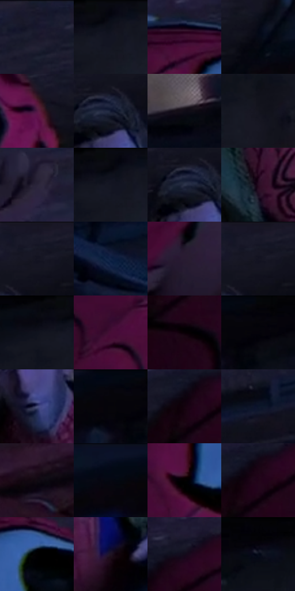

# 电影参考 296

- 状态：常规／活跃；来源世界：miles-home。
- 视角：high-angle；景别：medium；场景：city。
- 时段：night-appearance（外观依据，中置信度；具体时间／晨昏未知）；光照：night-mixed。
- 材质候选：skin, fabric, brick, metal, glass, sky（帧级，不是像素分割）。
- 明暗组：very-dark；L* P5/P50/P95：0.46752 / 6.7561 / 22.14385。
- 资格门禁：无附加门禁。
- 原截图 SHA-256：`caba930a41810b830904d94408249c49eec115890f1ade23927802450eb78cc7`；尺寸：2880 × 1206。
- sRGB 像素 SHA-256：`fee7ec6225401c1d28908868122f498eb70de05dac765fda40e97020b8275137`。

## 观察与迁移

消防梯与外墙冷夜光，栏杆、管道和楼体遮挡不能重排。

296  /  斜机位／衣料  /  前景头部、彼得外套和墙面层级；不因倾斜而判为结构故障

本公开版保存32个128×128原像素色卡上下文；图集格子并非原场景相邻位置。原rect、图集tile和像素SHA见 `data/palette-crops.json`。上下文不足时不得批准替色，不能以小样推断完整构图。

## 实测色卡

颜色比例分母为保留采样像素，不是材料面积；全部 32 色参与全库匹配。表内四舍五入仅用于阅读，原精度在 JSON。

| ID | HEX | Lab | 原图 xy | 像素数 | 比例 | 明度角色 |
| --- | --- | --- | --- | ---: | ---: | --- |
| 296-S01 | #1B1B2D | [10.603704, 5.434882, -12.057125] | [988, 28] | 13250 | 6.852999% | deep-shadow |
| 296-S02 | #0D101A | [4.793813, 1.361486, -6.733851] | [2820, 40] | 10663 | 5.514984% | deep-shadow |
| 296-S03 | #390A2C | [11.056852, 26.952697, -10.260115] | [536, 92] | 8957 | 4.632628% | deep-shadow |
| 296-S04 | #060A16 | [2.833661, 1.238765, -6.586938] | [1888, 80] | 7641 | 3.951982% | deep-shadow |
| 296-S05 | #501843 | [19.07429, 31.661005, -13.892903] | [916, 264] | 7321 | 3.786476% | deep-shadow |
| 296-S06 | #101830 | [8.796119, 5.306091, -17.163722] | [1716, 152] | 7106 | 3.675276% | deep-shadow |
| 296-S07 | #100D17 | [4.153904, 3.0777, -5.312919] | [2456, 584] | 6931 | 3.584765% | deep-shadow |
| 296-S08 | #14141E | [6.709229, 2.742491, -6.913289] | [2688, 220] | 6902 | 3.569766% | deep-shadow |
| 296-S09 | #2A2439 | [15.744218, 8.294628, -12.537137] | [2384, 1104] | 6745 | 3.488565% | deep-shadow |
| 296-S10 | #0F121E | [5.671568, 2.080397, -8.52195] | [2800, 52] | 6526 | 3.375296% | deep-shadow |
| 296-S11 | #2C344A | [21.892612, 3.051996, -14.654405] | [1692, 156] | 6380 | 3.299784% | shadow |
| 296-S12 | #260D21 | [7.314828, 16.50235, -8.070526] | [1708, 552] | 6252 | 3.233581% | deep-shadow |
| 296-S13 | #171926 | [9.13492, 3.042582, -9.205981] | [1772, 44] | 6109 | 3.159621% | deep-shadow |
| 296-S14 | #122446 | [14.58153, 5.883709, -23.556731] | [2332, 816] | 6098 | 3.153931% | deep-shadow |
| 296-S15 | #291C31 | [12.757888, 11.35868, -11.486194] | [712, 796] | 6031 | 3.119278% | deep-shadow |
| 296-S16 | #151623 | [7.719231, 3.520148, -9.162652] | [1772, 48] | 5861 | 3.031353% | deep-shadow |
| 296-S17 | #080A12 | [2.821571, 0.857322, -3.94112] | [2740, 32] | 5794 | 2.996700% | deep-shadow |
| 296-S18 | #460D36 | [14.715879, 31.303883, -11.65656] | [460, 420] | 5701 | 2.948600% | deep-shadow |
| 296-S19 | #090005 | [0.623713, 3.048713, -1.062871] | [152, 292] | 5543 | 2.866881% | deep-shadow |
| 296-S20 | #05040A | [1.273724, 1.095693, -2.178271] | [2416, 28] | 5426 | 2.806368% | deep-shadow |
| 296-S21 | #464C77 | [33.568045, 9.402108, -25.329114] | [1744, 344] | 5377 | 2.781025% | shadow |
| 296-S22 | #04050F | [1.525033, 1.231487, -4.155543] | [2352, 28] | 5310 | 2.746372% | deep-shadow |
| 296-S23 | #13020F | [1.954563, 6.99757, -3.406243] | [112, 208] | 5122 | 2.649137% | deep-shadow |
| 296-S24 | #0B1329 | [6.295191, 4.446958, -15.959924] | [1448, 148] | 4928 | 2.548799% | deep-shadow |
| 296-S25 | #110A13 | [3.462119, 3.806787, -3.554226] | [972, 776] | 4907 | 2.537937% | deep-shadow |
| 296-S26 | #060C1F | [3.618104, 2.993997, -12.458343] | [2172, 32] | 4881 | 2.524490% | deep-shadow |
| 296-S27 | #040001 | [0.253022, 1.185041, -0.009869] | [532, 276] | 4317 | 2.232785% | deep-shadow |
| 296-S28 | #210419 | [4.339651, 15.953529, -6.358019] | [140, 200] | 4306 | 2.227095% | deep-shadow |
| 296-S29 | #010001 | [0.078096, 0.400543, -0.286285] | [684, 164] | 4045 | 2.092104% | deep-shadow |
| 296-S30 | #1F1424 | [8.297654, 9.506361, -8.926328] | [1912, 732] | 3253 | 1.682476% | deep-shadow |
| 296-S31 | #130C1B | [4.340501, 5.779311, -8.137778] | [172, 152] | 3160 | 1.634376% | deep-shadow |
| 296-S32 | #040106 | [0.548034, 1.4797, -1.615669] | [2568, 40] | 2503 | 1.294570% | deep-shadow |

## 色阶与空间分布

- 采样 ROI：`[0.01, 0.02, 0.98, 0.94]`；步长：4；样本数：193346。
- 排除区：`[]`。
- 深暗、暗、中、亮、高光五段计数：`[180398, 11866, 1082, 0, 0]`。
- RGB 各 256 箱、L* 100 箱、13×5 色相明度表和 3×3 空间统计全部保存在 [总数据](../film-library.json)。
- [可视化档案](../../references/library.html)按需绘制直方图，不存 2,094 张重复图表图片。

## 纹理特征占比

**这是分块图像特征的面积占比，不是波点／排线／丝网／错版的精确语义覆盖率。** 窗格、发丝、织物也会产生方向或周期特征。
原图 ROI 像素 3098546；已测块覆盖 3098546（100.0000%）；未测 0。

| 特征 | 块覆盖像素 | 占已测面积 | 阈值敏感范围 |
| --- | ---: | ---: | --- |
| low-contrast | 551424 | 17.7962% | 11.5419% ~ 20.2624% |
| directional-structure | 398592 | 12.8638% | 4.2301% ~ 32.6884% |
| periodic-structure | 2115762 | 68.2824% | 55.7697% ~ 71.1039% |
| mixed-detail | 32768 | 1.0575% | 0.0000% ~ 4.4036% |

阈值敏感范围不是统计置信区间。逐块坐标、尺度、对比、方向一致性、频谱集中度、频率与角度见 [全量特征记录](../texture-features.jsonl)，以帧号定位。
四种印刷层的真实像素覆盖仍标为 `null`，不能填 0，也不能拿上表代替。不得据这些代理测量删除唯一证据。

[测量方法与保留策略](../../references/library-retention.md) · [分类索引](../archive/README.md)
