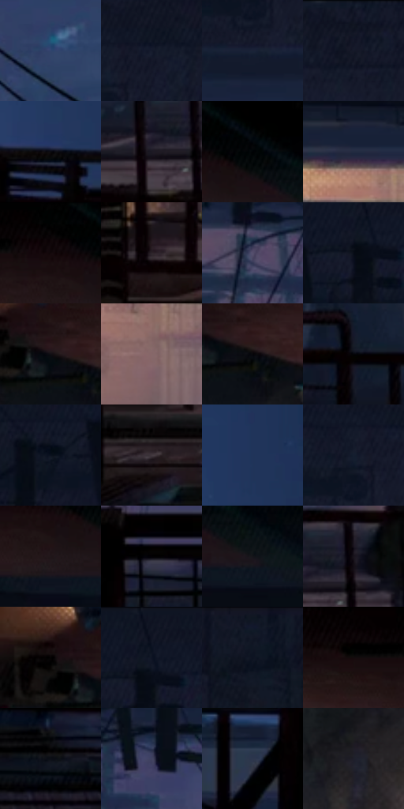

# 电影参考 297

- 状态：常规／活跃；来源世界：miles-home。
- 视角：high-angle；景别：environment-wide；场景：city。
- 时段：night-appearance（外观依据，中置信度；具体时间／晨昏未知）；光照：night-mixed。
- 材质候选：skin, fabric, brick, metal, glass, sky（帧级，不是像素分割）。
- 明暗组：very-dark；L* P5/P50/P95：0.2166 / 8.5515 / 36.40147。
- 资格门禁：无附加门禁。
- 原截图 SHA-256：`f6fa5a1939c4a4944697348cf44e665aba4d4041d7952b8af52e8ca5c9f7ff16`；尺寸：2880 × 1210。
- sRGB 像素 SHA-256：`59115d1561cc5ab5a287e0c766c982a3ba2e1c6b0ea315b2bf87acd4ed93fc45`。

## 观察与迁移

消防梯与外墙冷夜光，栏杆、管道和楼体遮挡不能重排。

297  /  旋转机位／建筑  /  消防梯、墙面、远处街道仍空间连续；不自动旋转用户照片

本公开版保存32个128×128原像素色卡上下文；图集格子并非原场景相邻位置。原rect、图集tile和像素SHA见 `data/palette-crops.json`。上下文不足时不得批准替色，不能以小样推断完整构图。

## 实测色卡

颜色比例分母为保留采样像素，不是材料面积；全部 32 色参与全库匹配。表内四舍五入仅用于阅读，原精度在 JSON。

| ID | HEX | Lab | 原图 xy | 像素数 | 比例 | 明度角色 |
| --- | --- | --- | --- | ---: | ---: | --- |
| 297-S01 | #30446C | [29.017601, 4.95295, -25.667316] | [1804, 388] | 14297 | 7.367917% | shadow |
| 297-S02 | #141A2B | [9.496514, 2.984955, -12.366388] | [1852, 92] | 9384 | 4.836017% | deep-shadow |
| 297-S03 | #1A2337 | [13.811646, 2.678955, -14.248222] | [1796, 216] | 8824 | 4.547422% | deep-shadow |
| 297-S04 | #101522 | [6.882545, 1.89549, -9.731931] | [1984, 28] | 8389 | 4.323246% | deep-shadow |
| 297-S05 | #0B0A0F | [2.91507, 1.065847, -2.076634] | [2648, 552] | 7759 | 3.998578% | deep-shadow |
| 297-S06 | #1B1923 | [9.398059, 3.72312, -6.529966] | [788, 700] | 7559 | 3.895508% | deep-shadow |
| 297-S07 | #000000 | [0.0, 0.0, 0.0] | [724, 28] | 7401 | 3.814083% | deep-shadow |
| 297-S08 | #222B41 | [17.687941, 3.040063, -15.133458] | [1156, 288] | 7306 | 3.765125% | deep-shadow |
| 297-S09 | #020101 | [0.332482, 0.261482, 0.092172] | [624, 32] | 7179 | 3.699676% | deep-shadow |
| 297-S10 | #2C2429 | [15.261867, 4.875533, -1.910585] | [324, 732] | 6664 | 3.434273% | deep-shadow |
| 297-S11 | #554F6C | [35.214037, 9.222855, -15.80701] | [1456, 340] | 6480 | 3.339449% | shadow |
| 297-S12 | #070C16 | [3.306208, 0.654032, -5.889918] | [1600, 92] | 6207 | 3.198759% | deep-shadow |
| 297-S13 | #120F14 | [4.703938, 2.111757, -2.37926] | [124, 104] | 6170 | 3.179691% | deep-shadow |
| 297-S14 | #866869 | [46.96082, 12.149658, 4.047651] | [1192, 444] | 6133 | 3.160623% | midtone |
| 297-S15 | #07070B | [1.998866, 0.559599, -1.523112] | [164, 120] | 5909 | 3.045186% | deep-shadow |
| 297-S16 | #040408 | [1.175841, 0.556106, -1.513562] | [516, 604] | 5902 | 3.041578% | deep-shadow |
| 297-S17 | #0B121E | [5.396779, 0.848041, -8.963533] | [1476, 128] | 5434 | 2.800396% | deep-shadow |
| 297-S18 | #42383E | [24.747744, 5.64971, -2.093503] | [356, 872] | 5411 | 2.788543% | shadow |
| 297-S19 | #203459 | [21.886401, 5.016571, -24.702547] | [2696, 372] | 5235 | 2.697842% | shadow |
| 297-S20 | #151E2F | [11.227316, 1.797431, -12.579936] | [1796, 120] | 5228 | 2.694234% | deep-shadow |
| 297-S21 | #1F161A | [8.479008, 5.433631, -1.078644] | [660, 128] | 5217 | 2.688565% | deep-shadow |
| 297-S22 | #020104 | [0.391843, 0.678613, -1.043099] | [1460, 608] | 5132 | 2.644761% | deep-shadow |
| 297-S23 | #141419 | [6.496593, 1.248274, -3.382525] | [808, 140] | 4878 | 2.513863% | deep-shadow |
| 297-S24 | #18131C | [6.718488, 4.594894, -5.322088] | [848, 664] | 4722 | 2.433469% | deep-shadow |
| 297-S25 | #050304 | [0.958925, 0.66199, -0.194048] | [64, 76] | 4672 | 2.407701% | deep-shadow |
| 297-S26 | #141726 | [8.141573, 3.441362, -10.76932] | [1620, 28] | 4408 | 2.271650% | deep-shadow |
| 297-S27 | #101826 | [8.158496, 1.256823, -10.76902] | [2800, 32] | 4155 | 2.141267% | deep-shadow |
| 297-S28 | #0B0406 | [1.545916, 2.115181, -0.109396] | [504, 32] | 3832 | 1.974810% | deep-shadow |
| 297-S29 | #0B0F16 | [4.251816, 0.254452, -4.48096] | [1560, 816] | 3784 | 1.950073% | deep-shadow |
| 297-S30 | #414261 | [29.115602, 7.727016, -18.397079] | [1592, 328] | 3553 | 1.831028% | shadow |
| 297-S31 | #2C364C | [22.637804, 2.330144, -14.838725] | [2488, 680] | 3430 | 1.767640% | shadow |
| 297-S32 | #1E1F2B | [12.158385, 2.956257, -8.173806] | [144, 300] | 3390 | 1.747026% | deep-shadow |

## 色阶与空间分布

- 采样 ROI：`[0.01, 0.02, 0.98, 0.94]`；步长：4；样本数：194044。
- 排除区：`[]`。
- 深暗、暗、中、亮、高光五段计数：`[149957, 37560, 6325, 201, 1]`。
- RGB 各 256 箱、L* 100 箱、13×5 色相明度表和 3×3 空间统计全部保存在 [总数据](../film-library.json)。
- [可视化档案](../../references/library.html)按需绘制直方图，不存 2,094 张重复图表图片。

## 纹理特征占比

**这是分块图像特征的面积占比，不是波点／排线／丝网／错版的精确语义覆盖率。** 窗格、发丝、织物也会产生方向或周期特征。
原图 ROI 像素 3109722；已测块覆盖 3109722（100.0000%）；未测 0。

| 特征 | 块覆盖像素 | 占已测面积 | 阈值敏感范围 |
| --- | ---: | ---: | --- |
| low-contrast | 364800 | 11.7310% | 7.7671% ~ 14.7316% |
| directional-structure | 668928 | 21.5109% | 6.8492% ~ 35.2093% |
| periodic-structure | 2059610 | 66.2313% | 57.0236% ~ 73.6774% |
| mixed-detail | 16384 | 0.5269% | 0.0000% ~ 4.7418% |

阈值敏感范围不是统计置信区间。逐块坐标、尺度、对比、方向一致性、频谱集中度、频率与角度见 [全量特征记录](../texture-features.jsonl)，以帧号定位。
四种印刷层的真实像素覆盖仍标为 `null`，不能填 0，也不能拿上表代替。不得据这些代理测量删除唯一证据。

[测量方法与保留策略](../../references/library-retention.md) · [分类索引](../archive/README.md)
