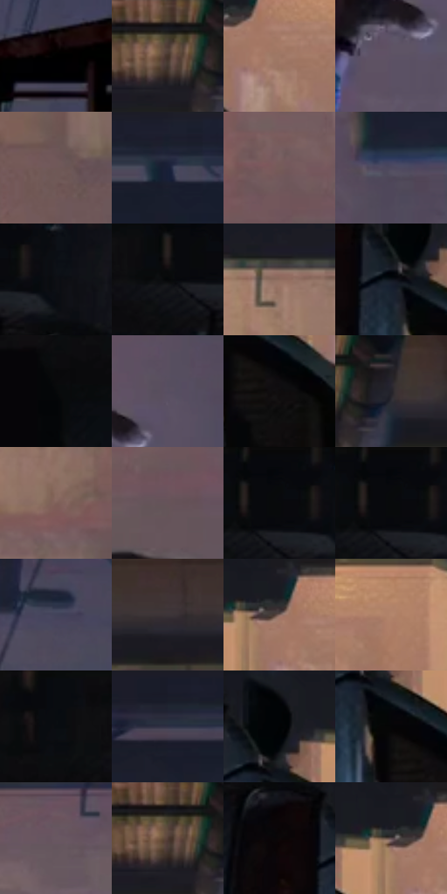

# 电影参考 298

- 状态：常规／活跃；来源世界：miles-home。
- 视角：high-angle；景别：full-body；场景：city。
- 时段：night-appearance（外观依据，中置信度；具体时间／晨昏未知）；光照：night-mixed。
- 材质候选：skin, fabric, brick, metal, glass, sky（帧级，不是像素分割）。
- 明暗组：very-dark；L* P5/P50/P95：0.27417 / 16.2457 / 53.60878。
- 资格门禁：无附加门禁。
- 原截图 SHA-256：`8bd4511594c2aed640086bfcea431389d2ae3f24e8dbebd67ca734239ec6d265`；尺寸：2880 × 1210。
- sRGB 像素 SHA-256：`ace8ef3d8aefb210c8c63e078a51c4bceb1bd921104a865de0b8428779bc77a5`。

## 观察与迁移

消防梯与外墙冷夜光，栏杆、管道和楼体遮挡不能重排。

298  /  动作／旋转机位  /  人物腾跃与画面侧向汽车；建筑未碎裂，非故障证据

本公开版保存32个128×128原像素色卡上下文；图集格子并非原场景相邻位置。原rect、图集tile和像素SHA见 `data/palette-crops.json`。上下文不足时不得批准替色，不能以小样推断完整构图。

## 实测色卡

颜色比例分母为保留采样像素，不是材料面积；全部 32 色参与全库匹配。表内四舍五入仅用于阅读，原精度在 JSON。

| ID | HEX | Lab | 原图 xy | 像素数 | 比例 | 明度角色 |
| --- | --- | --- | --- | ---: | ---: | --- |
| 298-S01 | #000000 | [0.0, 0.0, 0.0] | [2820, 456] | 10803 | 5.567294% | deep-shadow |
| 298-S02 | #191A21 | [9.44346, 1.500828, -4.98696] | [1124, 32] | 8242 | 4.247490% | deep-shadow |
| 298-S03 | #9E7865 | [53.646048, 12.12898, 16.179464] | [844, 228] | 8157 | 4.203686% | midtone |
| 298-S04 | #5D5264 | [36.521455, 8.321214, -8.746407] | [2272, 476] | 8143 | 4.196471% | shadow |
| 298-S05 | #6F5857 | [39.660386, 9.272529, 4.173119] | [1476, 728] | 7975 | 4.109893% | shadow |
| 298-S06 | #191E2C | [11.393914, 2.096087, -10.116165] | [2768, 32] | 7416 | 3.821814% | deep-shadow |
| 298-S07 | #755C59 | [41.466132, 9.694291, 5.615715] | [1804, 356] | 7410 | 3.818722% | midtone |
| 298-S08 | #4E495E | [32.242005, 6.939964, -11.574785] | [2404, 232] | 6990 | 3.602276% | shadow |
| 298-S09 | #0E0F14 | [4.385546, 0.683855, -2.882377] | [540, 84] | 6744 | 3.475500% | deep-shadow |
| 298-S10 | #050608 | [1.626306, 0.016484, -0.848788] | [424, 92] | 6370 | 3.282761% | deep-shadow |
| 298-S11 | #906E60 | [49.407051, 11.393402, 13.010773] | [1568, 156] | 6325 | 3.259570% | midtone |
| 298-S12 | #0F141C | [6.193694, 0.203263, -6.193931] | [640, 228] | 6198 | 3.194121% | deep-shadow |
| 298-S13 | #070809 | [2.154866, -0.122595, -0.470298] | [236, 160] | 6170 | 3.179691% | deep-shadow |
| 298-S14 | #584E61 | [34.775334, 8.241342, -9.544205] | [2344, 388] | 6167 | 3.178145% | shadow |
| 298-S15 | #0E0D0E | [3.729851, 0.48371, -0.345456] | [736, 332] | 6067 | 3.126610% | deep-shadow |
| 298-S16 | #26232B | [14.33598, 3.405933, -4.792784] | [1212, 68] | 5968 | 3.075591% | deep-shadow |
| 298-S17 | #7F6059 | [43.653391, 11.495718, 8.871127] | [1644, 388] | 5962 | 3.072499% | midtone |
| 298-S18 | #665359 | [37.35863, 8.968208, -0.526932] | [1904, 424] | 5860 | 3.019934% | shadow |
| 298-S19 | #080A0C | [2.66692, -0.229426, -0.983413] | [464, 44] | 5838 | 3.008596% | deep-shadow |
| 298-S20 | #04070A | [1.803649, -0.367488, -1.411455] | [456, 32] | 5598 | 2.884913% | deep-shadow |
| 298-S21 | #42435A | [29.185763, 5.406416, -13.778174] | [2632, 260] | 5406 | 2.785966% | shadow |
| 298-S22 | #3D3438 | [22.770697, 4.840604, -1.036085] | [1384, 76] | 5362 | 2.763291% | shadow |
| 298-S23 | #836860 | [46.406744, 9.487244, 8.603934] | [804, 188] | 5346 | 2.755045% | midtone |
| 298-S24 | #B3866C | [59.633466, 13.755428, 20.712562] | [1108, 200] | 5344 | 2.754015% | midtone |
| 298-S25 | #080C10 | [3.179269, -0.386223, -2.254908] | [308, 48] | 5038 | 2.596318% | deep-shadow |
| 298-S26 | #282D3D | [18.647724, 2.374434, -10.855716] | [2484, 56] | 4897 | 2.523654% | deep-shadow |
| 298-S27 | #020305 | [0.803785, 0.016536, -0.848887] | [672, 176] | 4837 | 2.492734% | deep-shadow |
| 298-S28 | #050406 | [1.194576, 0.539517, -0.664577] | [684, 280] | 4295 | 2.213416% | deep-shadow |
| 298-S29 | #695861 | [39.319899, 8.655931, -2.583055] | [2056, 200] | 4031 | 2.077364% | shadow |
| 298-S30 | #171417 | [6.723548, 2.075, -1.482616] | [1120, 28] | 3794 | 1.955227% | deep-shadow |
| 298-S31 | #0C0708 | [2.237112, 1.475869, 0.092877] | [560, 204] | 3759 | 1.937190% | deep-shadow |
| 298-S32 | #5A494D | [32.864239, 7.936889, 0.329087] | [776, 184] | 3532 | 1.820206% | shadow |

## 色阶与空间分布

- 采样 ROI：`[0.01, 0.02, 0.98, 0.94]`；步长：4；样本数：194044。
- 排除区：`[]`。
- 深暗、暗、中、亮、高光五段计数：`[101415, 50372, 40335, 1914, 8]`。
- RGB 各 256 箱、L* 100 箱、13×5 色相明度表和 3×3 空间统计全部保存在 [总数据](../film-library.json)。
- [可视化档案](../../references/library.html)按需绘制直方图，不存 2,094 张重复图表图片。

## 纹理特征占比

**这是分块图像特征的面积占比，不是波点／排线／丝网／错版的精确语义覆盖率。** 窗格、发丝、织物也会产生方向或周期特征。
原图 ROI 像素 3109722；已测块覆盖 3109722（100.0000%）；未测 0。

| 特征 | 块覆盖像素 | 占已测面积 | 阈值敏感范围 |
| --- | ---: | ---: | --- |
| low-contrast | 517338 | 16.6361% | 11.6886% ~ 22.4769% |
| directional-structure | 839936 | 27.0100% | 15.6454% ~ 41.0295% |
| periodic-structure | 1703296 | 54.7733% | 47.2819% ~ 59.7702% |
| mixed-detail | 49152 | 1.5806% | 0.0000% ~ 2.1075% |

阈值敏感范围不是统计置信区间。逐块坐标、尺度、对比、方向一致性、频谱集中度、频率与角度见 [全量特征记录](../texture-features.jsonl)，以帧号定位。
四种印刷层的真实像素覆盖仍标为 `null`，不能填 0，也不能拿上表代替。不得据这些代理测量删除唯一证据。

[测量方法与保留策略](../../references/library-retention.md) · [分类索引](../archive/README.md)
