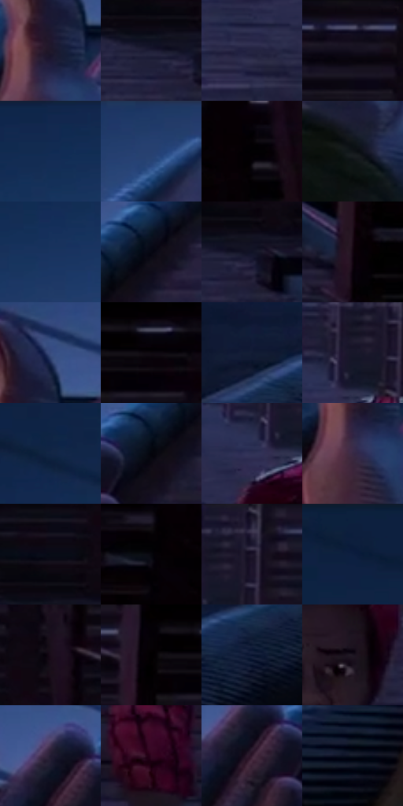

# 电影参考 299

- 状态：常规／活跃；来源世界：miles-home。
- 视角：low-angle；景别：medium；场景：city。
- 时段：night-appearance（外观依据，中置信度；具体时间／晨昏未知）；光照：night-mixed。
- 材质候选：skin, fabric, brick, metal, glass, sky（帧级，不是像素分割）。
- 明暗组：very-dark；L* P5/P50/P95：0.70423 / 9.28948 / 27.06724。
- 资格门禁：无附加门禁。
- 原截图 SHA-256：`fdf8496494d2d5cd3331f7ba81e1638eaa63fea7417cc296514a219406663266`；尺寸：2880 × 1206。
- sRGB 像素 SHA-256：`4457846a90cf81ed9846a11d8e9f6da77a9285d04e94415610ad6739a70545fb`。

## 观察与迁移

消防梯与外墙冷夜光，栏杆、管道和楼体遮挡不能重排。

299  /  手部／透视  /  前景伸手与后景坐姿；大手来自透视，不是默认手掌比例

本公开版保存32个128×128原像素色卡上下文；图集格子并非原场景相邻位置。原rect、图集tile和像素SHA见 `data/palette-crops.json`。上下文不足时不得批准替色，不能以小样推断完整构图。

## 实测色卡

颜色比例分母为保留采样像素，不是材料面积；全部 32 色参与全库匹配。表内四舍五入仅用于阅读，原精度在 JSON。

| ID | HEX | Lab | 原图 xy | 像素数 | 比例 | 明度角色 |
| --- | --- | --- | --- | ---: | ---: | --- |
| 299-S01 | #1F192B | [10.26626, 7.83019, -11.083303] | [784, 420] | 9508 | 4.917609% | deep-shadow |
| 299-S02 | #1D1C34 | [11.549574, 7.815969, -15.636149] | [2220, 300] | 8812 | 4.557632% | deep-shadow |
| 299-S03 | #242441 | [15.583329, 8.742153, -18.420223] | [1784, 244] | 8758 | 4.529703% | deep-shadow |
| 299-S04 | #171426 | [7.428524, 6.841229, -11.858216] | [2232, 28] | 8194 | 4.237998% | deep-shadow |
| 299-S05 | #132950 | [17.004241, 6.612909, -26.51127] | [796, 36] | 8066 | 4.171796% | deep-shadow |
| 299-S06 | #243E6D | [26.516854, 6.663547, -30.308521] | [1460, 44] | 7882 | 4.076629% | shadow |
| 299-S07 | #020103 | [0.372056, 0.53957, -0.664676] | [2784, 100] | 7728 | 3.996980% | deep-shadow |
| 299-S08 | #101517 | [6.398306, -1.507307, -2.035586] | [848, 692] | 7713 | 3.989221% | deep-shadow |
| 299-S09 | #19335F | [21.57998, 6.697501, -29.159174] | [952, 92] | 7412 | 3.833542% | shadow |
| 299-S10 | #060712 | [2.116719, 1.536005, -4.984351] | [1244, 324] | 7395 | 3.824749% | deep-shadow |
| 299-S11 | #101326 | [6.46572, 4.74908, -13.407581] | [2268, 300] | 6663 | 3.446154% | deep-shadow |
| 299-S12 | #120410 | [2.284098, 5.982664, -3.478625] | [2460, 416] | 6490 | 3.356677% | deep-shadow |
| 299-S13 | #384C7F | [33.008671, 8.284099, -31.247371] | [816, 332] | 6273 | 3.244443% | shadow |
| 299-S14 | #0E0D1B | [4.158059, 3.492769, -8.452994] | [2572, 28] | 6256 | 3.235650% | deep-shadow |
| 299-S15 | #121B34 | [10.261137, 5.170906, -17.735498] | [248, 532] | 6210 | 3.211859% | deep-shadow |
| 299-S16 | #18172A | [8.773865, 6.343385, -12.731801] | [1932, 96] | 6182 | 3.197377% | deep-shadow |
| 299-S17 | #122444 | [14.44276, 5.031446, -22.394416] | [336, 124] | 5895 | 3.048938% | deep-shadow |
| 299-S18 | #04040C | [1.257217, 1.12794, -3.069875] | [1192, 368] | 5792 | 2.995666% | deep-shadow |
| 299-S19 | #303255 | [22.178753, 9.334026, -21.519016] | [1892, 148] | 5778 | 2.988425% | shadow |
| 299-S20 | #382A44 | [19.69632, 12.513879, -13.902067] | [768, 480] | 5434 | 2.810506% | deep-shadow |
| 299-S21 | #080C16 | [3.364517, 0.915531, -5.79778] | [2236, 220] | 5274 | 2.727752% | deep-shadow |
| 299-S22 | #06070C | [1.962068, 0.449257, -2.026644] | [2708, 220] | 5093 | 2.634138% | deep-shadow |
| 299-S23 | #231F36 | [13.252012, 8.38113, -14.352643] | [1984, 44] | 5076 | 2.625345% | deep-shadow |
| 299-S24 | #0B1B3C | [10.417187, 7.077411, -23.245147] | [116, 60] | 4932 | 2.550867% | deep-shadow |
| 299-S25 | #190D1A | [5.140843, 7.795837, -6.09802] | [2340, 152] | 4878 | 2.522938% | deep-shadow |
| 299-S26 | #040106 | [0.548034, 1.4797, -1.615669] | [2492, 28] | 4786 | 2.475355% | deep-shadow |
| 299-S27 | #06102D | [5.40776, 6.751957, -20.376927] | [376, 580] | 4493 | 2.323813% | deep-shadow |
| 299-S28 | #1C1520 | [8.016737, 6.321416, -6.368942] | [2028, 304] | 4466 | 2.309849% | deep-shadow |
| 299-S29 | #211B31 | [11.476252, 8.995623, -13.556108] | [1068, 348] | 3953 | 2.044521% | deep-shadow |
| 299-S30 | #310821 | [8.451722, 23.491775, -6.140602] | [2192, 816] | 3557 | 1.839707% | deep-shadow |
| 299-S31 | #341D30 | [14.525614, 14.886896, -7.919493] | [1084, 392] | 2561 | 1.324568% | deep-shadow |
| 299-S32 | #101824 | [8.046, 0.487461, -9.445587] | [396, 1012] | 1836 | 0.949593% | deep-shadow |

## 色阶与空间分布

- 采样 ROI：`[0.01, 0.02, 0.98, 0.94]`；步长：4；样本数：193346。
- 排除区：`[]`。
- 深暗、暗、中、亮、高光五段计数：`[166681, 26455, 210, 0, 0]`。
- RGB 各 256 箱、L* 100 箱、13×5 色相明度表和 3×3 空间统计全部保存在 [总数据](../film-library.json)。
- [可视化档案](../../references/library.html)按需绘制直方图，不存 2,094 张重复图表图片。

## 纹理特征占比

**这是分块图像特征的面积占比，不是波点／排线／丝网／错版的精确语义覆盖率。** 窗格、发丝、织物也会产生方向或周期特征。
原图 ROI 像素 3098546；已测块覆盖 3098546（100.0000%）；未测 0。

| 特征 | 块覆盖像素 | 占已测面积 | 阈值敏感范围 |
| --- | ---: | ---: | --- |
| low-contrast | 207360 | 6.6922% | 5.1059% ~ 9.2451% |
| directional-structure | 1436210 | 46.3511% | 30.0586% ~ 62.4701% |
| periodic-structure | 1345792 | 43.4330% | 31.8952% ~ 54.5288% |
| mixed-detail | 109184 | 3.5237% | 0.5288% ~ 6.1675% |

阈值敏感范围不是统计置信区间。逐块坐标、尺度、对比、方向一致性、频谱集中度、频率与角度见 [全量特征记录](../texture-features.jsonl)，以帧号定位。
四种印刷层的真实像素覆盖仍标为 `null`，不能填 0，也不能拿上表代替。不得据这些代理测量删除唯一证据。

[测量方法与保留策略](../../references/library-retention.md) · [分类索引](../archive/README.md)
