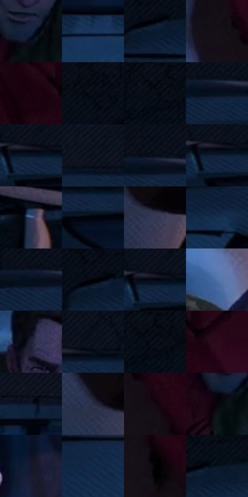

# 电影参考 300

- 状态：常规／活跃；来源世界：miles-home。
- 视角：overhead；景别：environment-wide；场景：city。
- 时段：night-appearance（外观依据，中置信度；具体时间／晨昏未知）；光照：night-mixed。
- 材质候选：skin, fabric, brick, metal, glass, sky（帧级，不是像素分割）。
- 明暗组：very-dark；L* P5/P50/P95：0.70695 / 5.7668 / 32.28596。
- 资格门禁：无附加门禁。
- 原截图 SHA-256：`3e7b5032bb7a9c91b218b6401a2f54a98fed5b871c2f05eb8bfaef964618e39a`；尺寸：2880 × 1202。
- sRGB 像素 SHA-256：`ae4f6bd59351c6a3e018ff2b6d4b8f7fb2b25dbeff8ced733965274aac006268`。

## 观察与迁移

消防梯与外墙冷夜光，栏杆、管道和楼体遮挡不能重排。

300  /  车漆／人物  /  车体反光带托住伸手人物；人站在车前，不误认车身上印了人脸

本公开版保存32个128×128原像素色卡上下文；图集格子并非原场景相邻位置。原rect、图集tile和像素SHA见 `data/palette-crops.json`。上下文不足时不得批准替色，不能以小样推断完整构图。

## 实测色卡

颜色比例分母为保留采样像素，不是材料面积；全部 32 色参与全库匹配。表内四舍五入仅用于阅读，原精度在 JSON。

| ID | HEX | Lab | 原图 xy | 像素数 | 比例 | 明度角色 |
| --- | --- | --- | --- | ---: | ---: | --- |
| 300-S01 | #13233D | [13.693317, 3.066269, -18.698537] | [1320, 648] | 8800 | 4.567917% | deep-shadow |
| 300-S02 | #1C365A | [22.383799, 3.129897, -24.586937] | [1148, 288] | 8437 | 4.379490% | shadow |
| 300-S03 | #08182E | [8.14723, 2.463624, -16.758237] | [276, 152] | 8098 | 4.203521% | deep-shadow |
| 300-S04 | #151018 | [5.383292, 3.80696, -4.223781] | [2396, 300] | 8069 | 4.188468% | deep-shadow |
| 300-S05 | #1F0312 | [3.61478, 13.374084, -2.523056] | [2460, 32] | 8051 | 4.179125% | deep-shadow |
| 300-S06 | #040A12 | [2.588336, -0.188675, -4.309674] | [232, 28] | 7505 | 3.895706% | deep-shadow |
| 300-S07 | #080F19 | [4.186097, 0.241141, -6.874646] | [64, 28] | 7443 | 3.863523% | deep-shadow |
| 300-S08 | #08101F | [4.706955, 1.530854, -10.798507] | [752, 96] | 7141 | 3.706761% | deep-shadow |
| 300-S09 | #061326 | [5.820182, 1.854015, -14.461986] | [908, 100] | 7132 | 3.702089% | deep-shadow |
| 300-S10 | #0F1521 | [6.753472, 1.186068, -9.176462] | [1260, 28] | 6856 | 3.558822% | deep-shadow |
| 300-S11 | #030B17 | [2.895336, 0.293124, -7.249133] | [744, 36] | 6762 | 3.510029% | deep-shadow |
| 300-S12 | #0D1D34 | [10.646345, 2.371418, -17.144637] | [900, 104] | 6654 | 3.453968% | deep-shadow |
| 300-S13 | #3D4E79 | [33.606833, 6.197251, -26.559162] | [1944, 1120] | 6613 | 3.432686% | shadow |
| 300-S14 | #01040A | [1.040489, 0.049695, -2.546825] | [944, 152] | 6392 | 3.317969% | deep-shadow |
| 300-S15 | #363955 | [24.846966, 6.457772, -17.307534] | [2564, 944] | 6187 | 3.211557% | shadow |
| 300-S16 | #172F4F | [19.137864, 2.607257, -22.427176] | [540, 176] | 6149 | 3.191832% | deep-shadow |
| 300-S17 | #040E1E | [3.916459, 1.198116, -11.235981] | [716, 88] | 6024 | 3.126947% | deep-shadow |
| 300-S18 | #010206 | [0.569186, 0.294641, -1.605767] | [260, 132] | 5990 | 3.109298% | deep-shadow |
| 300-S19 | #01040F | [1.154028, 0.84755, -4.718276] | [904, 92] | 5861 | 3.042336% | deep-shadow |
| 300-S20 | #5072AA | [47.804513, 4.344446, -33.657669] | [1628, 496] | 5822 | 3.022092% | midtone |
| 300-S21 | #1E1E31 | [12.131383, 5.644383, -12.556979] | [1260, 444] | 5543 | 2.877268% | deep-shadow |
| 300-S22 | #060C16 | [3.247899, 0.392533, -5.982057] | [936, 32] | 5417 | 2.811864% | deep-shadow |
| 300-S23 | #02070F | [1.800571, -0.092633, -3.767184] | [88, 28] | 5028 | 2.609941% | deep-shadow |
| 300-S24 | #2D0A1D | [7.802775, 20.331672, -4.131376] | [2564, 76] | 5021 | 2.606308% | deep-shadow |
| 300-S25 | #091728 | [7.443034, 0.766548, -13.417131] | [1380, 104] | 4982 | 2.586064% | deep-shadow |
| 300-S26 | #272C45 | [18.636962, 5.329875, -16.36465] | [2516, 916] | 4591 | 2.383103% | deep-shadow |
| 300-S27 | #110810 | [2.983223, 3.998381, -2.467963] | [2492, 376] | 4252 | 2.207134% | deep-shadow |
| 300-S28 | #0A040A | [1.565267, 2.403189, -1.717578] | [1280, 692] | 3987 | 2.069578% | deep-shadow |
| 300-S29 | #13182A | [8.643575, 3.809869, -12.96979] | [1920, 400] | 3874 | 2.010921% | deep-shadow |
| 300-S30 | #112949 | [16.433725, 3.256852, -22.668212] | [352, 260] | 3507 | 1.820419% | deep-shadow |
| 300-S31 | #020103 | [0.372056, 0.53957, -0.664676] | [2536, 476] | 3278 | 1.701549% | deep-shadow |
| 300-S32 | #07141F | [5.820419, -1.124416, -9.115771] | [320, 128] | 3182 | 1.651717% | deep-shadow |

## 色阶与空间分布

- 采样 ROI：`[0.01, 0.02, 0.98, 0.94]`；步长：4；样本数：192648。
- 排除区：`[]`。
- 深暗、暗、中、亮、高光五段计数：`[163202, 23568, 5003, 875, 0]`。
- RGB 各 256 箱、L* 100 箱、13×5 色相明度表和 3×3 空间统计全部保存在 [总数据](../film-library.json)。
- [可视化档案](../../references/library.html)按需绘制直方图，不存 2,094 张重复图表图片。

## 纹理特征占比

**这是分块图像特征的面积占比，不是波点／排线／丝网／错版的精确语义覆盖率。** 窗格、发丝、织物也会产生方向或周期特征。
原图 ROI 像素 3087370；已测块覆盖 3087370（100.0000%）；未测 0。

| 特征 | 块覆盖像素 | 占已测面积 | 阈值敏感范围 |
| --- | ---: | ---: | --- |
| low-contrast | 617984 | 20.0165% | 13.8971% ~ 23.6774% |
| directional-structure | 695168 | 22.5165% | 15.2819% ~ 38.5737% |
| periodic-structure | 1774218 | 57.4670% | 47.5292% ~ 59.9794% |
| mixed-detail | 0 | 0.0000% | 0.0000% ~ 1.0614% |

阈值敏感范围不是统计置信区间。逐块坐标、尺度、对比、方向一致性、频谱集中度、频率与角度见 [全量特征记录](../texture-features.jsonl)，以帧号定位。
四种印刷层的真实像素覆盖仍标为 `null`，不能填 0，也不能拿上表代替。不得据这些代理测量删除唯一证据。

[测量方法与保留策略](../../references/library-retention.md) · [分类索引](../archive/README.md)
