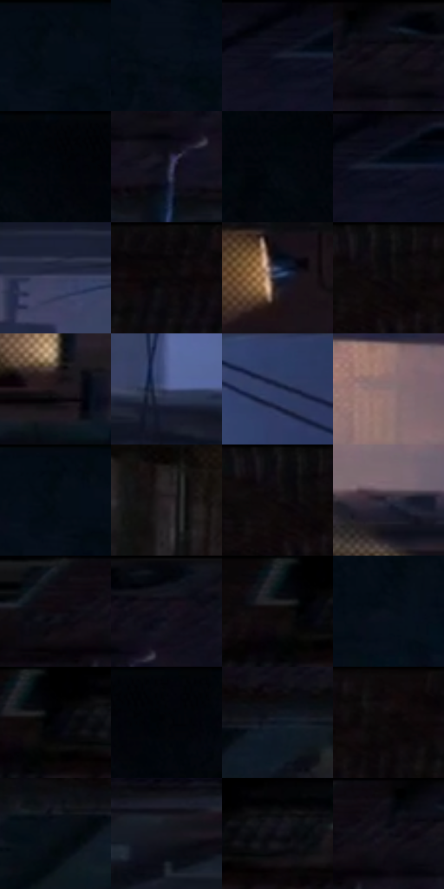

# 电影参考 301

- 状态：常规／活跃；来源世界：miles-home。
- 视角：overhead；景别：environment-wide；场景：city。
- 时段：night-appearance（外观依据，中置信度；具体时间／晨昏未知）；光照：night-mixed。
- 材质候选：skin, fabric, brick, metal, asphalt, sky（帧级，不是像素分割）。
- 明暗组：very-dark；L* P5/P50/P95：0.7861 / 4.72692 / 33.86309。
- 资格门禁：无附加门禁。
- 原截图 SHA-256：`013bb77a86ee655016807597c3441042f43745f3cdc09167276b635631c1730e`；尺寸：2880 × 1210。
- sRGB 像素 SHA-256：`f571f1f04e476d78129f1ffabccb54001918cd921885baaf62183df9e9531c75`。

## 观察与迁移

冷暗巷道俯仰视，少量暖灯与黑形保空间。

301  /  巷道／双人  /  大空间、少量人物与稳定设施；暗部不必均匀提亮

本公开版保存32个128×128原像素色卡上下文；图集格子并非原场景相邻位置。原rect、图集tile和像素SHA见 `data/palette-crops.json`。上下文不足时不得批准替色，不能以小样推断完整构图。

## 实测色卡

颜色比例分母为保留采样像素，不是材料面积；全部 32 色参与全库匹配。表内四舍五入仅用于阅读，原精度在 JSON。

| ID | HEX | Lab | 原图 xy | 像素数 | 比例 | 明度角色 |
| --- | --- | --- | --- | ---: | ---: | --- |
| 301-S01 | #040C16 | [3.131282, -0.130466, -6.166334] | [88, 36] | 9017 | 4.646884% | deep-shadow |
| 301-S02 | #070E19 | [3.878748, 0.488396, -7.33137] | [44, 168] | 8653 | 4.459298% | deep-shadow |
| 301-S03 | #171B29 | [10.00037, 2.56155, -10.089058] | [2696, 64] | 7923 | 4.083095% | deep-shadow |
| 301-S04 | #151219 | [5.981853, 2.931348, -4.12755] | [2256, 56] | 7915 | 4.078972% | deep-shadow |
| 301-S05 | #01040A | [1.040489, 0.049695, -2.546825] | [372, 48] | 7803 | 4.021253% | deep-shadow |
| 301-S06 | #131522 | [7.138154, 3.041827, -9.317256] | [2304, 144] | 7586 | 3.909423% | deep-shadow |
| 301-S07 | #04090F | [2.309344, -0.370755, -3.010271] | [316, 92] | 7519 | 3.874894% | deep-shadow |
| 301-S08 | #0D111E | [5.240598, 2.017522, -9.186472] | [2736, 44] | 7501 | 3.865618% | deep-shadow |
| 301-S09 | #3E425F | [28.763824, 6.134654, -17.67767] | [1888, 588] | 7277 | 3.750180% | shadow |
| 301-S10 | #0D0B0E | [3.221297, 1.06275, -1.096509] | [1520, 28] | 7202 | 3.711529% | deep-shadow |
| 301-S11 | #192237 | [13.39036, 3.101721, -14.912892] | [1532, 260] | 7024 | 3.619798% | deep-shadow |
| 301-S12 | #080709 | [2.017097, 0.539465, -0.664478] | [1300, 48] | 6621 | 3.412113% | deep-shadow |
| 301-S13 | #1E171B | [8.721695, 4.430283, -1.493711] | [1552, 992] | 6185 | 3.187421% | deep-shadow |
| 301-S14 | #444D74 | [33.556961, 7.226947, -23.486775] | [2192, 832] | 6077 | 3.131764% | shadow |
| 301-S15 | #2F3A5E | [25.070482, 6.558924, -22.885291] | [2600, 632] | 5881 | 3.030756% | shadow |
| 301-S16 | #886F72 | [49.275364, 10.350345, 2.050635] | [1496, 692] | 5876 | 3.028179% | midtone |
| 301-S17 | #030B12 | [2.731104, -0.860948, -4.108194] | [72, 28] | 5852 | 3.015811% | deep-shadow |
| 301-S18 | #292226 | [14.147673, 4.217062, -1.445318] | [1160, 268] | 5784 | 2.980767% | deep-shadow |
| 301-S19 | #130E13 | [4.512384, 2.798219, -1.999707] | [1280, 36] | 5693 | 2.933871% | deep-shadow |
| 301-S20 | #2F2D3D | [19.299685, 5.026423, -9.800059] | [1532, 844] | 5635 | 2.903981% | deep-shadow |
| 301-S21 | #0C0D14 | [3.762261, 1.06063, -3.808989] | [2120, 28] | 5497 | 2.832863% | deep-shadow |
| 301-S22 | #0F1118 | [5.134192, 0.90241, -4.650252] | [2364, 40] | 5157 | 2.657645% | deep-shadow |
| 301-S23 | #080A0F | [2.738657, 0.274682, -2.355399] | [1700, 44] | 5096 | 2.626208% | deep-shadow |
| 301-S24 | #08111A | [4.760941, -0.573339, -6.817056] | [188, 396] | 4748 | 2.446868% | deep-shadow |
| 301-S25 | #000000 | [0.0, 0.0, 0.0] | [1736, 28] | 4593 | 2.366989% | deep-shadow |
| 301-S26 | #030407 | [1.097746, 0.155563, -1.227277] | [452, 44] | 4575 | 2.357713% | deep-shadow |
| 301-S27 | #0E1522 | [6.730769, 1.214813, -9.978145] | [2044, 204] | 4555 | 2.347406% | deep-shadow |
| 301-S28 | #0D070A | [2.343578, 2.053952, -0.558268] | [1404, 32] | 4546 | 2.342768% | deep-shadow |
| 301-S29 | #080D14 | [3.522459, -0.014817, -4.18792] | [1940, 232] | 4519 | 2.328853% | deep-shadow |
| 301-S30 | #17161F | [7.722175, 3.037727, -6.112284] | [2696, 236] | 4141 | 2.134052% | deep-shadow |
| 301-S31 | #020204 | [0.587921, 0.278053, -0.756781] | [1816, 28] | 3846 | 1.982025% | deep-shadow |
| 301-S32 | #0E0E16 | [4.203507, 1.663431, -4.527423] | [2200, 28] | 3747 | 1.931005% | deep-shadow |

## 色阶与空间分布

- 采样 ROI：`[0.01, 0.02, 0.98, 0.94]`；步长：4；样本数：194044。
- 排除区：`[]`。
- 深暗、暗、中、亮、高光五段计数：`[166841, 20596, 6516, 91, 0]`。
- RGB 各 256 箱、L* 100 箱、13×5 色相明度表和 3×3 空间统计全部保存在 [总数据](../film-library.json)。
- [可视化档案](../../references/library.html)按需绘制直方图，不存 2,094 张重复图表图片。

## 纹理特征占比

**这是分块图像特征的面积占比，不是波点／排线／丝网／错版的精确语义覆盖率。** 窗格、发丝、织物也会产生方向或周期特征。
原图 ROI 像素 3109722；已测块覆盖 3109722（100.0000%）；未测 0。

| 特征 | 块覆盖像素 | 占已测面积 | 阈值敏感范围 |
| --- | ---: | ---: | --- |
| low-contrast | 899712 | 28.9322% | 17.9134% ~ 33.5135% |
| directional-structure | 766810 | 24.6585% | 16.3369% ~ 40.8307% |
| periodic-structure | 1343488 | 43.2028% | 41.2559% ~ 46.4163% |
| mixed-detail | 99712 | 3.2065% | 0.0000% ~ 3.7333% |

阈值敏感范围不是统计置信区间。逐块坐标、尺度、对比、方向一致性、频谱集中度、频率与角度见 [全量特征记录](../texture-features.jsonl)，以帧号定位。
四种印刷层的真实像素覆盖仍标为 `null`，不能填 0，也不能拿上表代替。不得据这些代理测量删除唯一证据。

[测量方法与保留策略](../../references/library-retention.md) · [分类索引](../archive/README.md)
